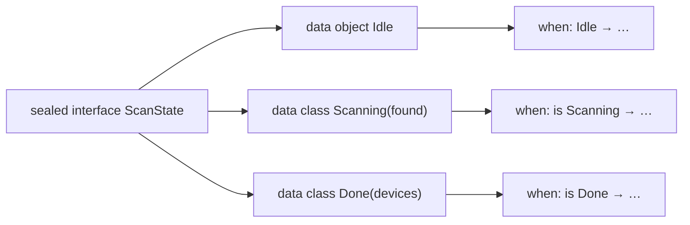
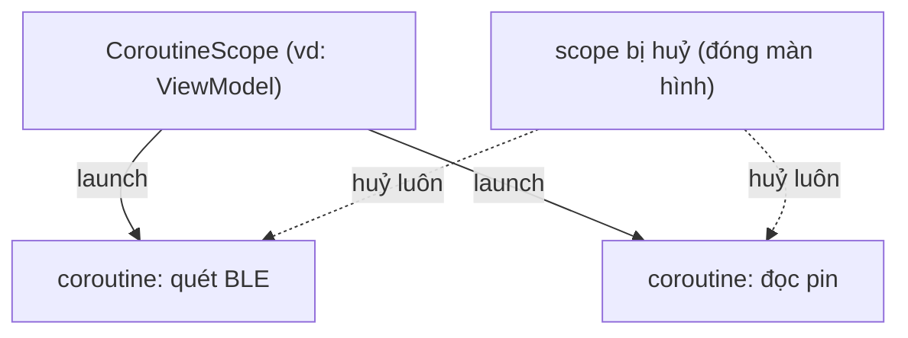
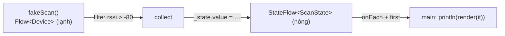
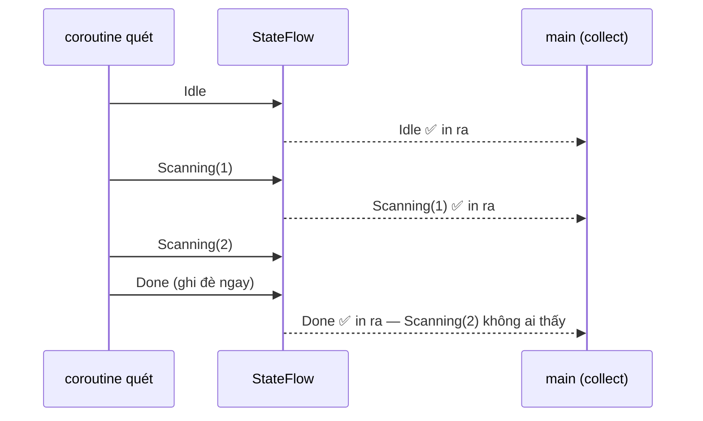

# Kotlin cho dev TypeScript

> Viết chương trình Kotlin đầu tiên: một **bản quét BLE giả**, đẩy thiết bị vào một state có thể "theo dõi" được.
> Bài gốc: [01 — Kotlin for TypeScript Developers](https://phongna-inn.github.io/carmd-kmp-course/lessons/01-kotlin-for-typescript-devs.html).

## Vì sao bài này quan trọng

Code dùng chung của app là Kotlin. Hết bài, bạn có một chương trình nhỏ: quét BLE giả, thiết bị chảy dần vào một state.
Đúng **khuôn** đó là thứ app thật làm từ bài 08, và từ bài 13 thì sau lưng là sóng Bluetooth thật. Bài 02 viết lại y hệt chương trình này bằng Swift.

!!! tip "Đọc kèm"
    Coroutine là chỗ kinh nghiệm TypeScript giúp **ít nhất**. Đọc mục 4 và 5 của bài này song song với hai trang chính chủ:
    [Coroutines basics](https://kotlinlang.org/docs/coroutines-basics.html) và [Asynchronous Flow](https://kotlinlang.org/docs/flow.html).

## Ước lượng thời gian

Cho người đã quen TypeScript, chưa từng viết Kotlin.

| Việc | Thời gian |
|---|---|
| Đọc bảng so sánh + mục 1–3 | 30 phút |
| Đọc mục 4–5 (coroutine, Flow) + docs chính chủ | 45 phút |
| Dựng project, chạy `./gradlew run` | 15 phút |
| Trả lời câu hỏi ôn + bài tự làm | 30 phút |
| **Tổng** | **≈ 2 giờ** |

## Tóm tắt

| | |
|---|---|
| **Tuần / ngày** | Tuần 1 · Ngày 1 |
| **Mới học** | `val`/`var` · null safety · `data class` · `sealed interface` + `when` · lambda · extension · `suspend` · coroutine scope · `Flow` · `StateFlow` |
| **Cần trước** | TypeScript |
| **Kết quả** | Chương trình nháp Kotlin, chưa có milestone |
| **Thư mục code** | `scratch/lesson-01/kotlin/` |

## Bản đồ: thứ bạn đã biết

Phần lớn cú pháp chuyển gần như một-một. Lướt bảng này, lát quay lại tra. Những dòng có **(mới)** là thứ TypeScript không có, bài này dành thời gian cho chúng.

| Ý tưởng | TypeScript | Kotlin |
|---|---|---|
| Hằng / biến | `const` / `let` | `val` / `var` |
| Kiểu có thể null | `string \| null` | `String?` |
| Truy cập an toàn / giá trị dự phòng | `a?.b ?? x` | `a?.b ?: x` |
| "Tin tôi đi, không null đâu" | `a!` (không kiểm tra) | `a!!` (ném lỗi) |
| Hợp đồng | `interface` | `interface` |
| Object giữ giá trị, so sánh bằng nội dung, có copy **(mới)** | không có (object so theo tham chiếu) | `data class` |
| Union phân biệt | `{kind:'a'} \| {kind:'b'}` | `sealed interface` |
| Arrow function | `(x) => x * 2` | `{ x -> x * 2 }`, hoặc `it` |
| Thêm method cho kiểu có sẵn | (hack prototype) | extension function |
| Hàm bất đồng bộ **(nghĩa mới)** | `async` / `await`, `Promise` | `suspend fun`, không có Promise |
| Luồng giá trị bất đồng bộ | RxJS `Observable`, async generator | `Flow` |
| Chỗ giữ "giá trị hiện tại" | RxJS `BehaviorSubject` | `StateFlow` |
| "Chỉ chạy trên luồng UI" **(mới)** | không có (chỉ một luồng) | `Dispatchers.Main` |

## 1. Khai báo và null safety

`val` chính là `const` của TypeScript, **mặc định dùng nó**. Kiểu viết sau tên, giống TS.
Điểm nâng cấp thật sự: null safety nằm **trong hệ thống kiểu** và áp dụng ở mọi nơi. Không có công tắc `strictNullChecks`, cũng không có cửa thoát `any`
([docs: Null safety](https://kotlinlang.org/docs/null-safety.html)).

=== "TypeScript"

    ```ts
    const name: string | null = scan();
    const label = name ?? "Unknown";
    const len = name?.length;
    ```

=== "Kotlin"

    ```kotlin
    val name: String? = scan()
    val label = name ?: "Unknown"
    val len = name?.length
    ```

!!! warning "Hai chỗ dễ nhầm"
    - Toán tử dự phòng của Kotlin là `?:` (gọi là **Elvis**), **không phải** `??`.
    - `name!!` **ném `NullPointerException` thật** nếu `name` là null. Còn `name!` của TS chỉ để trình biên dịch im lặng.

## 2. Data class và sealed interface

**`data class`** là class chỉ để giữ giá trị. Kotlin tự sinh `equals()`, `hashCode()`, `toString()` và `copy()` từ các thuộc tính trong constructor
([docs](https://kotlinlang.org/docs/data-classes.html)).
Hai thiết bị có cùng field thì `==` nhau, điều không bao giờ xảy ra với object thường của TS.

```kotlin
data class Device(val name: String?, val address: String, val rssi: Int)

val a = Device("OBD-II Dongle", "AA:01", -48)
a == a.copy()             // true: so sánh theo nội dung
a.copy(rssi = -50)        // một Device mới; `a` không bị đổi
```

**`sealed interface`** là một tập kiểu con **đóng**, trình biên dịch biết hết lúc build
([docs](https://kotlinlang.org/docs/sealed-classes.html)).
Nó là discriminated union của TS, nhưng không phải tự viết field `kind`:

=== "TypeScript"

    ```ts
    type ScanState =
      | { kind: "idle" }
      | { kind: "scanning"; found: number }
      | { kind: "done"; devices: Device[] };
    ```

=== "Kotlin"

    ```kotlin
    sealed interface ScanState {
        data object Idle : ScanState
        data class Scanning(val found: Int) : ScanState
        data class Done(val devices: List<Device>) : ScanState
    }
    ```

Vì tập đóng, biểu thức `when` trên nó **phải xử lý đủ mọi trường hợp**, và trình biên dịch kiểm tra giùm bạn. TS phải dùng mẹo `never` mới có được đảm bảo này.
Bạn sẽ dùng nó liên tục: danh sách thiết bị của app giữ một `ScanState` sealed rất giống cái này trong UI state, và màn nào hiện kết quả quét cũng `when` trên nó.



Tập đóng 3 kiểu con → `when` có đúng 3 nhánh, không cần `else`.

## 3. Lambda, collection, extension function

Collection đọc giống mảng JS: `filter`, `map`, `joinToString`. Lambda có **một** tham số thì tên ngầm định là `it`.
Khi tham số cuối là lambda, nó được đưa **ra ngoài dấu ngoặc** (gọi là *trailing lambda*)
([docs](https://kotlinlang.org/docs/lambdas.html)).

```kotlin
devices.filter { it.rssi > -80 }.map { it.name ?: "Unknown" }
```

**Extension function** thêm method cho một kiểu bạn không sở hữu, không cần kế thừa, không đụng prototype.
Nó được phân giải **tĩnh**, nên thật ra chỉ là một hàm bình thường với cú pháp đẹp hơn
([docs](https://kotlinlang.org/docs/extensions.html)):

```kotlin
fun Device.label(): String = "${name ?: "Unknown"} ($address) $rssi dBm"
```

## 4. Coroutine: `suspend` không phải `async`

Đây là chỗ trực giác TS **dẫn sai**. Trong JS, gọi hàm `async` là nó chạy ngay và trả về một `Promise`, Promise đó có thể sống lâu hơn người gọi.
Kotlin khác ở hai điểm ([docs](https://kotlinlang.org/docs/coroutines-basics.html)):

1. **`suspend fun` chỉ gọi được từ một `suspend fun` khác hoặc từ trong coroutine.** Không có object Promise nào cả.
   Hàm tạm dừng ở `delay()` hay một lời gọi suspend khác **mà không chặn luồng**, rồi chạy tiếp.
2. **Coroutine được khởi động bằng builder (`launch`) bên trong một `CoroutineScope`.** Scope **sở hữu** coroutine: huỷ scope là mọi coroutine trong nó bị huỷ.
   Cái này gọi là **structured concurrency**. Nhờ nó, đóng màn hình là bản quét BLE tự dừng, khi bản quét nằm trong ViewModel (bài 08).



Coroutine luôn thuộc về một scope, scope quyết định nó được sống bao lâu.

!!! note "`runBlocking`"
    `runBlocking { }` là cầu nối từ code thường vào coroutine: nó **chặn** luồng hiện tại tới khi mọi thứ bên trong chạy xong.
    Chỉ dùng trong `main()` và test, **không bao giờ** dùng trong code app.

## 5. Flow và StateFlow

**`Flow`** là luồng giá trị bất đồng bộ. Nó **lạnh** (cold), giống RxJS `Observable`: thân `flow { }` **chưa chạy** cho tới khi có ai gọi `collect`,
và chạy lại từ đầu cho mỗi người collect ([docs](https://kotlinlang.org/docs/flow.html)).

**`StateFlow`** thì **nóng** (hot) và **luôn giữ đúng một giá trị hiện tại**, giống `BehaviorSubject`.
Mọi ViewModel trong khoá này đưa UI state ra ngoài bằng nó ([Android docs: StateFlow](https://developer.android.com/kotlin/flow/stateflow-and-sharedflow)).

Chương trình của bài là một bản quét BLE giả: thiết bị chảy vào dần, thiết bị sóng yếu bị lọc bỏ, một `StateFlow` theo dõi trạng thái quét, còn `main` in ra từng trạng thái nó thấy.



Một chương trình, hai loại luồng: `Flow` lạnh sinh ra thiết bị, `StateFlow` nóng giữ trạng thái hiện tại.

Toàn bộ chương trình nằm trong **một file** `src/main/kotlin/Main.kt`. Mỗi đoạn dưới đây chỉ trích phần đang bàn; file đầy đủ ở mục [File đầy đủ](#file-ay-u) cuối trang.

### Model

```kotlin title="src/main/kotlin/Main.kt"
data class Device(val name: String?, val address: String, val rssi: Int) // (1)!

fun Device.label(): String = "${name ?: "Unknown"} ($address) $rssi dBm" // (2)!

sealed interface ScanState {
    data object Idle : ScanState // (3)!
    data class Scanning(val found: Int) : ScanState
    data class Done(val devices: List<Device>) : ScanState
}
```

1. Model thiết bị **bất biến** (chỉ có `val`). Kết quả quét là một bức ảnh chụp, không ai được sửa tại chỗ.
2. Extension function cho mọi `Device` một nhãn hiển thị, dùng `?:` cho thiết bị không có tên.
3. `Idle` không mang dữ liệu nên là `data object`: một singleton có `toString` dễ đọc.

### Bản quét giả: một `Flow` lạnh

```kotlin title="src/main/kotlin/Main.kt"
fun fakeScan(): Flow<Device> = flow { // (1)!
    val nearby = listOf(
        Device("OBD-II Dongle", "AA:01", -48),
        Device(null, "BB:02", -91),
        Device("Heart Rate", "CC:03", -67),
    )
    for (device in nearby) {
        delay(300) // (2)!
        emit(device) // (3)!
    }
}
```

1. `fakeScan()` là hàm **thường**, trả về một `Flow`. Gọi nó **chưa làm gì cả**, vì flow lạnh.
2. Bên trong `flow { }` là đang ở trong coroutine, nên gọi được hàm suspend. `delay(300)` dừng mà không chặn luồng, đóng vai độ trễ của sóng radio.
3. `emit(device)` đẩy một giá trị tới người đang collect. Ở bài 13, callback quét Bluetooth thật sẽ thay chỗ dòng này.

### Scanner: `StateFlow` sau một backing property

```kotlin title="src/main/kotlin/Main.kt"
class Scanner(private val scope: CoroutineScope) { // (1)!
    private val _state = MutableStateFlow<ScanState>(ScanState.Idle) // (2)!
    val state: StateFlow<ScanState> = _state.asStateFlow()

    fun start() { // (3)!
        scope.launch {
            val found = mutableListOf<Device>()
            fakeScan()
                .filter { it.rssi > -80 } // (4)!
                .collect { device ->
                    found += device
                    _state.value = ScanState.Scanning(found.size) // (5)!
                }
            _state.value = ScanState.Done(found.toList())
        }
    }
}
```

1. Scanner **không tự tạo** scope, nó **được đưa** một scope. Ai sở hữu scope thì người đó quyết định vòng đời. Đây là hạt giống của dependency injection (bài 10).
2. Mẫu **backing property**: một `MutableStateFlow` private chỉ class này được ghi, đưa ra ngoài dưới dạng `StateFlow` chỉ đọc. Mọi ViewModel dùng chung trong khoá làm đúng như vậy.
3. `start()` **không** phải `suspend`. Nó `launch` một coroutine trong scope rồi trả về ngay: "bắn rồi theo dõi".
4. `filter` là toán tử của Flow: tạo ra một flow lạnh mới, **chưa chạy gì**. `collect` mới là lời gọi cuối thật sự khởi động thân `fakeScan()`, và nó tạm dừng tới khi flow chạy xong.
5. Ghi `_state.value` là phát state mới tới mọi người collect. Khi flow xong, `Done` cuối cùng mang một bản sao chỉ đọc của danh sách.

### Render và `main`

```kotlin title="src/main/kotlin/Main.kt"
fun render(state: ScanState): String = when (state) { // (1)!
    ScanState.Idle -> "Idle"
    is ScanState.Scanning -> "Scanning… ${state.found} found"
    is ScanState.Done -> "Done: " + state.devices.joinToString { it.label() }
}

fun main(): Unit = runBlocking { // (2)!
    val scanner = Scanner(scope = this)
    scanner.start()
    scanner.state
        .onEach { println(render(it)) }
        .first { it is ScanState.Done } // (3)!
}
```

1. `when` đủ nhánh, không cần `else`. Sau `is ScanState.Scanning`, `state` được **smart-cast**, nên `state.found` qua được kiểm tra kiểu.
2. `runBlocking` cho ra scope (`this`) để scanner `launch` vào. `: Unit` nói với Kotlin rằng `main` không trả về gì, bất kể dòng cuối của block là gì.
3. `StateFlow` **không bao giờ kết thúc**, collect mãi thì treo. `first { … }` collect tới khi điều kiện đúng rồi dừng, `onEach` in ra mọi state trên đường đi.

Chạy lên được:

```text
Idle
Scanning… 1 found
Done: OBD-II Dongle (AA:01) -48 dBm, Heart Rate (CC:03) -67 dBm
```

!!! warning "Bẫy: \"Scanning… 2 found\" đi đâu mất?"
    Hai thiết bị qua được bộ lọc, nên state **đã** được gán `Scanning(2)`. Nhưng ngay sau đó flow kết thúc và **cùng coroutine đó** gán luôn `Done`, trước khi người collect kịp chạy.

    `StateFlow` là **conflated**: người collect chỉ thấy **giá trị mới nhất**, không bao giờ thấy hàng đợi các giá trị cũ.
    Với UI state thì đúng quá: màn hình nên vẽ cái **đang đúng bây giờ**.
    Nhưng sai với **sự kiện không được bỏ lỡ**, như "hiện lỗi này một lần". Bài 08 xử lý chuyện đó bằng cách đưa sự kiện vào trong state.



## Chương trình này nằm ở đâu trong app

Mỗi mảnh của file nháp đều có bản "người lớn" trong Native Device Monitor. Bài 10 giải thích kỹ các phần; giờ chỉ cần để ý: **model, nguồn quét và màn hình nằm ở những chỗ khác nhau**.

| Trong file nháp | Trong app thật |
|---|---|
| `Device`, `ScanState` | **App core** · model |
| `fakeScan()` | **Outbound adapter** · sóng Bluetooth thật (bài 13) |
| `Scanner` + `StateFlow` | **Inbound adapter** · ViewModel dùng chung (bài 08) |
| `render()` + `main` | Màn hình **Android** (Compose) / **iOS** (SwiftUI) |

!!! question "Hỏi agent"
    Kẹt dòng nào? Nhờ agent (thầy của bạn) giải thích, hoặc bảo nó đổi một chỗ rồi **đoán kết quả trước khi chạy**.
    Ví dụ: *"Nếu `fakeScan()` thêm `delay(300)` sau vòng lặp thì output đổi thế nào?"*

## Câu hỏi ôn

Trả lời bằng trí nhớ, đừng kéo lên xem. Bấm để xem đáp án.

??? question "1. `user?.name ?? \"Guest\"` của TypeScript viết bằng Kotlin là gì?"
    **`user?.name ?: "Guest"`**. Toán tử dự phòng của Kotlin là Elvis `?:`. (Swift thì giữ `??`, bạn sẽ thấy ở bài 02.)

??? question "2. Vì sao `when` trong `render()` biên dịch được mà không có `else`?"
    **Vì `sealed` nghĩa là trình biên dịch biết hết mọi kiểu con.** Thêm kiểu con thứ tư là `render()` báo lỗi ngay cho tới khi bạn xử lý nó. Đó chính là tính năng bạn muốn.

??? question "3. Thân `flow { … }` trong `fakeScan()` bắt đầu chạy lúc nào?"
    **Khi có ai đó gọi `collect` trên nó.** Flow lạnh: gọi `fakeScan()` hay gắn `filter` chỉ là **mô tả** đường ống, `collect` mới chạy nó.

??? question "4. Output không bao giờ có `Scanning… 2 found`. Vì sao?"
    **Vì `StateFlow` chỉ giữ giá trị mới nhất** (conflation): `Done` đã ghi đè `Scanning(2)` trước khi người collect kịp chạy tiếp.

??? question "5. Gọi một `suspend fun` từ một hàm thường (không suspend) thì sao?"
    **Không biên dịch được.** Hàm suspend cần một coroutine để chạy. Bạn tạo coroutine bằng `launch` trong một scope, hoặc `runBlocking` trong `main`.

## Bài tự làm (không dùng agent)

- [ ] Thêm state thứ tư: `data class Failed(val reason: String) : ScanState`. Build, **đọc lỗi biên dịch** trong `render()`, rồi sửa.
- [ ] Cho `start()` một tham số `minRssi: Int = -80` và dùng nó trong `filter`. Gọi `start(minRssi = -95)` và **đoán output trước khi chạy**. Có hiện `Scanning… 3 found` không? Vì sao có / vì sao không?

## Brief cho agent

Đưa đoạn dưới cho agent để nó dựng và chạy chương trình. Sau đó **tự đọc code của nó** đối chiếu với các mục ở trên, và tự làm bài tập.

Tóm tắt brief: tạo project Gradle Kotlin/JVM ở `scratch/lesson-01/kotlin/` với đúng 3 file ở mục [File đầy đủ](#file-ay-u) → sinh Gradle wrapper 9.8.2 → chạy `./gradlew run -q`.
Đạt khi in **đúng 3 dòng** như trên và build **không có warning**. Agent giải thích code từng dòng, **không** làm bài tự làm giùm.

??? abstract "Brief gốc (copy nguyên văn cho agent)"
    ```text
    Lesson source: https://phongna-inn.github.io/carmd-kmp-course/lessons/01-kotlin-for-typescript-devs.html
    Before anything else, download the lesson and the reference pages it links, then read
    them in full. Don't use a summarising web fetch; it can leave out code.
      mkdir -p .course    # in my workspace root, not inside demo/
      curl -fsSL "https://phongna-inn.github.io/carmd-kmp-course/lessons/01-kotlin-for-typescript-devs.html" -o .course/lesson-01.html
      curl -fsSL "https://phongna-inn.github.io/carmd-kmp-course/reference/kotlin-swift-typescript-cheatsheet.html" -o .course/ref-kotlin-swift-typescript-cheatsheet.html
      curl -fsSL "https://phongna-inn.github.io/carmd-kmp-course/reference/glossary.html" -o .course/ref-glossary.html
    Use these files to answer my questions about this lesson without asking me for context.
    Then build what follows, using the lesson's "Full files" exactly,
    except where the brief below says otherwise.

    Lesson 01 (Kotlin for TypeScript developers): set up a Kotlin scratch program.
    Starting point: nothing. Create the folder scratch/lesson-01/kotlin/ in my workspace.

    1. A Gradle Kotlin/JVM console project in scratch/lesson-01/kotlin/, with exactly the
       three files in the lesson's "Full files" section:
       - settings.gradle.kts
       - build.gradle.kts (Kotlin 2.4.21 JVM plugin, application plugin,
         kotlinx-coroutines-core 1.11.0, JVM toolchain 17, main class MainKt)
       - src/main/kotlin/Main.kt (the whole program, with its imports)
       Newer Kotlin/coroutines versions are fine if those are unavailable.
    2. Generate a Gradle wrapper: `gradle wrapper --gradle-version 9.8.2` (install Gradle
       with `brew install gradle` if there is none; needs JDK 17+).
    3. Run `./gradlew run -q`.

    Acceptance checks:
    - It prints exactly 3 lines: "Idle", "Scanning… 1 found",
      "Done: OBD-II Dongle (AA:01) -48 dBm, Heart Rate (CC:03) -67 dBm".
    - It builds with no compiler warnings.
    Then walk me through the code line by line. Do NOT do the lesson's unaided exercise;
    I do that myself.
    ```

## Đọc thêm

- [Cheatsheet Kotlin ↔ Swift ↔ TypeScript](https://phongna-inn.github.io/carmd-kmp-course/reference/kotlin-swift-typescript-cheatsheet.html): bản một trang của bài này và bài sau.
- [Từ điển của khoá](https://phongna-inn.github.io/carmd-kmp-course/reference/glossary.html): coroutine, scope, cold/hot, conflation…
- [Kotlin Playground](https://play.kotlinlang.org/): chạy Kotlin ngay trên trình duyệt, không cần cài gì.
- [r/Kotlin](https://www.reddit.com/r/Kotlin/): khi muốn nghe ý kiến người làm thật.

## File đầy đủ

Mọi file bài này tạo ra. Mở ra để đối chiếu; file Gradle wrapper là **sinh ra**, không viết tay.

??? example "settings.gradle.kts"
    ```kotlin
    rootProject.name = "lesson01-kotlin"
    ```

??? example "build.gradle.kts"
    ```kotlin
    plugins {
        kotlin("jvm") version "2.4.21"
        application
    }

    repositories { mavenCentral() }

    dependencies {
        implementation("org.jetbrains.kotlinx:kotlinx-coroutines-core:1.11.0")
    }

    kotlin { jvmToolchain(17) }

    application { mainClass.set("MainKt") }
    ```

??? example "src/main/kotlin/Main.kt"
    ```kotlin
    import kotlinx.coroutines.CoroutineScope
    import kotlinx.coroutines.delay
    import kotlinx.coroutines.flow.Flow
    import kotlinx.coroutines.flow.MutableStateFlow
    import kotlinx.coroutines.flow.StateFlow
    import kotlinx.coroutines.flow.asStateFlow
    import kotlinx.coroutines.flow.filter
    import kotlinx.coroutines.flow.first
    import kotlinx.coroutines.flow.flow
    import kotlinx.coroutines.flow.onEach
    import kotlinx.coroutines.launch
    import kotlinx.coroutines.runBlocking

    data class Device(val name: String?, val address: String, val rssi: Int)

    fun Device.label(): String = "${name ?: "Unknown"} ($address) $rssi dBm"

    sealed interface ScanState {
        data object Idle : ScanState
        data class Scanning(val found: Int) : ScanState
        data class Done(val devices: List<Device>) : ScanState
    }

    fun fakeScan(): Flow<Device> = flow {
        val nearby = listOf(
            Device("OBD-II Dongle", "AA:01", -48),
            Device(null, "BB:02", -91),
            Device("Heart Rate", "CC:03", -67),
        )
        for (device in nearby) {
            delay(300)
            emit(device)
        }
    }

    class Scanner(private val scope: CoroutineScope) {
        private val _state = MutableStateFlow<ScanState>(ScanState.Idle)
        val state: StateFlow<ScanState> = _state.asStateFlow()

        fun start() {
            scope.launch {
                val found = mutableListOf<Device>()
                fakeScan()
                    .filter { it.rssi > -80 }
                    .collect { device ->
                        found += device
                        _state.value = ScanState.Scanning(found.size)
                    }
                _state.value = ScanState.Done(found.toList())
            }
        }
    }

    fun render(state: ScanState): String = when (state) {
        ScanState.Idle -> "Idle"
        is ScanState.Scanning -> "Scanning… ${state.found} found"
        is ScanState.Done -> "Done: " + state.devices.joinToString { it.label() }
    }

    fun main(): Unit = runBlocking {
        val scanner = Scanner(scope = this)
        scanner.start()
        scanner.state
            .onEach { println(render(it)) }
            .first { it is ScanState.Done }
    }
    ```

## Sau bài này tự làm được gì

Tự kiểm tra: đánh dấu được hết là qua bài, sang bài 02.

- [ ] Đọc một đoạn Kotlin và "dịch nhẩm" sang TypeScript: `val`/`var`, `String?`, `?.`, `?:`, `!!`, lambda `it`, trailing lambda.
- [ ] Biết lúc nào dùng `?:` và vì sao **tránh** `!!` (nó ném lỗi thật, khác `!` của TS).
- [ ] Viết một `data class` cho dữ liệu, dùng `copy()` để đổi một field mà không sửa bản gốc.
- [ ] Mô hình hoá các trạng thái màn hình bằng `sealed interface` + `when` đủ nhánh, không cần `else`.
- [ ] Viết extension function để thêm hàm hiển thị cho một kiểu có sẵn.
- [ ] Giải thích được `suspend fun` khác `async` của JS chỗ nào, và vì sao coroutine phải nằm trong một **scope**.
- [ ] Viết một `Flow` lạnh bằng `flow { emit(...) }`, nối `filter` / `map`, chạy nó bằng `collect`.
- [ ] Dùng mẫu backing property: `MutableStateFlow` private + `StateFlow` public chỉ đọc. Đây là khung của mọi ViewModel sau này.
- [ ] Giải thích được vì sao `StateFlow` "nuốt" giá trị trung gian (conflation), và vì sao collect `StateFlow` mãi thì treo (dùng `first { }`).
- [ ] Tự dựng một project Gradle Kotlin/JVM console và chạy bằng `./gradlew run`.
- [ ] Làm xong 2 bài tự làm ở trên mà không cần agent.
