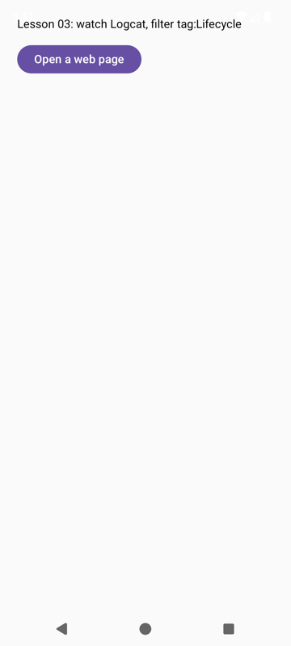
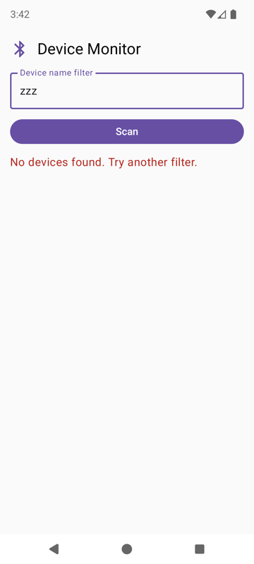
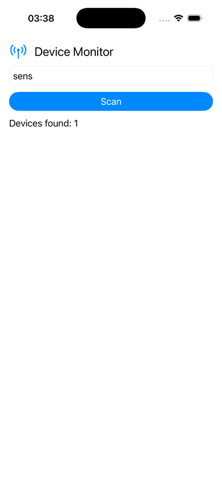
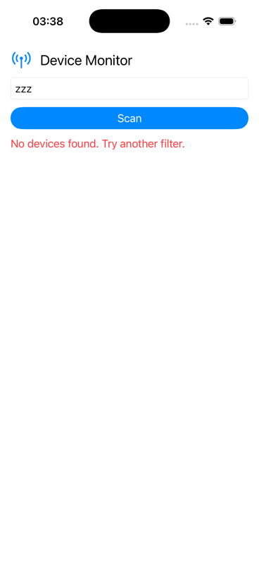

# UI declarative: thành phần, state, layout

<p class="kicker">Bài 06 · Tuần 2 · Ngày 6 · Khoá Native Device Monitor · <a href="https://phongna-inn.github.io/carmd-kmp-course/lessons/06-declarative-ui-components.html">Bản gốc tiếng Anh</a></p>

<div class="meta">
  <span class="tag">~2 giờ · +1 giờ cho mỗi track UI thêm</span>
  <span class="tag">Milestone: m01 màn hình Device Monitor</span>
  <span class="tag">Cần trước: <a href="../05-giai-phau-project-kmp/">05</a></span>
</div>

!!! abstract "Vì sao bài này quan trọng"
    Mọi tính năng của Native Device Monitor (kết quả quét, trạng thái kết nối, giá trị cảm biến trực tiếp, lỗi quyền) tới tay người dùng qua một màn hình phải luôn *nhất quán* trong khi dữ liệu tới bất đồng bộ.
    Hôm nay bạn dựng bản đầu tiên của màn hình đó, milestone **m01**: một tiêu đề có icon, một ô lọc theo tên, một nút Scan, một vòng xoay tiến trình và một dòng trạng thái/lỗi.
    Dữ liệu là một lần quét giả từ Kotlin dùng chung, nên bạn tập trung được vào cách UI phản ứng với nó. Bài 07 thêm danh sách thiết bị và màn hình thứ hai, và từ bài 08 một ViewModel dùng chung điều khiển màn hình.

!!! info "Nguồn chính"
    [Thinking in Compose](https://developer.android.com/develop/ui/compose/mental-model) của Android. Đây là chỗ phát biểu rõ nhất mô hình declarative, và mọi thứ trong đó cũng áp dụng cho SwiftUI. Đọc nó sau mục 2.
    Người học iOS đọc thêm trang tham khảo [State](https://developer.apple.com/documentation/swiftui/state) của Apple (mười phút).

!!! info "Track"
    Phần khái niệm (mục 1, 2 và 6) và phần Kotlin dùng chung (mục 3) giống nhau trên mọi track. Các màn hình thì khác theo track.
    XML Views và UIKit là toolkit *imperative*. Ở các track đó, bạn tự viết kỷ luật declarative bằng tay, trong một hàm `render()` duy nhất.
    Bài này có hai nhóm tab: **Compose** / **XML** cho Android và **SwiftUI** / **UIKit** cho iOS; chọn một tab là mọi tab cùng tên trên trang đổi theo.
    Mỗi đoạn trích dưới đây chỉ hiện những dòng mà phần ghi chú giải thích; các file đầy đủ nằm ở mục [File đầy đủ](#file-ay-u) cuối trang.

## 1. Imperative và declarative, qua một lần làm hỏng

Trong một toolkit **imperative**, widget là các object tự giữ state của mình, và các event handler của bạn sửa chúng từng lời gọi một: tắt nút, hiện vòng xoay, đặt chữ cho label.
Trong một toolkit **declarative**, bạn mô tả màn hình phải trông thế nào *với một state cho trước*, và framework tự tính ra những thay đổi. Tài liệu Android nói là "về mặt khái niệm, tạo lại toàn bộ màn hình từ đầu, rồi chỉ áp những thay đổi cần thiết" ([Thinking in Compose](https://developer.android.com/develop/ui/compose/mental-model)).

Toy dưới đây là luồng quét của Device Monitor viết theo cả hai cách. Các handler bên trái chính xác là đoạn code nằm bên dưới nó. Bấm các sự kiện theo những thứ tự khác nhau cho tới khi hai điện thoại hiện khác nhau.
(Toy cũng vẽ kết quả thành các hàng. Màn hình m01 chỉ hiện đã tìm thấy bao nhiêu thiết bị, và bài 07 thêm các hàng.)

<div class="toy" id="toy">
  <div class="toy-controls">
    <button type="button" data-ev="scan">Bấm Scan</button>
    <button type="button" data-ev="found">Quét thấy 3 thiết bị</button>
    <button type="button" data-ev="none">Quét không thấy gì</button>
    <button type="button" data-ev="reset">Reset</button>
  </div>
  <div class="toy-phones">
    <figure><figcaption>Imperative: handler sửa widget</figcaption><div id="toy-imp"></div></figure>
    <figure><figcaption>Declarative: màn hình = render(state)</figcaption><div id="toy-dec"></div></figure>
  </div>
  <pre class="toy-state" id="toy-state"></pre>
</div>

<div class="compare" markdown>

```kotlin title="Handler kiểu imperative"
fun onScanTapped() {
    button.isEnabled = false
    spinner.show()
    status.text = "Scanning…"
    list.clear()
}

fun onResults(devices: List<Device>) {
    if (devices.isEmpty()) {
        status.text = "No devices found."
        status.color = RED
        return
    }
    spinner.hide()
    button.isEnabled = true
    status.text = "Devices found: ${devices.size}"
    list.show(devices)
}
```

```kotlin title="Declarative: state + một render"
var isScanning = false
var devices: List<Device>? = null  // null = not scanned

fun onScanTapped() { isScanning = true; devices = null }
fun onResults(found: List<Device>) {
    isScanning = false; devices = found
}

fun render() = Screen(
    buttonEnabled = !isScanning,
    spinner = isScanning,
    status = when {
        isScanning -> "Scanning…"
        devices == null -> "Tap Scan to look for devices."
        devices.isEmpty() -> "No devices found."
        else -> "Devices found: ${devices.size}"
    },
    statusError = devices?.isEmpty() == true,
    rows = devices.orEmpty(),
)
```

</div>

<div class="quiz">
<p class="q">Bấm <em>Bấm Scan</em>, rồi <em>Quét không thấy gì</em>. Điện thoại imperative sai ở chỗ nào?</p>
<div class="opts">
<button class="opt">các hàng thiết bị cũ vẫn còn trên màn hình</button>
<button class="opt" data-correct>vòng xoay vẫn quay và nút Scan vẫn bị tắt</button>
<button class="opt">thông báo lỗi hiện sai màu</button>
</div>
<p class="feedback"></p>
<p class="why">Nhánh rỗng <code>return</code> trước <code>spinner.hide()</code> và <code>button.isEnabled = true</code>. Mỗi handler phải nhớ mọi widget, và handler này quên hai cái.</p>
</div>

<div class="quiz">
<p class="q">Giờ bấm <em>Bấm Scan</em> lần nữa (sự kiện vẫn chạy dù nút trông như đang tắt). "Scanning…" trên điện thoại imperative có màu gì?</p>
<div class="opts">
<button class="opt" data-correct>đỏ, sót lại từ lỗi</button>
<button class="opt">màu bình thường, đúng như mong đợi</button>
<button class="opt">xám, vì nút đang tắt</button>
</div>
<p class="feedback"></p>
<p class="why"><code>onScanTapped</code> không bao giờ đặt lại màu. Ở bản declarative, màu được tính từ state mỗi lần, nên không có gì để quên.</p>
</div>

Hai bug đó là toàn bộ lập luận. Với *n* widget và *m* sự kiện, code imperative có *n × m* chỗ để quên một lần cập nhật. Code declarative có một hàm từ state ra màn hình. Từ đó có ba luật, và mọi track trong khoá này đều dùng chúng:

1. **UI là một hàm của state.** Màn hình hiện đúng thứ state nói, không gì khác ([Thinking in Compose](https://developer.android.com/develop/ui/compose/mental-model)).
2. **Một nguồn sự thật duy nhất (single source of truth).** Mỗi mẩu state sống ở đúng một chỗ. Android: "Bằng cách di chuyển state thay vì nhân bản nó, chúng ta bảo đảm chỉ có một nguồn sự thật" ([State and Jetpack Compose](https://developer.android.com/develop/ui/compose/state)). Apple: "Dùng state làm nguồn sự thật duy nhất cho một giá trị kiểu value mà bạn lưu trong một cây view" ([State](https://developer.apple.com/documentation/swiftui/state)).
3. **Suy ra, đừng lưu.** Chữ trạng thái, cờ bật/tắt của nút và màu lỗi được *tính* từ `isScanning` và kết quả quét. Các bản sao được lưu riêng chính là lý do hai điện thoại ở trên lệch nhau.

<figure class="diagram">
<svg class="dg" viewBox="0 0 640 232" role="img" aria-labelledby="l06-fn-title">
<title id="l06-fn-title">UI là một hàm của state. State (filter, isScanning, foundCount) được code UI, một hàm của state, đọc để vẽ màn hình. Người dùng thao tác trên màn hình, hoặc một việc chạy nền xong, và việc đó sinh ra một sự kiện. Một event handler đổi state, và code UI chạy lại với state mới. Handler không bao giờ sửa màn hình trực tiếp.</title>
<defs><marker id="l06-fn-arrow" viewBox="0 0 10 10" refX="9" refY="5" markerWidth="7" markerHeight="7" orient="auto-start-reverse"><path class="arrowhead" d="M0,0 L10,5 L0,10 z"/></marker></defs>
<rect class="box" x="20" y="30" width="170" height="82" rx="6"/>
<text x="32" y="52" font-weight="600">State</text>
<text class="mono small" x="32" y="72">filter</text>
<text class="mono small" x="32" y="87">isScanning</text>
<text class="mono small" x="32" y="102">foundCount</text>
<rect class="box" x="235" y="30" width="170" height="82" rx="6"/>
<text x="247" y="52" font-weight="600">Code UI</text>
<text class="small" x="247" y="72">một hàm của state</text>
<text class="small muted" x="247" y="88">Compose / body của SwiftUI,</text>
<text class="small muted" x="247" y="102">render() ở XML / UIKit</text>
<rect class="box" x="450" y="30" width="170" height="82" rx="6"/>
<text x="462" y="52" font-weight="600">Màn hình</text>
<text class="small" x="462" y="72">thứ người dùng thấy</text>
<path class="edge" d="M190,71 L233,71" marker-end="url(#l06-fn-arrow)"/>
<path class="edge" d="M405,71 L448,71" marker-end="url(#l06-fn-arrow)"/>
<text class="small muted" x="198" y="64">đọc</text>
<text class="small muted" x="415" y="64">vẽ</text>
<rect class="box" x="235" y="162" width="170" height="54" rx="6"/>
<text x="247" y="184" font-weight="600">Event handler</text>
<text class="small" x="247" y="203">chạm, gõ phím, quét xong</text>
<path class="edge" d="M535,114 L535,189 L407,189" marker-end="url(#l06-fn-arrow)"/>
<text class="small muted" x="480" y="154">sự kiện</text>
<path class="edge" d="M233,189 L105,189 L105,114" marker-end="url(#l06-fn-arrow)"/>
<text class="small muted" x="118" y="154">đổi state</text>
</svg>
<figcaption>Handler chỉ đổi state. Code UI là thứ duy nhất quyết định màn hình hiện gì.</figcaption>
</figure>

!!! info "Từ TypeScript"
    Đây là mô hình của React, hay template Angular với signal: template là một hàm của state component, và bạn đổi state, không bao giờ đổi DOM.
    Compose và SwiftUI cùng ý tưởng đó, khác cơ chế bên dưới: Compose dựa vào một compiler plugin của Kotlin, SwiftUI dựa vào result builder của Swift (`@ViewBuilder`).
    XML Views và UIKit là thời jQuery: bạn giữ tham chiếu tới widget và gán thuộc tính cho chúng.

## 2. Chạy lại UI, và side effect nằm ở đâu

Khi state đổi, framework gọi lại code UI của bạn. Compose gọi việc đó là **recomposition**: "quá trình gọi lại các hàm composable khi input thay đổi", và nó "bỏ qua phần còn lại" có input không đổi.
SwiftUI tính lại `body` của view: "Khi giá trị thay đổi, SwiftUI cập nhật những phần của cây view phụ thuộc vào giá trị đó" ([Apple: State](https://developer.apple.com/documentation/swiftui/state)).

<figure class="diagram">
<svg class="dg" viewBox="0 0 640 296" role="img" aria-labelledby="l06-rerun-title">
<title id="l06-rerun-title">Code UI chạy lại mỗi lần state đổi. Lúc mở app, state là isScanning false và foundCount null, và màn hình hiện nút Scan đang bật cùng dòng trạng thái Tap Scan to look for devices. Sau khi bấm Scan, handler đặt isScanning thành true và foundCount thành null, code UI chạy lại, và màn hình hiện nút Scan bị tắt, một vòng xoay và dòng Scanning. Một giây rưỡi sau, coroutine quét đặt foundCount thành 5 và isScanning thành false, code UI chạy lại, và màn hình hiện nút Scan bật cùng dòng Devices found: 5, tức mọi thiết bị mẫu vì ô lọc đang trống.</title>
<defs><marker id="l06-rerun-arrow" viewBox="0 0 10 10" refX="9" refY="5" markerWidth="7" markerHeight="7" orient="auto-start-reverse"><path class="arrowhead" d="M0,0 L10,5 L0,10 z"/></marker></defs>
<text class="small muted" x="20" y="16">state</text>
<text class="small muted" x="332" y="16">màn hình</text>
<rect class="box" x="20" y="26" width="600" height="56" rx="6"/>
<path class="axis" d="M320,34 L320,74"/>
<text class="mono small" x="32" y="59">isScanning = false · foundCount = null</text>
<text class="small" x="332" y="59">Scan bật · "Tap Scan to look for devices."</text>
<path class="edge" d="M320,84 L320,122" marker-end="url(#l06-rerun-arrow)"/>
<text class="small muted" x="332" y="102">bấm Scan: handler đổi state,</text>
<text class="small muted" x="332" y="116">và code UI chạy lại</text>
<rect class="box" x="20" y="124" width="600" height="56" rx="6"/>
<path class="axis" d="M320,132 L320,172"/>
<text class="mono small" x="32" y="157">isScanning = true · foundCount = null</text>
<text class="small" x="332" y="157">Scan tắt · vòng xoay · "Scanning…"</text>
<path class="edge" d="M320,182 L320,220" marker-end="url(#l06-rerun-arrow)"/>
<text class="small muted" x="332" y="200">1,5 s sau quét xong: state đổi,</text>
<text class="small muted" x="332" y="214">và code UI chạy lại</text>
<rect class="box" x="20" y="222" width="600" height="56" rx="6"/>
<path class="axis" d="M320,230 L320,270"/>
<text class="mono small" x="32" y="255">isScanning = false · foundCount = 5</text>
<text class="small" x="332" y="255">Scan bật · "Devices found: 5"</text>
</svg>
<figcaption>Ba lần render của cùng một hàm. Không có gì ở giữa sửa một widget.</figcaption>
</figure>

Hệ quả bạn phải thiết kế cho nó: **hàm UI của bạn chạy thường xuyên, và bạn không quyết định khi nào.**
Composable "có thể được chạy lại thường tới mức mỗi frame", các con "có thể chạy theo bất kỳ thứ tự nào", và một lần recomposition "có thể bị bỏ qua" ([Thinking in Compose](https://developer.android.com/develop/ui/compose/mental-model)).
Nên hàm UI phải **không có side effect**: không bắt đầu quét, không ghi file, không tăng một bộ đếm. Side effect đặt ở một trong hai chỗ:

| Ở đâu | Compose | SwiftUI | XML / UIKit |
|---|---|---|---|
| một **event callback** (một lần chạm) | `onClick = { … }`, cộng `rememberCoroutineScope().launch` cho việc async | `Button(action:)`, cộng `Task { }` cho việc async | click listener / `UIAction`, rồi gọi `render()` |
| một **effect gắn với vòng đời** (khi hiện ra) | `LaunchedEffect(key)` | `.task { }` / `.task(id:)` | `onCreate` / `viewDidLoad` (`viewDidLoad`: bài 04) |

Việc quét bắt đầu từ một lần chạm, nên trong m01 nó nằm trong một callback. Hướng dẫn của Android cũng nói vậy: "kích hoạt side effect từ các callback như `onClick`, thứ luôn chạy trên UI thread" ([cùng trang](https://developer.android.com/develop/ui/compose/mental-model)).

!!! note "Track imperative: render() là recomposition của bạn"
    XML Views và UIKit không bao giờ tự chạy lại code của bạn. Nên các màn hình XML và UIKit bên dưới giữ state trong vài property và cho mọi thay đổi đi qua **một** hàm `render()` gán mọi widget theo state đó.
    Đó là cột declarative của toy, viết bằng tay. Khi các màn hình cũ của team chạy sai, nguyên nhân thường là một handler bỏ qua `render()` và sửa thẳng một widget.

## 3. Dữ liệu: một lần quét giả trong Kotlin dùng chung

Danh sách thiết bị đến từ `commonMain`, nên cả hai app hiện cùng các thiết bị và luật lọc chỉ viết một lần. Đây là code dùng chung đầu tiên UI gọi tới, sau `Greeting` của m00.
(`Greeting.kt` và `Platform*.kt` vẫn ở đó; giờ không gì dùng chúng, và các bài sau cũng không cần chúng.)

```kotlin title="shared/src/commonMain/kotlin/com/example/devicemonitor/Device.kt" hl_lines="2"
⋯ package
data class Device(val id: String, val name: String, val rssi: Int)
```

```kotlin title="shared/src/commonMain/kotlin/com/example/devicemonitor/SampleDevices.kt" hl_lines="4 5 10 11"
⋯ package

// Stand-in for a real BLE scan until Lesson 13.
object SampleDevices {
    val all: List<Device> = listOf(
        Device(id = "C4:7C:8D:6A:01:10", name = "OBD-II Adapter", rssi = -48),
⋯ four more devices
    )

    fun matching(filter: String): List<Device> =
        all.filter { it.name.contains(filter.trim(), ignoreCase = true) }
}
```

1. `Device` là một **data class** (bài 01), nên hai thiết bị có cùng các field thì bằng nhau. `id` của nó là **danh tính ổn định** của thiết bị; bài 07 dùng nó làm key của mỗi hàng trong danh sách.
   Các id giả trông giống địa chỉ MAC của Android. Trên iOS, một id BLE thật là một UUID do hệ thống cấp, không phải địa chỉ của thiết bị (bài 13).
2. `object SampleDevices` là một singleton. Swift thấy nó là `SampleDevices.shared` (bảng tên ở bài 05), nên Swift gọi `SampleDevices.shared.matching(filter: query)`. Tên tham số Kotlin trở thành argument label của Swift.
3. `matching` là luật lọc: "chứa" không phân biệt hoa thường trên tên, với chuỗi lọc đã được trim. Chuỗi lọc rỗng khớp mọi thiết bị. `List<Device>` sang Swift thành `[Device]`.
   Màn hình chỉ cần bao nhiêu thiết bị khớp, nên Kotlin gọi `.size` và Swift gọi `.count`.
4. Lần quét giả không có độ trễ. Việc chờ là việc của UI trong m01. Ở bài 08 độ trễ chuyển vào code dùng chung dưới dạng một `Flow`, và bài 13 thay bản giả bằng một scanner thật.

## 4. Thành phần và layout

Màn hình m01 dùng năm loại thành phần, xếp trong một stack dọc. Toolkit nào cũng có đủ năm loại, dưới những cái tên khác nhau:

| Thành phần | Compose | XML | SwiftUI | UIKit |
|---|---|---|---|---|
| chữ | `Text` | `TextView` | `Text` | `UILabel` |
| ô nhập chữ | `OutlinedTextField` | `EditText` | `TextField` | `UITextField` |
| nút | `Button` | `Button` | `Button` | `UIButton` |
| ảnh | `Image` | `ImageView` | `Image` | `UIImageView` |
| tiến trình | `CircularProgressIndicator` | `ProgressBar` | `ProgressView` | `UIActivityIndicatorView` |

<figure class="diagram">
<svg class="dg" viewBox="0 0 640 332" role="img" aria-labelledby="l06-layout-title">
<title id="l06-layout-title">Layout của màn hình m01. Một stack dọc, có margin bao quanh và khoảng cách giữa các phần tử (16 dp và 12 dp trong Compose), chứa bốn phần tử từ trên xuống: một hàng có icon Bluetooth và tiêu đề, ô nhập chữ, một nút Scan rộng hết cỡ, và một hàng có vòng xoay tiến trình và dòng trạng thái. Phần còn lại của màn hình trống cho tới khi bài 07 thêm danh sách thiết bị. Trong Compose stack là một Column và mỗi hàng là một Row. Trong XML nó là một ConstraintLayout, trong đó mọi view được ghim vào cha hoặc vào một view anh em, không lồng nhau. Trong SwiftUI nó là một VStack và mỗi hàng là một HStack. Trong UIKit nó là một UIStackView dọc, và mỗi hàng là một UIStackView ngang khác.</title>
<rect class="box" x="20" y="10" width="250" height="312" rx="24"/>
<text class="small muted" x="36" y="38">stack dọc · margin · khoảng cách</text>
<rect class="box" x="46" y="52" width="198" height="36" rx="6"/>
<text class="small" x="58" y="75">hàng: icon + tiêu đề</text>
<rect class="box" x="46" y="100" width="198" height="34" rx="6"/>
<text class="small" x="58" y="121">ô nhập chữ</text>
<rect class="box" x="46" y="146" width="198" height="34" rx="6"/>
<text class="small" x="58" y="167">nút Scan, rộng hết cỡ</text>
<rect class="box" x="46" y="192" width="198" height="36" rx="6"/>
<text class="small" x="58" y="215">hàng: vòng xoay + trạng thái</text>
<text class="small muted" x="46" y="270">trống tới khi bài 07 thêm danh sách</text>
<text x="310" y="40" font-weight="600">Stack ở từng track</text>
<g data-part="android">
<rect class="box" x="310" y="56" width="310" height="48" rx="6"/>
<text class="title" x="322" y="76">Compose</text>
<text class="mono small" x="322" y="94">Column, mỗi hàng một Row</text>
<rect class="box" x="310" y="114" width="310" height="48" rx="6"/>
<text class="title" x="322" y="134">XML</text>
<text class="mono small" x="322" y="152">ConstraintLayout: ghim, không lồng</text>
</g>
<g data-part="ios">
<rect class="box" x="310" y="172" width="310" height="48" rx="6"/>
<text class="title" x="322" y="192">SwiftUI</text>
<text class="mono small" x="322" y="210">VStack, mỗi hàng một HStack</text>
<rect class="box" x="310" y="230" width="310" height="48" rx="6"/>
<text class="title" x="322" y="250">UIKit</text>
<text class="mono small" x="322" y="268">UIStackView, mỗi hàng thêm một cái</text>
</g>
</svg>
<figcaption>Một ý tưởng layout, bốn toolkit. Stack nói "các con xếp thành hàng, cách nhau chừng này". Constraint nói "cạnh của view này nằm cách cạnh của view kia chừng này".
<ul class="legend"><li data-part="android">Android</li><li data-part="ios">iOS</li></ul>
</figcaption>
</figure>

Dòng trạng thái (chữ, kèm vòng xoay tiến trình bên cạnh khi đang quét) là phần thay đổi. Mục 5 nói về nó. Mục này là phần hình dạng tĩnh.

=== "Compose"

    ```kotlin title="androidApp/src/main/java/com/example/devicemonitor/android/DeviceMonitorScreen.kt" hl_lines="3 4 7 8 10 11 12 13"
    ⋯ package, imports, DeviceMonitorContent's parameters
        Column(
            modifier = Modifier.fillMaxSize().safeDrawingPadding().padding(16.dp),
            verticalArrangement = Arrangement.spacedBy(12.dp),
        ) {
            Row(
                verticalAlignment = Alignment.CenterVertically,
                horizontalArrangement = Arrangement.spacedBy(12.dp),
            ) {
                Image(
                    painter = painterResource(R.drawable.ic_bluetooth),
                    contentDescription = null,
                    colorFilter = ColorFilter.tint(MaterialTheme.colorScheme.primary),
                    modifier = Modifier.size(32.dp),
                )
                Text("Device Monitor", style = MaterialTheme.typography.headlineSmall)
            }
    ⋯ the field, the button and the status line
        }
    ```

    ```kotlin title="androidApp/src/main/java/com/example/devicemonitor/android/DeviceMonitorScreen.kt" hl_lines="3 4 7 9"
    ⋯ the header row
            OutlinedTextField(
                value = filter,
                onValueChange = onFilterChange,
                label = { Text("Device name filter") },
                singleLine = true,
                modifier = Modifier.fillMaxWidth(),
            )
            Button(onClick = onScan, enabled = !isScanning, modifier = Modifier.fillMaxWidth()) {
                Text("Scan")
            }
            ScanStatus(isScanning = isScanning, foundCount = foundCount)
        }
    ```

    ```kotlin title="androidApp/src/main/java/com/example/devicemonitor/android/MainActivity.kt" hl_lines="7 8 9"
    ⋯ package and the other imports
    class MainActivity : ComponentActivity() {
        override fun onCreate(savedInstanceState: Bundle?) {
            enableEdgeToEdge()
            super.onCreate(savedInstanceState)
            setContent {
                MaterialTheme {
                    DeviceMonitorScreen()
                }
            }
        }
    }
    ```

    1. **`Column`** xếp các con theo chiều dọc, `Arrangement.spacedBy(12.dp)` giãn khoảng cách giữa chúng, và `Row` làm điều tương tự theo chiều ngang.
       **Modifier** được áp theo thứ tự: `fillMaxSize()`, rồi `safeDrawingPadding()` giữ nội dung không nằm dưới các thanh hệ thống (với targetSdk 36 app vẽ ra sau chúng, và `enableEdgeToEdge()` của m00 làm chúng trong suốt; bài 05), rồi `padding(16.dp)` thêm margin.
    2. **`Image(painterResource(R.drawable.ic_bluetooth))`** vẽ một vector drawable từ `res/drawable/` (file nằm trong File đầy đủ, dùng chung cho cả hai track Android), tô bằng màu của theme. `contentDescription = null` đánh dấu nó là ảnh trang trí cho trình đọc màn hình.
    3. **`OutlinedTextField(value = filter, onValueChange = onFilterChange)`**. Ô nhập chỉ hiện đúng thứ state nói. Một lần gõ phím là một sự kiện, sự kiện đổi state, và state mới recompose ô nhập.
       Android giờ khuyên dùng API `TextFieldState` mới hơn cho ô nhập chữ ([Configure text fields](https://developer.android.com/develop/ui/compose/text/user-input)). Bài này dùng value + callback vì nó cho thấy hoisting rõ ràng (mục 5) và khớp với binding của SwiftUI.
    4. **`Button(onClick = onScan, enabled = !isScanning)`**. `enabled` là `buttonEnabled` của toy, suy ra từ state. `Text("Scan")` là nội dung của nút.
    5. **`MaterialTheme { … }`** trong `MainActivity` cung cấp bảng màu, kiểu chữ và hình dạng mà các component Material đọc, gồm cả `MaterialTheme.colorScheme.primary` trên icon.
       Thiếu nó chúng vẫn vẽ được, bằng các giá trị mặc định sáng có sẵn của Material; lớp bọc này là chỗ một app đặt theme của riêng nó.

=== "XML"

    ```kotlin title="androidApp/build.gradle.kts" hl_lines="8 9"
    ⋯ plugins, android { namespace, compileSdk, defaultConfig }
        buildFeatures { viewBinding = true }
    }

    dependencies {
        implementation(project(":shared"))
    ⋯ core-ktx and appcompat, as in m00
        implementation("androidx.constraintlayout:constraintlayout:2.2.2")
        implementation("androidx.lifecycle:lifecycle-runtime-ktx:2.11.0")
    }
    ```

    ```xml title="androidApp/src/main/res/layout/activity_main.xml" hl_lines="5 10 16 19"
    <FrameLayout xmlns:android="http://schemas.android.com/apk/res/android"
        xmlns:app="http://schemas.android.com/apk/res-auto"
        android:layout_width="match_parent"
        android:layout_height="match_parent"
        android:fitsSystemWindows="true">

        <androidx.constraintlayout.widget.ConstraintLayout
            android:layout_width="match_parent"
            android:layout_height="match_parent"
            android:padding="16dp">

            <ImageView
                android:id="@+id/headerIcon"
                android:layout_width="32dp"
                android:layout_height="32dp"
                android:contentDescription="@null"
                android:src="@drawable/ic_bluetooth"
    ⋯ constraints
                app:tint="?attr/colorAccent" />
    ⋯ the title, the field, the button, the status
    ```

    ```xml title="androidApp/src/main/res/layout/activity_main.xml" hl_lines="4 6 7 8 9 14 15"
    ⋯ the header, the field and the button
            <TextView
                android:id="@+id/title"
                android:layout_width="0dp"
    ⋯ height, margin, text, appearance
                app:layout_constraintStart_toEndOf="@id/headerIcon"
                app:layout_constraintEnd_toEndOf="parent"
                app:layout_constraintTop_toTopOf="@id/headerIcon"
                app:layout_constraintBottom_toBottomOf="@id/headerIcon" />

            <EditText
                android:id="@+id/filterInput"
    ⋯ width, margin, hint, autofill
                android:inputType="text"
                app:layout_constraintTop_toBottomOf="@id/headerIcon" />
    ⋯ the button and the status
    ```

    ```xml title="androidApp/src/main/res/layout/activity_main.xml" hl_lines="7 8 14 19"
    ⋯ the title, the field and the button
            <ProgressBar
                android:id="@+id/progress"
                android:layout_width="20dp"
                android:layout_height="20dp"
                app:layout_constraintStart_toStartOf="parent"
                app:layout_constraintTop_toTopOf="@id/statusText"
                app:layout_constraintBottom_toBottomOf="@id/statusText" />

            <TextView
                android:id="@+id/statusText"
                android:layout_width="0dp"
                android:layout_height="wrap_content"
                android:layout_marginStart="8dp"
                android:layout_marginTop="12dp"
                app:layout_constraintStart_toEndOf="@id/progress"
                app:layout_constraintEnd_toEndOf="parent"
                app:layout_constraintTop_toBottomOf="@id/scanButton"
                app:layout_goneMarginStart="0dp" />
    ```

    1. **ConstraintLayout.** Mỗi view ghim các cạnh của nó vào cha hoặc vào một view anh em (`layout_constraintTop_toBottomOf="@id/headerIcon"`). `layout_width="0dp"` nghĩa là "match constraints": giãn ra giữa hai điểm neo.
       Tiêu đề được canh giữa theo icon bằng cách ghim cạnh trên và cạnh dưới của nó vào cạnh của icon. Dòng trạng thái nằm cách vòng xoay 8dp (`layout_marginStart`).
       Khi vòng xoay là `GONE`, `layout_goneMarginStart="0dp"` thay cho margin đó, nên chữ thẳng hàng với ô nhập ở trên.
    2. **`FrameLayout` có `fitsSystemWindows="true"`** đến từ m00. Nó đệm mọi thứ tránh khỏi các thanh hệ thống, và padding 16dp trên ConstraintLayout bên trong thêm margin.
    3. **Icon** là cùng vector drawable như ở Compose. `app:tint="?attr/colorAccent"` tô nó bằng màu nhấn của theme qua thuộc tính `app:` của AppCompat, và `contentDescription="@null"` đánh dấu nó là ảnh trang trí.
    4. **ViewBinding.** `buildFeatures { viewBinding = true }` làm Gradle sinh một class từ mỗi file layout: `activity_main.xml` thành `ActivityMainBinding`, với một field có kiểu cho mỗi view id (`binding.scanButton`). Không `findViewById`, không ép kiểu.
       `constraintlayout` và `lifecycle-runtime-ktx` (mục 5) là các dependency mới.
    5. Nút AppCompat hiện chữ in hoa ("SCAN"), bất kể `android:text` ghi gì. Các công cụ tự động hoá UI và test thấy chữ đã in hoa.

!!! info "XML vs Compose · cái gì đổi và vì sao"
    Compose mô tả layout bằng các lời gọi lồng nhau (`Column { Row { … } }`) và framework đo chúng.
    XML nói mỗi view nằm ở đâu so với các view hàng xóm, trong một file riêng, và Kotlin của bạn tìm các view qua một binding được sinh ra.

=== "SwiftUI"

    ```swift title="iosApp/iosApp/DeviceMonitorView.swift" hl_lines="3 4 5 7 14"
    ⋯ imports and the state
        var body: some View {
            VStack(alignment: .leading, spacing: 12) {
                HStack(spacing: 12) {
                    Image(systemName: "antenna.radiowaves.left.and.right")
                        .font(.title)
                        .foregroundStyle(.tint)
                    Text("Device Monitor")
                        .font(.title2)
                }
    ⋯ the field, the button, the status line
                Spacer()
            }
            .padding()
        }
    ```

    ```swift title="iosApp/iosApp/DeviceMonitorView.swift" hl_lines="2 5 7 10"
    ⋯ the header
                TextField("Device name filter", text: $filter)
                    .textFieldStyle(.roundedBorder)
                    .autocorrectionDisabled()
                Button(action: scan) {
                    Text("Scan")
                        .frame(maxWidth: .infinity)
                }
                .buttonStyle(.borderedProminent)
                .disabled(isScanning)
                ScanStatus(isScanning: isScanning, foundCount: foundCount)
    ```

    ```swift title="iosApp/iosApp/iOSApp.swift" hl_lines="6"
    ⋯ import
    @main
    struct iOSApp: App {
        var body: some Scene {
            WindowGroup {
                DeviceMonitorView()
            }
        }
    }
    ```

    1. **`VStack(alignment: .leading, spacing: 12)`** xếp các con theo chiều dọc; `HStack` xếp theo chiều ngang. `.padding()` dùng khoảng lề mặc định của hệ thống.
       **`Spacer()`** chiếm hết chiều cao còn dư và đẩy nội dung lên trên. Thiếu nó, stack sẽ nằm giữa màn hình.
    2. **`Image(systemName:)`** là một SF Symbol: một icon vector có sẵn trong iOS, co giãn theo cỡ chữ. `.foregroundStyle(.tint)` tô nó bằng màu nhấn của app.
    3. **`TextField(…, text: $filter)`**. `$filter` là một **Binding**, một tham chiếu đọc-ghi tới state. Ô nhập hiện `filter` và ghi các phím gõ ngược vào nó. Nó là `value` + `onValueChange` của Compose gộp trong một tham số.
    4. **`Button(action: scan) { Text("Scan").frame(maxWidth: .infinity) }`**. Frame nằm trên *label*.
       Đặt `.frame(maxWidth: .infinity)` lên `Button` thay vào đó, bạn sẽ được một nút nhỏ ở giữa trong một khung rộng vô hình (xem gotcha ở mục 7).
    5. **`.disabled(isScanning)`** được suy ra, như `enabled = !isScanning` của Compose.
    6. **File app** giờ hiện thẳng `DeviceMonitorView()`. `ContentView.swift` của m00 bị xoá. Bài 07 thêm điều hướng quanh view này.

=== "UIKit"

    ```swift title="iosApp/iosApp/DeviceMonitorViewController.swift" hl_lines="9"
    ⋯ imports, the state and the widgets
        override func viewDidLoad() {
            super.viewDidLoad()
            view.backgroundColor = .systemBackground

            let icon = UIImageView(image: UIImage(systemName: "antenna.radiowaves.left.and.right"))
            icon.preferredSymbolConfiguration = UIImage.SymbolConfiguration(pointSize: 28)
            icon.tintColor = .tintColor
            icon.setContentHuggingPriority(.required, for: .horizontal)
            let titleLabel = UILabel()
            titleLabel.text = "Device Monitor"
            titleLabel.font = .preferredFont(forTextStyle: .title2)
    ⋯ the field, the button and the status label
    ```

    ```swift title="iosApp/iosApp/DeviceMonitorViewController.swift" hl_lines="2 5 7 11 14 15 16"
    ⋯ the widgets
            let headerRow = UIStackView(arrangedSubviews: [icon, titleLabel])
            headerRow.spacing = 12
            headerRow.alignment = .center
            let statusRow = UIStackView(arrangedSubviews: [spinner, statusLabel])
            statusRow.spacing = 8
            let stack = UIStackView(arrangedSubviews: [headerRow, filterField, scanButton, statusRow])
            stack.axis = .vertical
            stack.alignment = .fill
            stack.spacing = 12
            stack.translatesAutoresizingMaskIntoConstraints = false
            view.addSubview(stack)
            NSLayoutConstraint.activate([
                stack.topAnchor.constraint(equalTo: view.layoutMarginsGuide.topAnchor),
                stack.leadingAnchor.constraint(equalTo: view.layoutMarginsGuide.leadingAnchor),
                stack.trailingAnchor.constraint(equalTo: view.layoutMarginsGuide.trailingAnchor),
            ])
            render()
    ```

    ```swift title="iosApp/iosApp/SceneDelegate.swift" hl_lines="6"
    ⋯ imports and the window property
        func scene(_ scene: UIScene, willConnectTo session: UISceneSession,
                   options connectionOptions: UIScene.ConnectionOptions) {
            guard let windowScene = scene as? UIWindowScene else { return }
            let window = UIWindow(windowScene: windowScene)
            window.rootViewController = DeviceMonitorViewController()
            window.makeKeyAndVisible()
            self.window = window
        }
    ```

    1. **Layout: một `UIStackView` dọc** chứa hàng tiêu đề, ô nhập, nút và hàng trạng thái. Một `UIStackView` tự sắp xếp các *arranged subview* của nó, nên chỉ stack ngoài cùng cần constraint.
       Nó được ghim vào layout margin (đã gồm safe area) ở ba cạnh. Không có constraint cạnh dưới, nên stack chỉ cao bằng nội dung của nó và nằm ở trên cùng.
    2. **`translatesAutoresizingMaskIntoConstraints = false`** trên stack. Thiếu nó, UIKit tự thêm các constraint của riêng nó, xung đột với constraint của bạn (label ở bài 05 cũng làm vậy).
    3. **Content hugging.** Một stack ngang với distribution mặc định `fill` phải kéo giãn một arranged view để dùng hết chiều rộng còn dư. Nó kéo giãn view có content-hugging priority thấp nhất, và khi hoà thì chọn theo vị trí trong `arrangedSubviews`.
       Một `UIImageView` và một `UILabel` tạo bằng code đều mặc định là 250, nên stack của chúng ta chọn icon, view đầu tiên: nó giãn ra khắp hàng tiêu đề và đẩy tiêu đề ra mép phải (xem gotcha ở mục 7).
       `setContentHuggingPriority(.required, for: .horizontal)` làm icon chống lại việc bị giãn, nên stack giãn label tiêu đề thay vào đó.
    4. **`UIButton(configuration: .filled())`** (khai báo cùng các widget) là API nút hiện đại. Trong một stack dọc với `alignment = .fill`, nó rộng bằng stack.
       `UIAction { [weak self] _ in self?.scan() }` tránh một retain cycle: view controller sở hữu nút, nên closure của nút không được sở hữu view controller.
    5. **Scene delegate** đặt view controller này làm gốc của cửa sổ. Chưa có navigation controller, nên chưa có thanh điều hướng và tiêu đề là một label trong stack. Bài 07 thêm `UINavigationController`.
       `ViewController.swift` (màn hình lời chào của m00) bị xoá.

!!! info "UIKit vs SwiftUI · cái gì đổi và vì sao"
    Stack của SwiftUI là các value lồng nhau, như của Compose. Stack của UIKit là các object bạn tạo, cấu hình và thêm vào một view cha, rồi ghim bằng constraint.
    Trong SwiftUI, chuỗi lọc là state được bind vào ô nhập. Trong UIKit, ô nhập tự giữ nó, và bạn đọc nó khi cần.

## 5. State, sự kiện và dòng trạng thái

Ba mẩu state điều khiển cả màn hình: chữ lọc, có đang quét hay không, và lần quét gần nhất tìm thấy bao nhiêu thiết bị (`null` trước lần quét đầu, để màn hình phân biệt được "chưa quét bao giờ" với "đã quét, không thấy gì").
Trên Compose, mẩu thứ tư là coroutine scope chạy việc quét. Mọi thứ người dùng thấy đều được suy ra từ chúng.

=== "Compose"

    <figure class="diagram">
    <svg class="dg" viewBox="0 0 640 214" role="img" aria-labelledby="l06-hoist-title">
    <title id="l06-hoist-title">State hoisting trong màn hình Compose. DeviceMonitorScreen là stateful: nó giữ filter, foundCount và isScanning, và nó bắt đầu việc quét. Nó truyền giá trị xuống DeviceMonitorContent, thứ stateless và chỉ vẽ những gì được đưa cho. DeviceMonitorContent báo sự kiện ngược lên qua các lambda onFilterChange và onScan.</title>
    <defs><marker id="l06-hoist-arrow" viewBox="0 0 10 10" refX="9" refY="5" markerWidth="7" markerHeight="7" orient="auto-start-reverse"><path class="arrowhead" d="M0,0 L10,5 L0,10 z"/></marker></defs>
    <g data-part="android">
    <rect class="box" x="130" y="14" width="380" height="62" rx="6"/>
    <text class="mono title" x="144" y="36">DeviceMonitorScreen</text>
    <text class="small" x="144" y="56">stateful: giữ state và bắt đầu việc quét</text>
    <rect class="box" x="130" y="136" width="380" height="62" rx="6"/>
    <text class="mono title" x="144" y="158">DeviceMonitorContent</text>
    <text class="small" x="144" y="178">stateless: vẽ thứ được đưa cho, báo sự kiện lên</text>
    </g>
    <path class="edge" d="M250,78 L250,134" marker-end="url(#l06-hoist-arrow)"/>
    <text class="small muted" x="240" y="110" text-anchor="end">state đi xuống</text>
    <path class="edge" d="M390,134 L390,78" marker-end="url(#l06-hoist-arrow)"/>
    <text class="small muted" x="400" y="110">sự kiện đi lên (onFilterChange, onScan)</text>
    </svg>
    <figcaption>State của màn hình sống ở một chỗ. Hàm content không bao giờ đổi nó, nên nó không thể lệch.
    <ul class="legend"><li data-part="android">Android</li></ul>
    </figcaption>
    </figure>

    ```kotlin title="androidApp/src/main/java/com/example/devicemonitor/android/DeviceMonitorScreen.kt" hl_lines="4-7 11-18"
    ⋯ package and imports
    @Composable
    fun DeviceMonitorScreen() {
        var filter by rememberSaveable { mutableStateOf("") }
        var foundCount by rememberSaveable { mutableStateOf<Int?>(null) }
        var isScanning by remember { mutableStateOf(false) }
        val scope = rememberCoroutineScope()

        DeviceMonitorContent(
    ⋯ filter, onFilterChange, isScanning, foundCount
            onScan = {
                val query = filter
                isScanning = true
                foundCount = null
                scope.launch {
                    delay(1_500)
                    foundCount = SampleDevices.matching(query).size
                    isScanning = false
                }
            },
        )
    }
    ```

    ```kotlin title="androidApp/src/main/java/com/example/devicemonitor/android/DeviceMonitorScreen.kt" hl_lines="8 16"
    ⋯ the screen and the content
    @Composable
    private fun ScanStatus(isScanning: Boolean, foundCount: Int?) {
        Row(
            verticalAlignment = Alignment.CenterVertically,
            horizontalArrangement = Arrangement.spacedBy(8.dp),
        ) {
            when {
                isScanning -> {
                    CircularProgressIndicator(modifier = Modifier.size(20.dp), strokeWidth = 2.dp)
                    Text("Scanning…")
                }
                foundCount == null -> Text("Tap Scan to look for devices.")
                foundCount == 0 -> Text(
                    "No devices found. Try another filter.",
                    color = MaterialTheme.colorScheme.error,
                )
                else -> Text("Devices found: $foundCount")
            }
        }
    }
    ```

    1. **`var filter by rememberSaveable { mutableStateOf("") }`**, đọc từ trong ra ngoài. `mutableStateOf` tạo một giá trị quan sát được: "Mọi thay đổi của `value` lên lịch recomposition cho mọi hàm composable đọc `value`".
       `remember` giữ nó qua các lần recomposition. `rememberSaveable` còn giữ nó "qua việc tạo lại activity hoặc process", như khi xoay máy ([State and Jetpack Compose](https://developer.android.com/develop/ui/compose/state)).
       `by` là một property delegate của Kotlin, nên bạn viết `filter` thay vì `filter.value`.
    2. **`foundCount` là một `Int?`**, với `null` nghĩa là "chưa quét bao giờ". `rememberSaveable` tự lưu được mọi kiểu mà một `Bundle` chứa được (chuỗi, số, Parcelable), và `Int?` là một kiểu như vậy.
       Một `Device` Kotlin từ code dùng chung thì không: nó sẽ cần một `Saver` tự viết. Bài 07 cần chính các hàng và gặp giới hạn đó khi ấy.
    3. **`isScanning` cố tình dùng `remember` thường.** Nếu Activity bị tạo lại giữa lúc quét, coroutine quét bị huỷ (ý tiếp theo). Một giá trị `true` được lưu lại sẽ làm màn hình hiện "Scanning…" mãi mãi.
    4. **`rememberCoroutineScope()`** cho một scope gắn với vị trí của composable này trên màn hình. Nó bị huỷ khi composable rời đi (xoay máy, điều hướng). Đó là cách một callback bắt đầu việc async trong Compose ([Side-effects in Compose](https://developer.android.com/develop/ui/compose/side-effects)).
       `delay` và `launch` đến từ kotlinx.coroutines, thư viện tới gián tiếp cùng Compose runtime.
    5. **`onScan`** là event handler. Nó đổi state một cách đồng bộ trước (`isScanning = true`, xoá kết quả), và chỉ sau đó mới launch phần chậm. Nút bị tắt ngay từ frame kế tiếp, nên bấm đúp không thể bắt đầu hai lần quét.
    6. **`val query = filter`** chụp chuỗi lọc *tại lúc bấm*. Đọc `filter` sau `delay` 1,5 s sẽ thấy bất cứ thứ gì người dùng gõ trong lúc đó.
    7. **Lớp bọc stateful, phần content stateless.** `DeviceMonitorScreen` giữ state. `DeviceMonitorContent` chỉ nhận giá trị và lambda: "state đi xuống … sự kiện đi lên".
       Đó là **state hoisting** và **luồng dữ liệu một chiều (unidirectional data flow)** ([cùng trang](https://developer.android.com/develop/ui/compose/state)). Ở bài 08 một ViewModel dùng chung thay lớp bọc, và `DeviceMonitorContent` không đổi.
    8. **`ScanStatus`** là `render()` của toy: một `when` trên state. Lỗi chỉ là một nhánh có màu lỗi, và vòng xoay tiến trình chỉ tồn tại khi `isScanning` là true.

=== "XML"

    ```kotlin title="androidApp/src/main/java/com/example/devicemonitor/android/MainActivity.kt" hl_lines="3 4 5 7 11 13 14 15 20"
    ⋯ package and imports
    class MainActivity : AppCompatActivity() {
        // Screen state lives in fields; render() copies it into the views.
        private var foundCount: Int? = null
        private var isScanning = false

        private lateinit var binding: ActivityMainBinding

        override fun onCreate(savedInstanceState: Bundle?) {
    ⋯ enableEdgeToEdge(), super.onCreate()
            binding = ActivityMainBinding.inflate(layoutInflater)
            setContentView(binding.root)
            foundCount = savedInstanceState?.getInt("foundCount", -1)?.takeIf { it >= 0 }
            binding.scanButton.setOnClickListener { scan(binding.filterInput.text.toString()) }
            render()
        }

        override fun onSaveInstanceState(outState: Bundle) {
            super.onSaveInstanceState(outState)
            foundCount?.let { outState.putInt("foundCount", it) }
        }
    ⋯ scan() and render()
    ```

    ```kotlin title="androidApp/src/main/java/com/example/devicemonitor/android/MainActivity.kt" hl_lines="3 4 5 6 16 24"
    ⋯ the state, onCreate and onSaveInstanceState
        private fun scan(query: String) {
            isScanning = true
            foundCount = null
            render()
            lifecycleScope.launch {
                delay(1_500)
                foundCount = SampleDevices.matching(query).size
                isScanning = false
                render()
            }
        }

        // The one place that touches views: every state change ends here.
        private fun render() {
            binding.scanButton.isEnabled = !isScanning
            binding.progress.visibility = if (isScanning) View.VISIBLE else View.GONE
            binding.statusText.text = when {
                isScanning -> "Scanning…"
                foundCount == null -> "Tap Scan to look for devices."
                foundCount == 0 -> "No devices found. Try another filter."
                else -> "Devices found: $foundCount"
            }
            binding.statusText.setTextColor(if (foundCount == 0) Color.RED else Color.DKGRAY)
        }
    ```

    1. **State là hai field:** `foundCount` và `isScanning`. Các view là một *bản sao* của nó, và `render()` là hàm duy nhất ghi vào view. Đó là cột declarative của toy ở mục 1, làm bằng tay.
       `binding` là một field `lateinit`: các view của một Activity sống lâu đúng bằng Activity.
    2. **`onSaveInstanceState` + `getInt`** là `rememberSaveable` làm bằng tay: con số sống sót qua lần xoay máy. `Bundle.putInt` nhận một `Int` không null, nên code chỉ ghi key khi đã có con số, và đọc lại với giá trị mặc định `-1`.
       `EditText` tự lưu chữ của nó, vì nó có id.
    3. **`scan()`** đặt state và render một cách *đồng bộ*, rồi launch phần chậm trong `lifecycleScope` của Activity. Scope đó bị huỷ khi Activity bị huỷ, và xoay máy huỷ Activity (mục 6).
       `lifecycleScope` thuộc thư viện Lifecycle, thứ chúng ta khai báo (dưới tên `lifecycle-runtime-ktx`) vì code của chúng ta dùng nó trực tiếp. Từ Lifecycle 2.8 artifact `-ktx` đó rỗng: nó kéo theo `lifecycle-runtime`, nơi giờ chứa các API Kotlin của nó.
    4. **Chuỗi lọc được chụp tại lúc bấm**: `scan(binding.filterInput.text.toString())` đọc chữ trước khi bắt đầu chờ.
    5. **Dòng trạng thái và màu của nó** được suy ra bên trong `render()`, từ hai field, mỗi lần. `Color.RED` cho lỗi là một màu viết cứng, chấp nhận được cho một bản demo.

!!! info "XML vs Compose · cái gì đổi và vì sao"
    Cùng state, cùng luật, khác cách ép buộc. Compose chạy lại `DeviceMonitorContent` mỗi khi state đổi, nên không thể có chuyện quên một lần cập nhật.
    Trong XML, không gì ngăn một click listener gán thẳng `statusText` và bỏ qua `render()`. Dòng `rememberSaveable` thành ba mẩu trong XML (field, `onCreate`, `onSaveInstanceState`).

=== "SwiftUI"

    ```swift title="iosApp/iosApp/DeviceMonitorView.swift" hl_lines="3 4 5 7-14"
    ⋯ imports
    struct DeviceMonitorView: View {
        @State private var filter = ""
        @State private var foundCount: Int? = nil
        @State private var isScanning = false
    ⋯ body
        private func scan() {
            let query = filter
            isScanning = true
            foundCount = nil
            Task {
                try? await Task.sleep(for: .seconds(1.5))
                foundCount = SampleDevices.shared.matching(filter: query).count
                isScanning = false
            }
        }
    }
    ```

    ```swift title="iosApp/iosApp/DeviceMonitorView.swift" hl_lines="6 7 15"
    ⋯ DeviceMonitorView
    private struct ScanStatus: View {
        let isScanning: Bool
        let foundCount: Int?

        var body: some View {
            if isScanning {
                HStack {
                    ProgressView()
                    Text("Scanning…")
                }
            } else if let foundCount {
                if foundCount == 0 {
                    Text("No devices found. Try another filter.")
                        .foregroundStyle(.red)
                } else {
                    Text("Devices found: \(foundCount)")
                }
            } else {
                Text("Tap Scan to look for devices.")
            }
        }
    }
    ```

    1. **`@State private var`**: "SwiftUI quản lý vùng lưu trữ của property. Khi giá trị thay đổi, SwiftUI cập nhật những phần của cây view phụ thuộc vào giá trị đó" ([Apple: State](https://developer.apple.com/documentation/swiftui/state)).
       Bản thân `struct` bị tạo lại liên tục; state thì không. Apple dặn khai báo nó `private` "ở view cao nhất trong cây view cần truy cập nó".
    2. **`scan()`** đổi state một cách đồng bộ, rồi bắt đầu một `Task` cho việc chờ. Một `View` là `@MainActor`, nên `Task` thừa hưởng main actor, và các lần ghi sau `await` xảy ra trên main thread.
       Nó là một unstructured task (bài 02): rời màn hình không huỷ nó, điều này vô hại trên màn hình duy nhất. Bài 08 chuyển việc quét vào một ViewModel sở hữu vòng đời của nó.
    3. **`let query = filter`** chụp chuỗi lọc tại lúc bấm.
    4. **`ScanStatus`** là `render()` của toy, một `if`/`else` trên state. `foundCount: Int?` dùng `nil` cho "chưa quét bao giờ".
       Nó nhận giá trị thường, không nhận chính state: `@State` sống ở view cha, và view cha truyền giá trị xuống. Đó là hoisting của Compose, không có lambda, vì ở đây view cha là bên ghi duy nhất.
    5. **`body` của một `View` không có side effect.** Chỗ duy nhất state đổi là `scan()`, được gọi từ action của nút.

=== "UIKit"

    ```swift title="iosApp/iosApp/DeviceMonitorViewController.swift" hl_lines="2-9"
    ⋯ viewDidLoad
        private func scan() {
            let query = filterField.text ?? ""
            isScanning = true
            foundCount = nil
            render()
            Task {
                try? await Task.sleep(for: .seconds(1.5))
                foundCount = SampleDevices.shared.matching(filter: query).count
                isScanning = false
                render()
            }
        }
    ```

    ```swift title="iosApp/iosApp/DeviceMonitorViewController.swift" hl_lines="4 16"
    ⋯ viewDidLoad and scan()
        // The one place that touches views: every state change ends here.
        private func render() {
            scanButton.isEnabled = !isScanning
            if isScanning { spinner.startAnimating() } else { spinner.stopAnimating() }
            spinner.isHidden = !isScanning
            if isScanning {
                statusLabel.text = "Scanning…"
            } else if let foundCount {
                statusLabel.text = foundCount == 0
                    ? "No devices found. Try another filter."
                    : "Devices found: \(foundCount)"
            } else {
                statusLabel.text = "Tap Scan to look for devices."
            }
            statusLabel.textColor = foundCount == 0 ? .systemRed : .label
        }
    ```

    1. **State là hai property**, `foundCount` và `isScanning`. Các widget là bản sao, và chỉ `render()` ghi vào chúng: kỷ luật declarative làm bằng tay. (Chữ lọc nằm trong chính `UITextField`, và `scan()` đọc nó một lần.)
    2. **`scan()`** đổi state và render một cách đồng bộ, rồi bắt đầu một `Task`. `UIViewController` là `@MainActor`, nên code của task cũng chạy trên main thread sau `await`. Giống task của SwiftUI, nó không bị huỷ khi màn hình biến mất.
    3. **`render()`** gán *mọi* widget từ state, mỗi lần. Vòng xoay được bắt đầu hoặc dừng, và hiện hoặc ẩn; một view ẩn trong `UIStackView` không chiếm chỗ, nên label trạng thái sát lề trái khi không quét.
    4. **Màu của label trạng thái** cũng được gán ở mọi lần render: đỏ khi con số là 0, màu label bình thường trong các trường hợp khác. Chỉ gán nó trong nhánh lỗi sẽ để nó đỏ cho lần quét sau, đúng cái bug của toy.

!!! info "UIKit vs SwiftUI · cái gì đổi và vì sao"
    `@State` của SwiftUI cộng một `body` đọc nó thay cho các property, `render()`, và toàn bộ phần dựng view trong `viewDidLoad` của UIKit. Hàm quét gần như giống hệt nhau ở cả hai.

## 6. Cái gì sống sót qua cái gì

"State cục bộ" nghĩa là state thuộc về màn hình, nên nó chết khi màn hình chết. Chúng tôi đã chạy các bản build m01 và kiểm tra việc xoay máy làm gì:

<table>
<tr><th>Sau khi…</th><th>Compose</th><th>XML</th><th>SwiftUI / UIKit</th></tr>
<tr><td>xoay máy, kết quả đang hiện</td><td>chuỗi lọc và kết quả còn nguyên (saved state)</td><td>chuỗi lọc và kết quả còn nguyên (saved state)</td><td>còn nguyên: iOS không tạo lại màn hình khi xoay</td></tr>
<tr><td>xoay máy <em>trong lúc</em> quét</td><td colspan="2">việc quét bị <strong>huỷ trong im lặng</strong> và màn hình quay về "Tap Scan to look for devices." (chữ lọc vẫn còn)</td><td>việc quét chạy xong</td></tr>
</table>

!!! warning "Gotcha · Android quên một thao tác đang chạy khi xoay máy"
    Xoay máy tạo lại Activity (bài 03). Việc đó huỷ scope đang chạy việc quét, và chỉ những giá trị được lưu tường minh mới quay lại.
    Với một lần quét giả thì chỉ phiền. Với một kết nối BLE ở bài 14 thì đó là một thiết bị bị rớt.
    Cách sửa không phải là lưu thêm state: hãy đưa thao tác đó *ra khỏi màn hình*, vào một ViewModel sống sót qua các thay đổi cấu hình. Đó là bài 08.

!!! warning "Gotcha · Compose: `remember` thường không sống sót qua xoay máy"
    Đổi `rememberSaveable` thành `remember` cho chuỗi lọc, và xoay máy sẽ làm ô nhập trống trơn: `remember` giữ một giá trị qua các lần recomposition, và chỉ `rememberSaveable` giữ nó "qua việc tạo lại activity hoặc process" ([State and Jetpack Compose](https://developer.android.com/develop/ui/compose/state)).

## 7. Thực tế xảy ra gì

Chúng tôi build m01 bằng brief bên dưới (Kotlin 2.4.21, AGP 9.4.1, Compose BOM 2026.09.00, Xcode 26.2) và chạy nó trên emulator Android 16 và simulator iOS 26.2.
Bấm Scan: nút xám đi và "Scanning…" hiện kèm vòng xoay trong 1,5 s. Rồi "Devices found: 5", vì chuỗi lọc rỗng khớp cả năm thiết bị mẫu. Chuỗi lọc `sens` tìm thấy một thiết bị, và `zzz` hiện lỗi màu đỏ với nút được bật lại.

<div class="shots" markdown>
<figure markdown>

<figcaption>Compose · trong lúc quét</figcaption>
</figure>
<figure markdown>

<figcaption>Compose · chuỗi lọc "zzz"</figcaption>
</figure>
<figure markdown>

<figcaption>SwiftUI · chuỗi lọc "sens"</figcaption>
</figure>
<figure markdown>

<figcaption>SwiftUI · chuỗi lọc "zzz"</figcaption>
</figure>
</div>

**m01 là một điểm dừng tự nhiên.** Nó xong khi cả hai app build được và màn hình chạy như trên. Hãy commit nó trước bài tiếp theo, bài bắt đầu từ trạng thái này.

!!! warning "Gotcha · những bất ngờ về layout chúng tôi gặp"
    - **SwiftUI:** `Button("Scan") { … }.frame(maxWidth: .infinity)` hiện ra một nút nhỏ ở giữa. Frame phải đặt trên label bên trong nút.
    - **UIKit:** icon Bluetooth giãn ra khắp hàng tiêu đề, và tiêu đề nằm ở mép phải, cho tới khi chúng tôi nâng content-hugging priority của icon.
    - **XML:** nút AppCompat hiện chữ in hoa ("SCAN"). Các công cụ tự động hoá UI và test thấy chữ đã in hoa.

!!! question "Hỏi agent của bạn"
    Nhờ agent giải thích, từng bước, chuyện gì xảy ra giữa lúc bạn bấm Scan và lúc "Devices found: 5" hiện ra trên track của bạn. Bảo nó gọi tên từng lần đổi state và từng lần render lại (hoặc từng lời gọi `render()`).
    Rồi hỏi: *"What would change if the scan took 30 seconds and I rotated the phone?"* (Sẽ khác gì nếu lần quét mất 30 giây và tôi xoay máy?)

## Câu hỏi ôn

Trả lời bằng trí nhớ, đừng kéo lên xem. Bấm vào đáp án bạn chọn.

<div class="quiz">
<p class="q">Dòng trạng thái ghi "Devices found: 3". Chuỗi đó nên sống ở đâu?</p>
<div class="opts">
<button class="opt">trong một biến state riêng, gán sau mỗi lần quét</button>
<button class="opt" data-correct>không ở đâu cả: tính từ con số ở mỗi lần render</button>
<button class="opt">trong module shared, cạnh SampleDevices</button>
</div>
<p class="feedback"></p>
<p class="why">Đó là state suy ra. Một bản sao được lưu là nguồn sự thật thứ hai, có thể bị cũ, như chữ "Scanning…" màu đỏ của toy.</p>
</div>

<div class="quiz">
<p class="q">Vì sao một composable hay một <code>body</code> SwiftUI không bao giờ được bắt đầu quét trực tiếp?</p>
<div class="opts">
<button class="opt">nó chạy trên một background thread</button>
<button class="opt" data-correct>nó có thể chạy nhiều lần, theo thứ tự bất kỳ</button>
<button class="opt">nó không gọi được code Kotlin dùng chung</button>
</div>
<p class="feedback"></p>
<p class="why">Recomposition / tính lại body xảy ra thường xuyên và có thể bị bỏ qua. Side effect nằm trong callback hoặc trong effect gắn với vòng đời (<code>LaunchedEffect</code>, <code>.task</code>).</p>
</div>

<div class="quiz">
<p class="q">Compose: bạn xoay máy khi đang quét. Sau đó màn hình hiện gì?</p>
<div class="opts">
<button class="opt">Scanning… kèm vòng xoay</button>
<button class="opt" data-correct>Tap Scan to look for devices.</button>
<button class="opt">Devices found: 0</button>
</div>
<p class="feedback"></p>
<p class="why">Xoay máy tạo lại Activity và huỷ coroutine quét. <code>isScanning</code> dùng <code>remember</code> thường, nên nó bắt đầu lại là <code>false</code>, và kết quả đã bị xoá lúc bắt đầu quét.</p>
</div>

<div class="quiz">
<p class="q">Trong các màn hình XML và UIKit, một nút Clear mới cần xoá kết quả. Handler của nó làm gì?</p>
<div class="opts">
<button class="opt">xoá widget trạng thái và đặt lại label</button>
<button class="opt" data-correct>đặt con số về null, rồi gọi render()</button>
<button class="opt">dựng lại cả màn hình từ layout</button>
</div>
<p class="feedback"></p>
<p class="why">Đổi state, rồi render. Sửa thẳng widget chính là cách điện thoại imperative bị kẹt.</p>
</div>

<div class="quiz">
<p class="q">SwiftUI: <code>.frame(maxWidth: .infinity)</code> đặt ở đâu để nút Scan rộng hết cỡ?</p>
<div class="opts">
<button class="opt">trên chính Button</button>
<button class="opt" data-correct>trên Text label bên trong Button</button>
<button class="opt">trên VStack bao quanh nó</button>
</div>
<p class="feedback"></p>
<p class="why">Vùng bấm được và được tô kiểu của nút là label của nó. Một frame trên <code>Button</code> chỉ tạo một khung vô hình rộng hơn quanh một nút nhỏ.</p>
</div>

<div class="quiz">
<p class="q">Track XML: một view trong ConstraintLayout có <code>layout_width="0dp"</code>. Nó nghĩa là gì?</p>
<div class="opts">
<button class="opt">view bị ẩn</button>
<button class="opt" data-correct>match constraints: giãn ra giữa hai điểm neo</button>
<button class="opt">bọc theo nội dung của view</button>
</div>
<p class="feedback"></p>
<p class="why">Trong ConstraintLayout, <code>0dp</code> nghĩa là "match constraints". View chiếm khoảng giữa các điểm neo bạn đã cho. <code>wrap_content</code> mới là cái bọc theo nội dung.</p>
</div>

### Ôn xen kẽ

<div class="quiz">
<p class="q">Swift gọi <code>SampleDevices.shared.matching(filter:)</code>. Trong Kotlin, <code>SampleDevices</code> là gì? (Bài 05)</p>
<div class="opts">
<button class="opt">một class có companion</button>
<button class="opt" data-correct>một khai báo object</button>
<button class="opt">một file hàm top-level</button>
</div>
<p class="feedback"></p>
<p class="why">Một <code>object</code> Kotlin xuất hiện trong Swift dưới dạng instance duy nhất của nó, <code>.shared</code>.</p>
</div>

<div class="quiz">
<p class="q">Một <code>Task { }</code> bắt đầu trong action của một nút SwiftUI chạy code sau <code>await</code> trên actor nào? (Bài 02 đã giới thiệu <code>Task</code> và <code>@MainActor</code>)</p>
<div class="opts">
<button class="opt" data-correct>main actor, thừa hưởng từ View</button>
<button class="opt">một background actor chọn ngẫu nhiên</button>
<button class="opt">không actor nào, vì nó là unstructured</button>
</div>
<p class="feedback"></p>
<p class="why"><code>Task { }</code> thừa hưởng actor isolation của nơi gọi. <code>Task.detached</code> thì không.</p>
</div>

<div class="quiz">
<p class="q"><code>delay(1_500)</code> làm gì với thread nó đang chạy? (Bài 01)</p>
<div class="opts">
<button class="opt">chặn thread đó 1,5 s</button>
<button class="opt" data-correct>suspend coroutine và để thread rảnh</button>
<button class="opt">chuyển coroutine sang một background thread</button>
</div>
<p class="feedback"></p>
<p class="why"><code>delay</code> là một hàm suspend: nó tạm dừng coroutine và tiếp tục nó sau, còn thread vẫn chạy việc khác, ở đây là UI.</p>
</div>

## Bài tự làm

!!! example "Bài tự làm (không dùng agent, trên bản build m01 của bạn)"
    1. **Sửa toy trên giấy.** Viết lại `onResults` imperative sao cho nó không thể để vòng xoay quay mãi. Rồi thêm một sự kiện thứ ba, "Bluetooth bị tắt", vào *cả hai* cột. Đếm số dòng mỗi bản cần. Bản nào bắt bạn phải nghĩ tới mọi widget?
    2. **Một nút Clear.** Thêm một nút "Clear" làm trống chuỗi lọc và kết quả. Viết nó trên track của bạn, rồi đếm các dòng đụng tới một widget.
       Compose/SwiftUI: không nên có dòng nào. XML/UIKit: lời gọi `render()`, cộng việc xoá ô nhập, thứ tự giữ chữ của nó trên cả hai track.
    3. **Nói rõ đã quét gì.** Làm cho dòng trạng thái thành `Devices found: 1 for "sens"`. Bạn cần mẩu state mới nào? Vì sao dòng trạng thái không đọc thẳng `filter` được? Kiểm tra câu trả lời bằng cách gõ vào ô nhập sau khi quét.

## Brief cho agent

Đưa đoạn này cho coding agent của bạn, kèm các track bạn chọn. Sau đó đọc code của nó đối chiếu với các phần giải thích ở trên, tự chạy cả hai app, và tự làm bài tự làm.

!!! note "Brief giữ nguyên tiếng Anh"
    Đây là prompt để copy nguyên văn cho agent, nên không dịch.

```text
Lesson source: https://phongna-inn.github.io/carmd-kmp-course/lessons/06-declarative-ui-components.html
Before anything else, download the lesson and the reference pages it links, then read
them in full. Don't use a summarising web fetch; it can leave out code.
  mkdir -p .course    # in my workspace root, not inside demo/
  curl -fsSL "https://phongna-inn.github.io/carmd-kmp-course/lessons/06-declarative-ui-components.html" -o .course/lesson-06.html
  curl -fsSL "https://phongna-inn.github.io/carmd-kmp-course/reference/declarative-ui-cheatsheet.html" -o .course/ref-declarative-ui-cheatsheet.html
  curl -fsSL "https://phongna-inn.github.io/carmd-kmp-course/reference/glossary.html" -o .course/ref-glossary.html
Use these files to answer my questions about this lesson without asking me for context.
Then build what follows, using the lesson's "Full files" for my tracks exactly,
except where the brief below says otherwise.

Lesson 06 (Declarative UI: components, state, layout): build milestone m01, the first
Device Monitor screen, on top of m00.
My tracks: Android = [Compose | XML], iOS = [SwiftUI | UIKit]  (default Compose + SwiftUI).
Starting point: my m00 project in demo/ (Lesson 05). Use exactly the file contents shown in the
lesson's "Full files" section for my tracks, including package lines and imports. All paths
are relative to demo/. Touch no file that isn't listed here.

1. Shared (all tracks). Add these, and leave Greeting.kt and Platform*.kt as they are:
     shared/src/commonMain/kotlin/com/example/devicemonitor/Device.kt
     shared/src/commonMain/kotlin/com/example/devicemonitor/SampleDevices.kt

2. Android, both tracks: add androidApp/src/main/res/drawable/ic_bluetooth.xml.
   AndroidManifest.xml, settings.gradle.kts, the root build.gradle.kts and gradle.properties
   stay as in m00.
   Compose track (androidApp/build.gradle.kts stays as in m00):
     androidApp/src/main/java/com/example/devicemonitor/android/DeviceMonitorScreen.kt (new)
     androidApp/src/main/java/com/example/devicemonitor/android/MainActivity.kt (replaced)
   XML track:
     androidApp/build.gradle.kts (replaced: viewBinding on; constraintlayout 2.2.2 and
       lifecycle-runtime-ktx 2.11.0 added)
     androidApp/src/main/res/layout/activity_main.xml (replaced)
     androidApp/src/main/java/com/example/devicemonitor/android/MainActivity.kt (replaced)
   Build, from demo/:
     ./gradlew :shared:compileCommonMainKotlinMetadata :androidApp:assembleDebug
   Run: `adb install -r androidApp/build/outputs/apk/debug/androidApp-debug.apk`, then
     `adb shell am start -n com.example.devicemonitor/com.example.devicemonitor.android.MainActivity`.

3. iOS. project.yml and Info.plist stay as in m00. After adding and deleting files, run
   `xcodegen generate` in iosApp/ so the target's file list is refreshed.
   SwiftUI: add iosApp/iosApp/DeviceMonitorView.swift, replace iosApp/iosApp/iOSApp.swift,
     delete iosApp/iosApp/ContentView.swift.
   UIKit: add iosApp/iosApp/DeviceMonitorViewController.swift, replace
     iosApp/iosApp/SceneDelegate.swift, delete iosApp/iosApp/ViewController.swift.
     AppDelegate.swift stays.
   Build, from demo/iosApp/ (pick an installed iPhone simulator on iOS 17 or newer; if two
   share a name, use id=<UDID>):
     xcodebuild -project iosApp.xcodeproj -scheme iosApp \
       -destination 'platform=iOS Simulator,name=<that iPhone>' -derivedDataPath build build
   Run: `xcrun simctl install booted build/Build/Products/Debug-iphonesimulator/iosApp.app`, then
     `xcrun simctl launch booted com.example.devicemonitor`.

Acceptance checks (run every one you can, on an emulator and a simulator):
- Both builds succeed with no compiler warnings from our own Kotlin or Swift code (don't use
  -q to check warnings; read the build output). Not from our code, and expected: Gradle's
  "Deprecated Gradle features … Gradle 10" line, "Unable to strip the following libraries"
  from the Android build, Xcode's "appintentsmetadataprocessor … warning: Metadata
  extraction skipped", and xcodebuild's "WARNING: Using the first of multiple matching
  destinations".
- Android, launch (give the emulator a few seconds: the first frame can be the app's icon on a
  plain background): the Bluetooth icon and "Device Monitor", a "Device name filter" field, a
  full-width Scan button, and "Tap Scan to look for devices." Nothing under the status bar,
  and dark, readable status-bar icons.
- Tap Scan: the button is disabled and a spinner + "Scanning…" show for about 1.5 s, then
  "Devices found: 5" and the button is enabled again. Filter "sens" + Scan: "Devices found: 1".
  Filter "zzz" + Scan: "No devices found. Try another filter." in red.
- Android, rotation (`adb shell settings put system accelerometer_rotation 0`, then
  `... user_rotation 1`): with a result showing, the filter and the result survive. Rotating
  during a scan returns the screen to "Tap Scan to look for devices." (expected for m01,
  lesson section 6). Restore user_rotation 0 and accelerometer_rotation 1 afterwards.
- iOS, launch: the antenna icon and "Device Monitor", the filter field, a full-width Scan
  button, and "Tap Scan to look for devices.", with the icon small and the title next to it
  (the simulator may be in dark mode). Run the Scan checks above too if you can drive the
  simulator (xcrun simctl has no tap command; idb or a throwaway XCUITest that launches the
  installed app by bundle ID can. Don't script the Simulator window with System Events: its
  clicks and keystrokes are unreliable). In automation, the status text ends in the single
  character "…", not three dots. If you can't, say so and list which iOS checks you didn't run.
Then walk me through each file line by line, tied to the lesson's walkthrough numbers, and
show me where SampleDevices appears in
shared/build/bin/iosSimulatorArm64/debugFramework/Shared.framework/Headers/Shared.h
(run ./gradlew :shared:linkDebugFrameworkIosSimulatorArm64 if that folder doesn't exist).
Do NOT do the unaided exercise for me.
```

## Đọc thêm

- [Cheatsheet: UI declarative trên bốn track](https://phongna-inn.github.io/carmd-kmp-course/reference/declarative-ui-cheatsheet.html): state, danh sách, điều hướng, side effect và thread trên một trang, Compose ↔ XML ↔ SwiftUI ↔ UIKit.
- Android: [Thinking in Compose](https://developer.android.com/develop/ui/compose/mental-model) (nguồn chính), [State and Jetpack Compose](https://developer.android.com/develop/ui/compose/state), [Side-effects in Compose](https://developer.android.com/develop/ui/compose/side-effects), [Configure text fields](https://developer.android.com/develop/ui/compose/text/user-input).
- Apple: [State](https://developer.apple.com/documentation/swiftui/state), [VStack](https://developer.apple.com/documentation/swiftui/vstack).
- [Từ điển của khoá](https://phongna-inn.github.io/carmd-kmp-course/reference/glossary.html): các thuật ngữ mới của bài này được đánh dấu (06).
- Kinh nghiệm thực tế: [r/androiddev](https://reddit.com/r/androiddev) và [r/iOSProgramming](https://reddit.com/r/iOSProgramming). Tìm "remember vs rememberSaveable" ở đó để thấy các cái bẫy của mục 6 cắn app thật thế nào.

## File đầy đủ

Mọi file bài này thêm hoặc sửa, đầy đủ. Mở một file để đối chiếu với bài làm của bạn. Mọi thứ khác giữ như ở m00.
Xoá `iosApp/iosApp/ContentView.swift` (SwiftUI) hoặc `iosApp/iosApp/ViewController.swift` (UIKit).

**Dùng chung cho mọi track**

??? example "shared/src/commonMain/kotlin/com/example/devicemonitor/Device.kt"
    ```kotlin
    package com.example.devicemonitor

    data class Device(val id: String, val name: String, val rssi: Int)
    ```

??? example "shared/src/commonMain/kotlin/com/example/devicemonitor/SampleDevices.kt"
    ```kotlin
    package com.example.devicemonitor

    // Stand-in for a real BLE scan until Lesson 13.
    object SampleDevices {
        val all: List<Device> = listOf(
            Device(id = "C4:7C:8D:6A:01:10", name = "OBD-II Adapter", rssi = -48),
            Device(id = "C4:7C:8D:6A:01:11", name = "Heart Rate Monitor", rssi = -61),
            Device(id = "C4:7C:8D:6A:01:12", name = "Tire Pressure Sensor", rssi = -67),
            Device(id = "C4:7C:8D:6A:01:13", name = "Thermometer", rssi = -74),
            Device(id = "C4:7C:8D:6A:01:14", name = "Smart Scale", rssi = -85),
        )

        fun matching(filter: String): List<Device> =
            all.filter { it.name.contains(filter.trim(), ignoreCase = true) }
    }
    ```

**Android**

??? example "androidApp/src/main/res/drawable/ic_bluetooth.xml (cả hai track)"
    ```xml
    <vector xmlns:android="http://schemas.android.com/apk/res/android"
        android:width="24dp"
        android:height="24dp"
        android:viewportWidth="24"
        android:viewportHeight="24">
        <path
            android:fillColor="#FF000000"
            android:pathData="M17.71,7.71L12,2h-1v7.59L6.41,5 5,6.41 10.59,12 5,17.59 6.41,19 11,14.41V22h1l5.71,-5.71 -4.3,-4.29 4.3,-4.29zM13,5.83l1.88,1.88L13,9.59V5.83zM14.88,16.29L13,18.17v-3.76l1.88,1.88z" />
    </vector>
    ```

=== "Compose"

    ??? example "androidApp/src/main/java/com/example/devicemonitor/android/DeviceMonitorScreen.kt"
        ```kotlin
        package com.example.devicemonitor.android

        import androidx.compose.foundation.Image
        import androidx.compose.foundation.layout.Arrangement
        import androidx.compose.foundation.layout.Column
        import androidx.compose.foundation.layout.Row
        import androidx.compose.foundation.layout.fillMaxSize
        import androidx.compose.foundation.layout.fillMaxWidth
        import androidx.compose.foundation.layout.padding
        import androidx.compose.foundation.layout.safeDrawingPadding
        import androidx.compose.foundation.layout.size
        import androidx.compose.material3.Button
        import androidx.compose.material3.CircularProgressIndicator
        import androidx.compose.material3.MaterialTheme
        import androidx.compose.material3.OutlinedTextField
        import androidx.compose.material3.Text
        import androidx.compose.runtime.Composable
        import androidx.compose.runtime.getValue
        import androidx.compose.runtime.mutableStateOf
        import androidx.compose.runtime.remember
        import androidx.compose.runtime.rememberCoroutineScope
        import androidx.compose.runtime.saveable.rememberSaveable
        import androidx.compose.runtime.setValue
        import androidx.compose.ui.Alignment
        import androidx.compose.ui.Modifier
        import androidx.compose.ui.graphics.ColorFilter
        import androidx.compose.ui.res.painterResource
        import androidx.compose.ui.unit.dp
        import com.example.devicemonitor.SampleDevices
        import kotlinx.coroutines.delay
        import kotlinx.coroutines.launch

        // Stateful: owns the screen's state and the scan side effect.
        @Composable
        fun DeviceMonitorScreen() {
            var filter by rememberSaveable { mutableStateOf("") }
            var foundCount by rememberSaveable { mutableStateOf<Int?>(null) }
            var isScanning by remember { mutableStateOf(false) }
            val scope = rememberCoroutineScope()

            DeviceMonitorContent(
                filter = filter,
                onFilterChange = { filter = it },
                isScanning = isScanning,
                foundCount = foundCount,
                onScan = {
                    val query = filter
                    isScanning = true
                    foundCount = null
                    scope.launch {
                        delay(1_500)
                        foundCount = SampleDevices.matching(query).size
                        isScanning = false
                    }
                },
            )
        }

        // Stateless: renders whatever it's given, reports events up.
        @Composable
        fun DeviceMonitorContent(
            filter: String,
            onFilterChange: (String) -> Unit,
            isScanning: Boolean,
            foundCount: Int?,
            onScan: () -> Unit,
        ) {
            Column(
                modifier = Modifier.fillMaxSize().safeDrawingPadding().padding(16.dp),
                verticalArrangement = Arrangement.spacedBy(12.dp),
            ) {
                Row(
                    verticalAlignment = Alignment.CenterVertically,
                    horizontalArrangement = Arrangement.spacedBy(12.dp),
                ) {
                    Image(
                        painter = painterResource(R.drawable.ic_bluetooth),
                        contentDescription = null,
                        colorFilter = ColorFilter.tint(MaterialTheme.colorScheme.primary),
                        modifier = Modifier.size(32.dp),
                    )
                    Text("Device Monitor", style = MaterialTheme.typography.headlineSmall)
                }
                OutlinedTextField(
                    value = filter,
                    onValueChange = onFilterChange,
                    label = { Text("Device name filter") },
                    singleLine = true,
                    modifier = Modifier.fillMaxWidth(),
                )
                Button(onClick = onScan, enabled = !isScanning, modifier = Modifier.fillMaxWidth()) {
                    Text("Scan")
                }
                ScanStatus(isScanning = isScanning, foundCount = foundCount)
            }
        }

        @Composable
        private fun ScanStatus(isScanning: Boolean, foundCount: Int?) {
            Row(
                verticalAlignment = Alignment.CenterVertically,
                horizontalArrangement = Arrangement.spacedBy(8.dp),
            ) {
                when {
                    isScanning -> {
                        CircularProgressIndicator(modifier = Modifier.size(20.dp), strokeWidth = 2.dp)
                        Text("Scanning…")
                    }
                    foundCount == null -> Text("Tap Scan to look for devices.")
                    foundCount == 0 -> Text(
                        "No devices found. Try another filter.",
                        color = MaterialTheme.colorScheme.error,
                    )
                    else -> Text("Devices found: $foundCount")
                }
            }
        }
        ```

    ??? example "androidApp/src/main/java/com/example/devicemonitor/android/MainActivity.kt"
        ```kotlin
        package com.example.devicemonitor.android

        import android.os.Bundle
        import androidx.activity.ComponentActivity
        import androidx.activity.compose.setContent
        import androidx.activity.enableEdgeToEdge
        import androidx.compose.material3.MaterialTheme

        class MainActivity : ComponentActivity() {
            override fun onCreate(savedInstanceState: Bundle?) {
                enableEdgeToEdge()
                super.onCreate(savedInstanceState)
                setContent {
                    MaterialTheme {
                        DeviceMonitorScreen()
                    }
                }
            }
        }
        ```

=== "XML"

    ??? example "androidApp/build.gradle.kts"
        ```kotlin
        plugins {
            id("com.android.application")
        }

        android {
            namespace = "com.example.devicemonitor.android"
            compileSdk = 37

            defaultConfig {
                applicationId = "com.example.devicemonitor"
                minSdk = 26
                targetSdk = 36
                versionCode = 1
                versionName = "1.0"
            }

            buildFeatures { viewBinding = true }
        }

        dependencies {
            implementation(project(":shared"))
            implementation("androidx.core:core-ktx:1.19.1")
            implementation("androidx.appcompat:appcompat:1.8.0")
            implementation("androidx.constraintlayout:constraintlayout:2.2.2")
            implementation("androidx.lifecycle:lifecycle-runtime-ktx:2.11.0")
        }
        ```

    ??? example "androidApp/src/main/res/layout/activity_main.xml"
        ```xml
        <FrameLayout xmlns:android="http://schemas.android.com/apk/res/android"
            xmlns:app="http://schemas.android.com/apk/res-auto"
            android:layout_width="match_parent"
            android:layout_height="match_parent"
            android:fitsSystemWindows="true">

            <androidx.constraintlayout.widget.ConstraintLayout
                android:layout_width="match_parent"
                android:layout_height="match_parent"
                android:padding="16dp">

                <ImageView
                    android:id="@+id/headerIcon"
                    android:layout_width="32dp"
                    android:layout_height="32dp"
                    android:contentDescription="@null"
                    android:src="@drawable/ic_bluetooth"
                    app:layout_constraintStart_toStartOf="parent"
                    app:layout_constraintTop_toTopOf="parent"
                    app:tint="?attr/colorAccent" />

                <TextView
                    android:id="@+id/title"
                    android:layout_width="0dp"
                    android:layout_height="wrap_content"
                    android:layout_marginStart="12dp"
                    android:text="Device Monitor"
                    android:textAppearance="@style/TextAppearance.AppCompat.Headline"
                    app:layout_constraintStart_toEndOf="@id/headerIcon"
                    app:layout_constraintEnd_toEndOf="parent"
                    app:layout_constraintTop_toTopOf="@id/headerIcon"
                    app:layout_constraintBottom_toBottomOf="@id/headerIcon" />

                <EditText
                    android:id="@+id/filterInput"
                    android:layout_width="0dp"
                    android:layout_height="wrap_content"
                    android:layout_marginTop="12dp"
                    android:hint="Device name filter"
                    android:importantForAutofill="no"
                    android:inputType="text"
                    app:layout_constraintStart_toStartOf="parent"
                    app:layout_constraintEnd_toEndOf="parent"
                    app:layout_constraintTop_toBottomOf="@id/headerIcon" />

                <Button
                    android:id="@+id/scanButton"
                    android:layout_width="0dp"
                    android:layout_height="wrap_content"
                    android:layout_marginTop="8dp"
                    android:text="Scan"
                    app:layout_constraintStart_toStartOf="parent"
                    app:layout_constraintEnd_toEndOf="parent"
                    app:layout_constraintTop_toBottomOf="@id/filterInput" />

                <ProgressBar
                    android:id="@+id/progress"
                    android:layout_width="20dp"
                    android:layout_height="20dp"
                    app:layout_constraintStart_toStartOf="parent"
                    app:layout_constraintTop_toTopOf="@id/statusText"
                    app:layout_constraintBottom_toBottomOf="@id/statusText" />

                <TextView
                    android:id="@+id/statusText"
                    android:layout_width="0dp"
                    android:layout_height="wrap_content"
                    android:layout_marginStart="8dp"
                    android:layout_marginTop="12dp"
                    app:layout_constraintStart_toEndOf="@id/progress"
                    app:layout_constraintEnd_toEndOf="parent"
                    app:layout_constraintTop_toBottomOf="@id/scanButton"
                    app:layout_goneMarginStart="0dp" />
            </androidx.constraintlayout.widget.ConstraintLayout>
        </FrameLayout>
        ```

    ??? example "androidApp/src/main/java/com/example/devicemonitor/android/MainActivity.kt"
        ```kotlin
        package com.example.devicemonitor.android

        import android.graphics.Color
        import android.os.Bundle
        import android.view.View
        import androidx.activity.enableEdgeToEdge
        import androidx.appcompat.app.AppCompatActivity
        import androidx.lifecycle.lifecycleScope
        import com.example.devicemonitor.SampleDevices
        import com.example.devicemonitor.android.databinding.ActivityMainBinding
        import kotlinx.coroutines.delay
        import kotlinx.coroutines.launch

        class MainActivity : AppCompatActivity() {
            // Screen state lives in fields; render() copies it into the views.
            private var foundCount: Int? = null
            private var isScanning = false

            private lateinit var binding: ActivityMainBinding

            override fun onCreate(savedInstanceState: Bundle?) {
                enableEdgeToEdge()
                super.onCreate(savedInstanceState)
                binding = ActivityMainBinding.inflate(layoutInflater)
                setContentView(binding.root)
                foundCount = savedInstanceState?.getInt("foundCount", -1)?.takeIf { it >= 0 }
                binding.scanButton.setOnClickListener { scan(binding.filterInput.text.toString()) }
                render()
            }

            override fun onSaveInstanceState(outState: Bundle) {
                super.onSaveInstanceState(outState)
                foundCount?.let { outState.putInt("foundCount", it) }
            }

            private fun scan(query: String) {
                isScanning = true
                foundCount = null
                render()
                lifecycleScope.launch {
                    delay(1_500)
                    foundCount = SampleDevices.matching(query).size
                    isScanning = false
                    render()
                }
            }

            // The one place that touches views: every state change ends here.
            private fun render() {
                binding.scanButton.isEnabled = !isScanning
                binding.progress.visibility = if (isScanning) View.VISIBLE else View.GONE
                binding.statusText.text = when {
                    isScanning -> "Scanning…"
                    foundCount == null -> "Tap Scan to look for devices."
                    foundCount == 0 -> "No devices found. Try another filter."
                    else -> "Devices found: $foundCount"
                }
                binding.statusText.setTextColor(if (foundCount == 0) Color.RED else Color.DKGRAY)
            }
        }
        ```

**iOS**

=== "SwiftUI"

    ??? example "iosApp/iosApp/iOSApp.swift"
        ```swift
        import SwiftUI

        @main
        struct iOSApp: App {
            var body: some Scene {
                WindowGroup {
                    DeviceMonitorView()
                }
            }
        }
        ```

    ??? example "iosApp/iosApp/DeviceMonitorView.swift"
        ```swift
        import SwiftUI
        import Shared

        struct DeviceMonitorView: View {
            @State private var filter = ""
            @State private var foundCount: Int? = nil
            @State private var isScanning = false

            var body: some View {
                VStack(alignment: .leading, spacing: 12) {
                    HStack(spacing: 12) {
                        Image(systemName: "antenna.radiowaves.left.and.right")
                            .font(.title)
                            .foregroundStyle(.tint)
                        Text("Device Monitor")
                            .font(.title2)
                    }
                    TextField("Device name filter", text: $filter)
                        .textFieldStyle(.roundedBorder)
                        .autocorrectionDisabled()
                    Button(action: scan) {
                        Text("Scan")
                            .frame(maxWidth: .infinity)
                    }
                    .buttonStyle(.borderedProminent)
                    .disabled(isScanning)
                    ScanStatus(isScanning: isScanning, foundCount: foundCount)
                    Spacer()
                }
                .padding()
            }

            private func scan() {
                let query = filter
                isScanning = true
                foundCount = nil
                Task {
                    try? await Task.sleep(for: .seconds(1.5))
                    foundCount = SampleDevices.shared.matching(filter: query).count
                    isScanning = false
                }
            }
        }

        private struct ScanStatus: View {
            let isScanning: Bool
            let foundCount: Int?

            var body: some View {
                if isScanning {
                    HStack {
                        ProgressView()
                        Text("Scanning…")
                    }
                } else if let foundCount {
                    if foundCount == 0 {
                        Text("No devices found. Try another filter.")
                            .foregroundStyle(.red)
                    } else {
                        Text("Devices found: \(foundCount)")
                    }
                } else {
                    Text("Tap Scan to look for devices.")
                }
            }
        }
        ```

=== "UIKit"

    ??? example "iosApp/iosApp/SceneDelegate.swift"
        ```swift
        import UIKit

        final class SceneDelegate: UIResponder, UIWindowSceneDelegate {
            var window: UIWindow?

            func scene(_ scene: UIScene, willConnectTo session: UISceneSession,
                       options connectionOptions: UIScene.ConnectionOptions) {
                guard let windowScene = scene as? UIWindowScene else { return }
                let window = UIWindow(windowScene: windowScene)
                window.rootViewController = DeviceMonitorViewController()
                window.makeKeyAndVisible()
                self.window = window
            }
        }
        ```

    ??? example "iosApp/iosApp/DeviceMonitorViewController.swift"
        ```swift
        import UIKit
        import Shared

        final class DeviceMonitorViewController: UIViewController {
            // Screen state lives in properties; render() copies it into the views.
            private var foundCount: Int? = nil
            private var isScanning = false

            private let filterField = UITextField()
            private let scanButton = UIButton(configuration: .filled())
            private let spinner = UIActivityIndicatorView(style: .medium)
            private let statusLabel = UILabel()

            override func viewDidLoad() {
                super.viewDidLoad()
                view.backgroundColor = .systemBackground

                let icon = UIImageView(image: UIImage(systemName: "antenna.radiowaves.left.and.right"))
                icon.preferredSymbolConfiguration = UIImage.SymbolConfiguration(pointSize: 28)
                icon.tintColor = .tintColor
                icon.setContentHuggingPriority(.required, for: .horizontal)
                let titleLabel = UILabel()
                titleLabel.text = "Device Monitor"
                titleLabel.font = .preferredFont(forTextStyle: .title2)
                filterField.placeholder = "Device name filter"
                filterField.borderStyle = .roundedRect
                filterField.autocorrectionType = .no
                scanButton.configuration?.title = "Scan"
                scanButton.addAction(UIAction { [weak self] _ in self?.scan() }, for: .touchUpInside)
                statusLabel.numberOfLines = 0

                let headerRow = UIStackView(arrangedSubviews: [icon, titleLabel])
                headerRow.spacing = 12
                headerRow.alignment = .center
                let statusRow = UIStackView(arrangedSubviews: [spinner, statusLabel])
                statusRow.spacing = 8
                let stack = UIStackView(arrangedSubviews: [headerRow, filterField, scanButton, statusRow])
                stack.axis = .vertical
                stack.alignment = .fill
                stack.spacing = 12
                stack.translatesAutoresizingMaskIntoConstraints = false
                view.addSubview(stack)
                NSLayoutConstraint.activate([
                    stack.topAnchor.constraint(equalTo: view.layoutMarginsGuide.topAnchor),
                    stack.leadingAnchor.constraint(equalTo: view.layoutMarginsGuide.leadingAnchor),
                    stack.trailingAnchor.constraint(equalTo: view.layoutMarginsGuide.trailingAnchor),
                ])
                render()
            }

            private func scan() {
                let query = filterField.text ?? ""
                isScanning = true
                foundCount = nil
                render()
                Task {
                    try? await Task.sleep(for: .seconds(1.5))
                    foundCount = SampleDevices.shared.matching(filter: query).count
                    isScanning = false
                    render()
                }
            }

            // The one place that touches views: every state change ends here.
            private func render() {
                scanButton.isEnabled = !isScanning
                if isScanning { spinner.startAnimating() } else { spinner.stopAnimating() }
                spinner.isHidden = !isScanning
                if isScanning {
                    statusLabel.text = "Scanning…"
                } else if let foundCount {
                    statusLabel.text = foundCount == 0
                        ? "No devices found. Try another filter."
                        : "Devices found: \(foundCount)"
                } else {
                    statusLabel.text = "Tap Scan to look for devices."
                }
                statusLabel.textColor = foundCount == 0 ? .systemRed : .label
            }
        }
        ```

---

## Appendix

Phần này **không có trong bản gốc**. Đây là giải thích thêm cho những chỗ khó hiểu của bài.
Ví dụ có output (A1, A2, A4, A7, A8, A9) là chương trình Kotlin console đã chạy thật (Kotlin 2.4.21, JVM 17, kotlinx-coroutines 1.11.0). Code Compose / SwiftUI / React trong phần này chỉ để minh hoạ, không kèm output.

!!! tip "Thấy bài khó? Đọc theo thứ tự này"
    1. [A6](#a6-bai-nay-noi-on-gian-trong-5-cau-tu-ien-nhanh): bài này nói gì trong 5 câu, kèm từ điển các chữ mới.
    2. [A1](#a1-hai-bug-cua-toy-chay-that-bang-kotlin): vì sao phải đổi cách viết UI (mục 1).
    3. [A7](#a7-side-effect-la-gi-va-vi-sao-ham-ui-khong-uoc-co): vì sao hàm UI không được tự làm việc (mục 2).
    4. [A8](#a8-hanh-trinh-cua-mot-lan-bam-scan-tung-buoc): một lần bấm Scan đi qua những bước nào (mục 5).
    5. [A2](#a2-var-filter-by-remembersaveable-mutablestateof-oc-the-nao), [A3](#a3-state-hoisting-va-binding-at-canh-react), [A4](#a4-vi-sao-phai-chup-val-query-filter-luc-bam): từng dòng khó trong code màn hình.
    6. [A9](#a9-xoay-may-vi-sao-android-quen-viec-ang-chay): xoay máy thì mất gì, còn gì (mục 6).
    7. [A10](#a10-bon-track-mot-bang) và [A11](#a11-state-struct-va-task-noi-on-gian): so bốn track trong một bảng, và phần Swift nói đơn giản.
    8. [A5](#a5-tu-vung-layout-cua-bon-toolkit-so-voi-css): tra layout khi cần (mục 4).

### A1. Hai bug của toy, chạy thật bằng Kotlin

Giải thích thêm cho [mục 1](#1-imperative-va-declarative-qua-mot-lan-lam-hong).

!!! abstract "Một câu để nhớ"
    **Imperative** giống nhắn tin cho từng người trong nhóm mỗi khi kế hoạch đổi: quên nhắn một người là người đó cầm thông tin cũ.
    **Declarative** giống ghim một tờ lịch lên bảng: ai cần thì nhìn bảng, bạn chỉ sửa tờ lịch.

Toy ở mục 1 viết lại bằng Kotlin console. Cả hai bản cùng nhận ba sự kiện: bấm Scan → quét không thấy gì → bấm Scan lần nữa.

```kotlin title="A1.kt"
data class Screen(val buttonEnabled: Boolean, val spinner: Boolean, val status: String, val statusError: Boolean)

// Cách imperative: các handler sửa từng "widget"
object Imperative {
    var screen = Screen(true, false, "Tap Scan to look for devices.", false)
    fun onScanTapped() {
        screen = screen.copy(buttonEnabled = false, spinner = true, status = "Scanning…")
    }
    fun onResults(devices: List<String>) {
        if (devices.isEmpty()) {
            screen = screen.copy(status = "No devices found.", statusError = true)
            return // quên tắt spinner và bật lại nút
        }
        screen = screen.copy(spinner = false, buttonEnabled = true, status = "Devices found: ${devices.size}")
    }
}

// Cách declarative: handler chỉ đổi state, render() tính cả màn hình
object Declarative {
    var isScanning = false
    var devices: List<String>? = null
    fun onScanTapped() { isScanning = true; devices = null }
    fun onResults(found: List<String>) { isScanning = false; devices = found }
    fun render() = Screen(
        buttonEnabled = !isScanning,
        spinner = isScanning,
        status = when {
            isScanning -> "Scanning…"
            devices == null -> "Tap Scan to look for devices."
            devices!!.isEmpty() -> "No devices found."
            else -> "Devices found: ${devices!!.size}"
        },
        statusError = devices?.isEmpty() == true,
    )
}

fun main() {
    val events = listOf<Pair<String, () -> Unit>>(
        "Tap Scan" to { Imperative.onScanTapped(); Declarative.onScanTapped() },
        "Scan finds nothing" to { Imperative.onResults(emptyList()); Declarative.onResults(emptyList()) },
        "Tap Scan" to { Imperative.onScanTapped(); Declarative.onScanTapped() },
    )
    for ((name, fire) in events) {
        fire()
        println("== $name")
        println("  imperative : ${Imperative.screen}")
        println("  declarative: ${Declarative.render()}")
    }
}
```

```text title="Output"
== Tap Scan
  imperative : Screen(buttonEnabled=false, spinner=true, status=Scanning…, statusError=false)
  declarative: Screen(buttonEnabled=false, spinner=true, status=Scanning…, statusError=false)
== Scan finds nothing
  imperative : Screen(buttonEnabled=false, spinner=true, status=No devices found., statusError=true)
  declarative: Screen(buttonEnabled=true, spinner=false, status=No devices found., statusError=true)
== Tap Scan
  imperative : Screen(buttonEnabled=false, spinner=true, status=Scanning…, statusError=true)
  declarative: Screen(buttonEnabled=false, spinner=true, status=Scanning…, statusError=false)
```

Đọc output:

- Sau "Scan finds nothing": bản imperative còn `spinner=true` và `buttonEnabled=false` (bug của câu hỏi 1). Bản declarative tự đúng vì `render()` tính lại cả bốn field.
- Sau "Tap Scan" lần hai: bản imperative có `status=Scanning…` nhưng `statusError=true`, tức chữ "Scanning…" màu đỏ (bug của câu hỏi 2).
- Bản declarative không có field nào "sót lại", vì `Screen` không được lưu ở đâu cả: mỗi lần là một `Screen` mới tính từ hai biến state.

`devices!!` cần ở đây vì `devices` là `var` trong một `object`, nên Kotlin không smart-cast được sau phép so sánh `== null`. Code Compose thật không gặp chuyện này vì state được đọc vào biến cục bộ.

### A2. `var filter by rememberSaveable { mutableStateOf("") }` đọc thế nào

Giải thích thêm cho ý 1–3 ở mục 5 (Compose).

Dòng đó có ba lớp, đọc từ trong ra ngoài:

| Lớp | Làm gì | Mất khi nào |
|---|---|---|
| `mutableStateOf("")` | một hộp chứa giá trị; ai *đọc* hộp trong lúc vẽ sẽ được vẽ lại khi hộp đổi | mỗi lần composable chạy lại sẽ tạo hộp mới, nếu không có `remember` |
| `remember { … }` | giữ đúng cái hộp đó qua các lần recomposition | khi Activity bị tạo lại (xoay máy) |
| `rememberSaveable { … }` | như `remember`, và còn ghi giá trị vào `Bundle` | khi người dùng tắt hẳn app |
| `by` | delegate của Kotlin: viết `filter` thay vì `filter.value` | — |

`by` không phải phép màu của Compose. Nó là tính năng Kotlin thường: mọi lần đọc/ghi biến được chuyển sang `getValue` / `setValue` của một object khác. Ví dụ dưới đây tự viết một "hộp state" nhỏ có báo "vẽ lại" mỗi lần giá trị đổi.
Đây chỉ là mô hình để hiểu, không phải cách Compose thật cài đặt.

```kotlin title="A2.kt"
import kotlin.reflect.KProperty

class State<T>(private var value: T, private val onChange: (T) -> Unit) {
    operator fun getValue(thisRef: Any?, property: KProperty<*>): T = value
    operator fun setValue(thisRef: Any?, property: KProperty<*>, newValue: T) {
        if (newValue == value) return          // giá trị không đổi → không vẽ lại
        value = newValue
        onChange(newValue)
    }
}

fun main() {
    var isScanning by State(false) { println("  → vẽ lại vì isScanning = $it") }
    var foundCount by State<Int?>(null) { println("  → vẽ lại vì foundCount = $it") }

    println("bấm Scan:")
    isScanning = true
    foundCount = null                          // vẫn là null → không vẽ lại
    println("quét xong:")
    foundCount = 5
    isScanning = false
    println("đọc như biến thường: isScanning=$isScanning, foundCount=$foundCount")
}
```

```text title="Output"
bấm Scan:
  → vẽ lại vì isScanning = true
quét xong:
  → vẽ lại vì foundCount = 5
  → vẽ lại vì isScanning = false
đọc như biến thường: isScanning=false, foundCount=5
```

So với những thứ bạn đã biết:

| Ý | React (TS) | Compose | SwiftUI |
|---|---|---|---|
| state cục bộ của component | `const [filter, setFilter] = useState("")` | `var filter by remember { mutableStateOf("") }` | `@State private var filter = ""` |
| sống sót qua xoay máy | (web không có chuyện này) | `rememberSaveable` | không cần: iOS không tạo lại màn hình khi xoay |
| đổi state | `setFilter("x")` | `filter = "x"` | `filter = "x"` |
| ai được vẽ lại | component gọi `useState` và con của nó | chỉ những composable *đọc* `filter` | những phần của `body` phụ thuộc `filter` |

Áp vào app: vì sao `isScanning` cố tình *không* dùng `rememberSaveable`? Xoay máy giữa lúc quét thì coroutine bị huỷ. Nếu `true` được lưu lại, màn hình mới sẽ hiện "Scanning…" mãi mà không còn ai đặt nó về `false`.
Quy tắc: chỉ lưu thứ màn hình mới vẫn còn đúng; đừng lưu trạng thái của một việc đang chạy mà màn hình mới không tiếp tục được.

### A3. State hoisting và Binding, đặt cạnh React

Giải thích thêm cho ý 7 (Compose) và ý 3–4 (SwiftUI) ở mục 4–5.

**State hoisting** = kéo state lên component cha, con chỉ nhận giá trị và gọi callback. Dev React đã làm việc này hàng ngày với "controlled component":

<div class="compare" markdown>

```tsx title="React: controlled input"
function DeviceMonitorScreen() {
  const [filter, setFilter] = useState("");
  return <Content filter={filter} onFilterChange={setFilter} />;
}

function Content({ filter, onFilterChange }) {
  return <input value={filter}
                onChange={e => onFilterChange(e.target.value)} />;
}
```

```kotlin title="Compose: cùng hình dạng"
@Composable
fun DeviceMonitorScreen() {
    var filter by rememberSaveable { mutableStateOf("") }
    DeviceMonitorContent(filter = filter, onFilterChange = { filter = it })
}

@Composable
fun DeviceMonitorContent(filter: String, onFilterChange: (String) -> Unit) {
    OutlinedTextField(value = filter, onValueChange = onFilterChange)
}
```

</div>

SwiftUI gộp cặp `value` + `onValueChange` thành một thứ: **Binding**. `$filter` là "tham chiếu đọc-ghi tới state `filter`". Nếu view con cần *sửa* state, nó nhận `@Binding`:

```swift
struct FilterField: View {
    @Binding var filter: String          // không sở hữu, chỉ mượn
    var body: some View { TextField("Device name filter", text: $filter) }
}
// ở view cha: FilterField(filter: $filter)
```

| | React | Compose | SwiftUI |
|---|---|---|---|
| con chỉ đọc | prop thường | tham số thường (`foundCount: Int?`) | `let` (như `ScanStatus`) |
| con đọc và sửa | prop giá trị + prop callback | giá trị + lambda (`onFilterChange`) | `@Binding` (`$filter`) |
| con báo một sự kiện | prop callback (`onScan`) | lambda (`onScan: () -> Unit`) | closure (`Button(action: scan)`) |

Vì sao đáng làm, áp vào app:

- `DeviceMonitorContent` không có state, nên viết preview hoặc test cho nó chỉ là gọi với giá trị giả: `DeviceMonitorContent(filter = "zzz", isScanning = false, foundCount = 0, …)` là thấy ngay màn hình lỗi đỏ, không cần chờ quét 1,5 s.
- Ở bài 08, ViewModel dùng chung thay vai `DeviceMonitorScreen`. `DeviceMonitorContent` giữ nguyên, vì nó chưa bao giờ biết state đến từ đâu.

### A4. Vì sao phải chụp `val query = filter` lúc bấm

Giải thích thêm cho ý 6 (Compose), ý 4 (XML), ý 3 (SwiftUI) ở mục 5.

Chương trình dưới đây chạy `SampleDevices` y như bài, rồi giả lập: người dùng gõ "sens", bấm Scan, và 0,5 s sau gõ tiếp thành "zzz" trong lúc đang chờ quét.

```kotlin title="A4.kt"
import kotlinx.coroutines.*

data class Device(val id: String, val name: String, val rssi: Int)

object SampleDevices {
    val all: List<Device> = listOf(
        Device(id = "C4:7C:8D:6A:01:10", name = "OBD-II Adapter", rssi = -48),
        Device(id = "C4:7C:8D:6A:01:11", name = "Heart Rate Monitor", rssi = -61),
        Device(id = "C4:7C:8D:6A:01:12", name = "Tire Pressure Sensor", rssi = -67),
        Device(id = "C4:7C:8D:6A:01:13", name = "Thermometer", rssi = -74),
        Device(id = "C4:7C:8D:6A:01:14", name = "Smart Scale", rssi = -85),
    )

    fun matching(filter: String): List<Device> =
        all.filter { it.name.contains(filter.trim(), ignoreCase = true) }
}

var filter = "sens"   // state của ô lọc

fun main() = runBlocking {
    for (f in listOf("", "sens", "  SENS ", "zzz")) {
        println("matching(\"$f\").size = ${SampleDevices.matching(f).size}")
    }

    val query = filter                         // chụp lúc bấm Scan
    val wrong = launch {
        delay(1_500)
        println("đọc filter sau delay  : \"$filter\" → ${SampleDevices.matching(filter).size} thiết bị")
    }
    val right = launch {
        delay(1_500)
        println("dùng query đã chụp    : \"$query\" → ${SampleDevices.matching(query).size} thiết bị")
    }
    delay(500)
    filter = "zzz"                             // người dùng gõ tiếp trong lúc đang quét
    joinAll(wrong, right)
}
```

```text title="Output"
matching("").size = 5
matching("sens").size = 1
matching("  SENS ").size = 1
matching("zzz").size = 0
đọc filter sau delay  : "zzz" → 0 thiết bị
dùng query đã chụp    : "sens" → 1 thiết bị
```

- Bốn dòng đầu là luật lọc của mục 3: rỗng khớp cả 5, không phân biệt hoa thường, có `trim()` nên `"  SENS "` vẫn ra 1.
- Hai dòng cuối: coroutine đọc `filter` *sau* `delay` thấy chữ mới "zzz", nên báo kết quả cho một lần quét người dùng chưa từng bấm. Bản chụp `query` trả lời đúng câu hỏi lúc bấm.
- Bên TS, đây là chuyện "stale closure" ngược chiều: trong React, closure *giữ* giá trị cũ của render lúc tạo nó; trong Kotlin, lambda đọc *biến*, nên thấy giá trị mới nhất. Muốn cố định thì tự chụp vào một `val`.
- Đây cũng là gợi ý cho bài tự làm 3: dòng trạng thái muốn ghi `for "sens"` thì phải lưu chuỗi đã quét ở đâu đó, vì `filter` có thể đã đổi.

### A5. Từ vựng layout của bốn toolkit, so với CSS

Giải thích thêm cho [mục 4](#4-thanh-phan-va-layout).

| Ý | CSS (web) | Compose | XML (ConstraintLayout) | SwiftUI | UIKit |
|---|---|---|---|---|---|
| xếp dọc, cách đều | `flex-direction: column; gap: 12px` | `Column(verticalArrangement = Arrangement.spacedBy(12.dp))` | mỗi view `layout_constraintTop_toBottomOf` view trên + `marginTop` | `VStack(spacing: 12)` | `UIStackView`, `axis = .vertical`, `spacing = 12` |
| xếp ngang, canh giữa dọc | `display: flex; align-items: center` | `Row(verticalAlignment = Alignment.CenterVertically)` | ghim `Top` và `Bottom` vào cùng một view | `HStack` (mặc định canh giữa) | `UIStackView`, `alignment = .center` |
| lề bao quanh | `padding: 16px` | `Modifier.padding(16.dp)` | `android:padding="16dp"` | `.padding()` | ghim vào `layoutMarginsGuide` |
| rộng hết cỡ | `width: 100%` | `Modifier.fillMaxWidth()` | `layout_width="0dp"` + ghim `Start` và `End` | `.frame(maxWidth: .infinity)` (trên label!) | `alignment = .fill` của stack cha |
| vừa đủ nội dung | `width: auto` / `fit-content` | mặc định | `wrap_content` | mặc định | content hugging cao |
| đẩy nội dung lên trên | `flex-grow: 1` trên phần trống | `Column` đã nằm trên sẵn | ConstraintLayout đã nằm trên sẵn | `Spacer()` | không ghim cạnh dưới |
| ẩn mà không chiếm chỗ | `display: none` | không gọi composable đó (nhánh `when`) | `View.GONE` (+ `layout_goneMarginStart`) | không đưa vào `body` (nhánh `if`) | `isHidden = true` trong `UIStackView` |
| tránh tai thỏ / thanh hệ thống | `env(safe-area-inset-*)` | `safeDrawingPadding()` | `fitsSystemWindows="true"` | tự có (safe area mặc định) | `layoutMarginsGuide` / `safeAreaLayoutGuide` |

Ba chỗ hay vấp, đã gặp trong bài:

- **Thứ tự modifier có nghĩa** (Compose). `Modifier.padding(16.dp).background(Red)` tô đỏ phần *bên trong* lề; đảo lại `background(Red).padding(16.dp)` tô đỏ cả phần lề. Giống CSS nếu mỗi modifier là một lớp `div` bọc ngoài.
- **`.frame` trên label, không trên `Button`** (SwiftUI). Nút chỉ vẽ nền quanh label của nó; frame bọc ngoài `Button` chỉ là khoảng trống vô hình.
- **Content hugging** (UIKit). Nghĩ như `flex-grow`: stack cần một view "chịu giãn". Mặc định icon và label cùng priority 250, nên view đầu tiên (icon) bị giãn. Đặt icon `.required` là bảo nó "`flex-grow: 0`".

### A6. Bài này nói đơn giản trong 5 câu, từ điển nhanh

Tóm tắt cả bài, đọc trước khi vào mục 1 nếu bài thấy nặng.

!!! abstract "5 câu"
    1. Màn hình chỉ là **bản vẽ của vài biến** (`filter`, `isScanning`, `foundCount`). Muốn màn hình đổi thì đổi biến, đừng sửa màn hình.
    2. Chữ trạng thái, nút bật/tắt, màu đỏ **không lưu riêng**, mà mỗi lần vẽ thì tính lại từ ba biến đó.
    3. Framework **tự gọi lại hàm vẽ** mỗi khi biến đổi, gọi bao nhiêu lần là việc của nó. Vì vậy hàm vẽ không được tự đi làm việc (quét, ghi file).
    4. Việc thật (quét) chỉ bắt đầu khi **người dùng bấm**, trong callback của nút.
    5. Android **dựng lại màn hình khi xoay máy**: biến nào được "gửi giữ" thì còn, việc đang chạy thì bị huỷ. iOS không dựng lại nên không bị.

Ví dụ đời thường: màn hình là **bảng điểm** trong sân bóng. Trọng tài không leo lên sửa từng con số trên bảng, mà chỉ báo "đội A ghi bàn" cho phòng điều khiển, và phòng điều khiển vẽ lại cả bảng từ tỉ số. Bảng không bao giờ lệch tỉ số, vì nó không tự nhớ gì cả.

| Chữ trong bài | Nói đơn giản | Trong m01 là |
|---|---|---|
| imperative | ra lệnh cho từng widget: "tắt đi", "đổi chữ" | track XML, UIKit |
| declarative | tả màn hình *nên* trông thế nào với state hiện tại | track Compose, SwiftUI |
| state | các biến mà màn hình phụ thuộc vào | `filter`, `isScanning`, `foundCount` |
| state suy ra (derived) | thứ tính được từ state, không cần lưu | chữ "Devices found: 5", màu đỏ, nút bật/tắt |
| single source of truth | mỗi thông tin chỉ nằm ở **một** biến | không có biến `statusText` riêng |
| recomposition / tính lại `body` | framework gọi lại hàm vẽ vì state đổi | `DeviceMonitorContent`, `body` chạy lại |
| side effect | việc làm thay đổi thế giới bên ngoài hàm: quét, ghi file, tăng bộ đếm | bắt đầu quét |
| callback / event handler | hàm chạy khi có sự kiện (bấm, gõ) | `onScan`, `scan()` |
| coroutine scope | "người quản lý" các coroutine; huỷ scope là huỷ hết việc nó đang chạy | `rememberCoroutineScope()`, `lifecycleScope` |
| state hoisting | kéo state lên cha, con chỉ nhận giá trị và báo sự kiện | `DeviceMonitorScreen` → `DeviceMonitorContent` |
| unidirectional data flow | state đi xuống, sự kiện đi lên, không có đường tắt | mũi tên của sơ đồ ở mục 5 |
| saved state | giá trị được Android giữ hộ qua lần xoay máy | `rememberSaveable`, `onSaveInstanceState` |
| `render()` | hàm duy nhất được ghi vào widget ở track imperative | `render()` của XML/UIKit |

### A7. Side effect là gì, và vì sao hàm UI không được có

Giải thích thêm cho [mục 2](#2-chay-lai-ui-va-side-effect-nam-o-au).

Ví dụ đời thường: hàm UI giống **máy photocopy**. Bạn bấm in bao nhiêu lần cũng được, mỗi lần ra một bản giống nhau. Nhưng nếu mỗi lần in máy lại tự **gọi điện đặt một pizza** (side effect), thì in 5 bản là có 5 cái pizza.
Framework là người bấm in, và nó bấm khi nó muốn: lúc mở app, mỗi phím gõ, lúc đổi dark mode…

Chương trình dưới đây giả lập đúng chuyện đó: framework gọi hàm UI 5 lần trong khi người dùng chưa bấm gì.

```kotlin title="A7.kt"
// Mô hình rất nhỏ của "framework": mỗi lần state đổi thì gọi lại hàm UI.
var renderCount = 0
var scansStarted = 0

fun startScan() { scansStarted++ }

// SAI: hàm UI tự bắt đầu quét
fun badUi(isScanning: Boolean): String {
    renderCount++
    startScan()                                  // side effect trong hàm UI
    return if (isScanning) "Scanning…" else "Tap Scan"
}

// ĐÚNG: hàm UI chỉ trả về màn hình; quét nằm trong callback onScan
fun goodUi(isScanning: Boolean): String {
    renderCount++
    return if (isScanning) "Scanning…" else "Tap Scan"
}

fun main() {
    // framework có thể gọi hàm UI bao nhiêu lần tuỳ ý: mở app, gõ phím, đổi theme…
    val reasons = listOf("mở app", "gõ 's'", "gõ 'e'", "gõ 'n'", "đổi dark mode")

    reasons.forEach { badUi(isScanning = false) }
    println("badUi : render $renderCount lần → đã bắt đầu $scansStarted lần quét (người dùng chưa bấm gì)")

    renderCount = 0; scansStarted = 0
    reasons.forEach { goodUi(isScanning = false) }
    val onScan = { startScan() }                 // callback: chỉ chạy khi người dùng bấm
    onScan()
    goodUi(isScanning = true)
    println("goodUi: render $renderCount lần → đã bắt đầu $scansStarted lần quét (đúng 1 lần bấm)")
}
```

```text title="Output"
badUi : render 5 lần → đã bắt đầu 5 lần quét (người dùng chưa bấm gì)
goodUi: render 6 lần → đã bắt đầu 1 lần quét (đúng 1 lần bấm)
```

Số lần render không quan trọng, bạn cũng không kiểm soát được nó. Số lần quét thì phải đúng bằng số lần người dùng bấm.

Vậy việc nào đặt ở đâu? Hỏi một câu: **"Việc này xảy ra vì người dùng làm gì, hay vì màn hình vừa hiện ra?"**

| Muốn làm | Vì sao xảy ra | Compose | SwiftUI |
|---|---|---|---|
| quét khi bấm Scan (m01) | người dùng bấm | trong `onClick` / `onScan`, async thì `scope.launch { }` | trong `Button(action:)`, async thì `Task { }` |
| quét ngay khi mở màn hình (m01 *không* làm) | màn hình hiện ra | `LaunchedEffect(Unit) { … }` | `.task { … }` |
| tính chữ "Devices found: 5" | không phải side effect | ngay trong hàm UI | ngay trong `body` |

Minh hoạ cách viết hàng thứ hai (không có trong app m01):

<div class="compare" markdown>

```kotlin title="Compose: chạy một lần khi hiện ra"
LaunchedEffect(Unit) {
    delay(1_500)
    foundCount = SampleDevices.matching("").size
}
```

```swift title="SwiftUI: chạy một lần khi hiện ra"
.task {
    try? await Task.sleep(for: .seconds(1.5))
    foundCount = SampleDevices.shared.matching(filter: "").count
}
```

</div>

Cả hai được framework *chạy một lần* khi view xuất hiện (và huỷ khi view biến mất), dù hàm UI chạy lại bao nhiêu lần đi nữa. Từ React: đây là vai của `useEffect(() => { … }, [])`.

### A8. Hành trình của một lần bấm Scan, từng bước

Giải thích thêm cho [mục 5](#5-state-su-kien-va-dong-trang-thai) và sơ đồ "ba lần render" ở [mục 2](#2-chay-lai-ui-va-side-effect-nam-o-au). Đây cũng là câu trả lời cho phần "Hỏi agent" ở mục 7, bạn có thể so với câu trả lời của agent.

Chương trình dưới đây là màn hình m01 thu nhỏ: ba biến state, mỗi lần một biến **đổi giá trị** thì "framework" gọi `render()` và in ra màn hình đang trông thế nào. `Delegates.observable` là delegate có sẵn của Kotlin, chạy một lambda sau mỗi lần gán (cùng ý với `by` ở [A2](#a2-var-filter-by-remembersaveable-mutablestateof-oc-the-nao)).

```kotlin title="A8.kt"
import kotlinx.coroutines.*
import kotlin.properties.Delegates

val start = System.currentTimeMillis()
fun t() = "t=%4d ms".format((System.currentTimeMillis() - start) / 100 * 100)

// Ba mẩu state. Mỗi lần một mẩu đổi → "framework" gọi lại render().
var filter by Delegates.observable("") { _, old, new -> if (old != new) render("filter đổi") }
var isScanning by Delegates.observable(false) { _, old, new -> if (old != new) render("isScanning đổi") }
var foundCount by Delegates.observable<Int?>(null) { _, old, new -> if (old != new) render("foundCount đổi") }

val all = listOf("OBD-II Adapter", "Heart Rate Monitor", "Tire Pressure Sensor", "Thermometer", "Smart Scale")

fun render(why: String) {
    val button = if (isScanning) "[Scan tắt]" else "[Scan bật]"
    val status = when {
        isScanning -> "⟳ Scanning…"
        foundCount == null -> "Tap Scan to look for devices."
        foundCount == 0 -> "No devices found. (đỏ)"
        else -> "Devices found: $foundCount"
    }
    println("${t()}  render ($why): ô lọc=\"$filter\" $button $status")
}

fun main() = runBlocking {
    render("mở app")
    filter = "sens"                             // người dùng gõ
    // onScan: đổi state đồng bộ trước, rồi mới launch phần chậm
    val query = filter
    isScanning = true
    foundCount = null                           // vốn đã null → không đổi → không render
    launch {
        delay(1_500)
        foundCount = all.count { it.contains(query.trim(), ignoreCase = true) }
        isScanning = false
    }.join()
}
```

```text title="Output"
t=   0 ms  render (mở app): ô lọc="" [Scan bật] Tap Scan to look for devices.
t=   0 ms  render (filter đổi): ô lọc="sens" [Scan bật] Tap Scan to look for devices.
t=   0 ms  render (isScanning đổi): ô lọc="sens" [Scan tắt] ⟳ Scanning…
t=1500 ms  render (foundCount đổi): ô lọc="sens" [Scan tắt] ⟳ Scanning…
t=1500 ms  render (isScanning đổi): ô lọc="sens" [Scan bật] Devices found: 1
```

Đọc từng dòng:

1. **Mở app:** state mặc định, nên màn hình mời bấm Scan.
2. **Gõ "sens":** chỉ `filter` đổi. Dòng trạng thái vẫn như cũ, vì nó không phụ thuộc `filter` (chỉ lúc *bấm* mới đọc `filter`).
3. **Bấm Scan:** `isScanning = true` làm nút tắt và vòng xoay hiện **ngay**, trước khi việc chậm bắt đầu. Vì vậy bấm đúp không mở được lần quét thứ hai (ý 5 ở mục 5). Dòng `foundCount = null` không render gì vì giá trị không đổi.
4. **1,5 s sau, gán `foundCount = 1`:** state đã có kết quả nhưng `isScanning` vẫn `true`, nên màn hình vẫn "Scanning…". Đây là một trạng thái nửa vời.
5. **Gán `isScanning = false`:** màn hình cuối cùng, "Devices found: 1".

Dòng 4 chỉ có trong mô hình này. Compose và SwiftUI thật gom các thay đổi xảy ra liền nhau và vẽ lại một lần ở frame kế tiếp, nên người dùng chỉ thấy dòng 5. Ở track XML/UIKit, bạn tự làm việc "gom" đó: gán cả hai field rồi mới gọi `render()` **một lần**, như trong `scan()` của bài.

Cùng hành trình đó trên bốn track:

| Bước | Compose | XML | SwiftUI | UIKit |
|---|---|---|---|---|
| bấm nút gọi | lambda `onScan` | click listener → `scan(text)` | `Button(action: scan)` | `UIAction` → `scan()` |
| chụp chuỗi lọc | `val query = filter` | đọc `filterInput.text` khi gọi `scan` | `let query = filter` | `let query = filterField.text ?? ""` |
| đổi state ngay | `isScanning = true` | `isScanning = true` | `isScanning = true` | `isScanning = true` |
| ai vẽ lại | Compose tự làm | bạn gọi `render()` | SwiftUI tự làm | bạn gọi `render()` |
| việc chậm chạy ở | `scope.launch { delay }` | `lifecycleScope.launch { delay }` | `Task { Task.sleep }` | `Task { Task.sleep }` |
| xong thì | gán state, Compose vẽ lại | gán field, gọi `render()` | gán state, SwiftUI vẽ lại | gán property, gọi `render()` |

### A9. Xoay máy: vì sao Android quên việc đang chạy

Giải thích thêm cho [mục 6](#6-cai-gi-song-sot-qua-cai-gi) và câu quiz thứ ba.

Ví dụ đời thường: Activity như **một bàn ăn trong nhà hàng**. Xoay máy giống quản lý bắt dọn bàn cũ, kê một bàn mới y hệt.

- **Saved state** (`rememberSaveable`, `Bundle`) là **tờ giấy ghi chú** bạn kịp chuyển sang bàn mới: món đã gọi, tên khách. Thứ gì có trên giấy thì còn.
- **Coroutine scope** của màn hình là **người phục vụ của riêng bàn đó**. Dọn bàn thì người phục vụ cũng nghỉ, món đang đi lấy giữa chừng bị bỏ, và không ai báo cho khách.
- `remember` thường là thứ để trên bàn mà không ghi lên giấy, nên mất khi dọn bàn.
- **ViewModel** (bài 08) là **bếp**: không bị dọn khi đổi bàn, nên món đang nấu vẫn nấu tiếp.

Chương trình dưới đây giả lập đúng m01 bản Compose: `filter` và `foundCount` được lưu (như `rememberSaveable`), `isScanning` thì không (như `remember`), và mỗi màn hình có scope riêng bị huỷ khi xoay.

```kotlin title="A9.kt"
import kotlinx.coroutines.*

// "Bundle": tờ giấy Android giữ hộ qua lần xoay máy (rememberSaveable / onSaveInstanceState)
class Bundle { val values = mutableMapOf<String, Any?>() }

class FakeScreen(name: String, saved: Bundle?, private val parent: CoroutineScope) {
    private val tag = "[$name]"
    var filter: String = saved?.values?.get("filter") as String? ?: ""       // rememberSaveable
    var foundCount: Int? = saved?.values?.get("foundCount") as Int?          // rememberSaveable
    var isScanning = false                                                   // remember thường
    private val scope = CoroutineScope(parent.coroutineContext + Job())      // rememberCoroutineScope / lifecycleScope

    fun show() = println("$tag ô lọc=\"$filter\" isScanning=$isScanning foundCount=$foundCount")

    fun onScan() {
        val query = filter
        isScanning = true; foundCount = null
        show()
        scope.launch {
            try {
                delay(1_500)
                foundCount = if ("sensor".contains(query)) 1 else 0
                isScanning = false
                show()
            } catch (e: CancellationException) {
                println("$tag việc quét bị huỷ (người dùng không được báo gì)")
                throw e
            }
        }
    }

    suspend fun destroy(): Bundle {                    // xoay máy: lưu những gì được phép lưu, rồi huỷ scope
        val out = Bundle()
        out.values["filter"] = filter
        out.values["foundCount"] = foundCount
        scope.coroutineContext.job.cancelAndJoin()
        return out
    }
}

fun main() = runBlocking {
    println("— Lần 1: xoay máy khi kết quả đang hiện")
    var screen = FakeScreen("màn hình A", null, this)
    screen.filter = "sens"; screen.onScan()
    delay(2_000)
    screen = FakeScreen("màn hình B", screen.destroy(), this); screen.show()

    println("— Lần 2: xoay máy TRONG LÚC quét")
    screen.onScan()
    delay(500)
    screen = FakeScreen("màn hình C", screen.destroy(), this); screen.show()
    delay(2_000)
    println("— 2 giây sau: không ai đặt lại foundCount")
    screen.show()
}
```

```text title="Output"
— Lần 1: xoay máy khi kết quả đang hiện
[màn hình A] ô lọc="sens" isScanning=true foundCount=null
[màn hình A] ô lọc="sens" isScanning=false foundCount=1
[màn hình B] ô lọc="sens" isScanning=false foundCount=1
— Lần 2: xoay máy TRONG LÚC quét
[màn hình B] ô lọc="sens" isScanning=true foundCount=null
[màn hình B] việc quét bị huỷ (người dùng không được báo gì)
[màn hình C] ô lọc="sens" isScanning=false foundCount=null
— 2 giây sau: không ai đặt lại foundCount
[màn hình C] ô lọc="sens" isScanning=false foundCount=null
```

Khớp với bảng ở mục 6:

- **Lần 1:** màn hình B nhận lại `filter` và `foundCount` từ "tờ giấy", nên vẫn hiện "Devices found: 1".
- **Lần 2:** lúc bắt đầu quét, `foundCount` đã bị xoá về `null`, nên tờ giấy chỉ còn chữ lọc. Việc quét của B bị huỷ, và C bắt đầu với `isScanning=false, foundCount=null`, tức là "Tap Scan to look for devices.".
- **Nếu lỡ lưu `isScanning`:** C sẽ có `isScanning=true` mà không còn coroutine nào đặt nó về `false`, nên vòng xoay quay mãi. Đó là lý do ý 3 ở mục 5 cố tình dùng `remember`.

Vì sao iOS không bị? Xoay iPhone **không** tạo lại view hay view controller, chỉ sắp lại layout cho khổ ngang. `@State` và `Task` vẫn là của màn hình cũ, nên việc quét chạy xong bình thường.

### A10. Bốn track, một bảng

Gom các ý rải rác ở mục 2, 5 và 6 vào một chỗ để so.

| Câu hỏi | Compose | XML | SwiftUI | UIKit |
|---|---|---|---|---|
| state nằm ở đâu? | `remember` / `rememberSaveable` trong `DeviceMonitorScreen` | field của `MainActivity` | `@State` trong `DeviceMonitorView` | property của view controller |
| ai ghi vào widget? | Compose, sau mỗi lần state đổi | chỉ `render()` | SwiftUI, sau mỗi lần state đổi | chỉ `render()` |
| quên cập nhật một widget được không? | không | được, nếu bỏ qua `render()` | không | được, nếu bỏ qua `render()` |
| giữ qua xoay máy bằng | `rememberSaveable` | `onSaveInstanceState` + `Bundle` | không cần | không cần |
| việc async chạy trong | `rememberCoroutineScope()` | `lifecycleScope` | `Task { }` | `Task { }` |
| việc async bị huỷ khi | composable rời màn hình (kể cả xoay) | Activity bị huỷ (kể cả xoay) | không tự huỷ | không tự huỷ |
| từ bài 08 đổi thành | ViewModel dùng chung giữ state và việc quét | như Compose | như Compose | như Compose |

Mẹo nhớ: hai track **declarative** (Compose, SwiftUI) cho framework làm phần "vẽ lại", còn hai track **imperative** (XML, UIKit) bắt bạn tự làm, qua đúng một cửa là `render()`.
Hai track **Android** phải lo chuyện xoay máy, còn hai track **iOS** thì không.

### A11. `@State`, struct và `Task` nói đơn giản

Giải thích thêm cho ý 1–2 (SwiftUI) và ý 2 (UIKit) ở mục 5.

**Struct bị tạo lại liên tục, sao state không mất?** `DeviceMonitorView` là một `struct`, giống một **tờ phiếu in**: SwiftUI in lại tờ phiếu mỗi khi cần vẽ. Giá trị của `@State` không nằm trên tờ phiếu, mà nằm trong **ngăn kéo do SwiftUI giữ**. Tờ phiếu chỉ ghi "lấy giá trị ở ngăn kéo số 3".
In lại bao nhiêu tờ thì ngăn kéo vẫn vậy. Đó là ý của Apple khi nói "SwiftUI quản lý vùng lưu trữ của property". So với Compose: ngăn kéo là `remember`, và `@State` gộp cả `remember { mutableStateOf(…) }` lẫn `by` vào một chữ.

**Vì sao phải `private`?** Vì `@State` là của riêng view này. Muốn view con sửa được thì đưa `$filter` (một `Binding`, xem [A3](#a3-state-hoisting-va-binding-at-canh-react)), chứ không cho người ngoài đụng thẳng vào.

**`Task { }` và main thread:** widget chỉ được sửa trên main thread, cả iOS lẫn Android. `View` và `UIViewController` đều là `@MainActor`, và `Task { }` tạo trong đó thừa hưởng điều này. Nên sau `await Task.sleep`, dòng `foundCount = …` vẫn chạy trên main thread mà bạn không phải viết `DispatchQueue.main.async`.
Bên Kotlin cũng vậy: `rememberCoroutineScope()` và `lifecycleScope` mặc định chạy trên main thread, còn `delay` chỉ *tạm dừng* coroutine chứ không giữ thread (câu ôn xen kẽ cuối).

**"Unstructured" nghĩa là gì ở đây?** Một `Task { }` không gắn với vòng đời màn hình, nên rời màn hình thì nó vẫn chạy tới hết. Với m01 chỉ có một màn hình thì vô hại. Từ bài 07 có màn hình thứ hai, và bài 08 đưa việc quét vào ViewModel để có người chịu trách nhiệm huỷ nó.

---

## How to test

Phần này **không có trong bản gốc**. Đây là cách tự kiểm tra bản build m01 của bạn: test tay từng bước, và test tự động bằng Maestro, XCUITest và một script `adb`.
Mọi bước dưới đây đã chạy thật ngày 2026-10-27 trên emulator Pixel 8 (Android 14) và simulator iPhone 17 (iOS 26.5): Maestro Android 4/4, Maestro iOS 4/4, XCUITest 3/3, script xoay máy 5/5.

### Chuẩn bị

Build và cài theo đúng lệnh của brief (mục Brief cho agent), từ thư mục project m01 (`demo/`, hoặc `app/` ở tag `m01`):

```bash
./gradlew :shared:compileCommonMainKotlinMetadata :androidApp:assembleDebug
adb install -r androidApp/build/outputs/apk/debug/androidApp-debug.apk
adb shell am start -n com.example.devicemonitor/com.example.devicemonitor.android.MainActivity

cd iosApp && xcodegen generate
xcodebuild -project iosApp.xcodeproj -scheme iosApp \
  -destination 'platform=iOS Simulator,id=<UDID>' -derivedDataPath build build
xcrun simctl install booted build/Build/Products/Debug-iphonesimulator/iosApp.app
xcrun simctl launch booted com.example.devicemonitor
```

Đọc output build: không được có dòng `w:` (Kotlin) hay `warning:` từ file Swift của mình. Bốn dòng sau là bình thường: "Deprecated Gradle features … Gradle 10", "Unable to strip the following libraries", "appintentsmetadataprocessor … Metadata extraction skipped", "Using the first of multiple matching destinations".

### Manual test

Làm lần lượt trên cả hai máy. Mỗi bước ghi kết quả đúng phải thấy.

1. **Mở app.** Thấy icon (Bluetooth trên Android, ăng-ten trên iOS) và chữ "Device Monitor" nằm ngay cạnh icon, ô "Device name filter", nút Scan rộng hết màn hình, dòng "Tap Scan to look for devices.". Android: không có gì nằm dưới thanh trạng thái, icon thanh trạng thái màu tối, đọc rõ. Emulator vừa khởi động có thể trắng vài giây ở khung hình đầu, chờ một chút.
2. **Bấm Scan, ô lọc để trống.** Ngay lập tức: nút xám lại (không bấm được), vòng quay hiện cạnh chữ "Scanning…". Khoảng 1,5 giây sau: "Devices found: 5", nút bấm được lại.
3. **Gõ `sens`, bấm Scan.** Kết quả: "Devices found: 1" (chỉ "Tire Pressure Sensor" khớp).
4. **Gõ `zzz`, bấm Scan.** Kết quả: "No devices found. Try another filter." **màu đỏ**, nút bấm được lại.
5. **Quét lại sau lỗi đỏ.** "Scanning…" phải có màu chữ bình thường, không đỏ. Đây đúng là bug thứ hai của toy ở mục 1, và bản declarative không mắc.
6. **Android, xoay máy khi đang có kết quả.** Chạy `adb shell settings put system accelerometer_rotation 0`, rồi `adb shell settings put system user_rotation 1`. Ô lọc và dòng kết quả vẫn còn.
7. **Android, xoay máy trong lúc quét.** Về dọc (`user_rotation 0`), bấm Scan, rồi xoay ngang ngay. Màn hình về "Tap Scan to look for devices.", chữ trong ô lọc vẫn còn. Đây là hành vi đúng của m01 (mục 6), bài 08 mới sửa.
8. **Trả máy về như cũ.** `adb shell settings put system user_rotation 0` và `adb shell settings put system accelerometer_rotation 1`.

iOS không tạo lại màn hình khi xoay, nên bước 6–7 chỉ làm trên Android.

### Automation test

Tất cả file test nằm trong [`scratch/lesson-06/`](https://github.com/tucarmd/carmd-kmp-course/tree/main/scratch/lesson-06):

- `maestro/01-launch.yaml` … `04-filter-zzz.yaml`: bốn flow Maestro dùng chung cho Android và iOS, vì hai app cùng id `com.example.devicemonitor`.
- `android-rotation.sh`: script `adb` kiểm tra bước 6–7 ở trên, in `PASS`/`FAIL` từng ý, và tự trả cài đặt xoay về như cũ.
- `xcuitest/`: project XCUITest dùng một lần, mở app iOS đã cài theo bundle id để kiểm tra lúc đang quét.
- [`TESTING.md`](https://github.com/tucarmd/carmd-kmp-course/blob/main/scratch/lesson-06/TESTING.md): bản hướng dẫn đầy đủ bằng tiếng Anh cho AI/LLM đọc và tự chạy. Gồm bảng trạng thái phải đúng, lệnh build, lệnh chạy, check cần nhìn ảnh, các bẫy đã gặp và mẫu báo cáo.

Chạy từ thư mục gốc của repo:

```bash
maestro --device emulator-5554 test --test-output-dir /tmp/m01-android scratch/lesson-06/maestro/
maestro --device <UDID>        test --test-output-dir /tmp/m01-ios     scratch/lesson-06/maestro/
ANDROID_SERIAL=emulator-5554 scratch/lesson-06/android-rotation.sh
cd scratch/lesson-06/xcuitest && xcodegen generate && \
  xcodebuild test -project Probe.xcodeproj -scheme Probe \
  -destination 'platform=iOS Simulator,id=<UDID>' -derivedDataPath build
```

Muốn agent làm hộ thì đưa nó đoạn này (giữ tiếng Anh để copy):

```text
Verify milestone m01 (Lesson 06) on an Android emulator and an iOS simulator.
Read scratch/lesson-06/TESTING.md in full and follow it step by step.
The app is in demo/ (or app/ at tag m01). Report every check as PASS / FAIL / NOT RUN,
using the report format at the end of TESTING.md. Do not change any app source file.
```

Mỗi check tự động phủ phần nào:

| Check | Android | iOS |
|---|---|---|
| Màn hình lúc mở | Maestro `01` | Maestro `01` |
| "Scanning…" và nút bị tắt khi đang quét | Maestro `02` + ảnh `02-scanning` | XCUITest `testScanAll` |
| "Devices found: 5" | Maestro `02` | Maestro `02`, XCUITest |
| Lọc `sens` → 1 | Maestro `03` | Maestro `03`, XCUITest |
| Lọc `zzz` → lỗi | Maestro `04` | Maestro `04`, XCUITest |
| Lỗi màu đỏ | nhìn ảnh `04-not-found` | nhìn ảnh `04-not-found` |
| Xoay máy | `android-rotation.sh` | không cần |

!!! warning "Bẫy đã gặp khi viết phần test này"
    - **Maestro trên iOS không bắt kịp 1,5 giây "Scanning…".** Một lệnh `tapOn` trên iOS mất khoảng 4 giây, nên flow `02` chỉ kiểm tra lúc đang quét trên Android. Trên iOS, XCUITest làm việc đó: nó kiểm tra được cả nút tắt (`isEnabled == false`), vòng quay, và chữ `…` là **một** ký tự chứ không phải ba dấu chấm.
    - **Compose giấu trạng thái `enabled` với Maestro.** Chữ "Scan" là một node con luôn báo `enabled=true`, còn node nút thật thì không có chữ. Vì vậy các flow không kiểm tra `enabled`; trên Android, xem ảnh chụp lúc quét.
    - **Emulator vẽ bằng phần mềm thì app trắng màn, xoay máy thì đen màn và báo "isn't responding".** AVD có `hw.gpu.enabled=no` vẽ bằng CPU. Trace ANR cho thấy main thread chờ RenderThread của hệ thống, không có dòng code nào của app, và chính app Settings xoay ngang cũng trắng trơn. Cách chữa: khởi động emulator bằng `emulator -avd <tên> -gpu host -no-snapshot-load` (chỉ là cờ lúc chạy, không sửa cấu hình AVD), chờ `adb shell cat /proc/loadavg` xuống dưới khoảng 4 rồi chạy lại. Không phải bug của app: m01 không chặn main thread (`delay` chỉ tạm dừng coroutine).
    - **Cắm cả điện thoại lẫn emulator** thì luôn ghi `--device` cho Maestro và `ANDROID_SERIAL` cho `adb`, nếu không lệnh xoay máy sẽ đổi cài đặt trên điện thoại thật.

---

## Sau bài này tự làm được gì

Tự kiểm tra: đánh dấu được hết là qua bài, sang bài 07.

- [ ] Giải thích bằng lời của mình vì sao code imperative có *n × m* chỗ để quên, và chỉ ra hai bug của toy (xem [A1](#a1-hai-bug-cua-toy-chay-that-bang-kotlin)).
- [ ] Nói được ba luật: UI là hàm của state, một nguồn sự thật, suy ra đừng lưu; và nhận ra một "bản sao được lưu" trong code.
- [ ] Biết vì sao hàm UI không được có side effect, và đặt việc async đúng chỗ: callback (`onClick`, `Button(action:)`) hay effect gắn vòng đời (`LaunchedEffect`, `.task`) (xem [A7](#a7-side-effect-la-gi-va-vi-sao-ham-ui-khong-uoc-co)).
- [ ] Viết `SampleDevices` trong `commonMain` và gọi nó từ cả hai phía (`SampleDevices.matching(…)` / `SampleDevices.shared.matching(filter:)`).
- [ ] Gọi tên năm loại thành phần (chữ, ô nhập, nút, ảnh, tiến trình) trên track của mình, và dựng màn hình m01 bằng stack hoặc constraint (xem [A5](#a5-tu-vung-layout-cua-bon-toolkit-so-voi-css)).
- [ ] Đọc được `var filter by rememberSaveable { mutableStateOf("") }` và chọn đúng giữa `remember` và `rememberSaveable` (xem [A2](#a2-var-filter-by-remembersaveable-mutablestateof-oc-the-nao)).
- [ ] Tách một màn hình thành phần stateful và phần stateless (Compose), hoặc truyền giá trị / `$binding` xuống view con (SwiftUI) (xem [A3](#a3-state-hoisting-va-binding-at-canh-react)).
- [ ] Trên track XML/UIKit, cho mọi thay đổi đi qua một hàm `render()` duy nhất (xem [A8](#a8-hanh-trinh-cua-mot-lan-bam-scan-tung-buoc), [A10](#a10-bon-track-mot-bang)).
- [ ] Chụp chuỗi lọc lúc bấm (`val query = filter`) và giải thích vì sao cần (xem [A4](#a4-vi-sao-phai-chup-val-query-filter-luc-bam)).
- [ ] Đoán đúng chuyện gì xảy ra khi xoay máy lúc có kết quả và lúc đang quét, trên Android và iOS (xem [A9](#a9-xoay-may-vi-sao-android-quen-viec-ang-chay)).
- [ ] Tránh được ba bất ngờ về layout: frame trên label, content hugging, chữ in hoa của nút AppCompat.
- [ ] Làm xong 3 bài tự làm ở trên mà không cần agent.
- [ ] Tự chạy được manual test và automation test của m01, và đọc được kết quả (xem [How to test](#how-to-test)).
