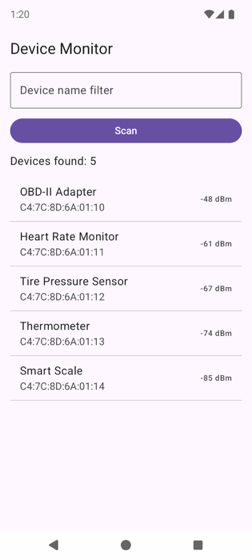
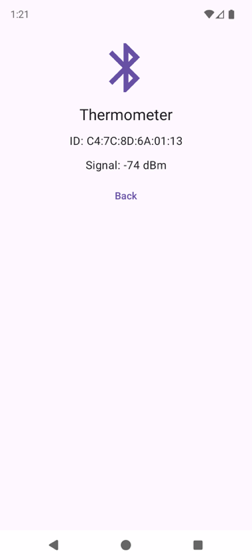
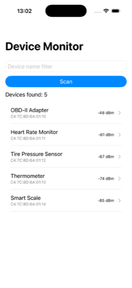
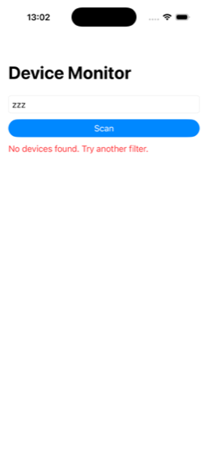

# UI declarative: danh sách, bất đồng bộ, điều hướng

<p class="kicker">Bài 07 · Tuần 2 · Ngày 7 · Khoá Native Device Monitor · <a href="https://phongna-inn.github.io/carmd-kmp-course/lessons/07-declarative-ui-lists.html">Bản gốc tiếng Anh</a></p>

<div class="meta">
  <span class="tag">~2,5 giờ · +1 giờ cho mỗi track UI thêm</span>
  <span class="tag">Milestone: m02 khung Device Monitor</span>
  <span class="tag">Cần trước: <a href="../06-ui-declarative-thanh-phan/">06</a></span>
</div>

!!! abstract "Vì sao bài này quan trọng"
    Một lần quét cho ra nhiều thiết bị, chúng tới muộn, và người dùng chạm vào một thiết bị để xem thêm. Mọi màn hình trong Native Device Monitor đều là một kiểu pha trộn của ba thứ đó: một danh sách, một cập nhật tới bất đồng bộ, và một màn hình thứ hai.
    Hôm nay bạn hoàn thành phần khung, milestone **m02**: màn hình của m01 có thêm danh sách kết quả, với các hàng giữ được danh tính của mình, và một màn hình chi tiết mở ra khi chạm vào một hàng.
    Dữ liệu vẫn là lần quét giả từ Kotlin dùng chung. Từ bài 08 một ViewModel dùng chung điều khiển chính màn hình này, và từ bài 13 là một radio BLE thật.

!!! info "Nguồn chính"
    [Lists and grids](https://developer.android.com/develop/ui/compose/lists) của Android cho phần key, và [Processes and threads](https://developer.android.com/guide/components/processes-and-threads) cho luật main thread (cả hai đều ngắn).
    Người học iOS đọc thêm trang [NavigationStack](https://developer.apple.com/documentation/swiftui/navigationstack) của Apple.

!!! info "Track"
    Phần khái niệm (mục 2, 3 và 4) giống nhau trên mọi track. Các màn hình thì khác theo track, và XML Views với UIKit giữ kỷ luật `render()` từ bài 06.
    Bài này có hai nhóm tab: **Compose** / **XML** cho Android và **SwiftUI** / **UIKit** cho iOS; chọn một tab là mọi tab cùng tên trên trang đổi theo.
    Mỗi đoạn trích chỉ hiện những dòng mà phần ghi chú giải thích; các file đầy đủ nằm ở mục [File đầy đủ](#file-ay-u) cuối trang.

## Thay đổi so với m01

m01 có một màn hình cho biết lần quét tìm thấy bao nhiêu thiết bị. m02 là app hai màn hình, nên các file được sắp xếp lại.
Code màn hình của m01 trở thành **màn hình danh sách**, trong một file mới giữ nguyên ô lọc, nút Scan và dòng trạng thái, và thêm các hàng. Icon tiêu đề chuyển sang màn hình chi tiết. Brief ở cuối bài liệt kê chính xác những file m01 cần xoá.

| Cái gì | m01 | m02 |
|---|---|---|
| màn hình | một: ô lọc, Scan, trạng thái | hai: màn hình danh sách (ô lọc, Scan, trạng thái, các hàng) và một màn hình chi tiết |
| state giữ lại sau một lần quét | tìm thấy bao nhiêu thiết bị | tìm thấy những thiết bị nào |
| Kotlin dùng chung | `matching(filter)` | thêm `find(id)` |
| điều hướng | không có | một back stack với hai màn hình |

## 1. Kết quả là state, và tra cứu theo id

Một danh sách cần chính các thiết bị, nên state đổi từ một con số thành các kết quả: một danh sách là `null` trước lần quét đầu (để màn hình vẫn phân biệt được "chưa quét bao giờ" với "đã quét, không thấy gì") và có thể rỗng sau đó. Dòng trạng thái vẫn được suy ra từ nó: "Devices found: N" là kích thước của danh sách.

Kotlin dùng chung có thêm một hàm, `find(id)`. Nó trả về thiết bị có id đó, hoặc `null`. Hai chỗ dùng nó ở bên dưới: Compose cần nó để dựng lại các hàng từ các id đã lưu, và màn hình chi tiết cần nó để hiện một thiết bị chỉ từ id của nó.

```kotlin title="shared/src/commonMain/kotlin/com/example/devicemonitor/SampleDevices.kt" hl_lines="2"
⋯ package, the five sample devices, matching()
    fun find(id: String): Device? = all.firstOrNull { it.id == id }
}
```

Swift gọi nó là `SampleDevices.shared.find(id: deviceId)`. Nó trả về `Device?`, Swift thấy là một optional, nên code Swift mở nó bằng `if let`.

=== "Compose"

    ```kotlin title="androidApp/src/main/java/com/example/devicemonitor/android/DeviceListScreen.kt" hl_lines="4 6 12 16 19 23"
    ⋯ package and imports
    // Stateful: owns the screen's state and the scan side effect.
    @Composable
    fun DeviceListScreen(onDeviceClick: (Device) -> Unit) {
        var filter by rememberSaveable { mutableStateOf("") }
        var foundIds by rememberSaveable { mutableStateOf<List<String>?>(null) }
        var isScanning by remember { mutableStateOf(false) }
        val scope = rememberCoroutineScope()

        DeviceListContent(
    ⋯ filter, onFilterChange, isScanning
            devices = foundIds?.mapNotNull { SampleDevices.find(it) },
            onScan = {
                val query = filter
                isScanning = true
                foundIds = null
                scope.launch {
                    delay(1_500)
                    foundIds = SampleDevices.matching(query).map { it.id }
                    isScanning = false
                }
            },
            onDeviceClick = onDeviceClick,
        )
    ```

    1. **State giữ id, không giữ thiết bị.** `rememberSaveable` lưu những kiểu mà một `Bundle` chứa được: chuỗi, số, Parcelable. Một danh sách chuỗi id đủ điều kiện, và bản build của chúng tôi giữ được nó qua lần xoay máy. Một `Device` Kotlin từ code dùng chung không thuộc các kiểu đó, và muốn lưu nó sẽ cần một `Saver` tự viết.
    2. **`devices` được suy ra** ở mỗi lần recomposition: `find` biến mỗi id đã lưu trở lại thành thiết bị của nó. Các id là nguồn sự thật duy nhất, và các hàng được tính từ chúng, như dòng trạng thái ở m01.
    3. **`onScan`** là handler của m01 với id thay cho con số: nó xoá kết quả một cách đồng bộ (`foundIds = null`), rồi chờ, rồi lưu id của các thiết bị khớp. `val query = filter` vẫn chụp chuỗi lọc tại lúc bấm.
    4. **`onDeviceClick`** là một sự kiện mới, được chuyển lên nguyên vẹn. Màn hình danh sách báo "thiết bị này vừa được chạm" và không biết chuyện gì xảy ra tiếp theo. Mục 4 cho thấy ai quyết định.
    5. Lớp bọc stateful và phần content stateless vẫn là hai hàm (`DeviceListScreen` và `DeviceListContent`), cùng cách tách như `DeviceMonitorScreen` và `DeviceMonitorContent` ở m01. Ở bài 08 một ViewModel dùng chung thay lớp bọc, và hàm content không đổi.

=== "XML"

    ```kotlin title="androidApp/src/main/java/com/example/devicemonitor/android/DeviceListFragment.kt" hl_lines="4 7 9 14 19 23"
    ⋯ package and imports
    class DeviceListFragment : Fragment() {
        // Screen state lives in fields; render() copies it into the views.
        private var foundIds: ArrayList<String>? = null
        private var isScanning = false
    ⋯ binding and adapter
        override fun onCreate(savedInstanceState: Bundle?) {
            super.onCreate(savedInstanceState)
            foundIds = savedInstanceState?.getStringArrayList("foundIds")
        }
    ⋯ onCreateView and onDestroyView
        override fun onSaveInstanceState(outState: Bundle) {
            super.onSaveInstanceState(outState)
            outState.putStringArrayList("foundIds", foundIds)
        }

        private fun scan(query: String) {
            isScanning = true
            foundIds = null
            render()
            lifecycleScope.launch {
                delay(1_500)
                foundIds = ArrayList(SampleDevices.matching(query).map { it.id })
    ⋯ isScanning = false, render()
    ```

    ```kotlin title="androidApp/src/main/java/com/example/devicemonitor/android/DeviceListFragment.kt" hl_lines="4 5 15"
    ⋯ the state, onCreate, onSaveInstanceState and scan()
        // The one place that touches views: every state change ends here.
        private fun render() {
            val b = binding ?: return
            val devices = foundIds?.mapNotNull { SampleDevices.find(it) }
            b.scanButton.isEnabled = !isScanning
            b.progress.visibility = if (isScanning) View.VISIBLE else View.GONE
            b.statusText.text = when {
                isScanning -> "Scanning…"
                devices == null -> "Tap Scan to look for devices."
                devices.isEmpty() -> "No devices found. Try another filter."
                else -> "Devices found: ${devices.size}"
            }
            b.statusText.setTextColor(if (devices?.isEmpty() == true) Color.RED else Color.DKGRAY)
            adapter.submitList(devices.orEmpty())
        }
    ```

    1. **State là hai field:** `foundIds` và `isScanning`. Các view là một *bản sao* của nó, và `render()` là hàm duy nhất ghi vào view, như ở m01. Giờ state giữ id của các thiết bị tìm thấy thay vì một con số.
    2. **`onSaveInstanceState` + `getStringArrayList`** là `rememberSaveable` làm bằng tay: kết quả sống sót qua lần xoay máy dưới dạng một danh sách id. `EditText` tự lưu chữ của nó, vì nó có id. Một `Bundle` chứa chuỗi, không chứa `Device` của chúng ta, nên `render()` biến các id trở lại thành thiết bị bằng `find`.
    3. **`scan()`** đặt state và render một cách *đồng bộ*, rồi launch phần chậm trong `lifecycleScope` của Fragment. Scope đó sống lâu bằng Fragment, không phải bằng các view của nó. Nên một lần quét bắt đầu trước khi bạn mở màn hình chi tiết sẽ chạy xong trong lúc bạn ở đó, và kết quả hiện ra khi bạn quay lại. Xoay máy huỷ Fragment và huỷ việc quét (mục 5).
    4. **`binding` nullable.** Một Fragment sống lâu hơn các view của nó: khi bạn điều hướng sang màn hình chi tiết, Fragment vẫn nằm trong back stack nhưng `onDestroyView` chạy. `render()` return sớm khi không có view. Khi bạn quay lại, `onCreateView` dựng view mới và gọi `render()`, nên chúng hiện đúng state hiện tại.
    5. **Dòng cuối của `render()`** đưa danh sách suy ra cho adapter. Mục 2 nói adapter làm gì với nó.

!!! info "XML vs Compose · cái gì đổi và vì sao"
    Cùng state, cùng luật, khác cách ép buộc. Compose chạy lại `DeviceListContent` mỗi khi state đổi, nên không thể có chuyện quên một lần cập nhật.
    Trong XML, không gì ngăn một click listener gán thẳng `statusText` và bỏ qua `render()`. Dòng `rememberSaveable` thành ba mẩu trong XML (`onCreate`, `onSaveInstanceState`, field). Fragment còn cần màn "binding nullable", vì view của nó chết trước nó.

=== "SwiftUI"

    ```swift title="iosApp/iosApp/DeviceListView.swift" hl_lines="4 10 13"
    ⋯ imports
    struct DeviceListView: View {
        @State private var filter = ""
        @State private var devices: [Device]? = nil
        @State private var isScanning = false
    ⋯ body
        private func scan() {
            let query = filter
            isScanning = true
            devices = nil
            Task {
                try? await Task.sleep(for: .seconds(1.5))
                devices = SampleDevices.shared.matching(filter: query)
                isScanning = false
            }
        }
    ```

    ```swift title="iosApp/iosApp/DeviceListView.swift" hl_lines="4 9"
    ⋯ DeviceListView
    private struct ScanStatus: View {
        let isScanning: Bool
        let devices: [Device]?

        var body: some View {
            if isScanning {
    ⋯ the spinner
            } else if let devices {
                if devices.isEmpty {
                    Text("No devices found. Try another filter.")
                        .foregroundStyle(.red)
                } else {
                    Text("Devices found: \(devices.count)")
                }
            } else {
                Text("Tap Scan to look for devices.")
            }
        }
    }
    ```

    1. **State giữ chính các thiết bị.** `devices: [Device]?` dùng `nil` cho "chưa quét bao giờ". Khác saved state của Android, `@State` không bị ép đi qua một `Bundle`, nên không cần đổi gì sang id.
    2. **`scan()`** đổi state một cách đồng bộ, rồi bắt đầu một `Task` cho việc chờ. Một `View` là `@MainActor`, nên `Task` thừa hưởng main actor, và các lần ghi sau `await` xảy ra trên main thread (mục 3).
       Nó là một unstructured task (bài 02): rời màn hình không huỷ nó. Ở đây điều đó vô hại, vì danh sách là màn hình gốc. Bài 08 chuyển việc quét vào một ViewModel sở hữu vòng đời của nó.
    3. **`ScanStatus`** là view trạng thái của m01 với `devices` thay cho `foundCount`: một `if`/`else` trên state. Con số là `devices.count`, được suy ra mỗi lần.

=== "UIKit"

    ```swift title="iosApp/iosApp/DeviceListViewController.swift" hl_lines="4 10 14"
    ⋯ imports
    final class DeviceListViewController: UIViewController, UITableViewDelegate {
        // Screen state lives in properties; render() copies it into the views.
        private var devices: [Device]? = nil
        private var isScanning = false
    ⋯ views and viewDidLoad
        private func scan() {
            let query = filterField.text ?? ""
            isScanning = true
            devices = nil
            render()
            Task {
                try? await Task.sleep(for: .seconds(1.5))
                devices = SampleDevices.shared.matching(filter: query)
                isScanning = false
                render()
            }
        }
    ```

    1. **State là hai property**, `devices` và `isScanning`. Các widget là bản sao, và chỉ `render()` ghi vào chúng: kỷ luật declarative làm bằng tay, như ở m01. (Chữ lọc nằm trong chính `UITextField`, và `scan()` đọc nó một lần.) `devices` thay cho `foundCount` của m01, và `nil` vẫn nghĩa là "chưa quét bao giờ".
    2. **`scan()`** đổi state và render một cách đồng bộ, rồi bắt đầu một `Task`. `UIViewController` là `@MainActor`, nên code của task cũng chạy trên main thread sau `await` (mục 3).
    3. **`render()`** gán *mọi* widget từ state, mỗi lần. Nội dung của bảng cũng được gán cùng cách, từ một snapshot (mục 2).

    !!! info "UIKit vs SwiftUI · cái gì đổi và vì sao"
        `@State` của SwiftUI cộng một `body` đọc nó thay cho các property, `render()`, và toàn bộ phần dựng view trong `viewDidLoad` của UIKit. Hàm quét gần như giống hệt nhau ở cả hai.
        Một khác biệt thật: trong SwiftUI chuỗi lọc là state (gắn với ô nhập), còn trong UIKit ô nhập sở hữu nó và bạn đọc nó khi cần.

## 2. Danh sách cần key ổn định

Một widget danh sách tái sử dụng view của các hàng và tạo hiệu ứng khi thêm, di chuyển và xoá. Để làm được việc đó, nó phải biết hàng nào là hàng nào *qua các lần cập nhật*, và vị trí là không đủ.
Mặc định Compose gán key cho mỗi item "theo vị trí của item", nên "các item đổi vị trí thực chất mất mọi state đã được remember". Cho mỗi item "một key ổn định và duy nhất" sẽ sửa được chuyện đó ([Lists and grids](https://developer.android.com/develop/ui/compose/lists)). Mọi track đều dùng `id` của thiết bị.

<figure class="diagram">
<svg class="dg" viewBox="0 0 640 236" role="img" aria-labelledby="l07-keys-title">
<title id="l07-keys-title">Vì sao một danh sách cần key ổn định. Hai khung, mỗi khung có ba hàng trước và sau khi bấm nút Reverse (đảo thứ tự). Trong mỗi khung, hàng của OBD-II Adapter mang một ngôi sao, một mẩu state mà hàng đó remember. Ở khung trái, key là id của thiết bị: sau Reverse, OBD-II Adapter là hàng cuối và ngôi sao đi theo nó. Ở khung phải, key là vị trí của hàng: sau Reverse, ngôi sao ở lại vị trí 1, nên giờ nó nằm trên Tire Pressure Sensor, sai thiết bị.</title>
<defs><marker id="l07-keys-arrow" viewBox="0 0 10 10" refX="9" refY="5" markerWidth="7" markerHeight="7" orient="auto-start-reverse"><path class="arrowhead" d="M0,0 L10,5 L0,10 z"/></marker></defs>
<rect class="box" x="4" y="10" width="312" height="216" rx="8"/>
<text x="18" y="34" font-weight="600">Key = id của thiết bị</text>
<text class="small muted" x="18" y="56">trước</text>
<text class="small muted" x="182" y="56">sau Reverse</text>
<rect class="box" x="12" y="64" width="142" height="30" rx="5"/><text class="small" x="22" y="83">★ OBD-II Adapter</text>
<rect class="box" x="166" y="64" width="142" height="30" rx="5"/><text class="small" x="176" y="83">Tire Pressure Sensor</text>
<rect class="box" x="12" y="100" width="142" height="30" rx="5"/><text class="small" x="22" y="119">Heart Rate Monitor</text>
<rect class="box" x="166" y="100" width="142" height="30" rx="5"/><text class="small" x="176" y="119">Heart Rate Monitor</text>
<rect class="box" x="12" y="136" width="142" height="30" rx="5"/><text class="small" x="22" y="155">Tire Pressure Sensor</text>
<rect class="box" x="166" y="136" width="142" height="30" rx="5"/><text class="small" x="176" y="155">★ OBD-II Adapter</text>
<path class="edge" d="M156,115 L164,115" marker-end="url(#l07-keys-arrow)"/>
<text class="small" x="18" y="192">Ngôi sao đi theo thiết bị.</text>
<text class="small muted" x="18" y="210">Danh sách khớp các hàng theo id.</text>
<rect class="box" x="324" y="10" width="312" height="216" rx="8"/>
<text x="338" y="34" font-weight="600">Key = vị trí</text>
<text class="small muted" x="338" y="56">trước</text>
<text class="small muted" x="502" y="56">sau Reverse</text>
<rect class="box" x="332" y="64" width="142" height="30" rx="5"/><text class="small" x="342" y="83">★ OBD-II Adapter</text>
<rect class="box" x="486" y="64" width="142" height="30" rx="5"/><text class="small" x="496" y="83">★ Tire Pressure Sensor</text>
<rect class="box" x="332" y="100" width="142" height="30" rx="5"/><text class="small" x="342" y="119">Heart Rate Monitor</text>
<rect class="box" x="486" y="100" width="142" height="30" rx="5"/><text class="small" x="496" y="119">Heart Rate Monitor</text>
<rect class="box" x="332" y="136" width="142" height="30" rx="5"/><text class="small" x="342" y="155">Tire Pressure Sensor</text>
<rect class="box" x="486" y="136" width="142" height="30" rx="5"/><text class="small" x="496" y="155">OBD-II Adapter</text>
<path class="edge" d="M476,115 L484,115" marker-end="url(#l07-keys-arrow)"/>
<text class="small" x="338" y="192">Ngôi sao ở lại vị trí 1.</text>
<text class="small muted" x="338" y="210">Giờ nó nằm trên sai thiết bị.</text>
</svg>
<figcaption>State đã remember của một hàng thuộc về key của hàng đó. Key là id thì nó đi theo thiết bị. Key là vị trí thì nó ở lại chỗ cũ.</figcaption>
</figure>

!!! info "Từ TypeScript"
    Đây là prop `key` của các item trong danh sách React, hay `track item.id` trong một khối `@for` của Angular. React cảnh báo khi bạn bỏ qua nó.
    Compose, nếu bạn bỏ qua, lặng lẽ dùng vị trí thay vào, và bug chỉ lộ ra khi các item đổi vị trí: một lần thêm, một lần xoá (một chuỗi lọc mới) hoặc một lần sắp xếp lại.

| Track | Key đặt ở đâu |
|---|---|
| Compose | `items(devices, key = { it.id })` trong `LazyColumn` |
| XML | `DiffUtil.ItemCallback.areItemsTheSame` so id; `areContentsTheSame` so mọi field |
| SwiftUI | `List(devices, id: \.id)`; một kiểu conform `Identifiable` thì không cần `id:` ([Apple: List](https://developer.apple.com/documentation/swiftui/list)) |
| UIKit | *item identifier* của diffable data source chính là các id |

Đừng bao giờ dùng chỉ số mảng làm key. Chỉ số đổi ở mỗi lần thêm, lọc hay sắp xếp. Compose thêm một ràng buộc: key phải là một kiểu mà `Bundle` chứa được, vì `rememberSaveable` bên trong các hàng được khôi phục theo key. Một id `String` đủ điều kiện.

=== "Compose"

    ```kotlin title="androidApp/src/main/java/com/example/devicemonitor/android/DeviceListScreen.kt" hl_lines="2 3 11 15"
    ⋯ DeviceListContent's header, the field, the button and the status
            LazyColumn(modifier = Modifier.weight(1f)) {
                items(devices.orEmpty(), key = { it.id }) { device ->
                    DeviceRow(device = device, onClick = { onDeviceClick(device) })
                    HorizontalDivider()
                }
            }
    ⋯ ScanStatus
    @Composable
    private fun DeviceRow(device: Device, onClick: () -> Unit) {
        ListItem(
            headlineContent = { Text(device.name) },
            supportingContent = { Text(device.id) },
            trailingContent = { Text("${device.rssi} dBm") },
            modifier = Modifier.clickable(onClick = onClick),
        )
    }
    ```

    1. **`LazyColumn`** chỉ compose những hàng đang hiện trên màn hình. `Modifier.weight(1f)` cho nó toàn bộ chiều cao còn lại trong `Column` sau tiêu đề, ô nhập, nút và dòng trạng thái.
    2. **`items(list, key = { it.id })`** là key. `devices.orEmpty()` biến `null` của "chưa quét bao giờ" thành một danh sách rỗng, nên danh sách không hiện gì và dòng trạng thái giải thích vì sao.
    3. **`ListItem`** là hàng của Material 3 với các ô headline, supporting và trailing, và `Modifier.clickable` biến cả hàng thành một vùng chạm.

=== "XML"

    ```kotlin title="androidApp/src/main/java/com/example/devicemonitor/android/DeviceAdapter.kt" hl_lines="4 6 16 17"
    ⋯ package and imports
    class DeviceAdapter(
        private val onClick: (Device) -> Unit,
    ) : ListAdapter<Device, DeviceAdapter.Holder>(DeviceDiff) {
    ⋯ Holder and onCreateViewHolder
        override fun onBindViewHolder(holder: Holder, position: Int) {
            val device = getItem(position)
            holder.binding.deviceName.text = device.name
            holder.binding.deviceId.text = device.id
            holder.binding.deviceRssi.text = "${device.rssi} dBm"
            holder.itemView.setOnClickListener { onClick(device) }
        }
    }

    private object DeviceDiff : DiffUtil.ItemCallback<Device>() {
        override fun areItemsTheSame(oldItem: Device, newItem: Device) = oldItem.id == newItem.id
        override fun areContentsTheSame(oldItem: Device, newItem: Device) = oldItem == newItem
    }
    ```

    ```xml title="androidApp/src/main/res/layout/fragment_device_list.xml" hl_lines="7"
    ⋯ the other views
        <androidx.recyclerview.widget.RecyclerView
            android:id="@+id/deviceList"
            android:layout_width="0dp"
            android:layout_height="0dp"
            android:layout_marginTop="12dp"
            app:layoutManager="androidx.recyclerview.widget.LinearLayoutManager"
            app:layout_constraintStart_toStartOf="parent"
            app:layout_constraintEnd_toEndOf="parent"
            app:layout_constraintTop_toBottomOf="@id/statusText"
            app:layout_constraintBottom_toBottomOf="parent" />
    ```

    1. **`ListAdapter`** là adapter có diff của RecyclerView. Bạn gọi `submitList(newList)` (trong `render()`), nó diff với danh sách cũ trên một background thread, rồi phát ra đúng các cập nhật thêm/di chuyển/xoá. Bạn không bao giờ gọi `notifyDataSetChanged()`.
    2. **`DeviceDiff`** trả lời hai câu hỏi: cùng item (cùng id)? Cùng nội dung (so bằng data class)? Câu đầu là key. Câu sau quyết định một hàng có cần bind lại hay không.
    3. **ViewHolder** giữ binding của một hàng. `onCreateViewHolder` inflate một hàng (hiếm khi: các hàng được tái chế). `onBindViewHolder` đổ thiết bị ở vị trí đó vào một hàng được tái chế, mỗi lần một hàng cuộn vào màn hình.
    4. **Layout manager** được đặt trong XML layout (`app:layoutManager`). Một RecyclerView không có nó thì không hiện gì. Đường kẻ giữa các hàng đến từ `DividerItemDecoration` được thêm trong `onCreateView`; mặc định RecyclerView không vẽ đường kẻ nào.
    5. **`adapter = null` trong `onDestroyView`** (trong file đầy đủ). Adapter là một field của Fragment. Khi một RecyclerView được gán adapter, nó đăng ký chính nó làm observer của adapter. Không có dòng này, Fragment nằm trong back stack sẽ giữ danh sách đã bị huỷ sống tiếp thông qua adapter.

<!-- iOS -->

=== "SwiftUI"

    ```swift title="iosApp/iosApp/DeviceListView.swift" hl_lines="2"
    ⋯ the field, the button and the status
                List(devices ?? [], id: \.id) { device in
                    NavigationLink(value: DeviceRoute(id: device.id)) {
                        DeviceRow(device: device)
                    }
                }
                .listStyle(.plain)
    ⋯ the rest of body and scan()
    private struct DeviceRow: View {
        let device: Device

        var body: some View {
            HStack {
                VStack(alignment: .leading) {
                    Text(device.name)
                    Text(device.id)
                        .font(.caption)
                        .foregroundStyle(.secondary)
                }
                Spacer()
                Text("\(device.rssi) dBm")
                    .font(.caption)
            }
        }
    }
    ```

    1. **`List(devices ?? [], id: \.id)`** là key. `\.id` là một key path tới `id` của mỗi thiết bị. `Device` đến từ Kotlin và không conform `Identifiable`, nên key path được truyền tường minh.
    2. **`devices ?? []`** biến `nil` của "chưa quét bao giờ" thành một danh sách rỗng.
    3. Mỗi hàng là một `NavigationLink` (mục 4), thứ thêm dấu mũi tên chevron. `DeviceRow` là một view thường: một `HStack` với một `VStack` hai dòng, một `Spacer` và cường độ tín hiệu.

=== "UIKit"

    ```swift title="iosApp/iosApp/DeviceListViewController.swift" hl_lines="2 5 15 17 18"
    ⋯ state and views
        private lazy var dataSource = UITableViewDiffableDataSource<Int, String>(tableView: tableView) {
            tableView, indexPath, deviceId in
            let cell = tableView.dequeueReusableCell(withIdentifier: "device", for: indexPath)
            var content = UIListContentConfiguration.subtitleCell()
            if let device = SampleDevices.shared.find(id: deviceId) {
                content.text = device.name
                content.secondaryText = "\(device.id)   \(device.rssi) dBm"
            }
            cell.contentConfiguration = content
            cell.accessoryType = .disclosureIndicator
            return cell
        }
    ⋯ viewDidLoad, scan() and the status part of render()
            var snapshot = NSDiffableDataSourceSnapshot<Int, String>()
            snapshot.appendSections([0])
            snapshot.appendItems((devices ?? []).map(\.id))
            dataSource.apply(snapshot, animatingDifferences: true)
    ```

    1. **`UITableViewDiffableDataSource<Int, String>`**: section identifier là `Int` (một section, `0`), và item identifier là các `String` id của thiết bị, nên key *chính là* item. Closure dựng một cell cho một id ([Apple: UITableViewDiffableDataSource](https://developer.apple.com/documentation/uikit/uitableviewdiffabledatasource)).
    2. **Trong `render()`**, bạn dựng một `NSDiffableDataSourceSnapshot` mới từ state và `apply` nó. UIKit diff các snapshot và tạo hiệu ứng cho các thay đổi. Đó là ý tưởng declarative bên trong một toolkit imperative.
    3. `UIListContentConfiguration.subtitleCell()` là cell hai dòng chuẩn. `dequeueReusableCell` tái chế cell, như ViewHolder của RecyclerView.
    4. **`lazy var`**: data source cần `tableView`, nên nó được tạo ở lần dùng đầu tiên, sau khi các property đã tồn tại.

## 3. Cập nhật bất đồng bộ và luật main thread

Mọi UI toolkit ở đây đều đơn luồng. Hai luật của Android là "Đừng chặn UI thread" và "Đừng truy cập Android UI toolkit từ ngoài UI thread", vì "Android UI toolkit *không* thread-safe" ([Processes and threads](https://developer.android.com/guide/components/processes-and-threads)).
Trên iOS, `UIViewController` và `View` của SwiftUI là `@MainActor`, và compiler Swift 6 kiểm tra điều đó (bài 02). Việc quét bạn viết ở mục 1 theo đúng cả hai luật: `delay` và `Task.sleep` *suspend* mà không chặn thread nào, và các lần cập nhật state sau chúng chạy trên main thread.

<figure class="diagram">
<svg class="dg" viewBox="0 0 640 262" role="img" aria-labelledby="l07-async-title">
<title id="l07-async-title">Một lần quét theo thời gian, trên ba làn. Trên main thread, handler của lần chạm đặt isScanning thành true, xoá kết quả và render. Coroutine quét rồi chờ trong delay 1,5 giây: nó đang suspend và không giữ thread nào, nên main thread rảnh để vẽ frame và nhận chạm. Khi delay hết, coroutine tiếp tục trên main thread, gán kết quả, đặt isScanning thành false, và render. Làn thứ ba, một background thread, là nơi việc chậm sẽ chạy và nơi một số callback của radio tới. Kết quả của nó phải được chuyển về main thread trước khi đụng tới UI state.</title>
<defs><marker id="l07-async-arrow" viewBox="0 0 10 10" refX="9" refY="5" markerWidth="7" markerHeight="7" orient="auto-start-reverse"><path class="arrowhead" d="M0,0 L10,5 L0,10 z"/></marker></defs>
<text x="14" y="58" font-weight="600">Main thread</text>
<text x="14" y="130" font-weight="600">Coroutine quét</text>
<text x="14" y="202" font-weight="600">Background thread</text>
<rect class="box" x="140" y="34" width="110" height="38" rx="5"/>
<text class="small" x="150" y="51">handler chạm</text><text class="small muted" x="150" y="65">state, rồi render</text>
<rect class="box" x="250" y="34" width="210" height="38" rx="5"/>
<text class="small" x="262" y="51">rảnh: vẽ frame, nhận chạm</text><text class="small muted" x="262" y="65">không gì bị chặn</text>
<rect class="box" x="460" y="34" width="110" height="38" rx="5"/>
<text class="small" x="470" y="51">handler kết quả</text><text class="small muted" x="470" y="65">state, rồi render</text>
<rect class="box" x="250" y="106" width="210" height="38" rx="5"/>
<text class="mono small" x="262" y="123">delay(1_500)</text><text class="small muted" x="262" y="137">suspend: không giữ thread</text>
<path class="edge" d="M240,72 L240,104 L248,104" marker-end="url(#l07-async-arrow)"/>
<text class="small muted" x="148" y="100">launch</text>
<path class="edge" d="M462,106 L462,74" marker-end="url(#l07-async-arrow)"/>
<text class="small muted" x="454" y="100" text-anchor="end">tiếp tục trên main</text>
<rect class="box" x="250" y="178" width="210" height="38" rx="5" stroke-dasharray="5 4"/>
<text class="small" x="262" y="195">việc ngoài main thread</text><text class="small muted" x="262" y="209">(việc chậm, callback radio BLE)</text>
<path class="edge dashed" d="M462,178 L520,178 L520,74" marker-end="url(#l07-async-arrow)"/>
<text class="small muted" x="530" y="140">chuyển kết quả</text><text class="small muted" x="530" y="154">về main</text>
<line class="axis" x1="140" y1="238" x2="590" y2="238"/>
<text class="small muted" x="140" y="254">thời gian →</text>
<text class="small" x="300" y="254">Việc chậm ngoài main thread, UI state đăng trên main.</text>
</svg>
<figcaption>Trong lúc coroutine chờ, không gì giữ main thread. Hai lần đổi state (bắt đầu và kết thúc) đều chạy trên nó.</figcaption>
</figure>

Để xem mỗi toolkit làm gì khi bạn phá luật thứ hai, chúng tôi chuyển lần cập nhật sau khi quét sang một background thread trên từng track:

| Track | Chúng tôi đổi gì | Chuyện gì xảy ra |
|---|---|---|
| Compose | `withContext(Dispatchers.Default) { foundIds = … }` | Không crash. Danh sách cập nhật (lần ghi chạy trên `DefaultDispatcher-worker-1`). State của Compose chịu được chuyện đó, nhưng đừng xây dựa vào nó: ViewModel dùng chung của bài 08 đăng UI state trên main thread. |
| XML | `withContext(Dispatchers.Default) { render() }` | **Crash:** `CalledFromWrongThreadException: Only the original thread that created a view hierarchy can touch its views. Expected: main Calling: DefaultDispatcher-worker-1` |
| SwiftUI | `Task.detached { devices = … }` | **Warning** của compiler (chế độ Swift 6): `main actor-isolated property 'devices' can not be mutated from a nonisolated context`. Nó chỉ là warning vì view lấy main-actor isolation từ `View`, thứ SwiftUI khai báo `@preconcurrency`: một property wrapper tự viết ở cùng chỗ cũng bị cùng warning đó, và trong một struct được đánh dấu `@MainActor` trực tiếp thì cùng lần ghi đó là một error. Khoá này coi warning là error. |
| UIKit | `Task.detached { self.render() }` | **Error** của compiler: `main actor-isolated instance method 'render()' cannot be called from outside of the actor` |

Luật mang theo về sau: **làm việc chậm ngoài main thread, và đăng UI state trên main thread.**
Trong các bài BLE, callback của radio có thể tới trên những thread khác main thread, và chúng phải quay về main thread trước khi UI thấy chúng. Từ bài 08 đó là việc của ViewModel dùng chung: nó đăng UI state trên main thread, bất kể dữ liệu đến từ thread nào.

!!! info "Từ TypeScript"
    Trình duyệt cũng có một UI thread, và `await` không chặn nó, y như `delay` và `Task.sleep` ở đây. Khác nhau ở chỗ rời thread đó dễ tới mức nào.
    JavaScript của một trang web không có thread nào khác đụng được vào trang (một Worker không chạm được DOM), còn trên Android và iOS một thread khác chỉ cách một lời gọi (`Dispatchers.Default`, `Task.detached`) và chạm được vào các object UI. Đó là lý do các nền tảng này có một luật viết thành văn, và vì sao Swift 6 ép nó trong compiler.

## 4. Màn hình thứ hai: điều hướng là một back stack

Mọi hệ thống điều hướng ở đây đều là một **back stack**: màn hình gốc ở dưới đáy, các màn hình được push nằm trên, Back pop một cái. Hai ý dùng được trên mọi track:

- **Route là một giá trị.** Bạn điều hướng bằng cách push một giá trị nhỏ mô tả đích đến (`DeviceDetail(id)`, `DeviceRoute(id:)`, một `Bundle` có `deviceId`), và hệ thống ánh xạ nó sang một màn hình.
- **Truyền id, không truyền object.** Android phải lưu được route (process bị kill, xoay máy), nên route chứa những giá trị nhỏ lưu được. Màn hình chi tiết sau đó tra thiết bị từ nguồn sự thật duy nhất (`SampleDevices.find`). State duy nhất của màn hình chi tiết là `deviceId`, và mọi thứ nó hiện được suy ra từ đó.

<figure class="diagram">
<svg class="dg" viewBox="0 0 640 172" role="img" aria-labelledby="l07-nav-title">
<title id="l07-nav-title">Back stack qua ba bước. Lúc mở app stack có một màn hình, danh sách thiết bị. Chạm vào một hàng push một route chi tiết mang id của thiết bị, nên stack có danh sách và màn hình chi tiết nằm trên. Bấm Back pop màn hình chi tiết, và stack lại chỉ có danh sách, với chuỗi lọc và kết quả của người dùng vẫn còn. Giá trị route khác nhau theo track: data class DeviceDetail trong Compose, một Bundle có deviceId trong XML, struct DeviceRoute trong SwiftUI, và tham số của initializer trong UIKit.</title>
<defs><marker id="l07-nav-arrow" viewBox="0 0 10 10" refX="9" refY="5" markerWidth="7" markerHeight="7" orient="auto-start-reverse"><path class="arrowhead" d="M0,0 L10,5 L0,10 z"/></marker></defs>
<text class="small muted" x="30" y="20">1 · mở app</text>
<text class="small muted" x="245" y="20">2 · chạm một hàng: push</text>
<text class="small muted" x="470" y="20">3 · Back: pop</text>
<rect class="box" x="30" y="76" width="150" height="38" rx="5"/><text class="small" x="42" y="99">DeviceList</text>
<rect class="box" x="245" y="76" width="150" height="38" rx="5"/><text class="small" x="257" y="99">DeviceList</text>
<rect class="box" x="245" y="32" width="150" height="38" rx="5"/><text class="mono small" x="257" y="48">DeviceDetail(id)</text><text class="small muted" x="257" y="63">đỉnh stack</text>
<rect class="box" x="470" y="76" width="150" height="38" rx="5"/><text class="small" x="482" y="99">DeviceList</text>
<path class="edge" d="M182,95 L243,95" marker-end="url(#l07-nav-arrow)"/>
<path class="edge" d="M397,95 L468,95" marker-end="url(#l07-nav-arrow)"/>
<text class="small muted" x="190" y="88">push</text>
<text class="small muted" x="418" y="88">pop</text>
<text class="small muted" x="30" y="136">đáy stack: màn hình gốc</text>
<text class="small muted" x="470" y="136">chuỗi lọc và kết quả vẫn còn</text>
<text class="small" x="30" y="160">Giá trị route: Compose DeviceDetail(id) · XML Bundle("deviceId") · SwiftUI DeviceRoute(id:) · UIKit init(deviceId:)</text>
</svg>
<figcaption>Push một giá trị nhỏ gọi tên đích đến, pop để quay lại. Màn hình bên dưới vẫn còn đó.</figcaption>
</figure>

!!! info "Từ TypeScript"
    Back stack là history stack của trình duyệt, và một route là một URL có tham số, như `/devices/:id`. Màn hình chi tiết đọc `:id` và tra thiết bị, như một trang web sẽ làm.

=== "Compose"

    ```kotlin title="build.gradle.kts" hl_lines="2"
    ⋯ plugins { and the four plugins from m00
        id("org.jetbrains.kotlin.plugin.serialization") version "2.4.21" apply false
    }
    ```

    ```kotlin title="androidApp/build.gradle.kts" hl_lines="4 9 10 11"
    plugins {
        id("com.android.application")
        id("org.jetbrains.kotlin.plugin.compose")
        id("org.jetbrains.kotlin.plugin.serialization")
    }
    ⋯ android { }
    dependencies {
    ⋯ project(":shared"), compose-bom, core-ktx, activity-compose, material3
        implementation("androidx.navigation:navigation-compose:2.10.2")
        implementation("androidx.lifecycle:lifecycle-runtime-compose:2.11.0")
        implementation("org.jetbrains.kotlinx:kotlinx-serialization-core:1.12.0")
    }
    ```

    ```kotlin title="androidApp/src/main/java/com/example/devicemonitor/android/DeviceMonitorApp.kt" hl_lines="3 6"
    ⋯ package and imports
    @Serializable
    data object DeviceList

    @Serializable
    data class DeviceDetail(val id: String)
    ```

    ```kotlin title="androidApp/src/main/java/com/example/devicemonitor/android/DeviceMonitorApp.kt" hl_lines="4 5 7 8 9 11 13 16 17 20"
    ⋯ routes
    @Composable
    fun DeviceMonitorApp() {
        val navController = rememberNavController()
        Scaffold { innerPadding ->
            NavHost(
                navController = navController,
                startDestination = DeviceList,
                modifier = Modifier.padding(innerPadding),
            ) {
                composable<DeviceList> {
                    DeviceListScreen(
                        onDeviceClick = { device -> navController.navigate(DeviceDetail(device.id)) },
                    )
                }
                composable<DeviceDetail> { entry ->
                    val route: DeviceDetail = entry.toRoute()
                    DeviceDetailScreen(
                        deviceId = route.id,
                        onBack = { navController.popBackStack() },
                    )
                }
            }
        }
    }
    ```

    ```kotlin title="androidApp/src/main/java/com/example/devicemonitor/android/DeviceDetailScreen.kt" hl_lines="3 4 9 10 16"
    ⋯ package and imports
    @Composable
    fun DeviceDetailScreen(deviceId: String, onBack: () -> Unit) {
        val device = SampleDevices.find(deviceId)
        Column(
    ⋯ modifier and arrangement
        ) {
    ⋯ the Bluetooth icon
            if (device == null) {
                Text("Unknown device", color = MaterialTheme.colorScheme.error)
            } else {
                Text(device.name, style = MaterialTheme.typography.headlineSmall)
                Text("ID: ${device.id}")
                Text("Signal: ${device.rssi} dBm")
            }
            TextButton(onClick = dropUnlessResumed { onBack() }) {
                Text("Back")
            }
        }
    }
    ```

    ```kotlin title="androidApp/src/main/java/com/example/devicemonitor/android/MainActivity.kt" hl_lines="8"
    ⋯ package and the other imports
    class MainActivity : ComponentActivity() {
        override fun onCreate(savedInstanceState: Bundle?) {
            enableEdgeToEdge()
            super.onCreate(savedInstanceState)
            setContent {
                MaterialTheme {
                    DeviceMonitorApp()
                }
            }
        }
    }
    ```

    1. **Route là các kiểu `@Serializable`**: một object cho màn hình không có tham số, một data class cho màn hình có tham số. Việc đó cần plugin Kotlin serialization (cùng phiên bản với Kotlin) và `kotlinx-serialization-core` ([Navigation setup](https://developer.android.com/guide/navigation#set-up), [type safety](https://developer.android.com/guide/navigation/design/type-safety)). Chúng ta tự khai báo thư viện serialization vì code của chúng ta dùng `@Serializable` trực tiếp.
    2. **`NavHost(navController, startDestination = DeviceList)`** là thùng chứa của back stack. `composable<DeviceDetail> { entry -> … }` ánh xạ một kiểu route sang một màn hình, và `entry.toRoute()` trả lại route có kiểu kèm `id` của nó.
    3. **`navController.navigate(DeviceDetail(device.id))`** push. Màn hình danh sách không biết gì về NavController: nó chỉ báo `onDeviceClick` (sự kiện đi lên). Composable của app quyết định một lần chạm nghĩa là gì.
    4. **`Scaffold`** cung cấp `innerPadding` cho các thanh hệ thống, và `Modifier.padding(innerPadding)` giữ cả hai màn hình không nằm dưới chúng. Màn hình của m01 tự làm việc này bằng `safeDrawingPadding()`.
    5. **`dropUnlessResumed { onBack() }`** bỏ qua lần chạm trừ khi màn hình đang resumed hoàn toàn. Không có nó, một lần chạm đúp nhanh vào Back pop hai lần và để lại một **màn hình trắng** (mục 6). Back của hệ thống (cử chỉ hoặc nút) được chính `NavHost` xử lý.
    6. **Màn hình chi tiết không có state riêng**: nó suy ra mọi thứ từ `deviceId`. Nếu id không biết, nó hiện lỗi thay vì crash. Icon Bluetooth là icon tiêu đề của m01, giờ nằm trên màn hình này (file `res/drawable/ic_bluetooth.xml` không đổi).

    !!! note "Navigation Compose vs Navigation 3"
        Google cũng phát hành **Navigation 3** (stable). Trong Nav3 back stack là một danh sách bạn sở hữu: bạn tự thêm và xoá key, đúng mô hình `NavigationStack(path:)` của SwiftUI ([Navigation 3](https://developer.android.com/guide/navigation/navigation-3)).
        Hướng dẫn điều hướng chính của Google vẫn nói "Nếu app của bạn được xây hoàn toàn bằng Jetpack Compose, hãy dùng Navigation Compose" ([Navigation](https://developer.android.com/guide/navigation)), nên khoá này dùng Navigation Compose. Các khái niệm (route là giá trị, id chứ không phải object, một back stack) dùng lại được nguyên vẹn.

=== "XML"

    ```kotlin title="androidApp/build.gradle.kts" hl_lines="5 6 7"
    ⋯ plugins, android { }
    dependencies {
        implementation(project(":shared"))
    ⋯ core-ktx, appcompat, constraintlayout
        implementation("androidx.fragment:fragment-ktx:1.9.1")
        implementation("androidx.recyclerview:recyclerview:1.4.0")
        implementation("androidx.navigation:navigation-fragment:2.10.2")
        implementation("androidx.lifecycle:lifecycle-runtime-ktx:2.11.0")
    }
    ```

    ```xml title="androidApp/src/main/res/layout/activity_main.xml" hl_lines="2 6 9 10"
    ⋯ namespaces and sizes
        android:fitsSystemWindows="true">

        <androidx.fragment.app.FragmentContainerView
            android:id="@+id/navHost"
            android:name="androidx.navigation.fragment.NavHostFragment"
            android:layout_width="match_parent"
            android:layout_height="match_parent"
            app:defaultNavHost="true"
            app:navGraph="@navigation/nav_graph" />
    </FrameLayout>
    ```

    ```xml title="androidApp/src/main/res/navigation/nav_graph.xml" hl_lines="7 14 15"
    ⋯ namespaces and the graph's id
        <fragment
            android:id="@+id/deviceList"
            android:name="com.example.devicemonitor.android.DeviceListFragment">
            <action
                android:id="@+id/toDetail"
                app:destination="@id/deviceDetail" />
        </fragment>

        <fragment
            android:id="@+id/deviceDetail"
            android:name="com.example.devicemonitor.android.DeviceDetailFragment">
            <argument
                android:name="deviceId"
                app:argType="string" />
        </fragment>
    ```

    ```kotlin title="androidApp/src/main/java/com/example/devicemonitor/android/DeviceListFragment.kt" hl_lines="6 7"
    ⋯ package, imports, state
        private var binding: FragmentDeviceListBinding? = null
        private val adapter = DeviceAdapter { device ->
            val nav = findNavController()
            // A fast double tap delivers two clicks; only navigate from the list itself.
            if (nav.currentDestination?.id == R.id.deviceList) {
                nav.navigate(R.id.toDetail, Bundle().apply { putString("deviceId", device.id) })
            }
        }
    ```

    ```kotlin title="androidApp/src/main/java/com/example/devicemonitor/android/DeviceDetailFragment.kt" hl_lines="5 6 17"
    ⋯ package and imports
    class DeviceDetailFragment : Fragment() {
        override fun onCreateView(inflater: LayoutInflater, container: ViewGroup?, savedInstanceState: Bundle?): View {
            val b = FragmentDeviceDetailBinding.inflate(inflater, container, false)
            val deviceId = requireArguments().getString("deviceId").orEmpty()
            val device = SampleDevices.find(deviceId)
            if (device == null) {
                b.deviceName.text = "Unknown device"
            } else {
                b.deviceName.text = device.name
                b.deviceId.text = "ID: ${device.id}"
                b.deviceRssi.text = "Signal: ${device.rssi} dBm"
            }
            b.backButton.setOnClickListener {
                val nav = findNavController()
                // A fast double tap would otherwise pop the list too and empty the back stack.
                if (nav.currentDestination?.id == R.id.deviceDetail) nav.popBackStack()
            }
            return b.root
        }
    }
    ```

    1. **Một Activity, nhiều Fragment.** Giờ `MainActivity` chỉ đặt một layout chứa một `FragmentContainerView` có class là `NavHostFragment`. NavHostFragment đọc `nav_graph.xml` và đổi Fragment ra vào. `defaultNavHost="true"` cho nó xử lý nút Back của hệ thống.
       `MainActivity` của m01 chứa cả màn hình và `render()` của nó; code đó giờ nằm trong `DeviceListFragment`.
    2. **Nav graph** liệt kê các đích đến (mỗi cái là một class Fragment), `startDestination`, một `action` (`toDetail`) và `argument` có kiểu của màn hình chi tiết. Nếu bạn đã thấy file này trong app của team: chỉ start destination xuất hiện lúc mở app, và mọi màn hình khác được tới bằng `navigate()`.
    3. **`navigate(R.id.toDetail, Bundle().apply { putString("deviceId", device.id) })`** push, truyền id trong một `Bundle`. `requireArguments().getString("deviceId")` đọc nó ở phía bên kia.
       Cách viết ngắn hơn `bundleOf("deviceId" to device.id)` bị deprecated trong core-ktx 1.19.1 ("không cung cấp type safety lúc compile") và cho một warning của compiler. Plugin Gradle Safe Args sinh wrapper có kiểu cho các argument; với một argument thì không cần.
    4. **Lớp bọc `FrameLayout` với `fitsSystemWindows="true"`** đẩy mọi thứ ra khỏi vùng thanh hệ thống. Đặt `fitsSystemWindows` lên chính `FragmentContainerView` không có tác dụng gì trong bản build của chúng tôi: danh sách bị vẽ dưới thanh trạng thái (mục 6).
    5. **Fragment chi tiết không có state riêng**: nó đọc argument và đổ vào view một lần. `Bundle` argument của một Fragment được lưu và khôi phục giúp bạn, nên xoay máy không cần thêm code ở đây. (Icon Bluetooth trong `fragment_device_detail.xml` là icon tiêu đề của m01, được tô màu qua `app:tint` của AppCompat.)
    6. **Cả hai đường Back đều có chốt chặn.** Lần chạm hàng chỉ điều hướng khi danh sách là đích hiện tại, và Back chỉ pop khi màn hình chi tiết là đích hiện tại. Không có các kiểm tra này, hai lần chạm nhanh điều hướng hoặc pop hai lần (mục 6).

!!! info "XML vs Compose · cái gì đổi và vì sao"
    Navigation Compose giữ graph trong Kotlin (`composable<Route>`), với route có kiểu được compiler kiểm tra. Bản Fragment giữ nó trong XML, với argument `Bundle` theo key chuỗi được kiểm tra lúc chạy. Cả hai giữ một back stack bên trong một Activity.
    Lớp thêm của bản Fragment (vòng đời Fragment cộng vòng đời view) là lý do `binding` nullable ở đó và vì sao adapter cần được xoá.

=== "SwiftUI"

    ```swift title="iosApp/iosApp/ContentView.swift" hl_lines="5 7 14 15"
    import SwiftUI

    struct ContentView: View {
        var body: some View {
            NavigationStack {
                DeviceListView()
                    .navigationDestination(for: DeviceRoute.self) { route in
                        DeviceDetailView(deviceId: route.id)
                    }
            }
        }
    }

    struct DeviceRoute: Hashable {
        let id: String
    }
    ```

    ```swift title="iosApp/iosApp/DeviceDetailView.swift" hl_lines="3 8 20 21"
    ⋯ imports
    struct DeviceDetailView: View {
        let deviceId: String

        var body: some View {
            VStack(spacing: 12) {
    ⋯ the icon
                if let device = SampleDevices.shared.find(id: deviceId) {
                    Text(device.name)
                        .font(.title2)
                    Text("ID: \(device.id)")
                    Text("Signal: \(device.rssi) dBm")
                } else {
                    Text("Unknown device")
                        .foregroundStyle(.red)
                }
                Spacer()
            }
            .padding()
            .navigationTitle("Device")
            .navigationBarTitleDisplayMode(.inline)
        }
    }
    ```

    1. **`NavigationStack { root }`** sở hữu back stack. `NavigationLink(value: DeviceRoute(id: device.id))` trong danh sách push một giá trị, và `.navigationDestination(for: DeviceRoute.self)` ánh xạ kiểu giá trị đó sang một màn hình. Tài liệu của Apple mô tả đúng cặp này ([Apple: NavigationStack](https://developer.apple.com/documentation/swiftui/navigationstack)).
    2. **`DeviceRoute` là một struct `Hashable`**, anh em sinh đôi bên Swift của `DeviceDetail(id)` trong Compose. Push một `String` trơn cũng chạy. Một kiểu có tên giúp các đích đến không đụng nhau khi có thêm một màn hình thứ hai cũng nhận một `String`.
    3. **`.navigationDestination` đặt bên trong stack**, trên view gốc, không đặt trên chính `NavigationStack`.
    4. Để điều hướng bằng code (deep link, "quay về gốc"), dùng `NavigationStack(path: $path)` với một mảng bạn sở hữu. "Stack thêm item vào collection khi nó thêm view vào stack và xoá item khi nó xoá view" (cùng trang). Chúng ta chưa cần nó.
    5. **View chi tiết không có state riêng**: `deviceId` là tất cả những gì nó giữ, và mọi thứ nó hiện đến từ `find`. `Image(systemName:)` (trong file đầy đủ) là cùng SF Symbol với icon tiêu đề của m01.
    6. Nút back và cử chỉ vuốt để quay lại đi kèm `NavigationStack`, nên không cần code. `.navigationBarTitleDisplayMode(.inline)` giữ tiêu đề màn hình chi tiết nhỏ.
       `.navigationTitle("Device Monitor")` của danh sách giờ là tiêu đề màn hình, thay cho hàng tiêu đề của m01. `iOSApp.swift` lại hiện `ContentView()`, như ở m00.

=== "UIKit"

    ```swift title="iosApp/iosApp/SceneDelegate.swift" hl_lines="3"
    ⋯ imports and the scene delegate's window property
            let window = UIWindow(windowScene: windowScene)
            window.rootViewController = UINavigationController(rootViewController: DeviceListViewController())
            window.makeKeyAndVisible()
    ```

    ```swift title="iosApp/iosApp/DeviceListViewController.swift" hl_lines="4 5 9 10"
    ⋯ state, views and the data source
        override func viewDidLoad() {
            super.viewDidLoad()
            title = "Device Monitor"
            navigationController?.navigationBar.prefersLargeTitles = true
    ⋯ the rest of viewDidLoad, scan() and render()
        func tableView(_ tableView: UITableView, didSelectRowAt indexPath: IndexPath) {
            tableView.deselectRow(at: indexPath, animated: true)
            guard let deviceId = dataSource.itemIdentifier(for: indexPath) else { return }
            navigationController?.pushViewController(DeviceDetailViewController(deviceId: deviceId), animated: true)
        }
    ```

    ```swift title="iosApp/iosApp/DeviceDetailViewController.swift" hl_lines="3 5 10 15 17"
    ⋯ imports
    final class DeviceDetailViewController: UIViewController {
        private let deviceId: String

        init(deviceId: String) {
            self.deviceId = deviceId
            super.init(nibName: nil, bundle: nil)
        }

        required init?(coder: NSCoder) { fatalError("not used") }

        override func viewDidLoad() {
            super.viewDidLoad()
            title = "Device"
            navigationItem.largeTitleDisplayMode = .never
    ⋯ the labels
            if let device = SampleDevices.shared.find(id: deviceId) {
                nameLabel.text = device.name
                idLabel.text = "ID: \(device.id)"
                rssiLabel.text = "Signal: \(device.rssi) dBm"
    ⋯ the unknown-device branch and the stack
    ```

    1. **`UINavigationController(rootViewController:)`** là back stack. Nó cung cấp thanh điều hướng, nút back và cử chỉ vuốt để quay lại. Gốc của scene giờ là navigation controller, không phải chính màn hình như ở m01.
    2. **`pushViewController(_:animated:)`** (trong `didSelectRowAt` của danh sách) push một `DeviceDetailViewController(deviceId:)` mới. Trong UIKit, "route" là danh sách tham số của initializer.
    3. **`required init?(coder:)`** là bắt buộc vì chúng ta thêm initializer của riêng mình. Nó chỉ được gọi khi load từ storyboard, thứ app này không dùng.
    4. **`dataSource.itemIdentifier(for: indexPath)`** biến một hàng được chạm trở lại thành id của nó. Thứ được truyền đi là id, không phải `Device`.
    5. **Tiêu đề và tiêu đề lớn** đến từ navigation controller: `title` cộng `prefersLargeTitles` trên danh sách, và `largeTitleDisplayMode = .never` trên màn hình chi tiết. Chúng thay cho hàng tiêu đề của m01.
    6. `AppDelegate.swift` và `project.yml` giữ như ở m00. Màn hình chi tiết dựng cùng icon SF Symbol với tiêu đề của m01 (xem file đầy đủ).

!!! info "UIKit vs SwiftUI · cái gì đổi và vì sao"
    Trong UIKit bạn push các *instance* view controller, nên chỗ gọi quyết định màn hình nào mở ra. Trong SwiftUI bạn push các *giá trị*, và stack quyết định một giá trị nghĩa là màn hình nào.
    Đó là lý do SwiftUI khôi phục hay viết lại được cả stack từ một mảng, còn UIKit thì không nếu không thêm code.

## 5. Cái gì sống sót qua cái gì

"State cục bộ" nghĩa là state thuộc về màn hình, nên nó chết khi màn hình chết. Giờ có hai màn hình, nên có thêm một trường hợp mới: rời danh sách rồi quay lại. Chúng tôi đã chạy các bản build m02 và kiểm tra nó, cạnh các trường hợp xoay máy từ bài 06:

<table>
<tr><th>Sau khi…</th><th>Compose</th><th>XML</th><th>SwiftUI / UIKit</th></tr>
<tr><td>mở một thiết bị rồi quay lại</td><td>chuỗi lọc + kết quả còn (<code>rememberSaveable</code>). Với <code>remember</code> thường, kết quả <strong>bị mất</strong>: màn hình danh sách rời khỏi composition trong lúc màn hình chi tiết đang hiện.</td><td>còn: Fragment ở lại trong back stack, và chỉ view của nó được dựng lại</td><td>còn: danh sách vẫn sống bên dưới màn hình được push</td></tr>
<tr><td>xoay máy, kết quả đang hiện</td><td>còn (saved state)</td><td>còn (saved state)</td><td>còn: iOS không tạo lại màn hình khi xoay</td></tr>
<tr><td>xoay máy <em>trong lúc</em> quét</td><td colspan="2">việc quét bị <strong>huỷ trong im lặng</strong> và màn hình quay về "Tap Scan to look for devices."</td><td>việc quét chạy xong</td></tr>
</table>

!!! warning "Gotcha · Compose: `remember` quên khi bạn điều hướng đi"
    Đổi `rememberSaveable` thành `remember` cho kết quả, mở một thiết bị, quay lại: kết quả biến mất. Chúng tôi đã tái hiện được chuyện này.
    NavHost gỡ màn hình danh sách khỏi composition trong lúc màn hình chi tiết đang hiện, và chỉ state đã *lưu* mới được khôi phục. Ngược lại, view gốc của SwiftUI vẫn sống bên dưới màn hình được push.

!!! warning "Gotcha · SwiftUI: `.task` và `onAppear` chạy lại khi bạn quay lại"
    Chúng tôi ghi log một `.task` trên view danh sách. Nó chạy lúc mở app và **chạy lại** sau khi pop từ màn hình chi tiết về, trong khi `@State` không bị đụng tới.
    Đừng bắt đầu quét trong `.task` hay `onAppear` trừ khi bạn muốn nó chạy mỗi lần quay lại. Đây là vòng đời view của bài 04 đang hoạt động.

## 6. Thực tế xảy ra gì

Chúng tôi build m02 bằng brief bên dưới (Kotlin 2.4.21, AGP 9.4.1, Compose BOM 2026.09.00, Navigation 2.10.2, Xcode 26.2) và chạy nó trên emulator Android 16 và simulator iOS 26.2.
Bấm Scan: nút xám đi và "Scanning…" hiện kèm vòng xoay trong 1,5 s. Rồi "Devices found: 5" và năm hàng, tín hiệu mạnh nhất trước. Chuỗi lọc `sens` tìm thấy một thiết bị, và `zzz` hiện lỗi màu đỏ. Chạm vào một hàng mở màn hình chi tiết, và Back quay về danh sách với kết quả vẫn còn.

<div class="shots" markdown>
<figure markdown>

<figcaption>Compose · sau khi Scan</figcaption>
</figure>
<figure markdown>

<figcaption>Compose · chi tiết</figcaption>
</figure>
<figure markdown>

<figcaption>SwiftUI · sau khi Scan</figcaption>
</figure>
<figure markdown>

<figcaption>SwiftUI · chuỗi lọc "zzz"</figcaption>
</figure>
</div>

**m02 là một điểm dừng tự nhiên.** Nó xong khi cả hai app build được và phần khung chạy như trên. Hãy commit nó trước bài tiếp theo, bài bắt đầu từ trạng thái này.

!!! warning "Gotcha · Android: chạm đúp nhanh điều hướng hai lần"
    - **Compose:** với `onClick = { navController.popBackStack() }`, hai lần chạm nhanh vào nút Back của chúng tôi pop màn hình chi tiết *rồi pop luôn danh sách*, để lại một `NavHost` rỗng và một app trắng trơn. `dropUnlessResumed { … }` (từ `lifecycle-runtime-compose`) sửa được. Bên trong một đích của `NavHost`, lifecycle mà nó kiểm tra là back-stack entry của màn hình chi tiết, thứ thôi resumed ngay khi lần chạm đầu pop nó, nên lần chạm thứ hai bị bỏ.
    - **Fragment, tệ hơn vì nó bị che giấu:** hai lần chạm thật sự đồng thời vào một Back không có chốt chặn để danh sách vẫn *trên màn hình* nhưng cũng pop luôn back-stack entry của nó. Lần chạm hàng *kế tiếp* crash với `IllegalArgumentException: Navigation action/destination …:id/toDetail cannot be found from the current destination`. Một lần chạm đúp không chốt chặn vào một hàng crash ngay lập tức, theo cùng cách. Kiểm tra `currentDestination?.id` trước `navigate`/`popBackStack` sửa được cả hai.
      Chạm chậm bằng tay, hoặc qua một phiên adb, không bao giờ lộ ra vấn đề. Phải cần hai phiên adb song song.

!!! warning "Gotcha · XML: `fitsSystemWindows` đặt sai view"
    `android:fitsSystemWindows="true"` trên `FragmentContainerView` bị bỏ qua, và tiêu đề bị vẽ dưới thanh trạng thái. Bọc nó trong một `FrameLayout` có thuộc tính đó thì sửa được.

!!! question "Hỏi agent của bạn"
    Nhờ agent giải thích, từng bước, chuyện gì xảy ra giữa lúc bạn chạm vào một hàng và lúc màn hình chi tiết hiện thiết bị đó trên track của bạn. Bảo nó gọi tên giá trị route, ai tạo màn hình, và màn hình lấy thiết bị từ đâu.
    Rồi hỏi: *"What would change if the detail screen received a `Device` object instead of an id?"* (Sẽ khác gì nếu màn hình chi tiết nhận một object `Device` thay vì một id?)

## Câu hỏi ôn

Trả lời bằng trí nhớ, đừng kéo lên xem. Bấm vào đáp án bạn chọn.

<div class="quiz">
<p class="q">Một danh sách thiết bị nên dùng gì làm key của mỗi hàng?</p>
<div class="opts">
<button class="opt">vị trí của hàng trong danh sách</button>
<button class="opt" data-correct>id ổn định và duy nhất của thiết bị</button>
<button class="opt">chữ tên hiển thị của thiết bị</button>
</div>
<p class="feedback"></p>
<p class="why">Vị trí đổi ở mỗi lần lọc hay sắp xếp, và hai thiết bị có thể trùng tên. Id đi theo thiết bị.</p>
</div>

<div class="quiz">
<p class="q">Track XML: <code>render()</code> chạy bên trong <code>withContext(Dispatchers.Default)</code>. Chuyện gì xảy ra?</p>
<div class="opts">
<button class="opt" data-correct>app crash khi một view bị chạm tới</button>
<button class="opt">các view cập nhật chậm hơn một chút</button>
<button class="opt">compiler từ chối nó trước khi chạy</button>
</div>
<p class="feedback"></p>
<p class="why"><code>CalledFromWrongThreadException</code> lúc chạy. Compiler Kotlin không biết về luật thread của Android. Compiler Swift thì biết về <code>@MainActor</code>.</p>
</div>

<div class="quiz">
<p class="q">Vì sao route chi tiết chỉ mang id của thiết bị?</p>
<div class="opts">
<button class="opt">id so sánh nhanh hơn object</button>
<button class="opt" data-correct>route phải là giá trị nhỏ và lưu được</button>
<button class="opt">Swift không nhận được data class của Kotlin</button>
</div>
<p class="feedback"></p>
<p class="why">Back stack được lưu và khôi phục, nên route chứa giá trị lưu được. Màn hình sau đó suy ra phần còn lại từ nguồn sự thật duy nhất.</p>
</div>

<div class="quiz">
<p class="q">Compose: bạn mở một thiết bị rồi bấm Back. Cái gì giữ kết quả quét trên màn hình danh sách?</p>
<div class="opts">
<button class="opt"><code>remember</code> thường</button>
<button class="opt" data-correct><code>rememberSaveable</code></button>
<button class="opt">một <code>delay</code> dài hơn</button>
</div>
<p class="feedback"></p>
<p class="why">NavHost gỡ màn hình danh sách khỏi composition trong lúc màn hình chi tiết nằm trên. <code>remember</code> thường bị bỏ cùng nó, và chỉ state đã lưu được khôi phục.</p>
</div>

<div class="quiz">
<p class="q">SwiftUI: view danh sách có <code>.task { scan() }</code>. Khi nào một lần quét bắt đầu?</p>
<div class="opts">
<button class="opt">chỉ một lần, lúc mở app</button>
<button class="opt" data-correct>lúc mở app, và lại mỗi lần bạn quay về từ màn hình chi tiết</button>
<button class="opt">chỉ khi nút Scan được bấm</button>
</div>
<p class="feedback"></p>
<p class="why"><code>.task</code> của view chạy mỗi lần view xuất hiện, và danh sách xuất hiện lại khi màn hình chi tiết bị pop. Hãy bắt đầu quét từ action của nút.</p>
</div>

### Ôn xen kẽ

<div class="quiz">
<p class="q">XML hoặc UIKit: một click handler gán thẳng <code>statusText</code> và không bao giờ gọi <code>render()</code>. Cái gì hỏng? (Bài 06)</p>
<div class="opts">
<button class="opt">compiler từ chối handler đó</button>
<button class="opt" data-correct>chữ trạng thái có thể lệch với các widget khác và với state</button>
<button class="opt">các view không được vẽ gì cả</button>
</div>
<p class="feedback"></p>
<p class="why">Chỉ <code>render()</code> làm mọi widget khớp với state. Một lần sửa thẳng là cách điện thoại imperative trong toy của bài 06 bị kẹt.</p>
</div>

<div class="quiz">
<p class="q">Swift gọi <code>SampleDevices.shared.find(id:)</code>. Trong Kotlin, <code>SampleDevices</code> là gì? (Bài 05)</p>
<div class="opts">
<button class="opt">một class có companion</button>
<button class="opt" data-correct>một khai báo object</button>
<button class="opt">một file hàm top-level</button>
</div>
<p class="feedback"></p>
<p class="why">Một <code>object</code> Kotlin xuất hiện trong Swift dưới dạng instance duy nhất của nó, <code>.shared</code>.</p>
</div>

<div class="quiz">
<p class="q">Một <code>Task { }</code> bắt đầu trong action của một nút SwiftUI chạy code sau <code>await</code> trên actor nào? (Bài 02 đã giới thiệu <code>Task</code> và <code>@MainActor</code>)</p>
<div class="opts">
<button class="opt" data-correct>main actor, thừa hưởng từ View</button>
<button class="opt">một background actor chọn ngẫu nhiên</button>
<button class="opt">không actor nào, vì nó là unstructured</button>
</div>
<p class="feedback"></p>
<p class="why"><code>Task { }</code> thừa hưởng actor isolation của nơi gọi. <code>Task.detached</code> thì không, và đó là thứ thí nghiệm ở mục 3 đã lợi dụng.</p>
</div>

<div class="quiz">
<p class="q">Android: bạn xoay máy trong lúc một lần quét đang chạy trong một coroutine scope gắn với màn hình. Việc quét ra sao? (Bài 03)</p>
<div class="opts">
<button class="opt">nó chạy tiếp và màn hình mới hiện kết quả</button>
<button class="opt" data-correct>nó bị huỷ cùng màn hình cũ</button>
<button class="opt">nó tạm dừng cho tới khi xoay xong</button>
</div>
<p class="feedback"></p>
<p class="why">Xoay máy tạo lại Activity, và scope gắn với màn hình cũ bị huỷ cùng nó. Bài 08 đưa việc quét ra khỏi màn hình.</p>
</div>

## Bài tự làm

!!! example "Bài tự làm (không dùng agent, trên bản build m02 của bạn)"
    1. **Tìm state của màn hình chi tiết.** Không kéo lên xem, viết ra màn hình chi tiết cần state gì. (Gợi ý: so nó với thứ nó *hiện ra*.) Kiểm tra câu trả lời với mục 4.
    2. **Làm cho key hiện ra trước mắt.** Thêm một nút "Reverse" đảo thứ tự kết quả.
       Compose/SwiftUI: cho mỗi hàng một nút gắn sao cục bộ (`var starred by remember { mutableStateOf(false) }` trong `DeviceRow`; `@State private var starred = false` trong `DeviceRow` của Swift). Gắn sao một thiết bị rồi đảo: ngôi sao đi theo thiết bị. Rồi đặt key theo vị trí (Compose: bỏ `key = `; SwiftUI: `List(Array((devices ?? []).enumerated()), id: \.offset) { _, device in … }`), gắn sao, đảo lần nữa, và giải thích bạn thấy gì.
       XML/UIKit: làm cho phép so id luôn trả về `false` (XML: `areItemsTheSame`; UIKit: nối thêm `"#" + UUID().uuidString` vào mỗi identifier, và tra thiết bị bằng phần trước `#` trong cell provider và trong `didSelectRowAt`, nếu không các hàng sẽ trống) và so hiệu ứng đảo khi có và không có thay đổi đó.
    3. **Cố tình chặn main thread.** Thay `delay(1_500)` bằng `Thread.sleep(1_500)` (Android), hoặc `try? await Task.sleep(…)` bằng `Thread.sleep(forTimeInterval: 1.5)` (iOS). Đoán xem bạn có thấy "Scanning…" không, rồi chạy thử. Giải thích kết quả bằng luật thứ nhất của mục 3. Hoàn tác.

## Brief cho agent

Đưa đoạn này cho coding agent của bạn, kèm các track bạn chọn. Sau đó đọc code của nó đối chiếu với các phần giải thích ở trên, tự chạy cả hai app, và tự làm bài tự làm.

!!! note "Brief giữ nguyên tiếng Anh"
    Đây là prompt để copy nguyên văn cho agent, nên không dịch.

```text
Lesson source: https://phongna-inn.github.io/carmd-kmp-course/lessons/07-declarative-ui-lists.html
Before anything else, download the lesson and the reference pages it links, then read
them in full. Don't use a summarising web fetch; it can leave out code.
  mkdir -p .course    # in my workspace root, not inside demo/
  curl -fsSL "https://phongna-inn.github.io/carmd-kmp-course/lessons/07-declarative-ui-lists.html" -o .course/lesson-07.html
  curl -fsSL "https://phongna-inn.github.io/carmd-kmp-course/reference/declarative-ui-cheatsheet.html" -o .course/ref-declarative-ui-cheatsheet.html
  curl -fsSL "https://phongna-inn.github.io/carmd-kmp-course/reference/glossary.html" -o .course/ref-glossary.html
Use these files to answer my questions about this lesson without asking me for context.
Then build what follows, using the lesson's "Full files" for my tracks exactly,
except where the brief below says otherwise.

Lesson 07 (Declarative UI: lists, async, navigation): build milestone m02, the Device Monitor
shell with a list screen and a detail screen, on top of m01.
My tracks: Android = [Compose | XML], iOS = [SwiftUI | UIKit]  (default Compose + SwiftUI).
Starting point: my m01 project in demo/ (Lesson 06). Use exactly the file contents shown in the
lesson's "Full files" section for my tracks, including package lines and imports. All paths
are relative to demo/. Touch no file that isn't listed here.

1. Shared (all tracks): replace
     shared/src/commonMain/kotlin/com/example/devicemonitor/SampleDevices.kt
   (it gains find(id)). Device.kt, Greeting.kt and Platform*.kt stay as they are.

2. Android, both tracks: AndroidManifest.xml, settings.gradle.kts, gradle.properties and
   androidApp/src/main/res/drawable/ic_bluetooth.xml stay as in m01.
   Compose track:
     build.gradle.kts (root): replaced (adds the serialization plugin)
     androidApp/build.gradle.kts: replaced (adds the serialization plugin, navigation-compose
       2.10.2, lifecycle-runtime-compose 2.11.0, kotlinx-serialization-core 1.12.0)
     androidApp/src/main/java/com/example/devicemonitor/android/
       DeviceListScreen.kt, DeviceDetailScreen.kt, DeviceMonitorApp.kt (new),
       MainActivity.kt (replaced). Delete DeviceMonitorScreen.kt (m01's screen).
   XML track:
     androidApp/build.gradle.kts: replaced (adds fragment-ktx 1.9.1, recyclerview 1.4.0,
       navigation-fragment 2.10.2)
     androidApp/src/main/res/layout/: activity_main.xml (replaced), fragment_device_list.xml,
       item_device.xml, fragment_device_detail.xml (new)
     androidApp/src/main/res/navigation/nav_graph.xml (new)
     androidApp/src/main/java/com/example/devicemonitor/android/
       MainActivity.kt (replaced), DeviceListFragment.kt, DeviceAdapter.kt,
       DeviceDetailFragment.kt (new)
   Build, from demo/:
     ./gradlew :shared:compileCommonMainKotlinMetadata :androidApp:assembleDebug
   Run: `adb install -r androidApp/build/outputs/apk/debug/androidApp-debug.apk`, then
     `adb shell am start -n com.example.devicemonitor/com.example.devicemonitor.android.MainActivity`.

3. iOS. project.yml and Info.plist stay as in m01. After adding and deleting files, run
   `xcodegen generate` in iosApp/ so the target's file list is refreshed.
   SwiftUI: add iosApp/iosApp/ContentView.swift, DeviceListView.swift, DeviceDetailView.swift;
     replace iosApp/iosApp/iOSApp.swift; delete iosApp/iosApp/DeviceMonitorView.swift.
   UIKit: add iosApp/iosApp/DeviceListViewController.swift, DeviceDetailViewController.swift;
     replace iosApp/iosApp/SceneDelegate.swift; delete
     iosApp/iosApp/DeviceMonitorViewController.swift. AppDelegate.swift stays.
   Build, from demo/iosApp/ (pick an installed iPhone simulator on iOS 17 or newer; if two
   share a name, use id=<UDID>):
     xcodebuild -project iosApp.xcodeproj -scheme iosApp \
       -destination 'platform=iOS Simulator,name=<that iPhone>' -derivedDataPath build build
   Run: `xcrun simctl install booted build/Build/Products/Debug-iphonesimulator/iosApp.app`, then
     `xcrun simctl launch booted com.example.devicemonitor`.

Acceptance checks (run every one you can, on an emulator and a simulator):
- Both builds succeed with no compiler warnings from our own Kotlin or Swift code (don't use
  -q to check warnings; read the build output). Not from our code, and expected: Gradle's
  "Deprecated Gradle features … Gradle 10" line, "Unable to strip the following libraries"
  from the Android build, Xcode's "appintentsmetadataprocessor … warning: Metadata
  extraction skipped", and xcodebuild's "WARNING: Using the first of multiple matching
  destinations" (it can appear even with id=<UDID>).
- Launch: the title "Device Monitor" (m01's header icon is gone from the list screen: expected),
  a "Device name filter" field, a full-width Scan button, "Tap Scan to look for devices." and
  an empty list. Android: nothing under the status bar, and dark status-bar icons (judge it from
  a screenshot).
- Tap Scan: the button is disabled and a spinner + "Scanning…" show for ~1.5 s, then
  "Devices found: 5" and five rows (name, id, "-48 dBm"…) in SampleDevices order.
- Filter "sens" + Scan: one row (Tire Pressure Sensor). Filter "zzz" + Scan: the status shows
  "No devices found. Try another filter." in red, there are no rows, and the button is enabled
  again.
- Tap a row: a detail screen with the icon, the name, "ID: …" and "Signal: … dBm". Back returns
  to the list with filter and results still shown (Android: the on-screen Back button and
  system back; iOS: the navigation bar's back button and swipe-back). System Back on the list
  screen itself leaves the app, so press it only on the detail screen.
- Android: rotate with results showing (`adb shell settings put system accelerometer_rotation 0`,
  then `... user_rotation 1`): filter and results survive. Rotate during a scan: the screen
  returns to "Tap Scan to look for devices." (expected, lesson section 5). Restore
  user_rotation 0 and accelerometer_rotation 1 afterwards.
- Android: double-tap the detail screen's Back button as fast as you can (an agent: two parallel
  `adb shell input tap` processes), then tap a row: the list shows, never a blank screen, and the
  row opens normally. Double-tap a row: one detail screen opens, no crash.
- iOS: if you can drive the simulator (xcrun simctl has no tap command; idb or a throwaway
  XCUITest that launches the installed app by bundle ID can. Don't script the Simulator window
  with System Events: its clicks and keystrokes are unreliable), run the Scan, filter and
  row-tap checks above. In automation, the status text ends in the single character "…", not
  three dots. If you can't, say so and list which iOS checks you didn't run.
Then walk me through each file line by line, tied to the lesson's walkthrough numbers, and
show me where SampleDevices appears in
shared/build/bin/iosSimulatorArm64/debugFramework/Shared.framework/Headers/Shared.h
(run ./gradlew :shared:linkDebugFrameworkIosSimulatorArm64 if that folder doesn't exist).
Do NOT do the unaided exercise for me.
```

## Đọc thêm

- [Cheatsheet: UI declarative trên bốn track](https://phongna-inn.github.io/carmd-kmp-course/reference/declarative-ui-cheatsheet.html): state, danh sách, điều hướng, side effect và thread trên một trang, Compose ↔ XML ↔ SwiftUI ↔ UIKit.
- Android: [Lists and grids](https://developer.android.com/develop/ui/compose/lists), [Type-safe navigation](https://developer.android.com/guide/navigation/design/type-safety), [Processes and threads](https://developer.android.com/guide/components/processes-and-threads), [Side-effects in Compose](https://developer.android.com/develop/ui/compose/side-effects).
- Apple: [List](https://developer.apple.com/documentation/swiftui/list), [NavigationStack](https://developer.apple.com/documentation/swiftui/navigationstack), [UITableViewDiffableDataSource](https://developer.apple.com/documentation/uikit/uitableviewdiffabledatasource).
- [Từ điển của khoá](https://phongna-inn.github.io/carmd-kmp-course/reference/glossary.html): các thuật ngữ mới của bài này được đánh dấu (07).
- Kinh nghiệm thực tế: [r/androiddev](https://reddit.com/r/androiddev) và [r/iOSProgramming](https://reddit.com/r/iOSProgramming). Tìm "NavigationStack state lost" hoặc "remember vs rememberSaveable navigation" ở đó để thấy các cái bẫy của mục 5 cắn app thật thế nào.

## File đầy đủ

Mọi file bài này thêm hoặc sửa, đầy đủ. Mở một file để đối chiếu với bài làm của bạn. Mọi thứ khác giữ như ở m01.
Xoá màn hình của m01: `DeviceMonitorScreen.kt` (Compose), `iosApp/iosApp/DeviceMonitorView.swift` (SwiftUI) hoặc `iosApp/iosApp/DeviceMonitorViewController.swift` (UIKit).

**Dùng chung cho mọi track**

??? example "shared/src/commonMain/kotlin/com/example/devicemonitor/SampleDevices.kt"
    ```kotlin
    package com.example.devicemonitor

    // Stand-in for a real BLE scan until Lesson 13.
    object SampleDevices {
        val all: List<Device> = listOf(
            Device(id = "C4:7C:8D:6A:01:10", name = "OBD-II Adapter", rssi = -48),
            Device(id = "C4:7C:8D:6A:01:11", name = "Heart Rate Monitor", rssi = -61),
            Device(id = "C4:7C:8D:6A:01:12", name = "Tire Pressure Sensor", rssi = -67),
            Device(id = "C4:7C:8D:6A:01:13", name = "Thermometer", rssi = -74),
            Device(id = "C4:7C:8D:6A:01:14", name = "Smart Scale", rssi = -85),
        )

        fun matching(filter: String): List<Device> =
            all.filter { it.name.contains(filter.trim(), ignoreCase = true) }

        fun find(id: String): Device? = all.firstOrNull { it.id == id }
    }
    ```

**Android**

=== "Compose"

    ??? example "build.gradle.kts"
        ```kotlin
        plugins {
            id("com.android.application") version "9.4.1" apply false
            id("com.android.kotlin.multiplatform.library") version "9.4.1" apply false
            id("org.jetbrains.kotlin.multiplatform") version "2.4.21" apply false
            id("org.jetbrains.kotlin.plugin.compose") version "2.4.21" apply false
            id("org.jetbrains.kotlin.plugin.serialization") version "2.4.21" apply false
        }
        ```

    ??? example "androidApp/build.gradle.kts"
        ```kotlin
        plugins {
            id("com.android.application")
            id("org.jetbrains.kotlin.plugin.compose")
            id("org.jetbrains.kotlin.plugin.serialization")
        }

        android {
            namespace = "com.example.devicemonitor.android"
            compileSdk = 37

            defaultConfig {
                applicationId = "com.example.devicemonitor"
                minSdk = 26
                targetSdk = 36
                versionCode = 1
                versionName = "1.0"
            }

            buildFeatures { compose = true }
        }

        dependencies {
            implementation(project(":shared"))
            implementation(platform("androidx.compose:compose-bom:2026.09.00"))
            implementation("androidx.core:core-ktx:1.19.1")
            implementation("androidx.activity:activity-compose:1.13.0")
            implementation("androidx.compose.material3:material3")
            implementation("androidx.navigation:navigation-compose:2.10.2")
            implementation("androidx.lifecycle:lifecycle-runtime-compose:2.11.0")
            implementation("org.jetbrains.kotlinx:kotlinx-serialization-core:1.12.0")
        }
        ```

    ??? example "androidApp/src/main/java/com/example/devicemonitor/android/DeviceListScreen.kt"
        ```kotlin
        package com.example.devicemonitor.android

        import androidx.compose.foundation.clickable
        import androidx.compose.foundation.layout.Arrangement
        import androidx.compose.foundation.layout.Column
        import androidx.compose.foundation.layout.Row
        import androidx.compose.foundation.layout.fillMaxSize
        import androidx.compose.foundation.layout.fillMaxWidth
        import androidx.compose.foundation.layout.padding
        import androidx.compose.foundation.layout.size
        import androidx.compose.foundation.lazy.LazyColumn
        import androidx.compose.foundation.lazy.items
        import androidx.compose.material3.Button
        import androidx.compose.material3.CircularProgressIndicator
        import androidx.compose.material3.HorizontalDivider
        import androidx.compose.material3.ListItem
        import androidx.compose.material3.MaterialTheme
        import androidx.compose.material3.OutlinedTextField
        import androidx.compose.material3.Text
        import androidx.compose.runtime.Composable
        import androidx.compose.runtime.getValue
        import androidx.compose.runtime.mutableStateOf
        import androidx.compose.runtime.remember
        import androidx.compose.runtime.rememberCoroutineScope
        import androidx.compose.runtime.saveable.rememberSaveable
        import androidx.compose.runtime.setValue
        import androidx.compose.ui.Alignment
        import androidx.compose.ui.Modifier
        import androidx.compose.ui.unit.dp
        import com.example.devicemonitor.Device
        import com.example.devicemonitor.SampleDevices
        import kotlinx.coroutines.delay
        import kotlinx.coroutines.launch

        // Stateful: owns the screen's state and the scan side effect.
        @Composable
        fun DeviceListScreen(onDeviceClick: (Device) -> Unit) {
            var filter by rememberSaveable { mutableStateOf("") }
            var foundIds by rememberSaveable { mutableStateOf<List<String>?>(null) }
            var isScanning by remember { mutableStateOf(false) }
            val scope = rememberCoroutineScope()

            DeviceListContent(
                filter = filter,
                onFilterChange = { filter = it },
                isScanning = isScanning,
                devices = foundIds?.mapNotNull { SampleDevices.find(it) },
                onScan = {
                    val query = filter
                    isScanning = true
                    foundIds = null
                    scope.launch {
                        delay(1_500)
                        foundIds = SampleDevices.matching(query).map { it.id }
                        isScanning = false
                    }
                },
                onDeviceClick = onDeviceClick,
            )
        }

        // Stateless: renders whatever it's given, reports events up.
        @Composable
        fun DeviceListContent(
            filter: String,
            onFilterChange: (String) -> Unit,
            isScanning: Boolean,
            devices: List<Device>?,
            onScan: () -> Unit,
            onDeviceClick: (Device) -> Unit,
        ) {
            Column(
                modifier = Modifier.fillMaxSize().padding(16.dp),
                verticalArrangement = Arrangement.spacedBy(12.dp),
            ) {
                Text("Device Monitor", style = MaterialTheme.typography.headlineSmall)
                OutlinedTextField(
                    value = filter,
                    onValueChange = onFilterChange,
                    label = { Text("Device name filter") },
                    singleLine = true,
                    modifier = Modifier.fillMaxWidth(),
                )
                Button(onClick = onScan, enabled = !isScanning, modifier = Modifier.fillMaxWidth()) {
                    Text("Scan")
                }
                ScanStatus(isScanning = isScanning, devices = devices)
                LazyColumn(modifier = Modifier.weight(1f)) {
                    items(devices.orEmpty(), key = { it.id }) { device ->
                        DeviceRow(device = device, onClick = { onDeviceClick(device) })
                        HorizontalDivider()
                    }
                }
            }
        }

        @Composable
        private fun ScanStatus(isScanning: Boolean, devices: List<Device>?) {
            Row(
                verticalAlignment = Alignment.CenterVertically,
                horizontalArrangement = Arrangement.spacedBy(8.dp),
            ) {
                when {
                    isScanning -> {
                        CircularProgressIndicator(modifier = Modifier.size(20.dp), strokeWidth = 2.dp)
                        Text("Scanning…")
                    }
                    devices == null -> Text("Tap Scan to look for devices.")
                    devices.isEmpty() -> Text(
                        "No devices found. Try another filter.",
                        color = MaterialTheme.colorScheme.error,
                    )
                    else -> Text("Devices found: ${devices.size}")
                }
            }
        }

        @Composable
        private fun DeviceRow(device: Device, onClick: () -> Unit) {
            ListItem(
                headlineContent = { Text(device.name) },
                supportingContent = { Text(device.id) },
                trailingContent = { Text("${device.rssi} dBm") },
                modifier = Modifier.clickable(onClick = onClick),
            )
        }
        ```

    ??? example "androidApp/src/main/java/com/example/devicemonitor/android/DeviceDetailScreen.kt"
        ```kotlin
        package com.example.devicemonitor.android

        import androidx.compose.foundation.Image
        import androidx.compose.foundation.layout.Arrangement
        import androidx.compose.foundation.layout.Column
        import androidx.compose.foundation.layout.fillMaxSize
        import androidx.compose.foundation.layout.padding
        import androidx.compose.foundation.layout.size
        import androidx.compose.material3.MaterialTheme
        import androidx.compose.material3.Text
        import androidx.compose.material3.TextButton
        import androidx.compose.runtime.Composable
        import androidx.compose.ui.Alignment
        import androidx.compose.ui.Modifier
        import androidx.compose.ui.graphics.ColorFilter
        import androidx.compose.ui.res.painterResource
        import androidx.compose.ui.unit.dp
        import androidx.lifecycle.compose.dropUnlessResumed
        import com.example.devicemonitor.SampleDevices

        @Composable
        fun DeviceDetailScreen(deviceId: String, onBack: () -> Unit) {
            val device = SampleDevices.find(deviceId)
            Column(
                modifier = Modifier.fillMaxSize().padding(16.dp),
                horizontalAlignment = Alignment.CenterHorizontally,
                verticalArrangement = Arrangement.spacedBy(12.dp),
            ) {
                Image(
                    painter = painterResource(R.drawable.ic_bluetooth),
                    contentDescription = null,
                    colorFilter = ColorFilter.tint(MaterialTheme.colorScheme.primary),
                    modifier = Modifier.size(96.dp),
                )
                if (device == null) {
                    Text("Unknown device", color = MaterialTheme.colorScheme.error)
                } else {
                    Text(device.name, style = MaterialTheme.typography.headlineSmall)
                    Text("ID: ${device.id}")
                    Text("Signal: ${device.rssi} dBm")
                }
                TextButton(onClick = dropUnlessResumed { onBack() }) {
                    Text("Back")
                }
            }
        }
        ```

    ??? example "androidApp/src/main/java/com/example/devicemonitor/android/DeviceMonitorApp.kt"
        ```kotlin
        package com.example.devicemonitor.android

        import androidx.compose.foundation.layout.padding
        import androidx.compose.material3.Scaffold
        import androidx.compose.runtime.Composable
        import androidx.compose.ui.Modifier
        import androidx.navigation.compose.NavHost
        import androidx.navigation.compose.composable
        import androidx.navigation.compose.rememberNavController
        import androidx.navigation.toRoute
        import kotlinx.serialization.Serializable

        @Serializable
        data object DeviceList

        @Serializable
        data class DeviceDetail(val id: String)

        @Composable
        fun DeviceMonitorApp() {
            val navController = rememberNavController()
            Scaffold { innerPadding ->
                NavHost(
                    navController = navController,
                    startDestination = DeviceList,
                    modifier = Modifier.padding(innerPadding),
                ) {
                    composable<DeviceList> {
                        DeviceListScreen(
                            onDeviceClick = { device -> navController.navigate(DeviceDetail(device.id)) },
                        )
                    }
                    composable<DeviceDetail> { entry ->
                        val route: DeviceDetail = entry.toRoute()
                        DeviceDetailScreen(
                            deviceId = route.id,
                            onBack = { navController.popBackStack() },
                        )
                    }
                }
            }
        }
        ```

    ??? example "androidApp/src/main/java/com/example/devicemonitor/android/MainActivity.kt"
        ```kotlin
        package com.example.devicemonitor.android

        import android.os.Bundle
        import androidx.activity.ComponentActivity
        import androidx.activity.compose.setContent
        import androidx.activity.enableEdgeToEdge
        import androidx.compose.material3.MaterialTheme

        class MainActivity : ComponentActivity() {
            override fun onCreate(savedInstanceState: Bundle?) {
                enableEdgeToEdge()
                super.onCreate(savedInstanceState)
                setContent {
                    MaterialTheme {
                        DeviceMonitorApp()
                    }
                }
            }
        }
        ```

=== "XML"

    ??? example "androidApp/build.gradle.kts"
        ```kotlin
        plugins {
            id("com.android.application")
        }

        android {
            namespace = "com.example.devicemonitor.android"
            compileSdk = 37

            defaultConfig {
                applicationId = "com.example.devicemonitor"
                minSdk = 26
                targetSdk = 36
                versionCode = 1
                versionName = "1.0"
            }

            buildFeatures { viewBinding = true }
        }

        dependencies {
            implementation(project(":shared"))
            implementation("androidx.core:core-ktx:1.19.1")
            implementation("androidx.appcompat:appcompat:1.8.0")
            implementation("androidx.fragment:fragment-ktx:1.9.1")
            implementation("androidx.constraintlayout:constraintlayout:2.2.2")
            implementation("androidx.recyclerview:recyclerview:1.4.0")
            implementation("androidx.navigation:navigation-fragment:2.10.2")
            implementation("androidx.lifecycle:lifecycle-runtime-ktx:2.11.0")
        }
        ```

    ??? example "androidApp/src/main/res/layout/activity_main.xml"
        ```xml
        <FrameLayout xmlns:android="http://schemas.android.com/apk/res/android"
            xmlns:app="http://schemas.android.com/apk/res-auto"
            android:layout_width="match_parent"
            android:layout_height="match_parent"
            android:fitsSystemWindows="true">

            <androidx.fragment.app.FragmentContainerView
                android:id="@+id/navHost"
                android:name="androidx.navigation.fragment.NavHostFragment"
                android:layout_width="match_parent"
                android:layout_height="match_parent"
                app:defaultNavHost="true"
                app:navGraph="@navigation/nav_graph" />
        </FrameLayout>
        ```

    ??? example "androidApp/src/main/res/navigation/nav_graph.xml"
        ```xml
        <navigation xmlns:android="http://schemas.android.com/apk/res/android"
            xmlns:app="http://schemas.android.com/apk/res-auto"
            android:id="@+id/nav_graph"
            app:startDestination="@id/deviceList">

            <fragment
                android:id="@+id/deviceList"
                android:name="com.example.devicemonitor.android.DeviceListFragment">
                <action
                    android:id="@+id/toDetail"
                    app:destination="@id/deviceDetail" />
            </fragment>

            <fragment
                android:id="@+id/deviceDetail"
                android:name="com.example.devicemonitor.android.DeviceDetailFragment">
                <argument
                    android:name="deviceId"
                    app:argType="string" />
            </fragment>
        </navigation>
        ```

    ??? example "androidApp/src/main/res/layout/fragment_device_list.xml"
        ```xml
        <androidx.constraintlayout.widget.ConstraintLayout xmlns:android="http://schemas.android.com/apk/res/android"
            xmlns:app="http://schemas.android.com/apk/res-auto"
            android:layout_width="match_parent"
            android:layout_height="match_parent"
            android:padding="16dp">

            <TextView
                android:id="@+id/title"
                android:layout_width="0dp"
                android:layout_height="wrap_content"
                android:text="Device Monitor"
                android:textAppearance="@style/TextAppearance.AppCompat.Headline"
                app:layout_constraintStart_toStartOf="parent"
                app:layout_constraintEnd_toEndOf="parent"
                app:layout_constraintTop_toTopOf="parent" />

            <EditText
                android:id="@+id/filterInput"
                android:layout_width="0dp"
                android:layout_height="wrap_content"
                android:layout_marginTop="12dp"
                android:hint="Device name filter"
                android:importantForAutofill="no"
                android:inputType="text"
                app:layout_constraintStart_toStartOf="parent"
                app:layout_constraintEnd_toEndOf="parent"
                app:layout_constraintTop_toBottomOf="@id/title" />

            <Button
                android:id="@+id/scanButton"
                android:layout_width="0dp"
                android:layout_height="wrap_content"
                android:layout_marginTop="8dp"
                android:text="Scan"
                app:layout_constraintStart_toStartOf="parent"
                app:layout_constraintEnd_toEndOf="parent"
                app:layout_constraintTop_toBottomOf="@id/filterInput" />

            <ProgressBar
                android:id="@+id/progress"
                android:layout_width="20dp"
                android:layout_height="20dp"
                app:layout_constraintStart_toStartOf="parent"
                app:layout_constraintTop_toTopOf="@id/statusText"
                app:layout_constraintBottom_toBottomOf="@id/statusText" />

            <TextView
                android:id="@+id/statusText"
                android:layout_width="0dp"
                android:layout_height="wrap_content"
                android:layout_marginStart="8dp"
                android:layout_marginTop="12dp"
                app:layout_constraintStart_toEndOf="@id/progress"
                app:layout_constraintEnd_toEndOf="parent"
                app:layout_constraintTop_toBottomOf="@id/scanButton"
                app:layout_goneMarginStart="0dp" />

            <androidx.recyclerview.widget.RecyclerView
                android:id="@+id/deviceList"
                android:layout_width="0dp"
                android:layout_height="0dp"
                android:layout_marginTop="12dp"
                app:layoutManager="androidx.recyclerview.widget.LinearLayoutManager"
                app:layout_constraintStart_toStartOf="parent"
                app:layout_constraintEnd_toEndOf="parent"
                app:layout_constraintTop_toBottomOf="@id/statusText"
                app:layout_constraintBottom_toBottomOf="parent" />
        </androidx.constraintlayout.widget.ConstraintLayout>
        ```

    ??? example "androidApp/src/main/res/layout/item_device.xml"
        ```xml
        <androidx.constraintlayout.widget.ConstraintLayout xmlns:android="http://schemas.android.com/apk/res/android"
            xmlns:app="http://schemas.android.com/apk/res-auto"
            android:layout_width="match_parent"
            android:layout_height="wrap_content"
            android:background="?attr/selectableItemBackground"
            android:paddingVertical="12dp">

            <TextView
                android:id="@+id/deviceName"
                android:layout_width="0dp"
                android:layout_height="wrap_content"
                android:textAppearance="@style/TextAppearance.AppCompat.Medium"
                app:layout_constraintStart_toStartOf="parent"
                app:layout_constraintEnd_toStartOf="@id/deviceRssi"
                app:layout_constraintTop_toTopOf="parent" />

            <TextView
                android:id="@+id/deviceId"
                android:layout_width="0dp"
                android:layout_height="wrap_content"
                android:textAppearance="@style/TextAppearance.AppCompat.Small"
                app:layout_constraintStart_toStartOf="parent"
                app:layout_constraintEnd_toStartOf="@id/deviceRssi"
                app:layout_constraintTop_toBottomOf="@id/deviceName" />

            <TextView
                android:id="@+id/deviceRssi"
                android:layout_width="wrap_content"
                android:layout_height="wrap_content"
                android:textAppearance="@style/TextAppearance.AppCompat.Small"
                app:layout_constraintEnd_toEndOf="parent"
                app:layout_constraintTop_toTopOf="parent"
                app:layout_constraintBottom_toBottomOf="parent" />
        </androidx.constraintlayout.widget.ConstraintLayout>
        ```

    ??? example "androidApp/src/main/res/layout/fragment_device_detail.xml"
        ```xml
        <LinearLayout xmlns:android="http://schemas.android.com/apk/res/android"
            xmlns:app="http://schemas.android.com/apk/res-auto"
            android:layout_width="match_parent"
            android:layout_height="match_parent"
            android:gravity="center_horizontal"
            android:orientation="vertical"
            android:padding="16dp">

            <ImageView
                android:id="@+id/deviceIcon"
                android:layout_width="96dp"
                android:layout_height="96dp"
                android:contentDescription="@null"
                android:src="@drawable/ic_bluetooth"
                app:tint="?attr/colorAccent" />

            <TextView
                android:id="@+id/deviceName"
                android:layout_width="wrap_content"
                android:layout_height="wrap_content"
                android:layout_marginTop="12dp"
                android:textAppearance="@style/TextAppearance.AppCompat.Headline" />

            <TextView
                android:id="@+id/deviceId"
                android:layout_width="wrap_content"
                android:layout_height="wrap_content"
                android:layout_marginTop="12dp" />

            <TextView
                android:id="@+id/deviceRssi"
                android:layout_width="wrap_content"
                android:layout_height="wrap_content"
                android:layout_marginTop="12dp" />

            <Button
                android:id="@+id/backButton"
                style="@style/Widget.AppCompat.Button.Borderless.Colored"
                android:layout_width="wrap_content"
                android:layout_height="wrap_content"
                android:layout_marginTop="12dp"
                android:text="Back" />
        </LinearLayout>
        ```

    ??? example "androidApp/src/main/java/com/example/devicemonitor/android/MainActivity.kt"
        ```kotlin
        package com.example.devicemonitor.android

        import android.os.Bundle
        import androidx.activity.enableEdgeToEdge
        import androidx.appcompat.app.AppCompatActivity

        class MainActivity : AppCompatActivity() {
            override fun onCreate(savedInstanceState: Bundle?) {
                enableEdgeToEdge()
                super.onCreate(savedInstanceState)
                setContentView(R.layout.activity_main)
            }
        }
        ```

    ??? example "androidApp/src/main/java/com/example/devicemonitor/android/DeviceListFragment.kt"
        ```kotlin
        package com.example.devicemonitor.android

        import android.graphics.Color
        import android.os.Bundle
        import android.view.LayoutInflater
        import android.view.View
        import android.view.ViewGroup
        import androidx.fragment.app.Fragment
        import androidx.lifecycle.lifecycleScope
        import androidx.navigation.fragment.findNavController
        import androidx.recyclerview.widget.DividerItemDecoration
        import com.example.devicemonitor.SampleDevices
        import com.example.devicemonitor.android.databinding.FragmentDeviceListBinding
        import kotlinx.coroutines.delay
        import kotlinx.coroutines.launch

        class DeviceListFragment : Fragment() {
            // Screen state lives in fields; render() copies it into the views.
            private var foundIds: ArrayList<String>? = null
            private var isScanning = false

            private var binding: FragmentDeviceListBinding? = null
            private val adapter = DeviceAdapter { device ->
                val nav = findNavController()
                // A fast double tap delivers two clicks; only navigate from the list itself.
                if (nav.currentDestination?.id == R.id.deviceList) {
                    nav.navigate(R.id.toDetail, Bundle().apply { putString("deviceId", device.id) })
                }
            }

            override fun onCreate(savedInstanceState: Bundle?) {
                super.onCreate(savedInstanceState)
                foundIds = savedInstanceState?.getStringArrayList("foundIds")
            }

            override fun onCreateView(inflater: LayoutInflater, container: ViewGroup?, savedInstanceState: Bundle?): View {
                val b = FragmentDeviceListBinding.inflate(inflater, container, false)
                binding = b
                b.deviceList.adapter = adapter
                b.deviceList.addItemDecoration(DividerItemDecoration(requireContext(), DividerItemDecoration.VERTICAL))
                b.scanButton.setOnClickListener { scan(b.filterInput.text.toString()) }
                render()
                return b.root
            }

            override fun onDestroyView() {
                super.onDestroyView()
                binding?.deviceList?.adapter = null // the adapter outlives the view; don't let it keep the old list
                binding = null
            }

            override fun onSaveInstanceState(outState: Bundle) {
                super.onSaveInstanceState(outState)
                outState.putStringArrayList("foundIds", foundIds)
            }

            private fun scan(query: String) {
                isScanning = true
                foundIds = null
                render()
                lifecycleScope.launch {
                    delay(1_500)
                    foundIds = ArrayList(SampleDevices.matching(query).map { it.id })
                    isScanning = false
                    render()
                }
            }

            // The one place that touches views: every state change ends here.
            private fun render() {
                val b = binding ?: return
                val devices = foundIds?.mapNotNull { SampleDevices.find(it) }
                b.scanButton.isEnabled = !isScanning
                b.progress.visibility = if (isScanning) View.VISIBLE else View.GONE
                b.statusText.text = when {
                    isScanning -> "Scanning…"
                    devices == null -> "Tap Scan to look for devices."
                    devices.isEmpty() -> "No devices found. Try another filter."
                    else -> "Devices found: ${devices.size}"
                }
                b.statusText.setTextColor(if (devices?.isEmpty() == true) Color.RED else Color.DKGRAY)
                adapter.submitList(devices.orEmpty())
            }
        }
        ```

    ??? example "androidApp/src/main/java/com/example/devicemonitor/android/DeviceAdapter.kt"
        ```kotlin
        package com.example.devicemonitor.android

        import android.view.LayoutInflater
        import android.view.ViewGroup
        import androidx.recyclerview.widget.DiffUtil
        import androidx.recyclerview.widget.ListAdapter
        import androidx.recyclerview.widget.RecyclerView
        import com.example.devicemonitor.Device
        import com.example.devicemonitor.android.databinding.ItemDeviceBinding

        class DeviceAdapter(
            private val onClick: (Device) -> Unit,
        ) : ListAdapter<Device, DeviceAdapter.Holder>(DeviceDiff) {

            class Holder(val binding: ItemDeviceBinding) : RecyclerView.ViewHolder(binding.root)

            override fun onCreateViewHolder(parent: ViewGroup, viewType: Int): Holder =
                Holder(ItemDeviceBinding.inflate(LayoutInflater.from(parent.context), parent, false))

            override fun onBindViewHolder(holder: Holder, position: Int) {
                val device = getItem(position)
                holder.binding.deviceName.text = device.name
                holder.binding.deviceId.text = device.id
                holder.binding.deviceRssi.text = "${device.rssi} dBm"
                holder.itemView.setOnClickListener { onClick(device) }
            }
        }

        private object DeviceDiff : DiffUtil.ItemCallback<Device>() {
            override fun areItemsTheSame(oldItem: Device, newItem: Device) = oldItem.id == newItem.id
            override fun areContentsTheSame(oldItem: Device, newItem: Device) = oldItem == newItem
        }
        ```

    ??? example "androidApp/src/main/java/com/example/devicemonitor/android/DeviceDetailFragment.kt"
        ```kotlin
        package com.example.devicemonitor.android

        import android.os.Bundle
        import android.view.LayoutInflater
        import android.view.View
        import android.view.ViewGroup
        import androidx.fragment.app.Fragment
        import androidx.navigation.fragment.findNavController
        import com.example.devicemonitor.SampleDevices
        import com.example.devicemonitor.android.databinding.FragmentDeviceDetailBinding

        class DeviceDetailFragment : Fragment() {
            override fun onCreateView(inflater: LayoutInflater, container: ViewGroup?, savedInstanceState: Bundle?): View {
                val b = FragmentDeviceDetailBinding.inflate(inflater, container, false)
                val deviceId = requireArguments().getString("deviceId").orEmpty()
                val device = SampleDevices.find(deviceId)
                if (device == null) {
                    b.deviceName.text = "Unknown device"
                } else {
                    b.deviceName.text = device.name
                    b.deviceId.text = "ID: ${device.id}"
                    b.deviceRssi.text = "Signal: ${device.rssi} dBm"
                }
                b.backButton.setOnClickListener {
                    val nav = findNavController()
                    // A fast double tap would otherwise pop the list too and empty the back stack.
                    if (nav.currentDestination?.id == R.id.deviceDetail) nav.popBackStack()
                }
                return b.root
            }
        }
        ```

**iOS**

=== "SwiftUI"

    ??? example "iosApp/iosApp/iOSApp.swift"
        ```swift
        import SwiftUI

        @main
        struct iOSApp: App {
            var body: some Scene {
                WindowGroup {
                    ContentView()
                }
            }
        }
        ```

    ??? example "iosApp/iosApp/ContentView.swift"
        ```swift
        import SwiftUI

        struct ContentView: View {
            var body: some View {
                NavigationStack {
                    DeviceListView()
                        .navigationDestination(for: DeviceRoute.self) { route in
                            DeviceDetailView(deviceId: route.id)
                        }
                }
            }
        }

        struct DeviceRoute: Hashable {
            let id: String
        }
        ```

    ??? example "iosApp/iosApp/DeviceListView.swift"
        ```swift
        import SwiftUI
        import Shared

        struct DeviceListView: View {
            @State private var filter = ""
            @State private var devices: [Device]? = nil
            @State private var isScanning = false

            var body: some View {
                VStack(alignment: .leading, spacing: 12) {
                    TextField("Device name filter", text: $filter)
                        .textFieldStyle(.roundedBorder)
                        .autocorrectionDisabled()
                    Button(action: scan) {
                        Text("Scan")
                            .frame(maxWidth: .infinity)
                    }
                    .buttonStyle(.borderedProminent)
                    .disabled(isScanning)
                    ScanStatus(isScanning: isScanning, devices: devices)
                    List(devices ?? [], id: \.id) { device in
                        NavigationLink(value: DeviceRoute(id: device.id)) {
                            DeviceRow(device: device)
                        }
                    }
                    .listStyle(.plain)
                }
                .padding()
                .navigationTitle("Device Monitor")
            }

            private func scan() {
                let query = filter
                isScanning = true
                devices = nil
                Task {
                    try? await Task.sleep(for: .seconds(1.5))
                    devices = SampleDevices.shared.matching(filter: query)
                    isScanning = false
                }
            }
        }

        private struct ScanStatus: View {
            let isScanning: Bool
            let devices: [Device]?

            var body: some View {
                if isScanning {
                    HStack {
                        ProgressView()
                        Text("Scanning…")
                    }
                } else if let devices {
                    if devices.isEmpty {
                        Text("No devices found. Try another filter.")
                            .foregroundStyle(.red)
                    } else {
                        Text("Devices found: \(devices.count)")
                    }
                } else {
                    Text("Tap Scan to look for devices.")
                }
            }
        }

        private struct DeviceRow: View {
            let device: Device

            var body: some View {
                HStack {
                    VStack(alignment: .leading) {
                        Text(device.name)
                        Text(device.id)
                            .font(.caption)
                            .foregroundStyle(.secondary)
                    }
                    Spacer()
                    Text("\(device.rssi) dBm")
                        .font(.caption)
                }
            }
        }
        ```

    ??? example "iosApp/iosApp/DeviceDetailView.swift"
        ```swift
        import SwiftUI
        import Shared

        struct DeviceDetailView: View {
            let deviceId: String

            var body: some View {
                VStack(spacing: 12) {
                    Image(systemName: "antenna.radiowaves.left.and.right")
                        .font(.system(size: 64))
                        .foregroundStyle(.tint)
                    if let device = SampleDevices.shared.find(id: deviceId) {
                        Text(device.name)
                            .font(.title2)
                        Text("ID: \(device.id)")
                        Text("Signal: \(device.rssi) dBm")
                    } else {
                        Text("Unknown device")
                            .foregroundStyle(.red)
                    }
                    Spacer()
                }
                .padding()
                .navigationTitle("Device")
                .navigationBarTitleDisplayMode(.inline)
            }
        }
        ```

=== "UIKit"

    ??? example "iosApp/iosApp/SceneDelegate.swift"
        ```swift
        import UIKit

        final class SceneDelegate: UIResponder, UIWindowSceneDelegate {
            var window: UIWindow?

            func scene(_ scene: UIScene, willConnectTo session: UISceneSession,
                       options connectionOptions: UIScene.ConnectionOptions) {
                guard let windowScene = scene as? UIWindowScene else { return }
                let window = UIWindow(windowScene: windowScene)
                window.rootViewController = UINavigationController(rootViewController: DeviceListViewController())
                window.makeKeyAndVisible()
                self.window = window
            }
        }
        ```

    ??? example "iosApp/iosApp/DeviceListViewController.swift"
        ```swift
        import UIKit
        import Shared

        final class DeviceListViewController: UIViewController, UITableViewDelegate {
            // Screen state lives in properties; render() copies it into the views.
            private var devices: [Device]? = nil
            private var isScanning = false

            private let filterField = UITextField()
            private let scanButton = UIButton(configuration: .filled())
            private let spinner = UIActivityIndicatorView(style: .medium)
            private let statusLabel = UILabel()
            private let tableView = UITableView()
            private lazy var dataSource = UITableViewDiffableDataSource<Int, String>(tableView: tableView) {
                tableView, indexPath, deviceId in
                let cell = tableView.dequeueReusableCell(withIdentifier: "device", for: indexPath)
                var content = UIListContentConfiguration.subtitleCell()
                if let device = SampleDevices.shared.find(id: deviceId) {
                    content.text = device.name
                    content.secondaryText = "\(device.id)   \(device.rssi) dBm"
                }
                cell.contentConfiguration = content
                cell.accessoryType = .disclosureIndicator
                return cell
            }

            override func viewDidLoad() {
                super.viewDidLoad()
                title = "Device Monitor"
                navigationController?.navigationBar.prefersLargeTitles = true
                view.backgroundColor = .systemBackground

                filterField.placeholder = "Device name filter"
                filterField.borderStyle = .roundedRect
                filterField.autocorrectionType = .no
                scanButton.configuration?.title = "Scan"
                scanButton.addAction(UIAction { [weak self] _ in self?.scan() }, for: .touchUpInside)
                statusLabel.numberOfLines = 0
                tableView.register(UITableViewCell.self, forCellReuseIdentifier: "device")
                tableView.delegate = self

                let statusRow = UIStackView(arrangedSubviews: [spinner, statusLabel])
                statusRow.spacing = 8
                let stack = UIStackView(arrangedSubviews: [filterField, scanButton, statusRow, tableView])
                stack.axis = .vertical
                stack.spacing = 12
                stack.translatesAutoresizingMaskIntoConstraints = false
                view.addSubview(stack)
                NSLayoutConstraint.activate([
                    stack.topAnchor.constraint(equalTo: view.layoutMarginsGuide.topAnchor),
                    stack.leadingAnchor.constraint(equalTo: view.layoutMarginsGuide.leadingAnchor),
                    stack.trailingAnchor.constraint(equalTo: view.layoutMarginsGuide.trailingAnchor),
                    stack.bottomAnchor.constraint(equalTo: view.bottomAnchor),
                ])
                render()
            }

            private func scan() {
                let query = filterField.text ?? ""
                isScanning = true
                devices = nil
                render()
                Task {
                    try? await Task.sleep(for: .seconds(1.5))
                    devices = SampleDevices.shared.matching(filter: query)
                    isScanning = false
                    render()
                }
            }

            // The one place that touches views: every state change ends here.
            private func render() {
                scanButton.isEnabled = !isScanning
                if isScanning { spinner.startAnimating() } else { spinner.stopAnimating() }
                spinner.isHidden = !isScanning
                if isScanning {
                    statusLabel.text = "Scanning…"
                } else if let devices {
                    statusLabel.text = devices.isEmpty
                        ? "No devices found. Try another filter."
                        : "Devices found: \(devices.count)"
                } else {
                    statusLabel.text = "Tap Scan to look for devices."
                }
                statusLabel.textColor = devices?.isEmpty == true ? .systemRed : .label

                var snapshot = NSDiffableDataSourceSnapshot<Int, String>()
                snapshot.appendSections([0])
                snapshot.appendItems((devices ?? []).map(\.id))
                dataSource.apply(snapshot, animatingDifferences: true)
            }

            func tableView(_ tableView: UITableView, didSelectRowAt indexPath: IndexPath) {
                tableView.deselectRow(at: indexPath, animated: true)
                guard let deviceId = dataSource.itemIdentifier(for: indexPath) else { return }
                navigationController?.pushViewController(DeviceDetailViewController(deviceId: deviceId), animated: true)
            }
        }
        ```

    ??? example "iosApp/iosApp/DeviceDetailViewController.swift"
        ```swift
        import UIKit
        import Shared

        final class DeviceDetailViewController: UIViewController {
            private let deviceId: String

            init(deviceId: String) {
                self.deviceId = deviceId
                super.init(nibName: nil, bundle: nil)
            }

            required init?(coder: NSCoder) { fatalError("not used") }

            override func viewDidLoad() {
                super.viewDidLoad()
                title = "Device"
                navigationItem.largeTitleDisplayMode = .never
                view.backgroundColor = .systemBackground

                let icon = UIImageView(image: UIImage(systemName: "antenna.radiowaves.left.and.right"))
                icon.preferredSymbolConfiguration = UIImage.SymbolConfiguration(pointSize: 64)
                icon.tintColor = .tintColor
                let nameLabel = UILabel()
                nameLabel.font = .preferredFont(forTextStyle: .title2)
                let idLabel = UILabel()
                let rssiLabel = UILabel()

                if let device = SampleDevices.shared.find(id: deviceId) {
                    nameLabel.text = device.name
                    idLabel.text = "ID: \(device.id)"
                    rssiLabel.text = "Signal: \(device.rssi) dBm"
                } else {
                    nameLabel.text = "Unknown device"
                    nameLabel.textColor = .systemRed
                }

                let stack = UIStackView(arrangedSubviews: [icon, nameLabel, idLabel, rssiLabel])
                stack.axis = .vertical
                stack.alignment = .center
                stack.spacing = 12
                stack.translatesAutoresizingMaskIntoConstraints = false
                view.addSubview(stack)
                NSLayoutConstraint.activate([
                    stack.topAnchor.constraint(equalTo: view.layoutMarginsGuide.topAnchor, constant: 12),
                    stack.centerXAnchor.constraint(equalTo: view.centerXAnchor),
                ])
            }
        }
        ```

---

## Appendix

Phần này **không có trong bản gốc**. Đây là giải thích thêm cho những chỗ khó hiểu của bài.
Ví dụ có output (A2, A3, A4, A5, A6) là chương trình Kotlin console đã chạy thật (Kotlin 2.4.21, JVM 17, kotlinx-coroutines 1.11.0). Chúng là *mô hình* để hiểu, không phải cách Compose, RecyclerView hay Navigation cài đặt thật. Code Compose / SwiftUI trong phần này chỉ để minh hoạ, không kèm output.

!!! tip "Thấy bài khó? Đọc theo thứ tự này"
    1. [A1](#a1-bai-nay-noi-on-gian-trong-5-cau-tu-ien-nhanh): bài này nói gì trong 5 câu, kèm từ điển các chữ mới.
    2. [A2](#a2-vi-sao-giu-id-chu-khong-giu-object): vì sao chỗ nào cũng là id (mục 1 và 4).
    3. [A3](#a3-key-on-inh-chay-that-bang-kotlin) và [A4](#a4-adapter-diffutil-snapshot-lam-gi): key và diff (mục 2).
    4. [A5](#a5-main-thread-noi-on-gian): luật main thread (mục 3).
    5. [A6](#a6-back-stack-va-chot-chan-cham-up) và [A9](#a9-route-tren-bon-track-canh-url-cua-web): điều hướng (mục 4 và 6).
    6. [A7](#a7-fragment-co-hai-vong-oi) (chỉ track XML) và [A8](#a8-vi-sao-compose-quen-con-swiftui-thi-khong): cái gì sống sót (mục 5).

### A1. Bài này nói đơn giản trong 5 câu, từ điển nhanh

Tóm tắt cả bài, đọc trước khi vào mục 1 nếu bài thấy nặng.

!!! abstract "5 câu"
    1. State đổi từ "tìm thấy **bao nhiêu**" thành "tìm thấy **những cái nào**", và mọi thứ trên màn hình vẫn tính ra từ đó.
    2. Danh sách cần biết hàng nào là hàng nào sau mỗi lần đổi, nên mỗi hàng có một **key**: id của thiết bị, không bao giờ là vị trí.
    3. Chỉ **main thread** được đụng vào UI. Chờ thì dùng `delay` / `Task.sleep` (không giữ thread), việc nặng thì làm chỗ khác rồi mang kết quả về main.
    4. Mở màn hình mới là **push** một giá trị nhỏ (route) lên một ngăn xếp, Back là **pop**. Route chỉ mang **id**, màn hình chi tiết tự tra thiết bị.
    5. Có hai màn hình nên có thêm một câu hỏi: rời danh sách rồi quay lại thì state còn không? Compose chỉ giữ thứ đã `rememberSaveable`; Fragment, SwiftUI và UIKit giữ vì màn hình danh sách vẫn còn sống bên dưới.

Ví dụ đời thường cho cả bài: một **tủ hồ sơ bệnh viện**.

- Mỗi bệnh nhân có **mã hồ sơ** (id). Danh sách trên bàn y tá chỉ ghi mã, khi cần thì rút hồ sơ ra xem (`find(id)`).
- Xếp lại danh sách theo tên hay theo giờ khám thì "bệnh nhân số 3" đổi người, nhưng mã hồ sơ thì không. Ghi chú dán theo **mã** mới không bị dán nhầm người (key).
- Bác sĩ gọi phòng bên mượn hồ sơ thì chỉ đọc **mã**, không photo cả tập (route mang id).

| Chữ trong bài | Nói đơn giản | Trong m02 là |
|---|---|---|
| derived (suy ra) | tính từ state mỗi lần vẽ, không lưu riêng | `devices` tính từ `foundIds` (Compose, XML) |
| key | "thẻ tên" giúp danh sách nhận ra một hàng qua các lần cập nhật | `key = { it.id }`, `id: \.id`, item identifier |
| diff | so danh sách cũ với mới để ra đúng các thay đổi: thêm, xoá, di chuyển, vẽ lại | `ListAdapter`, snapshot của diffable data source |
| recycle / reuse | dùng lại view của hàng đã cuộn khỏi màn hình cho hàng mới | ViewHolder, `dequeueReusableCell`, `LazyColumn` |
| main thread / UI thread | thread duy nhất được vẽ và đụng vào widget | nơi `render()` và các lần gán state chạy |
| suspend | tạm dừng một coroutine mà không giữ thread | `delay(1_500)`, `Task.sleep` |
| back stack | ngăn xếp các màn hình, trên cùng là màn đang hiện | `DeviceList` ở đáy, `DeviceDetail(id)` ở trên |
| route | giá trị nhỏ gọi tên một màn hình | `DeviceDetail(id)`, `DeviceRoute(id:)` |
| push / pop | đặt một màn lên / lấy màn trên cùng xuống | `navigate(...)` / `popBackStack()` |
| `NavHost` / `NavigationStack` / `UINavigationController` | thùng chứa back stack của từng toolkit | `DeviceMonitorApp`, `ContentView`, `SceneDelegate` |
| Fragment | một "màn hình con" sống bên trong Activity, có vòng đời riêng | `DeviceListFragment`, `DeviceDetailFragment` |

### A2. Vì sao giữ id chứ không giữ object

Giải thích thêm cho ý 1–2 (Compose, XML) ở [mục 1](#1-ket-qua-la-state-va-tra-cuu-theo-id) và ý "truyền id, không truyền object" ở [mục 4](#4-man-hinh-thu-hai-ieu-huong-la-mot-back-stack). Đây cũng là gợi ý cho câu hỏi cuối của phần "Hỏi agent" ở mục 6.

Hai lý do, một lý do kỹ thuật và một lý do thiết kế:

1. **Kỹ thuật (chỉ Android):** saved state và route đi qua `Bundle`, mà `Bundle` chỉ chứa được chuỗi, số, Parcelable. `Device` của Kotlin dùng chung không phải loại đó. Chuỗi id thì được.
2. **Thiết kế (mọi track):** một bản sao object là **nguồn sự thật thứ hai**. Khi thiết bị thật đổi (bài 13 trở đi, `rssi` đổi liên tục) thì bản sao vẫn giữ số cũ. Giữ id và tra lại mỗi lần vẽ thì luôn thấy dữ liệu mới nhất.

Chương trình dưới đây so hai cách khi nguồn sự thật thay đổi:

```kotlin title="A2.kt"
data class Device(val id: String, val name: String, val rssi: Int)

// Nguồn sự thật: danh sách thiết bị (bài 13 sẽ là radio thật, rssi đổi liên tục)
object SampleDevices {
    val all = mutableListOf(
        Device("C4:7C:8D:6A:01:10", "OBD-II Adapter", -48),
        Device("C4:7C:8D:6A:01:12", "Tire Pressure Sensor", -67),
    )
    fun find(id: String): Device? = all.firstOrNull { it.id == id }
}

fun main() {
    // Cách 1: màn hình giữ BẢN SAO object
    val savedCopy: Device = SampleDevices.all[0]
    // Cách 2: màn hình chỉ giữ id, mỗi lần vẽ thì tra lại
    val savedId: String = SampleDevices.all[0].id

    // Thiết bị đến gần hơn: nguồn sự thật đổi
    SampleDevices.all[0] = SampleDevices.all[0].copy(rssi = -40)

    println("bản sao object : ${savedCopy.name} ${savedCopy.rssi} dBm")
    println("id + find()    : ${SampleDevices.find(savedId)?.let { "${it.name} ${it.rssi} dBm" }}")

    // Thiết bị biến mất (tắt nguồn, đi xa)
    SampleDevices.all.removeAt(0)
    println("sau khi mất    : bản sao vẫn hiện ${savedCopy.name}; find() = ${SampleDevices.find(savedId)} → hiện \"Unknown device\"")
}
```

```text title="Output"
bản sao object : OBD-II Adapter -48 dBm
id + find()    : OBD-II Adapter -40 dBm
sau khi mất    : bản sao vẫn hiện OBD-II Adapter; find() = null → hiện "Unknown device"
```

- Bản sao "đóng băng" ở `-48 dBm`, còn `find(id)` thấy ngay `-40 dBm`.
- Khi thiết bị biến mất, `find` trả `null`, và đó chính là lý do màn hình chi tiết có nhánh "Unknown device" thay vì crash (ý 6 Compose, mục 4).
- Từ web: giống việc URL là `/devices/42` chứ không nhét cả JSON thiết bị vào URL. Trang chi tiết đọc `42` rồi tự lấy dữ liệu mới.

Còn SwiftUI và UIKit thì sao? `@State` và property của view controller không đi qua `Bundle`, nên danh sách giữ luôn `[Device]` (ý 1 SwiftUI, mục 1). Nhưng route sang màn hình chi tiết **vẫn** chỉ mang id, vì lý do thiết kế ở trên.

### A3. Key ổn định, chạy thật bằng Kotlin

Giải thích thêm cho [mục 2](#2-danh-sach-can-key-on-inh) và sơ đồ ngôi sao.

Ví dụ đời thường: phòng gửi đồ trong siêu thị. Nếu nhân viên dán phiếu theo **số tủ** (vị trí) thì khi tủ bị xếp lại, đồ của bạn nằm ở tủ khác mà phiếu vẫn chỉ tủ cũ. Nếu dán phiếu theo **tên khách** (id) thì đồ dời đâu phiếu theo đó.

Chương trình dưới đây là mô hình của một list widget: state riêng của mỗi hàng (★) được cất trong một map, tra theo key của hàng.

```kotlin title="A3.kt"
data class Device(val id: String, val name: String)

// Mô hình của list widget: state riêng của từng hàng (★) được cất theo KEY của hàng.
class FakeList<K>(private val keyOf: (index: Int, Device) -> K) {
    private val rowState = mutableMapOf<K, Boolean>()      // key → đã gắn sao chưa

    fun star(devices: List<Device>, index: Int) { rowState[keyOf(index, devices[index])] = true }

    fun show(title: String, devices: List<Device>) {
        println(title)
        devices.forEachIndexed { i, d ->
            val star = if (rowState[keyOf(i, d)] == true) "★" else " "
            println("  $star ${d.name}")
        }
    }
}

fun main() {
    val before = listOf(
        Device("C4:7C:8D:6A:01:10", "OBD-II Adapter"),
        Device("C4:7C:8D:6A:01:11", "Heart Rate Monitor"),
        Device("C4:7C:8D:6A:01:12", "Tire Pressure Sensor"),
    )
    val after = before.reversed()

    val byId = FakeList<String> { _, d -> d.id }           // key = { it.id }
    byId.star(before, 0)
    byId.show("key = id, sau Reverse:", after)

    val byPosition = FakeList<Int> { i, _ -> i }            // không ghi key → theo vị trí
    byPosition.star(before, 0)
    byPosition.show("key = vị trí, sau Reverse:", after)

    val filtered = before.filter { it.name != "OBD-II Adapter" }
    byPosition.show("key = vị trí, sau khi lọc bỏ OBD-II:", filtered)
}
```

```text title="Output"
key = id, sau Reverse:
    Tire Pressure Sensor
    Heart Rate Monitor
  ★ OBD-II Adapter
key = vị trí, sau Reverse:
  ★ Tire Pressure Sensor
    Heart Rate Monitor
    OBD-II Adapter
key = vị trí, sau khi lọc bỏ OBD-II:
  ★ Heart Rate Monitor
    Tire Pressure Sensor
```

- Hai khối đầu chính là hai khung của sơ đồ ở mục 2.
- Khối thứ ba là trường hợp hay gặp nhất trong app thật: không cần nút Reverse, chỉ cần **gõ chuỗi lọc mới** là các hàng dồn lên, và ngôi sao nhảy sang thiết bị khác.
- Trong Compose, "★" có thể là bất cứ thứ gì một hàng `remember`: một ô đang mở rộng, chữ đang gõ dở, một animation. Tất cả đều đi theo key.

So với web:

| | React | Angular | Compose | SwiftUI |
|---|---|---|---|---|
| ghi key | `<Row key={d.id} />` | `@for (d of devices; track d.id)` | `items(devices, key = { it.id })` | `List(devices, id: \.id)` |
| quên key thì | console cảnh báo, dùng index | bắt buộc phải có `track` | **im lặng** dùng vị trí | phải có `id:` hoặc `Identifiable` |

### A4. Adapter, DiffUtil, snapshot làm gì

Giải thích thêm cho track XML và UIKit ở [mục 2](#2-danh-sach-can-key-on-inh). Track Compose và SwiftUI làm việc này giúp bạn, nhưng ý tưởng giống hệt.

Ví dụ đời thường: bảng xếp hạng điện tử ở sân vận động. Mỗi lần có kết quả mới, máy **không** tắt cả bảng rồi bật lại (đó là `notifyDataSetChanged()`), mà so bảng cũ với bảng mới rồi chỉ trượt vài dòng lên xuống, thêm một dòng, đổi một con số.

`DiffUtil` hỏi hai câu cho mỗi cặp hàng:

1. `areItemsTheSame`: **có phải cùng một thiết bị không?** (so id) → để biết hàng nào thêm, xoá, di chuyển.
2. `areContentsTheSame`: **nội dung có đổi không?** (so cả object) → để biết hàng nào cần vẽ lại.

Chương trình dưới đây là một bản diff rất đơn giản, đủ để thấy hai câu hỏi đó cho ra kết quả gì.

```kotlin title="A4.kt"
data class Device(val id: String, val name: String, val rssi: Int)

// Mô hình RẤT đơn giản của việc ListAdapter / diffable data source làm sau mỗi lần nhận list mới.
// (Thuật toán thật khác và khéo hơn; ở đây chỉ để thấy hai câu hỏi của DiffUtil.)
fun diff(old: List<Device>, new: List<Device>) {
    val oldById = old.associateBy { it.id }                 // areItemsTheSame: so id
    val newIds = new.map { it.id }.toSet()
    old.filter { it.id !in newIds }.forEach { println("  xoá hàng   ${it.name}") }
    val kept = old.filter { it.id in newIds }               // các hàng còn lại, theo thứ tự cũ
    new.forEachIndexed { i, d ->
        val o = oldById[d.id]
        when {
            o == null -> println("  thêm hàng  ${d.name} ở vị trí $i")
            o != d -> println("  vẽ lại     ${d.name}: rssi ${o.rssi} → ${d.rssi}")   // areContentsTheSame: so cả object
            kept.indexOf(o) != i -> println("  di chuyển  ${d.name}: ${kept.indexOf(o)} → $i")
            else -> println("  giữ nguyên ${d.name}")
        }
    }
}

fun main() {
    val obd = Device("C4:7C:8D:6A:01:10", "OBD-II Adapter", -48)
    val heart = Device("C4:7C:8D:6A:01:11", "Heart Rate Monitor", -61)
    val tire = Device("C4:7C:8D:6A:01:12", "Tire Pressure Sensor", -67)

    println("lần quét 1 → lần quét 2:")
    diff(old = listOf(obd, heart), new = listOf(obd.copy(rssi = -45), heart, tire))
    println("lọc \"sens\":")
    diff(old = listOf(obd, heart, tire), new = listOf(tire))
    println("đảo thứ tự:")
    diff(old = listOf(obd, heart, tire), new = listOf(tire, heart, obd))
}
```

```text title="Output"
lần quét 1 → lần quét 2:
  vẽ lại     OBD-II Adapter: rssi -48 → -45
  giữ nguyên Heart Rate Monitor
  thêm hàng  Tire Pressure Sensor ở vị trí 2
lọc "sens":
  xoá hàng   OBD-II Adapter
  xoá hàng   Heart Rate Monitor
  giữ nguyên Tire Pressure Sensor
đảo thứ tự:
  di chuyển  Tire Pressure Sensor: 2 → 0
  giữ nguyên Heart Rate Monitor
  di chuyển  OBD-II Adapter: 0 → 2
```

Mỗi dòng output là một hiệu ứng bạn thấy trên màn hình: hàng trượt vào, mờ đi, đổi chỗ. Nếu `areItemsTheSame` luôn trả `false` (bài tự làm 2, track XML) thì mọi hàng thành "xoá rồi thêm", và hiệu ứng trông khác hẳn.

Từ vựng của hai toolkit imperative, đặt cạnh nhau:

| Việc | RecyclerView (XML) | UITableView (UIKit) |
|---|---|---|
| đưa danh sách mới vào | `adapter.submitList(devices)` | `dataSource.apply(snapshot)` |
| "cùng item không?" | `areItemsTheSame` (so id) | item identifier (chính là id) |
| "nội dung đổi không?" | `areContentsTheSame` | (snapshot chỉ chứa id; muốn vẽ lại thì gọi `reconfigureItems`) |
| tạo view một hàng | `onCreateViewHolder` | `register` + `dequeueReusableCell` |
| đổ dữ liệu vào hàng | `onBindViewHolder` | closure của data source |
| xếp hàng theo chiều dọc | `LinearLayoutManager` | có sẵn |
| chạm một hàng | listener trong `onBindViewHolder` | `didSelectRowAt` của delegate |

Dòng `reconfigureItems` không có trong bài; nó chỉ để trả lời câu "vậy UIKit biết nội dung đổi bằng cách nào". m02 không cần, vì `SampleDevices` không đổi.

### A5. Main thread nói đơn giản

Giải thích thêm cho [mục 3](#3-cap-nhat-bat-ong-bo-va-luat-main-thread).

Ví dụ đời thường: main thread là **người thu ngân duy nhất** của cửa hàng, và chỉ người này được đụng vào máy tính tiền (UI).

- `delay` / `Task.sleep` = thu ngân nói "anh chờ chút nhé" rồi **phục vụ khách khác** trong lúc chờ. Quầy không bị kẹt.
- Việc nặng (đếm kho, tính toán lâu) = giao cho **nhân viên kho** (background thread). Xong thì nhân viên kho đưa kết quả cho thu ngân bấm vào máy.
- Nhân viên kho **tự** bấm máy tính tiền = phá luật thứ hai. Android crash (track XML), Swift không cho compile (UIKit).

Chương trình dưới đây giả lập một "main thread" tên `main-ui`, rồi in ra mỗi bước chạy trên thread nào:

```kotlin title="A5.kt"
import kotlinx.coroutines.*
import java.util.concurrent.Executors

fun log(step: String) = println("%-34s chạy trên: %s".format(step, Thread.currentThread().name))

fun main() {
    // Giả lập "main thread" của app: đúng một thread, tên là main-ui
    val mainDispatcher = Executors.newSingleThreadExecutor { r -> Thread(r, "main-ui") }.asCoroutineDispatcher()

    runBlocking(mainDispatcher) {
        log("bấm Scan, isScanning = true")
        val job = launch {
            delay(1_500)                                    // suspend: không giữ thread nào
            log("sau delay, gán kết quả")                  // quay lại đúng main-ui
            val count = withContext(Dispatchers.Default) {
                log("  việc nặng trong withContext")       // tạm sang thread nền
                5
            }
            log("về lại, gán foundCount = $count")          // withContext xong thì tự về main-ui
        }
        // Trong lúc coroutine đang delay, main-ui vẫn rảnh để vẽ frame
        repeat(3) { i ->
            delay(400)
            log("  frame ${i + 1} được vẽ")
        }
        job.join()
    }
    mainDispatcher.close()
}
```

```text title="Output"
bấm Scan, isScanning = true        chạy trên: main-ui
  frame 1 được vẽ                  chạy trên: main-ui
  frame 2 được vẽ                  chạy trên: main-ui
  frame 3 được vẽ                  chạy trên: main-ui
sau delay, gán kết quả             chạy trên: main-ui
  việc nặng trong withContext      chạy trên: DefaultDispatcher-worker-1
về lại, gán foundCount = 5         chạy trên: main-ui
```

- Ba "frame" được vẽ **trong lúc** coroutine quét đang `delay`: main thread không bị giữ. Đây là làn trên cùng của sơ đồ ở mục 3.
- Sau `delay`, coroutine quay lại **đúng** `main-ui`, nên gán state ở đó là an toàn.
- `withContext(Dispatchers.Default)` là cách đúng để làm việc nặng: chỉ phần bên trong chạy trên `DefaultDispatcher-worker-1`, xong thì tự về `main-ui`. Thí nghiệm ở bảng mục 3 làm ngược lại: đặt **lần gán state / `render()`** vào bên trong `withContext`, nên chúng chạy trên thread nền.

Cùng ý đó trên bốn track:

| | Compose | XML | SwiftUI | UIKit |
|---|---|---|---|---|
| chờ mà không chặn | `delay` | `delay` | `Task.sleep` | `Task.sleep` |
| việc nặng ở thread nền | `withContext(Dispatchers.Default) { }` | như Compose | `Task.detached { }` hoặc một hàm `nonisolated` | như SwiftUI |
| ai bắt lỗi đụng UI sai thread | không ai (chạy được, đừng dựa vào) | runtime: crash | compiler: warning | compiler: error |

### A6. Back stack và chốt chặn chạm đúp

Giải thích thêm cho [mục 4](#4-man-hinh-thu-hai-ieu-huong-la-mot-back-stack) và gotcha "chạm đúp nhanh" ở [mục 6](#6-thuc-te-xay-ra-gi).

Ví dụ đời thường: back stack là **chồng đĩa**. Mở màn hình mới = đặt một đĩa lên trên. Back = lấy đĩa trên cùng xuống. Chạm đúp Back quá nhanh = lấy **hai** đĩa, kể cả cái đĩa đáy (màn hình danh sách), và trên bàn không còn gì: màn hình trắng.

```kotlin title="A6.kt"
// Back stack = một ngăn xếp route. Route là giá trị nhỏ, chỉ mang id.
sealed interface Route
data object DeviceList : Route
data class DeviceDetail(val id: String) : Route

class BackStack {
    private val stack = ArrayDeque<Route>(listOf(DeviceList))
    val current: Route? get() = stack.lastOrNull()

    fun navigate(route: Route) { stack.addLast(route) }
    fun popBackStack() { stack.removeLastOrNull() }
    fun show(label: String) = println("%-36s %s".format(label, if (stack.isEmpty()) "[] ← màn hình trắng" else stack.toString()))
}

fun main() {
    println("— Không có chốt chặn")
    val a = BackStack()
    a.show("mở app:")
    a.navigate(DeviceDetail("C4:7C:8D:6A:01:13")); a.show("bấm một hàng (push):")
    a.popBackStack(); a.popBackStack(); a.show("bấm Back 2 lần thật nhanh:")

    println("— Có chốt chặn: chỉ pop khi đang ở màn hình chi tiết")
    val b = BackStack()
    b.navigate(DeviceDetail("C4:7C:8D:6A:01:13")); b.show("bấm một hàng (push):")
    repeat(2) { if (b.current is DeviceDetail) b.popBackStack() }
    b.show("bấm Back 2 lần thật nhanh:")
}
```

```text title="Output"
— Không có chốt chặn
mở app:                              [DeviceList]
bấm một hàng (push):                 [DeviceList, DeviceDetail(id=C4:7C:8D:6A:01:13)]
bấm Back 2 lần thật nhanh:           [] ← màn hình trắng
— Có chốt chặn: chỉ pop khi đang ở màn hình chi tiết
bấm một hàng (push):                 [DeviceList, DeviceDetail(id=C4:7C:8D:6A:01:13)]
bấm Back 2 lần thật nhanh:           [DeviceList]
```

- `data object DeviceList` và `data class DeviceDetail(val id: String)` có cùng hình dạng với route của Compose ở mục 4, chỉ thiếu `@Serializable`.
- Chốt chặn `if (b.current is DeviceDetail)` là đúng ý của `nav.currentDestination?.id == R.id.deviceDetail` bên Fragment.
- `dropUnlessResumed` bên Compose cùng mục đích nhưng hỏi câu khác: "màn hình này còn đang resumed không?". Lần chạm đầu pop màn hình chi tiết nên nó hết resumed, và lần chạm thứ hai bị bỏ.
- Vì sao chỉ Android bị? Nút Back trên màn hình là nút **của bạn**, gọi `popBackStack()` mỗi lần chạm. Back của hệ thống (cử chỉ, nút) thì `NavHost` / `NavHostFragment` tự xử lý đúng, và nút back của iOS do `NavigationStack` / `UINavigationController` quản lý.

### A7. Fragment có hai vòng đời

Giải thích thêm cho ý 3–5 (XML) ở [mục 1](#1-ket-qua-la-state-va-tra-cuu-theo-id) và [mục 2](#2-danh-sach-can-key-on-inh). Chỉ track XML cần mục này.

Ví dụ đời thường: Fragment là **người thuê nhà**, còn view của nó là **đồ đạc trong nhà**. Khi bạn mở màn hình chi tiết, người thuê vẫn giữ hợp đồng (Fragment ở lại trong back stack) nhưng đồ đạc bị dọn đi cho nhẹ (`onDestroyView`). Quay lại thì kê đồ mới (`onCreateView`).

| Thời điểm | Fragment (người thuê) | View (đồ đạc) | Code m02 làm gì |
|---|---|---|---|
| mở app | `onCreate` | `onCreateView` | đọc `foundIds` từ `Bundle`; tạo binding, gọi `render()` |
| bấm Scan | sống | sống | `scan()`, `lifecycleScope.launch` |
| mở màn hình chi tiết | **vẫn sống** trong back stack | `onDestroyView`: bị huỷ | `adapter = null`, `binding = null` |
| việc quét xong lúc đang ở chi tiết | vẫn sống, coroutine chạy tiếp | không có | `render()` thấy `binding == null` nên return |
| Back về danh sách | vẫn sống | `onCreateView`: dựng mới | gán adapter, gọi `render()`, kết quả hiện ra |
| xoay máy | bị huỷ và tạo lại | bị huỷ và tạo lại | `onSaveInstanceState` lưu `foundIds`; việc quét bị huỷ |

Từ đó suy ra ba dòng code "lạ" của `DeviceListFragment`:

- `private var binding: … ? = null`: đồ đạc có lúc không tồn tại, nên tham chiếu tới nó phải nullable.
- `val b = binding ?: return` trong `render()`: không có đồ đạc thì không bày gì cả. State vẫn đúng, lần `onCreateView` sau sẽ vẽ lại từ state.
- `binding?.deviceList?.adapter = null` trong `onDestroyView`: adapter là của người thuê (sống lâu), danh sách là đồ đạc (bị dọn). Không cắt dây nối thì người thuê cứ ôm cái danh sách cũ, bộ nhớ không được giải phóng.

So với SwiftUI và UIKit: view controller của danh sách giữ nguyên view của nó khi màn hình chi tiết được push lên, nên không có "vòng đời view" thứ hai phải lo.

### A8. Vì sao Compose quên còn SwiftUI thì không

Giải thích thêm cho [mục 5](#5-cai-gi-song-sot-qua-cai-gi) và hai gotcha của nó.

Ví dụ đời thường: hai kiểu xếp sách lên bàn.

- **Compose (NavHost)** giống **bàn chỉ để được một cuốn**. Mở cuốn chi tiết thì cuốn danh sách phải cất vào kệ. Thứ bạn kẹp trong sách (`rememberSaveable`) còn, thứ để rời trên bàn (`remember`) bị dọn mất. Quay lại thì lấy sách ra, mở đúng trang đã kẹp.
- **SwiftUI / UIKit / Fragment** giống **chồng sách**: cuốn chi tiết đặt **đè lên** cuốn danh sách. Cuốn bên dưới vẫn nằm đó y nguyên, chỉ bị che.

| Câu hỏi | Compose | XML (Fragment) | SwiftUI | UIKit |
|---|---|---|---|---|
| màn danh sách còn sống khi mở chi tiết? | không: rời composition | Fragment còn, view thì không | còn | còn |
| `remember` / state thường còn không? | **mất** | field còn | `@State` còn | property còn |
| cần làm gì để giữ kết quả? | `rememberSaveable` | không cần thêm (field + `render()` khi view dựng lại) | không cần | không cần |
| việc "khi xuất hiện" có chạy lại khi quay về? | `LaunchedEffect` chạy lại (composable vào lại composition) | `onCreateView` chạy lại | `.task` / `onAppear` **chạy lại** | `viewWillAppear` chạy lại, `viewDidLoad` thì không |

Hàng cuối là lý do gotcha thứ hai: màn hình "xuất hiện lại" là chuyện bình thường trên mọi track, nên đừng đặt việc quét vào những chỗ đó. Hàng `LaunchedEffect` và `viewWillAppear` không có trong bài; chúng là cùng quy luật vòng đời của bài 03–04 áp vào hai track còn lại.

Liên hệ bài 06 ([A9 của bài 06](06-ui-declarative-thanh-phan.md#a9-xoay-may-vi-sao-android-quen-viec-ang-chay)): xoay máy là "dọn bàn cũ, kê bàn mới". Bài này thêm một kiểu dọn nữa: **điều hướng đi** (chỉ Compose).

### A9. Route trên bốn track, cạnh URL của web

Giải thích thêm cho [mục 4](#4-man-hinh-thu-hai-ieu-huong-la-mot-back-stack). Gom các đoạn code điều hướng của bốn track vào một bảng.

| Việc | Web (React Router) | Compose | XML | SwiftUI | UIKit |
|---|---|---|---|---|---|
| khai báo màn hình | `<Route path="/devices/:id" …/>` | `composable<DeviceDetail> { }` | `<fragment>` trong `nav_graph.xml` | `.navigationDestination(for: DeviceRoute.self)` | (không khai báo; push thẳng instance) |
| giá trị route | URL `/devices/42` | `DeviceDetail(id)` | `Bundle` có `"deviceId"` | `DeviceRoute(id:)` | tham số `init(deviceId:)` |
| mở (push) | `navigate("/devices/42")` | `navController.navigate(DeviceDetail(id))` | `nav.navigate(R.id.toDetail, bundle)` | `NavigationLink(value: DeviceRoute(id:))` | `pushViewController(…)` |
| đọc id ở màn chi tiết | `useParams().id` | `entry.toRoute<DeviceDetail>().id` | `requireArguments().getString("deviceId")` | `route.id` | `self.deviceId` |
| quay lại (pop) | `navigate(-1)` | `popBackStack()` | `popBackStack()` | nút back có sẵn | nút back có sẵn |
| kiểm tra kiểu lúc compile | không (chuỗi URL) | có | không (key chuỗi) | có | có |

Ba điều rút ra từ bảng:

1. **Route luôn là một giá trị nhỏ**, dù có tên khác nhau. Chỉ UIKit "đi tắt" bằng cách tạo luôn màn hình, và đó là lý do UIKit khó khôi phục cả stack từ một mảng (callout "UIKit vs SwiftUI" ở mục 4).
2. **Màn hình danh sách không biết điều hướng.** Ở Compose nó chỉ gọi `onDeviceClick`, và `DeviceMonitorApp` quyết định chuyện gì xảy ra. Giống một component React nhận prop `onSelect` thay vì tự gọi router.
3. **`@Serializable`** trên route của Compose là để Navigation biến route thành dữ liệu lưu được (cùng lý do `Bundle` ở [A2](#a2-vi-sao-giu-id-chu-khong-giu-object)). `Hashable` trên `DeviceRoute` của SwiftUI là để stack so sánh và lưu được các giá trị trong đường dẫn của nó.

---

## How to test

Phần này **không có trong bản gốc**. Đây là cách tự kiểm tra bản build m02 của bạn: test tay từng bước, và test tự động bằng Maestro, XCUITest và một script `adb`.
Mọi bước dưới đây đã chạy thật ngày 2026-10-27 trên emulator Pixel 8 (Android 14, khởi động với `-gpu host`) và simulator iPhone 17 (iOS 26.5): Maestro Android 5/5, Maestro iOS 5/5, XCUITest 5/5, script `adb` 15/15.

### Chuẩn bị

Build và cài theo đúng lệnh của brief (mục Brief cho agent), từ thư mục project m02 (`demo/`, hoặc `app/` ở tag `m02`). Đọc output build: không được có dòng `w:` (Kotlin) hay `warning:` từ file Swift của mình. Bốn dòng sau là bình thường: "Deprecated Gradle features … Gradle 10", "Unable to strip the following libraries", "appintentsmetadataprocessor … Metadata extraction skipped", "Using the first of multiple matching destinations" (dòng này có thể hiện cả khi đã ghi `id=<UDID>`).

Khởi động emulator bằng GPU của máy Mac, rồi chờ máy ảo rảnh:

```bash
emulator -avd <tên> -gpu host -no-snapshot-load -no-snapshot-save
adb shell cat /proc/loadavg      # chờ số đầu tiên xuống dưới khoảng 4
```

### Manual test

Làm lần lượt trên cả hai máy. Mỗi bước ghi kết quả đúng phải thấy.

1. **Mở app.** Thấy tiêu đề "Device Monitor" (không còn icon ở màn danh sách, icon đã chuyển sang màn chi tiết), ô "Device name filter", nút Scan rộng hết màn hình, dòng "Tap Scan to look for devices.", và danh sách trống. Android: không có gì nằm dưới thanh trạng thái, icon thanh trạng thái màu tối.
2. **Bấm Scan, ô lọc để trống.** Ngay lập tức nút xám lại và vòng quay hiện cạnh "Scanning…". Khoảng 1,5 giây sau: "Devices found: 5" và năm hàng theo đúng thứ tự: OBD-II Adapter, Heart Rate Monitor, Tire Pressure Sensor, Thermometer, Smart Scale. Mỗi hàng có tên, id (`C4:7C:8D:6A:01:1x`) và tín hiệu (`-48 dBm` …). Nút bấm được lại.
3. **Gõ `sens`, bấm Scan.** Một hàng duy nhất: Tire Pressure Sensor.
4. **Gõ `zzz`, bấm Scan.** "No devices found. Try another filter." **màu đỏ**, không còn hàng nào, nút bấm được lại.
5. **Lọc `sens`, bấm vào hàng.** Màn chi tiết có icon lớn, tên "Tire Pressure Sensor", "ID: C4:7C:8D:6A:01:12", "Signal: -67 dBm".
6. **Quay lại bằng mọi đường.** Android: nút Back trên màn hình, rồi mở lại và dùng nút back của hệ thống. iOS: nút back trên thanh điều hướng, rồi mở lại và vuốt từ mép trái. Mỗi lần về danh sách, ô lọc vẫn là `sens` và hàng Tire Pressure Sensor vẫn còn. Đừng bấm back hệ thống khi đang ở màn danh sách: nó thoát app.
7. **Android, xoay máy khi đang có kết quả.** `adb shell settings put system accelerometer_rotation 0`, rồi `adb shell settings put system user_rotation 1`. Ô lọc, dòng trạng thái và các hàng vẫn còn.
8. **Android, xoay máy trong lúc quét.** Về dọc, bấm Scan, xoay ngang ngay. Màn hình về "Tap Scan to look for devices.", chữ trong ô lọc vẫn còn. Đây là hành vi đúng của m02 (mục 5), bài 08 mới sửa.
9. **Android, bấm đúp thật nhanh.** Ở màn chi tiết, bấm đúp nút Back: phải về danh sách, không bao giờ trắng màn, và bấm một hàng vẫn mở bình thường. Ở danh sách, bấm đúp một hàng: chỉ mở một màn chi tiết (bấm Back một lần là về danh sách), không crash. Tay người khó bấm đủ nhanh, nên bước này để script lo (xem bên dưới).
10. **Trả máy về như cũ.** `adb shell settings put system user_rotation 0` và `adb shell settings put system accelerometer_rotation 1`.

### Automation test

Tất cả file test nằm trong [`scratch/lesson-07/`](https://github.com/tucarmd/carmd-kmp-course/tree/main/scratch/lesson-07):

- `maestro/01-launch.yaml` … `05-detail-back.yaml`: năm flow Maestro dùng chung cho Android và iOS. Flow `05` chỉ chạy phần quay lại trên Android, vì Maestro không có lệnh back đáng tin trên iOS.
- `android-checks.sh`: script `adb` kiểm tra bước 7–9. Nó bấm đúp bằng hai tiến trình `adb` chạy song song, in `PASS`/`FAIL` từng ý, và tự trả cài đặt xoay về như cũ.
- `xcuitest/`: project XCUITest dùng một lần, mở app iOS đã cài theo bundle id. Nó kiểm tra lúc đang quét, thứ tự hàng, nút back trên thanh điều hướng và vuốt-back.
- [`TESTING.md`](https://github.com/tucarmd/carmd-kmp-course/blob/main/scratch/lesson-07/TESTING.md): bản hướng dẫn đầy đủ bằng tiếng Anh cho AI/LLM đọc và tự chạy, gồm bảng trạng thái phải đúng, lệnh, check cần nhìn ảnh, bẫy đã gặp và mẫu báo cáo.

Chạy từ thư mục gốc của repo:

```bash
maestro --device emulator-5554 test --test-output-dir /tmp/m02-android scratch/lesson-07/maestro/
maestro --device <UDID>        test --test-output-dir /tmp/m02-ios     scratch/lesson-07/maestro/
ANDROID_SERIAL=emulator-5554 scratch/lesson-07/android-checks.sh
cd scratch/lesson-07/xcuitest && xcodegen generate && \
  xcodebuild test -project Probe.xcodeproj -scheme Probe \
  -destination 'platform=iOS Simulator,id=<UDID>' -derivedDataPath build
```

Muốn agent làm hộ thì đưa nó đoạn này (giữ tiếng Anh để copy):

```text
Verify milestone m02 (Lesson 07) on an Android emulator and an iOS simulator.
Read scratch/lesson-07/TESTING.md in full and follow it step by step.
The app is in demo/ (or app/ at tag m02). Report every check as PASS / FAIL / NOT RUN,
using the report format at the end of TESTING.md. Do not change any app source file.
```

Mỗi check tự động phủ phần nào:

| Check | Android | iOS |
|---|---|---|
| Màn hình lúc mở, danh sách trống | Maestro `01` | Maestro `01`, XCUITest |
| "Scanning…" và nút bị tắt khi đang quét | Maestro `02` + ảnh `02-scanning` | XCUITest |
| 5 hàng đúng thứ tự | Maestro `02` | Maestro `02`, XCUITest |
| Lọc `sens` → 1 hàng | Maestro `03` | Maestro `03`, XCUITest |
| Lọc `zzz` → lỗi, không có hàng | Maestro `04` | Maestro `04`, XCUITest |
| Lỗi màu đỏ | nhìn ảnh `04-not-found` | nhìn ảnh `04-not-found` |
| Bấm hàng → chi tiết | Maestro `05` | Maestro `05`, XCUITest |
| Quay lại vẫn giữ lọc và kết quả | Maestro `05` | XCUITest |
| Xoay máy | `android-checks.sh` | không cần |
| Bấm đúp Back, bấm đúp hàng | `android-checks.sh` | không cần |

!!! warning "Bẫy đã gặp khi viết phần test này"
    - **Emulator vẽ bằng phần mềm thì xoay máy là đen màn và "isn't responding".** Với AVD có `hw.gpu.enabled=no`, lần đầu xoay m02 bị treo. Trace ANR cho thấy main thread chờ RenderThread của hệ thống, không có dòng code nào của app, và chính app Settings xoay ngang cũng trắng trơn. Khởi động lại bằng `-gpu host` là hết, mọi check đều đạt.
    - **Lỗi bấm đúp chỉ hiện khi hai cú bấm thật sự cùng lúc.** Bấm tuần tự bằng một phiên `adb` không bao giờ thấy lỗi, đúng như mục 6 của bài nói. Vì vậy script mở hai tiến trình `adb` song song.
    - **Maestro trên iOS chậm** (khoảng 4 giây mỗi cú bấm) và không có lệnh back đáng tin, nên lúc đang quét, nút back và vuốt-back trên iOS do XCUITest kiểm.
    - **Cắm cả điện thoại lẫn emulator** thì luôn ghi `--device` cho Maestro và `ANDROID_SERIAL` cho `adb`, nếu không các cú bấm và lệnh xoay sẽ chạy trên điện thoại thật.

---

## Sau bài này tự làm được gì

Tự kiểm tra: đánh dấu được hết là qua bài, sang bài 08.

- [ ] Giải thích vì sao state của danh sách giữ id (Compose, XML) hoặc chính thiết bị (SwiftUI, UIKit), và vì sao danh sách hiện ra vẫn là state suy ra (xem [A2](#a2-vi-sao-giu-id-chu-khong-giu-object)).
- [ ] Thêm `find(id)` vào `SampleDevices` trong `commonMain` và gọi nó từ cả hai phía (`SampleDevices.find(…)` / `SampleDevices.shared.find(id:)`).
- [ ] Đặt key ổn định cho danh sách trên track của mình (`key = { it.id }`, `areItemsTheSame`, `id: \.id`, item identifier), và giải thích chuyện gì xảy ra nếu key là vị trí (xem [A3](#a3-key-on-inh-chay-that-bang-kotlin)).
- [ ] Track XML/UIKit: đưa danh sách vào bằng `submitList` / snapshot từ trong `render()`, không gọi `notifyDataSetChanged()` (xem [A4](#a4-adapter-diffutil-snapshot-lam-gi)).
- [ ] Nói được hai luật main thread, và biết mỗi track phản ứng thế nào khi phá luật thứ hai: không gì, crash, warning, error (xem [A5](#a5-main-thread-noi-on-gian)).
- [ ] Dựng điều hướng hai màn hình trên track của mình, với route chỉ mang id và màn hình chi tiết không có state riêng (xem [A9](#a9-route-tren-bon-track-canh-url-cua-web)).
- [ ] Chặn được lỗi chạm đúp trên Android (`dropUnlessResumed` hoặc kiểm tra `currentDestination`) (xem [A6](#a6-back-stack-va-chot-chan-cham-up)).
- [ ] Track XML: giải thích vì sao `binding` nullable và vì sao phải gán `adapter = null` trong `onDestroyView` (xem [A7](#a7-fragment-co-hai-vong-oi)).
- [ ] Đoán đúng cái gì còn và cái gì mất khi mở chi tiết rồi quay lại, khi xoay máy, và khi xoay máy giữa lúc quét, trên Android và iOS (xem [A8](#a8-vi-sao-compose-quen-con-swiftui-thi-khong)).
- [ ] Biết vì sao không bắt đầu quét trong `.task` / `onAppear`.
- [ ] Làm xong 3 bài tự làm ở trên mà không cần agent.
- [ ] Tự chạy được manual test và automation test của m02, và đọc được kết quả (xem [How to test](#how-to-test)).

