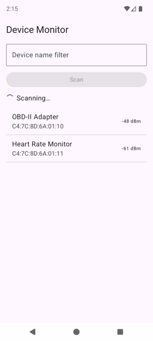
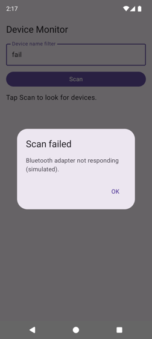
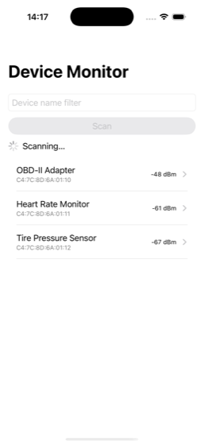
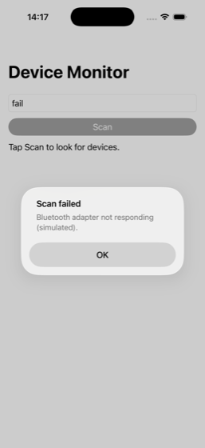

# ViewModel dùng chung

<p class="kicker">Bài 08 · Tuần 2 · Ngày 8 · Khoá Native Device Monitor · <a href="https://phongna-inn.github.io/carmd-kmp-course/lessons/08-shared-viewmodels.html">Bản gốc tiếng Anh</a></p>

<div class="meta">
  <span class="tag">~2 giờ · +0,5 giờ cho mỗi track UI thêm</span>
  <span class="tag">Milestone: m03 khung được điều khiển bởi một ViewModel dùng chung</span>
  <span class="tag">Cần trước: <a href="../07-ui-declarative-danh-sach/">07</a></span>
</div>

!!! abstract "Vì sao bài này quan trọng"
    Việc thật của Device Monitor (quét, giữ một kết nối, stream giá trị cảm biến) không được chết khi người dùng xoay máy hay mở một màn hình khác. Nó cũng nên được viết một lần, không phải hai lần.
    Ở m02 việc quét sống bên trong màn hình, và xoay máy trên Android huỷ nó ([bài 07](07-ui-declarative-danh-sach.md), mục 5). Hôm nay việc quét chuyển vào một **ViewModel trong Kotlin dùng chung**, và cả hai app chỉ quan sát nó.
    Đó là milestone **m03**, và đó là hình dạng của mọi màn hình trong app của team: một ViewModel dùng chung với một lớp UI native mỏng trên mỗi nền tảng.
    Hôm nay ViewModel vẫn tự tạo scanner giả của nó. Bài 10 cho thấy vì sao đó là vấn đề và sửa nó, và từ bài 13 scanner là một radio thật.

!!! info "Nguồn chính"
    Hướng dẫn [UI layer](https://developer.android.com/topic/architecture/ui-layer) của Android: UI state, state holder, luồng dữ liệu một chiều và `StateFlow`, tất cả trong một trang. Đọc nó sau mục 2.
    Người học iOS đọc thêm trang [KMP ViewModel](https://developer.android.com/kotlin/multiplatform/viewmodel) của Android trước mục 5: đó là nơi owner phía iOS đến từ.

!!! info "Track"
    ViewModel và mọi thứ trong `shared/` giống nhau trên mọi track. Mỗi track chỉ đổi cách nó *quan sát* ViewModel: Compose và XML ở mục 4, SwiftUI và UIKit ở mục 5.
    Bài này có hai nhóm tab: **Compose** / **XML** cho Android và **SwiftUI** / **UIKit** cho iOS; chọn một tab là mọi tab cùng tên trên trang đổi theo.
    Mỗi đoạn trích chỉ hiện những dòng mà phần ghi chú giải thích; các file đầy đủ nằm ở mục [File đầy đủ](#file-ay-u) cuối trang.

## Thay đổi so với m02

Các màn hình trông vẫn vậy. Cái đổi là ai sở hữu việc quét, và nó hoạt động thế nào:

<table>
<tr><th>Cái gì</th><th>m02</th><th>m03</th></tr>
<tr><td>ai sở hữu việc quét và kết quả của nó</td><td>màn hình danh sách</td><td>một <code>DeviceListViewModel</code> dùng chung trong <code>commonMain</code></td></tr>
<tr><td>kết quả tới thế nào</td><td>tất cả một lần, sau 1,5 s chờ</td><td>từng cái một, cách nhau 0,3 s, cho tới khi lần quét hết giờ ở 3 s</td></tr>
<tr><td>một lần quét bị lỗi</td><td>không thể xảy ra</td><td>chuỗi lọc <code>fail</code> giả lập một lỗi radio và hiện dialog "Scan failed"</td></tr>
<tr><td>Android: xoay máy trong lúc quét</td><td>việc quét bị huỷ</td><td>việc quét chạy tiếp</td></tr>
<tr><td>file</td><td colspan="2"><code>shared/build.gradle.kts</code>, ba file Kotlin mới trong <code>commonMain</code> và hai trong <code>iosMain</code>; <code>ViewModelOwner.swift</code> trên cả hai track iOS, cộng <code>DeviceListObserver.swift</code> trên SwiftUI; màn hình danh sách trên mọi track; và, chỉ trên Compose, <code>androidApp/build.gradle.kts</code></td></tr>
</table>

## 1. Đưa việc ra khỏi màn hình

Màn hình là chủ sở hữu sai cho việc chạy lâu, vì nền tảng huỷ màn hình bất cứ khi nào nó muốn. Android tạo lại Activity khi xoay máy. Cả hai nền tảng dỡ bỏ những màn hình bạn điều hướng rời đi.
Một **ViewModel** là một object có thời gian sống bằng đời *logic* của màn hình chứ không phải đời của các view. Android định nghĩa nó là "một state holder ở mức business logic hoặc mức màn hình", mà "ưu điểm chính là nó cache state và giữ nó qua các thay đổi cấu hình" ([ViewModel overview](https://developer.android.com/topic/libraries/architecture/viewmodel)).

Toy dưới đây chạy việc quét theo cả hai cách. Bắt đầu một lần quét, rồi xoay máy hoặc rời màn hình trong lúc nó còn chạy, và xem cả hai log.

<div class="toy" id="vm-toy">
  <div class="toy-controls">
    <button type="button" data-ev="scan">Bấm Scan</button>
    <button type="button" data-ev="rotate">Xoay máy</button>
    <button type="button" data-ev="leave">Rời màn hình</button>
    <button type="button" data-ev="reset">Reset</button>
    <label class="toy-toggle"><input type="checkbox" id="vm-toy-noowner"> iOS không có ViewModel owner (xem mục 5)</label>
  </div>
  <div class="toy-phones">
    <figure><figcaption>m02: màn hình sở hữu việc quét</figcaption><div id="vm-toy-screen"></div><pre class="toy-log" id="vm-toy-log-screen"></pre></figure>
    <figure><figcaption>m03: ViewModel sở hữu việc quét</figcaption><div id="vm-toy-vm"></div><pre class="toy-log" id="vm-toy-log-vm"></pre></figure>
  </div>
</div>

<div class="quiz">
<p class="q">Bấm Scan, rồi xoay máy trong lúc nó quét. Vì sao điện thoại m02 quay về "Tap Scan to look for devices."?</p>
<div class="opts">
<button class="opt" data-correct>scope của việc quét chết cùng màn hình cũ</button>
<button class="opt">xoay máy xoá mọi giá trị đã lưu trên Android</button>
<button class="opt">scanner giả khởi động lại sau mỗi lần xoay</button>
</div>
<p class="feedback"></p>
<p class="why">Việc quét chạy trong coroutine scope của màn hình, thứ bị huỷ khi Activity bị huỷ. Giá trị đã lưu thì có quay lại, nhưng chỉ những cái được ghi lại, và một lần quét đang chạy thì không ghi lại được.</p>
</div>

<div class="quiz">
<p class="q">Rời màn hình trong lúc quét. Cái gì dừng lần quét của m03?</p>
<div class="opts">
<button class="opt" data-correct>clear ViewModel làm huỷ viewModelScope</button>
<button class="opt">UI thôi collect từ flow uiState</button>
<button class="opt">scanner giả nhận ra không ai đang xem</button>
</div>
<p class="feedback"></p>
<p class="why">Thôi quan sát không dừng được gì: UI cũng thôi collect khi bạn xoay máy, và việc quét vẫn chạy tiếp. Việc dừng khi <em>scope</em> của nó bị huỷ, và <code>viewModelScope</code> bị huỷ khi ViewModel bị clear. Tick ô iOS rồi rời màn hình lần nữa để xem chuyện gì xảy ra khi không ai clear nó.</p>
</div>

Khi nào một ViewModel bị clear? "Một `ViewModel` ở lại trong bộ nhớ cho tới khi `ViewModelStoreOwner` mà nó được gắn vào biến mất": một Activity kết thúc, một navigation entry "bị gỡ khỏi back stack", một composable "rời khỏi Composition" ([cùng trang](https://developer.android.com/topic/libraries/architecture/viewmodel)).
Mọi coroutine được launch trong `viewModelScope` "tự động bị huỷ nếu `ViewModel` bị clear" ([Kotlin coroutines with lifecycle-aware components](https://developer.android.com/topic/libraries/architecture/coroutines)). Class `ViewModel` là **multiplatform** từ AndroidX Lifecycle 2.8 ([KMP ViewModel](https://developer.android.com/kotlin/multiplatform/viewmodel)), nên nó sống được trong `commonMain` và phục vụ cả hai app.

<figure class="diagram">
<svg class="dg" viewBox="0 0 640 230" role="img" aria-labelledby="l08-life-title">
<title id="l08-life-title">Thời gian sống trên Android, theo thời gian. Làn trên, màn hình: màn hình số một bị huỷ bởi một lần xoay máy và màn hình số hai được tạo ra thay nó; sau đó người dùng bấm Back và danh sách rời back stack hẳn. Làn giữa, ViewModel: một instance, được tạo khi màn hình số một hỏi nó lần đầu, giữ qua lần xoay, và chỉ bị clear khi danh sách rời back stack, lúc đó gọi onCleared và huỷ viewModelScope. Làn dưới, coroutine quét: được launch trong viewModelScope khi bấm Scan, nó chạy tiếp qua lần xoay và kết thúc ở timeout 3 giây.</title>
<defs><marker id="l08-life-arrow" viewBox="0 0 10 10" refX="9" refY="5" markerWidth="7" markerHeight="7" orient="auto-start-reverse"><path class="arrowhead" d="M0,0 L10,5 L0,10 z"/></marker></defs>
<text x="14" y="52" font-weight="600">Màn hình</text>
<text x="14" y="112" font-weight="600">ViewModel</text>
<text x="14" y="172" font-weight="600">Quét</text>
<g data-part="android">
<rect class="box" x="120" y="30" width="170" height="38" rx="5"/>
<text class="small" x="130" y="47">màn hình #1</text><text class="small muted" x="130" y="61">hỏi lấy ViewModel</text>
<rect class="box" x="300" y="30" width="230" height="38" rx="5"/>
<text class="small" x="310" y="47">màn hình #2, sau khi xoay</text><text class="small muted" x="310" y="61">nhận lại đúng ViewModel đó</text>
</g>
<line class="edge dashed" x1="295" y1="24" x2="295" y2="196"/>
<text class="small muted" x="295" y="18" text-anchor="middle">xoay máy</text>
<line class="edge dashed" x1="535" y1="24" x2="535" y2="196"/>
<text class="small muted" x="535" y="18" text-anchor="middle">Back: danh sách rời back stack</text>
<g data-part="inbound">
<rect class="box" x="120" y="90" width="410" height="38" rx="5"/>
<text class="title small" x="130" y="107">một DeviceListViewModel</text><text class="small muted" x="130" y="121">sống sót qua lần xoay</text>
</g>
<text class="small" x="545" y="107">bị clear:</text><text class="mono small" x="545" y="121">onCleared()</text>
<rect class="box" x="180" y="150" width="250" height="38" rx="5"/>
<text class="mono small" x="190" y="167">viewModelScope.launch</text><text class="small muted" x="190" y="181">chạy tiếp qua lần xoay</text>
<path class="edge" d="M150,68 L150,88" marker-end="url(#l08-life-arrow)"/>
<path class="edge" d="M330,88 L330,70" marker-end="url(#l08-life-arrow)"/>
<text class="small muted" x="436" y="173">timeout 3 s</text>
<line class="axis" x1="120" y1="212" x2="600" y2="212"/>
<text class="small muted" x="120" y="226">thời gian →</text>
</svg>
<figcaption>Màn hình đến rồi đi; ViewModel sống lâu hơn nó, và việc quét sống trong scope của ViewModel. Chỉ khi owner rời đi hẳn thì nó mới bị clear.
<ul class="legend"><li data-part="inbound">ViewModel dùng chung</li><li data-part="android">Android</li></ul>
</figcaption>
</figure>

<table>
<tr><th>Sau khi…</th><th>m02: state trong màn hình</th><th>m03: state trong ViewModel</th></tr>
<tr><td>Android: xoay máy <em>trong lúc</em> quét</td><td>việc quét bị huỷ; màn hình về "Tap Scan…"</td><td><strong>việc quét chạy tiếp</strong>; màn hình mới nhận state hiện tại</td></tr>
<tr><td>mở một thiết bị rồi quay lại</td><td>Compose: chỉ còn nếu dùng <code>rememberSaveable</code>. XML / SwiftUI / UIKit: còn, vì Fragment, view gốc hoặc view controller vẫn sống bên dưới màn hình chi tiết</td><td>còn: ViewModel của danh sách sống chừng nào entry của nó còn trong back stack</td></tr>
<tr><td>rời màn hình hẳn</td><td>việc quét bị huỷ</td><td>ViewModel bị clear, việc quét bị huỷ</td></tr>
<tr><td>Android process death (hệ thống kill app khi đang chạy nền)</td><td>khôi phục các giá trị đã lưu</td><td><strong>mất</strong>: ViewModel là bộ nhớ, không phải nơi lưu trữ. <code>SavedStateHandle</code> sửa được chuyện đó và nằm ngoài phạm vi bài này (<a href="https://developer.android.com/topic/libraries/architecture/viewmodel">cùng trang</a>).</td></tr>
</table>

## 2. Thiết kế UI state trước

Hướng dẫn của Android định nghĩa nó trong một dòng: "nếu UI là thứ người dùng thấy, thì UI state là thứ app nói họ nên thấy." Làm nó bất biến (immutable), vì "các object bất biến đảm bảo về trạng thái của ứng dụng tại một thời điểm".
Phơi nó ra từ ViewModel "trong một data holder quan sát được như `StateFlow`". UI gửi sự kiện lên và nhận state về: "state chảy xuống và sự kiện chảy lên" ([UI layer](https://developer.android.com/topic/architecture/ui-layer)).

<figure class="diagram">
<svg class="dg" viewBox="0 0 640 296" role="img" aria-labelledby="l08-udf-title">
<title id="l08-udf-title">State chảy xuống, sự kiện chảy lên. Ở trên cùng, DeviceListViewModel dùng chung trong commonMain phơi ra uiState, một StateFlow của DeviceListUiState. State chảy xuống từ nó tới UI Android, Compose hoặc XML Views, thứ collect nó trực tiếp, và tới UI iOS, SwiftUI hoặc UIKit, thứ quan sát nó qua một cầu nối viết tay. Sự kiện chảy lên từ cả hai UI tới ViewModel: startScan với chuỗi lọc, và errorShown. Bên trái ViewModel là FakeDeviceScanner, thứ factory của chính ViewModel tạo ra; ViewModel collect flow quét các thiết bị của nó.</title>
<defs><marker id="l08-udf-arrow" viewBox="0 0 10 10" refX="9" refY="5" markerWidth="7" markerHeight="7" orient="auto-start-reverse"><path class="arrowhead" d="M0,0 L10,5 L0,10 z"/></marker></defs>
<rect class="box" x="20" y="14" width="150" height="74" rx="6" stroke-dasharray="5 4"/>
<text x="30" y="34">FakeDeviceScanner</text>
<text class="mono small" x="30" y="52">scan(filter):</text>
<text class="mono small" x="30" y="66">Flow&lt;Device&gt;</text>
<text class="small muted" x="30" y="81">do ViewModel tạo</text>
<g data-part="inbound">
<rect class="box" x="200" y="20" width="290" height="62" rx="6"/>
<text class="title" x="214" y="42">DeviceListViewModel</text>
<text class="small muted" x="214" y="58">dùng chung, commonMain</text>
<text class="mono small" x="214" y="73">uiState: StateFlow&lt;DeviceListUiState&gt;</text>
</g>
<path class="edge" d="M198,51 L172,51" marker-end="url(#l08-udf-arrow)"/>
<g data-part="android">
<rect class="box" x="20" y="214" width="280" height="70" rx="6"/>
<text class="title" x="34" y="236">UI Android</text>
<text class="small" x="34" y="254">Compose · XML Views</text>
<text class="small muted" x="34" y="270">collect StateFlow khi đang hiện</text>
</g>
<g data-part="ios">
<rect class="box" x="340" y="214" width="280" height="70" rx="6"/>
<text class="title" x="354" y="236">UI iOS</text>
<text class="small" x="354" y="254">SwiftUI · UIKit</text>
<text class="small muted" x="354" y="270">quan sát nó qua một cầu nối viết tay</text>
</g>
<path class="edge" d="M220,84 L220,212" marker-end="url(#l08-udf-arrow)"/>
<path class="edge dashed" d="M285,212 L285,84" marker-end="url(#l08-udf-arrow)"/>
<path class="edge" d="M360,84 L360,212" marker-end="url(#l08-udf-arrow)"/>
<path class="edge dashed" d="M470,212 L470,84" marker-end="url(#l08-udf-arrow)"/>
<text class="small" x="212" y="130" text-anchor="end">state ↓</text>
<text class="small" x="293" y="130">sự kiện ↑</text>
<text class="small" x="352" y="170" text-anchor="end">state ↓</text>
<text class="small" x="478" y="166">sự kiện ↑</text>
<text class="mono small" x="478" y="182">startScan(filter)</text>
<text class="mono small" x="478" y="197">errorShown()</text>
</svg>
<figcaption>Một ViewModel, hai nền tảng, bốn toolkit. Mọi toolkit đọc cùng một state và gửi cùng hai sự kiện.
<ul class="legend"><li data-part="inbound">ViewModel dùng chung (bài 10 gọi nó là inbound adapter)</li><li data-part="android">Android</li><li data-part="ios">iOS</li></ul>
</figcaption>
</figure>

**Làm cho trạng thái vô lý không thể tồn tại.** m02 mô tả một lần quét bằng hai biến độc lập. Hai biến cho bốn tổ hợp, và một trong số đó không có nghĩa gì:

| `isScanning` | `devices` | Ý nghĩa | `ScanState` sealed |
|---|---|---|---|
| false | null | chưa quét bao giờ | `Idle` |
| true | […] | đang quét, đã thấy những cái này | `Scanning(found)` |
| false | […] | đã xong với những cái này | `Finished(found)` |
| true | null | **không gì cả**, nhưng kiểu dữ liệu cho phép | không viết ra được |

Một **sealed interface** ([bài 01](01-kotlin-cho-dev-typescript.md), mục 2) liệt kê đúng ba trạng thái thật, mỗi trạng thái chỉ mang dữ liệu mà trạng thái đó có. Mọi `when` trên nó phải xử lý cả ba, nên thêm một trạng thái thứ tư về sau sẽ khiến compiler chỉ ra mọi màn hình Kotlin cần cập nhật. Swift chưa có kiểm tra đó (mục 5); bài 09 mang nó tới.

**Lỗi cũng là state.** Một lần quét lỗi cần một dialog hiện đúng một lần. Rất dễ muốn gửi nó như một "sự kiện" một lần qua `Channel` hoặc `SharedFlow`.
Hướng dẫn của Android nói thẳng: "Sự kiện của ViewModel luôn phải dẫn tới một lần cập nhật UI state", vì với Channel hay các stream khác, "khi bên sản xuất (ViewModel) sống lâu hơn bên tiêu thụ (Compose UI), các giải pháp này không đảm bảo việc giao và xử lý các sự kiện đó".
Nên thông báo đi vào state, và khi UI đã hiện nó, UI gọi lại để ViewModel xoá nó: "Hoặc thông báo cho người dùng đang được hiện, hoặc không" ([UI events](https://developer.android.com/topic/architecture/ui-layer/events#handle-viewmodel-events)). Ở đây đó là `errorMessage` cộng `errorShown()`. Thêm một điểm cộng: dialog sống sót qua lần xoay, vì nó chỉ là state.

**Cái gì ở lại trong UI.** Chữ lọc là *input*: người dùng sở hữu nó trong lúc gõ, và ViewModel chỉ cần nó khi Scan được bấm. Nên nó ở lại chỗ m02 đặt nó (`rememberSaveable`, `@State`, hoặc chính ô nhập) và tới ViewModel dưới dạng tham số: `startScan(filter)`. Mỗi phím gõ vì vậy vẫn đồng bộ trên mọi track, không phải đi một vòng qua flow.

!!! info "Từ TypeScript"
    `ScanState` là một discriminated union: `type ScanState = { kind: "idle" } | { kind: "scanning"; found: Device[] } | { kind: "finished"; found: Device[] }`. `when` của Kotlin là một `switch` có sẵn kiểm tra đủ nhánh kiểu `never`. `it.copy(scan = …)` là `{ ...state, scan: … }`.
    Một `StateFlow` là một `BehaviorSubject` của RxJS (hay một signal của Angular): nó luôn có giá trị hiện tại, và người đăng ký mới nhận giá trị đó trước tiên. `viewModelScope` là `takeUntil(destroy$)` áp lên mọi thứ ViewModel bắt đầu.

## 3. Code dùng chung

Bốn file trong `shared/`: file build có thêm thư viện ViewModel, và ba file Kotlin mới chứa scanner, state, và ViewModel. Các file của m02 (`Device.kt`, `SampleDevices.kt`) giữ nguyên, và file build gốc cũng vậy: Kotlin vẫn ở 2.4.21 trong bài này.

```kotlin title="shared/build.gradle.kts" hl_lines="6 7 13 14"
⋯ plugins and the android { } block, as in m02
    listOf(iosArm64(), iosSimulatorArm64()).forEach { target ->
        target.binaries.framework {
            baseName = "Shared"
            isStatic = true
            export("androidx.lifecycle:lifecycle-viewmodel:2.11.0")
            binaryOption("bundleId", "com.example.devicemonitor.shared")
        }
    }

    sourceSets {
        commonMain.dependencies {
            api("androidx.lifecycle:lifecycle-viewmodel:2.11.0")
            api("org.jetbrains.kotlinx:kotlinx-coroutines-core:1.11.0")
        }
    }
}
```

1. `androidx.lifecycle:lifecycle-viewmodel` là `ViewModel` multiplatform của Google, cùng artifact mà app Android dùng ([KMP ViewModel](https://developer.android.com/kotlin/multiplatform/viewmodel)). Phiên bản 2.11.0 khớp với các thư viện lifecycle đã có trong app.
2. **`api`, không phải `implementation`**: `ViewModel` và `StateFlow` xuất hiện trong API *public* của module shared (ViewModel kế thừa cái này và phơi ra cái kia), nên các module dùng `:shared` cũng cần chúng. Với `api`, app Android nhận coroutines qua `:shared`, nên nó không còn phụ thuộc vào coroutines chỉ một cách tình cờ qua một thư viện khác ([bài 06](06-ui-declarative-thanh-phan.md), mục 5, đã ghi chú rằng Compose nhận chúng qua Compose runtime).
3. **`export(…)`** đưa các class của thư viện vào header public của framework iOS dưới đúng tên của chúng, để Swift dùng được `ViewModel` và `ViewModelStore` (mục 5). Hướng dẫn của Android yêu cầu điều này: "Bạn cần khai báo dependency `api` ở đây nếu muốn truy cập các class tốt hơn từ code Swift."
4. **`binaryOption("bundleId", …)`**: ngay khi chúng tôi export một thư viện, linker Kotlin/Native cảnh báo `Cannot infer a bundle ID from packages of source files and exported dependencies, use the bundle name instead: Shared`. Đặt bundle ID tường minh làm nó im. Khoá này coi warning là error.

```kotlin title="shared/src/commonMain/kotlin/com/example/devicemonitor/FakeDeviceScanner.kt" hl_lines="2 7 15 17"
⋯ package and imports
class ScanException(message: String) : Exception(message)

// Stand-in for the BLE scanner of Lesson 13. Like a real scan, devices arrive one at a
// time and the flow never completes on its own: the collector stops it by cancelling.
class FakeDeviceScanner {
    fun scan(filter: String): Flow<Device> = flow {
        // Test hook for now: the filter "fail" simulates a radio error.
        if (filter.trim().equals("fail", ignoreCase = true)) {
            delay(500)
            throw ScanException("Bluetooth adapter not responding (simulated).")
        }
        for (device in SampleDevices.matching(filter)) {
            delay(300)
            emit(device)
        }
        awaitCancellation()
    }
}
```

1. **`flow { … }`** dựng một `Flow` *lạnh* (cold) ([Asynchronous Flow](https://kotlinlang.org/docs/flow.html), [bài 01](01-kotlin-cho-dev-typescript.md), mục 5): không gì chạy cho tới khi có ai collect nó, và mỗi collector có một lần chạy riêng. `emit(device)` đưa một giá trị cho collector, và `delay(300)` suspend mà không chặn thread nào ([bài 07](07-ui-declarative-danh-sach.md), mục 3).
2. **`awaitCancellation()`** suspend mãi mãi. Một lần quét BLE thật không có điểm kết thúc, và nó báo thiết bị cho tới khi bạn dừng nó. Làm bản giả hoạt động y như vậy buộc ViewModel phải dừng nó đúng cách, nên code dừng của ViewModel đã chạy được sẵn khi một scanner thật tới.
3. **`ScanException`** là kiểu của riêng chúng ta, để ViewModel bắt được đúng lỗi này và không gì khác (ý 6 của ViewModel bên dưới). Chuỗi lọc `"fail"` là một test hook, để bạn tự tay đi tới nhánh lỗi. Từ bài 11, test dùng một scanner giả do chúng điều khiển.

```kotlin title="shared/src/commonMain/kotlin/com/example/devicemonitor/DeviceListUiState.kt" hl_lines="3 8"
⋯ package
// Everything the device list shows that the user didn't type.
data class DeviceListUiState(
    val scan: ScanState = ScanState.Idle,
    val errorMessage: String? = null,
)

sealed interface ScanState {
    data object Idle : ScanState
    data class Scanning(val found: List<Device>) : ScanState
    data class Finished(val found: List<Device>) : ScanState
}
```

1. Một `data class` bất biến cho màn hình. Giá trị mặc định làm `DeviceListUiState()` thành state ban đầu. Mọi thay đổi luôn tạo ra một object mới bằng `copy`.
2. `data object Idle` là một singleton có `toString` dễ đọc. `Scanning` và `Finished` mang các thiết bị đã tìm thấy, vì chỉ những trạng thái đó có thiết bị.

ViewModel được trích làm hai đoạn. Đầu tiên là hình dạng của nó: nó giữ gì, phơi ra gì, và được dựng thế nào.

```kotlin title="shared/src/commonMain/kotlin/com/example/devicemonitor/DeviceListViewModel.kt" hl_lines="3 5 6 14 15"
⋯ package and imports
class DeviceListViewModel(
    private val scanner: FakeDeviceScanner,
) : ViewModel() {
    private val _uiState = MutableStateFlow(DeviceListUiState())
    val uiState: StateFlow<DeviceListUiState> = _uiState.asStateFlow()

    private var scanJob: Job? = null

⋯ startScan() and errorShown(), in the next excerpt
    companion object {
        val SCAN_TIMEOUT = 3.seconds

        val Factory: ViewModelProvider.Factory = viewModelFactory {
            initializer { DeviceListViewModel(FakeDeviceScanner()) }
        }
    }
}
```

Rồi tới hai sự kiện. `startScan` chứa phần lớn Kotlin của bài:

```kotlin title="shared/src/commonMain/kotlin/com/example/devicemonitor/DeviceListViewModel.kt" hl_lines="3 4 5 8 11 15"
⋯ class header, uiState, scanJob
    fun startScan(filter: String) {
        if (scanJob?.isActive == true) return
        _uiState.update { it.copy(scan = ScanState.Scanning(emptyList())) }
        scanJob = viewModelScope.launch {
            val found = mutableListOf<Device>()
            try {
                withTimeoutOrNull(SCAN_TIMEOUT) {
                    scanner.scan(filter).collect { device ->
                        found += device
                        _uiState.update { it.copy(scan = ScanState.Scanning(found.toList())) }
                    }
                }
                _uiState.update { it.copy(scan = ScanState.Finished(found.toList())) }
            } catch (e: ScanException) {
                _uiState.update { it.copy(scan = ScanState.Idle, errorMessage = e.message) }
            }
        }
    }

    fun errorShown() {
        _uiState.update { it.copy(errorMessage = null) }
    }
⋯ companion object
```

1. **Backing property.** `_uiState` là một `MutableStateFlow` private; `uiState` public thì chỉ đọc (`asStateFlow()`). Chỉ ViewModel đổi được state, và mọi bên khác chỉ quan sát được nó. "`StateFlow` là một flow quan sát được giữ state, phát giá trị state hiện tại và mới cho các collector của nó" ([StateFlow and SharedFlow](https://developer.android.com/kotlin/flow/stateflow-and-sharedflow)).
2. **`_uiState.update { it.copy(…) }`** tính state mới từ state hiện tại và đổi vào một cách nguyên tử (atomic). Không bao giờ là `_uiState.value.scan = …`, vì state bất biến.
3. **`if (scanJob?.isActive == true) return`**: một lần `startScan` thứ hai trong lúc quét bị bỏ qua. Nút bị tắt đã ngăn chuyện đó, nhưng ViewModel không nên dựa vào UI của nó để đúng.
4. **State trước, rồi mới launch.** `Scanning(emptyList())` được gán đồng bộ, nên ngay frame kế tiếp đã hiện vòng xoay: luật của bài 06 và 07. Rồi `viewModelScope.launch` bắt đầu phần chậm trong scope riêng của ViewModel.
   Trên cả hai nền tảng nó chạy trên main thread (`Dispatchers.Main.immediate`), và `delay` giữ nó không chặn thread. Đó là cách ViewModel đăng UI state trên main thread, như bài 07 đã hứa.
5. **`withTimeoutOrNull(SCAN_TIMEOUT)`** huỷ khối sau 3 s và trả về `null` thay vì ném lỗi, nên code chạy tiếp tới dòng `Finished`. Đây là cách một lần quét không bao giờ kết thúc dừng lại "khi hết giờ" (yêu cầu A.3).
6. **`catch (e: ScanException)`**, không phải `catch (e: Exception)`. Khi scope bị huỷ (ViewModel bị clear), một `CancellationException` bay qua đoạn code này. Bắt mọi `Exception` sẽ nuốt nó và giữ coroutine của một ViewModel đã chết tiếp tục chạy. Chỉ bắt những gì bạn xử lý được.
7. **`found.toList()`** ở mỗi lần cập nhật đưa cho state một *bản sao*. Một `StateFlow` chỉ phát một giá trị không `equals` với giá trị hiện tại. Nếu state dùng chung danh sách mutable, state "mới" đã bằng state cũ rồi. Bạn sẽ thử điều này trong bài tự làm.
8. **`Factory`** cho nền tảng biết cách dựng ViewModel này, vì nền tảng tạo nó, không phải bạn. `viewModelFactory { initializer { … } }` là cách viết một factory kiểu multiplatform. Cả hai track Android và cả hai track iOS đều dùng chung factory này.

!!! note "Để mắt tới dòng này"
    `initializer { DeviceListViewModel(FakeDeviceScanner()) }`: chính factory của ViewModel chọn một scanner cụ thể, và constructor hỏi `FakeDeviceScanner` bằng tên. Hôm nay điều đó ổn, vì chỉ có một scanner.
    Nhưng bài 13 cần một scanner khác trên mỗi nền tảng (một radio Android và một class CoreBluetooth viết bằng Swift), và test của bài 11 cần một scanner do chúng điều khiển. Không cái nào truyền vào được chừng nào ViewModel còn gọi tên class của scanner. Đó là vấn đề mà bài 10 bắt đầu từ đó.

## 4. Android: collect khi đang hiện

Collect từ ViewModel là một việc khác với sở hữu nó. UI chỉ collect khi nó đang trên màn hình: "việc collect bắt đầu khi lifecycle ở `STARTED` và dừng khi lifecycle ở `STOPPED`" ([coroutines with lifecycle-aware components](https://developer.android.com/topic/libraries/architecture/coroutines)).
ViewModel vẫn làm việc suốt thời gian đó, nên khi UI bắt đầu collect lại, `StateFlow` đưa nó state mới nhất trước tiên.

=== "Compose"

    ```kotlin title="androidApp/build.gradle.kts" hl_lines="3"
    ⋯ plugins, android { }, and the dependencies above, as in m02
        implementation("androidx.lifecycle:lifecycle-runtime-compose:2.11.0")
        implementation("androidx.lifecycle:lifecycle-viewmodel-compose:2.11.0")
        implementation("org.jetbrains.kotlinx:kotlinx-serialization-core:1.12.0")
    }
    ```

    ```kotlin title="androidApp/src/main/java/com/example/devicemonitor/android/DeviceListScreen.kt" hl_lines="5 8 12 21 23"
    ⋯ package and imports
    @Composable
    fun DeviceListScreen(
        onDeviceClick: (Device) -> Unit,
        viewModel: DeviceListViewModel = viewModel(factory = DeviceListViewModel.Factory),
    ) {
        var filter by rememberSaveable { mutableStateOf("") }
        val state by viewModel.uiState.collectAsStateWithLifecycle()
        DeviceListContent(
    ⋯ filter, onFilterChange
            isScanning = state.scan is ScanState.Scanning,
            devices = when (val scan = state.scan) {
                ScanState.Idle -> null
                is ScanState.Scanning -> scan.found
                is ScanState.Finished -> scan.found
            },
            onScan = { viewModel.startScan(filter) },
    ⋯ onDeviceClick
        )

        state.errorMessage?.let { message ->
            AlertDialog(
                onDismissRequest = viewModel::errorShown,
    ⋯ the OK button (also errorShown), title, text, and the closing brackets
    ```

    1. **`viewModel(factory = DeviceListViewModel.Factory)`** (từ `lifecycle-viewmodel-compose`, dependency mới duy nhất) trả về ViewModel của `ViewModelStoreOwner` gần nhất. Bên trong một `NavHost` owner đó là **navigation entry**, nên ViewModel sống chừng nào danh sách còn trong back stack.
       Nó sống sót qua chuyến sang màn hình chi tiết và qua lần xoay máy, và bị clear khi entry bị pop. Là một tham số mặc định, nó có thể được thay bằng một bản giả trong preview hoặc test.
    2. **`collectAsStateWithLifecycle()`** biến `StateFlow` thành `State` của Compose và chỉ collect khi màn hình ít nhất ở `STARTED`. Android gọi nó là "cách được khuyên dùng để collect flow trên app Android". `collectAsState` thường là bản không phụ thuộc nền tảng, thứ vẫn collect khi ở nền ([State and Jetpack Compose](https://developer.android.com/develop/ui/compose/state)).
    3. **`DeviceListContent` không đổi.** Bài 06 và 07 tách màn hình thành một lớp bọc stateful và phần content stateless, và hứa rằng một ViewModel sẽ chỉ thay lớp bọc. Đó đúng là điều đã xảy ra. `remember`, `rememberCoroutineScope`, `delay` và `SampleDevices` đều đã rời file này.
    4. **`when (val scan = state.scan)`** ánh xạ state sealed sang hai tham số của content. Không có nhánh `else`: compiler kiểm tra rằng cả ba trường hợp đều được xử lý.
    5. **Dialog là state.** Nó tồn tại khi `errorMessage` khác null. Cả "OK" lẫn đóng dialog (chạm ra ngoài, Back) đều gọi `errorShown()`, thứ xoá thông báo, và lần recomposition kế tiếp gỡ dialog đi. Xoay máy không làm mất nó được.
    6. `viewModel::errorShown` là một *function reference*, một lambda gọi `errorShown()` trên instance đó.

=== "XML"

    `androidApp/build.gradle.kts` không đổi. `viewModels` đến từ `fragment-ktx`, `repeatOnLifecycle` từ `lifecycle-runtime-ktx`, còn các helper của factory và coroutines từ `:shared` (`api`).

    ```kotlin title="androidApp/src/main/java/com/example/devicemonitor/android/DeviceListFragment.kt" hl_lines="5 12 19 20"
    ⋯ package and imports
    class DeviceListFragment : Fragment() {
        // Survives rotation and the trip to the detail screen; cleared when this
        // Fragment leaves the back stack for good.
        private val viewModel: DeviceListViewModel by viewModels { DeviceListViewModel.Factory }

        private var binding: FragmentDeviceListBinding? = null
        private var errorDialog: AlertDialog? = null
    ⋯ the adapter, as in m02
        override fun onCreateView(inflater: LayoutInflater, container: ViewGroup?, savedInstanceState: Bundle?): View {
    ⋯ inflate, adapter, dividers
            b.scanButton.setOnClickListener { viewModel.startScan(b.filterInput.text.toString()) }
            return b.root
        }

        override fun onViewCreated(view: View, savedInstanceState: Bundle?) {
            super.onViewCreated(view, savedInstanceState)
            viewLifecycleOwner.lifecycleScope.launch {
                viewLifecycleOwner.repeatOnLifecycle(Lifecycle.State.STARTED) {
                    viewModel.uiState.collect { render(it) }
                }
            }
        }
    ⋯ onDestroyView, render(), renderError()
    ```

    ```kotlin title="androidApp/src/main/java/com/example/devicemonitor/android/DeviceListFragment.kt" hl_lines="2 9 17 21"
    ⋯ onDestroyView() also calls errorDialog?.dismiss()
        private fun render(state: DeviceListUiState) {
            val b = binding ?: return
            val isScanning = state.scan is ScanState.Scanning
            val devices = when (val scan = state.scan) {
    ⋯ Idle → null, Scanning and Finished → scan.found, as in Compose
            }
    ⋯ button, progress bar and status text, as in m02
            b.statusText.setTextColor(if (devices?.isEmpty() == true && !isScanning) Color.RED else Color.DKGRAY)
            adapter.submitList(devices.orEmpty())
            renderError(state.errorMessage)
        }
        private fun renderError(message: String?) {
            if (message == null) {
                errorDialog?.dismiss()
                errorDialog = null
            } else if (errorDialog == null) {
                errorDialog = AlertDialog.Builder(requireContext())
    ⋯ title "Scan failed" and the message
                    .setPositiveButton("OK") { _, _ -> viewModel.errorShown() }
                    .setOnCancelListener { viewModel.errorShown() }
                    .show()
            }
        }
    ```

    1. **`by viewModels { DeviceListViewModel.Factory }`** (từ `fragment-ktx`) gắn ViewModel vào Fragment này. Nó được tạo ở lần truy cập đầu, sống sót qua lần xoay (Fragment được tạo lại, nhưng `ViewModelStore` của nó thì không), và bị clear khi Fragment rời back stack hẳn.
    2. **Các field state đã biến mất**, và `onSaveInstanceState` lẫn `onCreate` cũng vậy. Fragment không còn giữ state nào của màn hình, chỉ còn view và tham chiếu tới ViewModel.
    3. **`viewLifecycleOwner.repeatOnLifecycle(STARTED)`** chạy khối `collect` "mỗi lần lifecycle ở trạng thái `STARTED` (hoặc cao hơn)" và "huỷ nó khi ở `STOPPED`" ([coroutines with Views](https://developer.android.com/topic/libraries/architecture/views/coroutines-views)). Dùng lifecycle của *view*, không phải của Fragment: view chết trong lúc Fragment nằm trong back stack, và `render` không bao giờ được chạm vào view đã chết.
    4. **`render(state)`** là `render()` của m02, giờ nhận state làm tham số thay vì field. Mọi lần phát đều kết thúc ở đây, và không gì khác chạm vào widget.
    5. **EditText giữ chuỗi lọc.** Nó sở hữu chữ của nó trong lúc người dùng gõ, khôi phục nó sau khi xoay (nó có id), và được đọc một lần, khi Scan được bấm.
    6. **Màu đỏ có thêm `&& !isScanning`.** Giờ một lần quét bắt đầu là `Scanning(found = [])`. Luật của m02 (`devices?.isEmpty() == true`) sẽ tô "Scanning…" màu đỏ, cùng loại bug với điện thoại imperative trong toy của bài 06.
       Compose và SwiftUI không bao giờ gặp chuyện này, vì `when`/`if` của chúng kiểm tra `isScanning` trước. Code `render()` viết tay tính từng widget riêng lẻ, nên mỗi phép suy ra phải được kiểm tra lại.
    7. **Dialog** được hiện khi state có thông báo và chưa có dialog nào đang mở. "OK" và cancel (Back, chạm ra ngoài) gọi `errorShown()`. Trong `onDestroyView`, `dismiss()` gỡ cửa sổ mà không gọi cancel listener, nên sau khi xoay thông báo vẫn còn trong state và view mới hiện lại dialog.

!!! info "XML vs Compose · cái gì đổi và vì sao"
    Giờ cả hai track trông giống nhau từ phía ViewModel: lấy nó từ owner gần nhất (Navigation entry hoặc Fragment), collect khi `STARTED`, render.
    Bản Compose xoá code stateful và giữ content. Bản XML xoá field và saved state, nhưng giữ `render()`. Bug duy nhất chỉ có ở XML đến từ việc `render()` tính từng widget riêng lẻ.

## 5. iOS: sở hữu ViewModel, rồi bắc cầu flow bằng tay

Swift không thấy Kotlin trực tiếp. Nó thấy header Objective-C từ [bài 05](05-giai-phau-project-kmp.md), mục 6. Đây là những gì header làm với Kotlin của hôm nay, đọc từ `Shared.h`:

<table>
<tr><th>Kotlin</th><th>Swift thấy gì</th><th>Hệ quả</th></tr>
<tr><td><code>val uiState: StateFlow&lt;DeviceListUiState&gt;</code></td><td><code>any Kotlinx_coroutines_coreStateFlow</code>, có <code>value</code> là <code>Any?</code></td><td>Tham số kiểu bị mất: "Generic chỉ được định nghĩa trên class, không trên interface" (<a href="https://kotlinlang.org/docs/native-objc-interop.html">Swift/Objective-C interop</a>). Không có cách nào <code>for await</code> nó.</td></tr>
<tr><td><code>sealed interface ScanState</code> + 3 trường hợp</td><td>protocol <code>ScanState</code>, các class <code>ScanStateIdle</code>, <code>ScanStateScanning</code>, <code>ScanStateFinished</code></td><td>Không có <code>switch</code> đủ nhánh, nên bạn ép kiểu bằng <code>as?</code> và compiler không giúp được.</td></tr>
<tr><td><code>data object Idle</code></td><td><code>ScanStateIdle.shared</code></td><td>Như mọi <code>object</code> Kotlin (bài 05).</td></tr>
<tr><td><code>companion object { val Factory }</code></td><td><code>DeviceListViewModel.companion.Factory</code></td><td></td></tr>
<tr><td><code>ViewModelProvider.Factory</code> (một interface lồng)</td><td>protocol <code>ViewModelProviderFactory</code></td><td>Tên lồng nhau được nối lại. <code>ViewModelOwner.swift</code> bên dưới nhận <code>any ViewModelProviderFactory</code>.</td></tr>
<tr><td><code>fun startScan(filter: String)</code></td><td><code>startScan(filter:)</code></td><td>Tên tham số trở thành argument label.</td></tr>
<tr><td><code>ViewModel</code>, <code>ViewModelStore</code></td><td><code>ViewModel</code>, <code>ViewModelStore</code></td><td>Tên gọn, vì mục 3 đã export thư viện.</td></tr>
</table>

Vậy là hai việc. **Sở hữu** ViewModel, để nó bị clear khi màn hình đi. **Quan sát** `StateFlow` của nó, thứ Swift không làm trực tiếp được. Sơ đồ cho thấy những mảnh mà mục này viết cho mỗi việc.

<figure class="diagram">
<svg class="dg" viewBox="0 0 640 296" role="img" aria-labelledby="l08-ios-title">
<title id="l08-ios-title">Hai việc phía iOS. Sở hữu, hàng trên: màn hình, một object observer của SwiftUI hoặc một view controller UIKit, giữ một ViewModelOwner viết bằng Swift; owner giữ một ViewModelStore, và store giữ DeviceListViewModel. Khi owner bị deinit nó gọi store.clear, thứ gọi onCleared và huỷ viewModelScope. Quan sát, hàng dưới: StateFlowWatcher, một class Kotlin trong iosMain, collect uiState trong một MainScope và gọi một closure Swift trên main thread với mỗi state mới. Trong SwiftUI closure ghi vào một property state quan sát được, và SwiftUI vẽ lại các view đọc nó. Trong UIKit closure gọi render. Huỷ handle Watch mà màn hình giữ sẽ dừng việc collect, không dừng ViewModel.</title>
<defs><marker id="l08-ios-arrow" viewBox="0 0 10 10" refX="9" refY="5" markerWidth="7" markerHeight="7" orient="auto-start-reverse"><path class="arrowhead" d="M0,0 L10,5 L0,10 z"/></marker></defs>
<text x="14" y="22" font-weight="600">Sở hữu: clear ViewModel khi màn hình của nó đi</text>
<g data-part="ios">
<rect class="box" x="14" y="36" width="140" height="56" rx="6"/>
<text class="title small" x="24" y="56">màn hình</text>
<text class="small muted" x="24" y="72">observer SwiftUI hoặc</text>
<text class="small muted" x="24" y="85">view controller UIKit</text>
<rect class="box" x="178" y="36" width="172" height="56" rx="6"/>
<text class="title small" x="188" y="56">ViewModelOwner</text>
<text class="small muted" x="188" y="72">Swift</text>
<text class="mono small" x="188" y="85">deinit: store.clear()</text>
</g>
<rect class="box" x="374" y="36" width="110" height="56" rx="6"/>
<text class="small" x="384" y="56">ViewModelStore</text>
<text class="small muted" x="384" y="72">AndroidX,</text>
<text class="small muted" x="384" y="85">được export</text>
<g data-part="inbound">
<rect class="box" x="508" y="36" width="118" height="56" rx="6"/>
<text class="title small" x="518" y="56">DeviceList-</text>
<text class="title small" x="518" y="70">ViewModel</text>
<text class="small muted" x="518" y="85">onCleared()</text>
</g>
<path class="edge" d="M156,64 L176,64" marker-end="url(#l08-ios-arrow)"/>
<path class="edge" d="M352,64 L372,64" marker-end="url(#l08-ios-arrow)"/>
<path class="edge" d="M486,64 L506,64" marker-end="url(#l08-ios-arrow)"/>
<text class="small muted" x="14" y="112">Mỗi mũi tên nghĩa là "giữ". Khi màn hình đi, deinit của owner clear store,</text>
<text class="small muted" x="14" y="126">thứ clear ViewModel và huỷ viewModelScope của nó.</text>
<text x="14" y="160" font-weight="600">Quan sát: biến StateFlow thành lời gọi Swift hiểu được</text>
<g data-part="inbound">
<rect class="box" x="14" y="174" width="140" height="56" rx="6"/>
<text class="mono small" x="24" y="196">uiState</text>
<text class="small muted" x="24" y="211">StateFlow, mất kiểu</text>
<text class="small muted" x="24" y="224">trong Swift</text>
</g>
<g data-part="ios">
<rect class="box" x="178" y="174" width="172" height="56" rx="6"/>
<text class="title small" x="188" y="194">StateFlowWatcher&lt;T&gt;</text>
<text class="small muted" x="188" y="210">Kotlin, iosMain</text>
<text class="small muted" x="188" y="223">collect trong một MainScope</text>
<rect class="box" x="384" y="168" width="242" height="32" rx="6"/>
<text class="small" x="394" y="188">SwiftUI: observer.state = newState</text>
<rect class="box" x="384" y="206" width="242" height="32" rx="6"/>
<text class="small" x="394" y="226">UIKit: render(state)</text>
</g>
<path class="edge" d="M156,202 L176,202" marker-end="url(#l08-ios-arrow)"/>
<path class="edge" d="M352,198 L382,186" marker-end="url(#l08-ios-arrow)"/>
<path class="edge" d="M352,206 L382,220" marker-end="url(#l08-ios-arrow)"/>
<text class="small muted" x="14" y="262">Các mũi tên này mang giá trị: mỗi state mới tới một closure Swift trên main thread.</text>
<text class="small muted" x="14" y="278">Màn hình giữ Watch được trả về; huỷ nó dừng việc collect, không dừng ViewModel.</text>
</svg>
<figcaption>Sở hữu và quan sát là hai việc riêng, do hai nhóm mảnh riêng làm. Bài 09 thay hàng dưới; hàng trên ở lại.
<ul class="legend"><li data-part="inbound">ViewModel dùng chung</li><li data-part="ios">iOS</li></ul>
</figcaption>
</figure>

### Sở hữu: iOS không có ViewModelStoreOwner

"Tuy nhiên, SwiftUI trên iOS không có thứ tương đương có sẵn cho AndroidX ViewModel" ([KMP ViewModel](https://developer.android.com/kotlin/multiplatform/viewmodel)). Nên chúng ta tự viết owner: một class Swift giữ một `ViewModelStore`, và clear nó trong `deinit`. Hai file này theo đúng hướng dẫn của Android, và cả hai track iOS đều dùng chúng. Chúng ở lại sau bài 09.

```kotlin title="shared/src/iosMain/kotlin/com/example/devicemonitor/ViewModelResolver.kt" hl_lines="4 5 11 13"
⋯ package and imports
// Swift can't pass a KClass, only its Objective-C class. This turns it back into the
// KClass that ViewModelProvider needs. Adapted from Android's KMP ViewModel guide.
@OptIn(BetaInteropApi::class)
@Throws(IllegalArgumentException::class)
fun ViewModelStore.resolveViewModel(
    modelClass: ObjCClass,
    factory: ViewModelProvider.Factory,
): ViewModel {
    @Suppress("UNCHECKED_CAST")
    val vmClass = getOriginalKotlinClass(modelClass) as? KClass<ViewModel>
    require(vmClass != null) { "The modelClass parameter must be a ViewModel type." }
    return ViewModelProvider.create(this, factory)[vmClass]
}
```

```swift title="iosApp/iosApp/ViewModelOwner.swift" hl_lines="7 12 18 19"
import Shared

// iOS has no ViewModelStoreOwner, so this class plays that role. Keep it in a view's
// @State (or a view controller's property). When it is deinitialised, clearing the store
// cancels every viewModelScope in it and calls onCleared().
final class ViewModelOwner {
    private let store = ViewModelStore()

    // Returns the store's instance of VM, creating it with the factory on first use.
    func viewModel<VM: ViewModel>(factory: any ViewModelProviderFactory) -> VM {
        do {
            return try store.resolveViewModel(modelClass: VM.self, factory: factory) as! VM
        } catch {
            fatalError("Couldn't create \(VM.self): \(error)")
        }
    }

    deinit {
        store.clear()
    }
}
```

1. **`ViewModelProvider.create(store, factory)[vmClass]`** là thứ Android làm phía sau `viewModels`. Nó trả về instance của store nếu đã có, còn không thì dựng một cái bằng factory và cất vào store. Nên gọi `owner.viewModel(…)` nhiều lần luôn trả về cùng một ViewModel.
2. **Vì sao cần một helper Kotlin?** Provider muốn một `KClass`, mà Swift chỉ truyền được một class Objective-C (`VM.self`). `getOriginalKotlinClass` đổi nó ngược lại. Nó được đánh dấu `@BetaInteropApi`, nên cần opt-in. `@Throws` biến lỗi của `require` thành một `throws` của Swift.
3. **`deinit { store.clear() }`** là lý do class này tồn tại. Clear store gọi `onCleared()` của mỗi ViewModel và huỷ `viewModelScope` của nó. Không có nó, việc của một ViewModel sống lâu hơn màn hình của nó (gotcha đầu tiên ở mục 6).
4. **Tạo owner được cố ý làm cho rẻ.** Bạn sẽ giữ nó trong `@State`, và Apple cảnh báo: "Một property State luôn khởi tạo giá trị mặc định của nó khi SwiftUI khởi tạo view. Vì lý do đó, tránh side effect và việc tốn hiệu năng khi khởi tạo giá trị mặc định" ([State](https://developer.apple.com/documentation/swiftui/state)). Một store rỗng không tốn gì. Bản thân ViewModel được tạo ở lần dùng đầu tiên.

### Quan sát: một cầu nối viết tay

Cầu nối cần một class Kotlin collect flow và gọi lại Swift. Nó phải là một *class*, vì chỉ class mới giữ được kiểu generic trong Swift. File này là tạm thời: bài 09 xoá nó.

```kotlin title="shared/src/iosMain/kotlin/com/example/devicemonitor/StateFlowWatcher.kt" hl_lines="3 9 11"
⋯ package and imports
// Until Lesson 09: lets Swift observe a StateFlow without SKIE. Lesson 09 deletes this file.
class StateFlowWatcher<T : Any>(private val flow: StateFlow<T>) {
    val value: T get() = flow.value

    // Calls onEach on the main thread with the current value, then with every new one,
    // until the returned Watch is cancelled.
    fun watch(onEach: (T) -> Unit): Watch {
        val scope = MainScope()
        scope.launch { flow.collect { onEach(it) } }
        return Watch { scope.cancel() }
    }
}

class Watch(private val onCancel: () -> Unit) {
    fun cancel() = onCancel()
}
```

1. **`class StateFlowWatcher<T : Any>`**: Swift viết `StateFlowWatcher<DeviceListUiState>(flow: viewModel.uiState)`, và `value` lẫn callback trả về có kiểu. `T : Any` làm chúng không optional trong Swift.
2. **`MainScope()`** chạy việc collect trên main thread (`Dispatchers.Main`), nên callback của Swift chạm được vào UI. Một `StateFlow` giao giá trị hiện tại trước, rồi mọi giá trị mới.
3. **`Watch`** là handle mà Swift giữ. `cancel()` huỷ scope, thứ dừng việc collect. Quên huỷ nó thì sẽ collect mãi mãi.

=== "SwiftUI"

    SwiftUI cần thêm một mảnh. Một view SwiftUI vẽ lại khi state quan sát được mà `body` của nó đã đọc thay đổi, và một callback Kotlin thì không quan sát được.
    Nên một class Swift nhỏ sở hữu ViewModel và chép mỗi state mới vào một property được đánh dấu để quan sát. `@Observable` (framework [Observation](https://developer.apple.com/documentation/observation), iOS 17) làm các stored property của một class được theo dõi: một view đọc `state` trong `body` của nó sẽ được cập nhật khi `state` đổi.

    ```swift title="iosApp/iosApp/DeviceListObserver.swift" hl_lines="2 5 17 18"
    ⋯ imports, and a comment: Lesson 09 deletes this file
    @Observable
    final class DeviceListObserver {
        @ObservationIgnored let viewModel: DeviceListViewModel
        private(set) var state: DeviceListUiState

        @ObservationIgnored private let owner: ViewModelOwner
        @ObservationIgnored private var watch: Watch?

        init() {
            let owner = ViewModelOwner()
            let viewModel: DeviceListViewModel = owner.viewModel(factory: DeviceListViewModel.companion.Factory)
            let watcher = StateFlowWatcher<DeviceListUiState>(flow: viewModel.uiState)
            self.owner = owner
            self.viewModel = viewModel
            self.state = watcher.value
            watch = watcher.watch { [weak self] newState in
                self?.state = newState
            }
        }

        deinit {
            watch?.cancel()
        }
    }
    ```

    ```swift title="iosApp/iosApp/DeviceListView.swift" hl_lines="3 8 18 19"
    ⋯ imports, and a comment: the stateful half of the screen
    struct DeviceListView: View {
        @State private var observer = DeviceListObserver()
        @State private var filter = ""

        var body: some View {
            let viewModel = observer.viewModel
            let state = observer.state
            DeviceListContent(
                filter: $filter,
                isScanning: state.scan is ScanStateScanning,
                devices: devices(in: state.scan),
                onScan: { viewModel.startScan(filter: filter) }
            )
            .alert(
                "Scan failed",
                isPresented: Binding(
                    get: { state.errorMessage != nil },
                    set: { if !$0 { viewModel.errorShown() } }
                ),
    ⋯ actions: an OK button; message: the error text
            )
        }
    ⋯ devices(in:), in the next excerpt
    ```

    ```swift title="iosApp/iosApp/DeviceListView.swift" hl_lines="4 5 11"
    ⋯ DeviceListView's properties and body
        // Without SKIE, Swift sees ScanState as a protocol: no exhaustive switch, so cast.
        private func devices(in scan: ScanState) -> [Device]? {
            if let scanning = scan as? ScanStateScanning { return scanning.found }
            if let finished = scan as? ScanStateFinished { return finished.found }
            return nil
        }
    }

    // Stateless: renders whatever it's given, reports events up.
    struct DeviceListContent: View {
        @Binding var filter: String
        let isScanning: Bool
        let devices: [Device]?
        let onScan: () -> Void
    ⋯ body: m02's list screen, with Button(action: onScan); ScanStatus and DeviceRow unchanged
    ```

    1. **`DeviceListObserver`** là một class `@Observable` có một property được theo dõi, `state`. Callback của watcher gán vào nó, và SwiftUI vẽ lại bất cứ thứ gì đã đọc nó. `@ObservationIgnored` giữ phần ống nước ra khỏi việc quan sát.
    2. **`[weak self]`**: scope Kotlin giữ callback, và callback không được giữ observer sống. Khi SwiftUI bỏ observer, `deinit` của nó huỷ watch, và rồi `deinit` của owner clear ViewModel.
    3. **Hàm init làm việc thật** (nó tạo ViewModel và bắt đầu theo dõi), ngược với lời khuyên về `@State` của Apple ở trên. Với một màn hình gốc mà SwiftUI tạo một lần thì vô hại. Bài 09 đưa việc ra khỏi initializer.
    4. **Màn hình giờ được tách như Compose**: `DeviceListView` sở hữu chuỗi lọc và nói chuyện với ViewModel, và `DeviceListContent` chỉ vẽ. Body của nó là body `DeviceListView` của m02, với `onScan` thay cho `scan()`. `ScanStatus` và `DeviceRow` không đổi. `filter` là `@State` thường, được truyền xuống như một binding và được đọc khi bấm Scan.
    5. **`devices(in:)`** ép kiểu bằng `as?`, vì `ScanState` tới Swift dưới dạng một protocol. Nếu thêm một trường hợp thứ tư, hàm này trả `nil` cho nó, và không gì cảnh báo bạn.
    6. **Binding của alert** đọc `errorMessage != nil`. Khi người dùng bấm OK, SwiftUI gán nó thành `false`, và điều đó gọi `errorShown()`.

=== "UIKit"

    ```swift title="iosApp/iosApp/DeviceListViewController.swift" hl_lines="3 4 9 12 19"
    ⋯ imports
    final class DeviceListViewController: UIViewController, UITableViewDelegate {
        private let owner = ViewModelOwner()
        private lazy var viewModel: DeviceListViewModel = owner.viewModel(factory: DeviceListViewModel.companion.Factory)
        private var watch: Watch?
    ⋯ views and the data source, as in m02
        override func viewDidLoad() {
    ⋯ layout as in m02; the Scan action calls viewModel.startScan(filter: filterField.text ?? "")
            render(StateFlowWatcher<DeviceListUiState>(flow: viewModel.uiState).value)
        }
        // Collect only while on screen, like repeatOnLifecycle(STARTED) on Android.
        override func viewWillAppear(_ animated: Bool) {
            super.viewWillAppear(animated)
            watch?.cancel()
            watch = StateFlowWatcher<DeviceListUiState>(flow: viewModel.uiState).watch { [weak self] state in
                self?.render(state)
            }
        }
        override func viewDidDisappear(_ animated: Bool) {
            super.viewDidDisappear(animated)
            watch?.cancel()
            watch = nil
        }
    ⋯ render(_:) and renderError(_:), in the next excerpt
    ```

    ```swift title="iosApp/iosApp/DeviceListViewController.swift" hl_lines="2 13 19 22"
    ⋯ properties and view lifecycle
        private func render(_ state: DeviceListUiState) {
            let isScanning = state.scan is ScanStateScanning
            // Without SKIE, Swift sees ScanState as a protocol: no exhaustive switch, so cast.
            let devices: [Device]? = if let scanning = state.scan as? ScanStateScanning {
                scanning.found
            } else if let finished = state.scan as? ScanStateFinished {
                finished.found
            } else {
                nil
            }
    ⋯ button, spinner and status text, as in m02
            statusLabel.textColor = devices?.isEmpty == true && !isScanning ? .systemRed : .label
    ⋯ the snapshot of device ids, as in m02
            renderError(state.errorMessage)
        }

        private func renderError(_ message: String?) {
            guard let message, presentedViewController == nil else { return }
            let alert = UIAlertController(title: "Scan failed", message: message, preferredStyle: .alert)
            alert.addAction(UIAlertAction(title: "OK", style: .default) { [weak self] _ in
                self?.viewModel.errorShown()
            })
            present(alert, animated: true)
        }
    ```

    1. **`private let owner = ViewModelOwner()`**: view controller là chủ của owner. Khi view controller được giải phóng (bị pop, hoặc cửa sổ của nó đóng), ViewModel bị clear. `lazy var viewModel` tạo nó ở lần dùng đầu tiên, sau khi `owner` đã tồn tại.
    2. **Watch trong `viewWillAppear`, huỷ trong `viewDidDisappear`**: phiên bản UIKit của `repeatOnLifecycle(STARTED)`, dùng vòng đời view từ [bài 04](04-ios-co-ban.md). `watch?.cancel()` trước khi bắt đầu một watch mới không tốn gì và đảm bảo không bao giờ có nhiều hơn một.
       Trong lúc màn hình chi tiết được push, không gì render vào view đang ẩn. ViewModel vẫn quét tiếp, và khi danh sách hiện lại, giá trị đầu tiên nó nhận là state mới nhất.
    3. **`[weak self]`** trong callback: scope Kotlin giữ closure, và closure không được giữ view controller sống.
    4. **`viewDidLoad` render `value` một lần**, để frame đầu tiên không trống trước khi watch bắt đầu.
    5. **`render(_:)`** là `render()` của m02 với state làm tham số. Chuỗi `as?` thay cho một switch, vì `ScanState` tới Swift dưới dạng protocol.
       Màu đỏ có thêm `&& !isScanning`: giờ một lần quét bắt đầu là `Scanning(found = [])`, nên chỉ riêng luật của m02 (`devices?.isEmpty == true`) sẽ tô "Scanning…" màu đỏ. SwiftUI không bao giờ gặp, vì `if` của nó kiểm tra `isScanning` trước. Một `render()` viết tay tính từng widget riêng lẻ, nên mỗi phép suy ra phải được kiểm tra lại.
    6. **`renderError`** hiện một alert khi có thông báo và chưa có gì đang được present. OK gọi `errorShown()`. Ô nhập sở hữu chuỗi lọc, và action của Scan đọc nó.

!!! info "UIKit vs SwiftUI · cái gì đổi và vì sao"
    Cùng owner, cùng watcher. SwiftUI cần một object `@Observable` ở giữa, vì một view chỉ vẽ lại được từ state quan sát được, còn callback của UIKit gọi thẳng `render`.
    UIKit quyết định khi nào quan sát (`viewWillAppear`/`viewDidDisappear`). Observer của SwiftUI quan sát suốt đời nó, mà với màn hình gốc thì đó là đời của app.

!!! warning "Gotcha · Swift 6 từ chối cầu nối hiển nhiên"
    Lần thử đầu bọc watcher trong một `AsyncStream`, để SwiftUI `for await` được nó trong `.task`. Swift 6 chặn nó hai lần: `capture of 'watch' with non-Sendable type 'Watch' in a '@Sendable' closure`, và sau khi lách được chỗ đó, `sending '$0' risks causing data races`.
    Class Kotlin tới Swift không kèm thông tin `Sendable` nào, nên mọi bước nhảy qua ranh giới concurrency đều đáng ngờ. Hình dạng callback-vào-`@Observable` ở trên không đi qua ranh giới nào như vậy, nên nó compile sạch. Ở bài 09, SKIE sinh ra các cầu nối thoả mãn bộ kiểm tra giúp bạn.

## 6. Thực tế xảy ra gì

Chúng tôi build m03 (Kotlin 2.4.21, Lifecycle 2.11.0, coroutines 1.11.0, AGP 9.4.1, Xcode 26.2) trên cả bốn track, và chạy nó trên emulator Android 16 và simulator iOS 26.2.
Bấm Scan: các hàng hiện từng cái một dưới "Scanning…", mỗi 0,3 s. Tới 3 s lần quét dừng và dòng trạng thái ghi "Devices found: 5". **Xoay máy trong lúc quét: nó chạy tiếp**, và màn hình mới kết thúc với đủ năm thiết bị (ở m02, nó quay về "Tap Scan"). Chuỗi lọc `fail` hiện dialog "Scan failed", sống sót qua lần xoay và biến mất khi bấm OK.

<div class="shots" markdown>
<figure markdown>

<figcaption>Compose · giữa lúc quét</figcaption>
</figure>
<figure markdown>

<figcaption>Compose · chuỗi lọc "fail"</figcaption>
</figure>
<figure markdown>

<figcaption>SwiftUI · giữa lúc quét</figcaption>
</figure>
<figure markdown>

<figcaption>SwiftUI · chuỗi lọc "fail"</figcaption>
</figure>
</div>

**m03 là một điểm dừng tự nhiên.** Nó xong khi cả hai app build được và chạy như trên. Hãy commit nó trước bài tiếp theo, bài bắt đầu từ trạng thái này.

!!! warning "Gotcha · iOS: một ViewModel không có owner vẫn làm việc sau khi màn hình của nó đã mất"
    Chúng tôi giữ ViewModel trực tiếp trong `@State` (không có `ViewModelOwner`), bắt đầu một lần quét, và thay view danh sách giữa lúc quét. Log cho thấy **hai lần quét đan xen nhau**: của màn hình mới, và của ViewModel cũ, vẫn đang tìm thiết bị cho một màn hình không còn tồn tại. `onCleared()` không bao giờ chạy.
    Với owner, ViewModel cũ bị clear ngay và lần quét của nó dừng. Với một radio thật, lần quét mồ côi đó là một khoản hao pin không ai thấy. Mọi ViewModel dùng chung trên iOS đều cần một owner clear nó.

!!! warning "Gotcha · `ViewModelStore.put` compile được từ Swift, nhưng không phải để bạn gọi"
    Owner đầu tiên của chúng tôi gọi thẳng `store.put(key:viewModel:)`, và nó chạy được. Nhưng `put` là `@RestrictTo(LIBRARY_GROUP)` trong source của Lifecycle: nội bộ của AndroidX, có thể đổi bất cứ lúc nào.
    Android lint sẽ đánh dấu nó trong Kotlin, nhưng không gì kiểm tra Swift. Vì vậy mới có con đường `ViewModelProvider` public trong `ViewModelResolver.kt`.

!!! question "Hỏi agent của bạn"
    Nhờ agent lần theo một lần phát từ đầu tới cuối trên các track của bạn: dòng trong ViewModel đổi state, giá trị mới tới code UI của bạn thế nào (collector, callback của watcher, hay `render`), và cái gì được vẽ lại.
    Rồi hỏi: *"During a scan I open a device, wait 5 s, and come back. Which lines run, and in what order?"* (Trong lúc quét tôi mở một thiết bị, chờ 5 s, rồi quay lại. Những dòng nào chạy, theo thứ tự nào?)

## Câu hỏi ôn

Trả lời bằng trí nhớ, đừng kéo lên xem. Bấm vào đáp án bạn chọn.

<div class="quiz">
<p class="q">Coroutine quét chạy ở đâu trong m03?</p>
<div class="opts">
<button class="opt">trong coroutine scope riêng của màn hình</button>
<button class="opt" data-correct>trong viewModelScope, do ViewModel sở hữu</button>
<button class="opt">trong một global scope sống mãi mãi</button>
</div>
<p class="feedback"></p>
<p class="why">Nó được launch trong <code>viewModelScope</code>, nên nó sống lâu bằng ViewModel và bị huỷ khi ViewModel bị clear.</p>
</div>

<div class="quiz">
<p class="q">Dialog lỗi đang mở và người dùng xoay máy. Chuyện gì xảy ra?</p>
<div class="opts">
<button class="opt" data-correct>nó hiện lại: thông báo vẫn là state</button>
<button class="opt">nó mất: sự kiện một lần không sống sót qua lần xoay</button>
<button class="opt">nó hiện hai lần: mỗi instance Activity một lần</button>
</div>
<p class="feedback"></p>
<p class="why"><code>errorMessage</code> vẫn khác null cho tới <code>errorShown()</code>, nên màn hình mới vẽ lại dialog. Đó là lý do Android khuyên dùng state thay vì stream sự kiện.</p>
</div>

<div class="quiz">
<p class="q">Vì sao owner ViewModel bên Swift phải clear store trong <code>deinit</code>?</p>
<div class="opts">
<button class="opt">để giải phóng bộ nhớ mà ViewModel đã dùng</button>
<button class="opt" data-correct>để huỷ viewModelScope và việc đang chạy của nó</button>
<button class="opt">để StateFlow thôi phát giá trị</button>
</div>
<p class="feedback"></p>
<p class="why">Bộ nhớ đằng nào cũng được thu hồi. Không có <code>clear()</code>, <code>onCleared</code> không bao giờ chạy và các coroutine trong <code>viewModelScope</code> cứ chạy tiếp: lần quét mồ côi ở mục 6.</p>
</div>

<div class="quiz">
<p class="q">Ở m03, Swift cho <code>viewModel.uiState.value</code> kiểu gì?</p>
<div class="opts">
<button class="opt">DeviceListUiState, như đã khai báo</button>
<button class="opt" data-correct>Any?, vì generic bị mất</button>
<button class="opt">StateFlow của DeviceListUiState</button>
</div>
<p class="feedback"></p>
<p class="why"><code>StateFlow</code> là một interface, thứ trở thành một protocol Objective-C, và protocol không giữ generic. Đó là lý do <code>StateFlowWatcher</code> là một class.</p>
</div>

<div class="quiz">
<p class="q">Thông báo "Scan failed" sống ở đâu trong lúc dialog đang hiện?</p>
<div class="opts">
<button class="opt">trong một Channel mà màn hình đọc một lần</button>
<button class="opt" data-correct>trong UI state, cho tới khi errorShown() xoá nó</button>
<button class="opt">trong object dialog mà màn hình đã tạo</button>
</div>
<p class="feedback"></p>
<p class="why">Thông báo là một phần của <code>DeviceListUiState</code>. UI hiện dialog khi nó khác null và báo lại bằng <code>errorShown()</code>. Một <code>Channel</code> có thể làm mất nó: nếu màn hình thôi collect (một lần xoay chẳng hạn) đúng lúc thông báo được giao, thông báo mất luôn.</p>
</div>

### Ôn xen kẽ

<div class="quiz">
<p class="q">Sau khi xoay, danh sách m03 collect <code>uiState</code> lại. Một collector mới nhận được gì đầu tiên? (Bài 01)</p>
<div class="opts">
<button class="opt" data-correct>giá trị hiện tại, rồi từng giá trị mới</button>
<button class="opt">mọi giá trị đã phát từ đầu</button>
<button class="opt">không gì cho tới lần đổi state kế tiếp</button>
</div>
<p class="feedback"></p>
<p class="why">Một <code>StateFlow</code> luôn có một giá trị và phát lại đúng giá trị đó cho mỗi collector mới. Đó là lý do xoay máy hiện ngay lần quét đang diễn ra.</p>
</div>

<div class="quiz">
<p class="q">Trên iOS, xoay máy có tạo lại màn hình danh sách không? (Bài 07)</p>
<div class="opts">
<button class="opt">có, như một Activity Android</button>
<button class="opt" data-correct>không, cùng các view đó được sắp xếp lại</button>
<button class="opt">chỉ khi scene được khôi phục</button>
</div>
<p class="feedback"></p>
<p class="why">iOS không tạo lại view controller hay view khi xoay. ViewModel vẫn có ích trên iOS: nó giữ việc ra khỏi view và dùng chung logic với Android.</p>
</div>

<div class="quiz">
<p class="q">Swift viết <code>ScanStateIdle.shared</code> cho <code>ScanState.Idle</code> của Kotlin. Vì sao có <code>.shared</code>? (Bài 05)</p>
<div class="opts">
<button class="opt">SKIE thêm nó vào mọi class Kotlin</button>
<button class="opt" data-correct>Idle là một object: Swift thấy instance duy nhất của nó</button>
<button class="opt">Swift cần nó cho các kiểu không có init</button>
</div>
<p class="feedback"></p>
<p class="why"><code>data object Idle</code> là một <code>object</code>, và header Objective-C phơi mọi <code>object</code> Kotlin ra dưới dạng <code>.shared</code>, như <code>SampleDevices.shared</code>. Khi Swift không tìm thấy một tên Kotlin, câu trả lời nằm trong <code>Shared.h</code>.</p>
</div>

## Bài tự làm

!!! example "Bài tự làm (không dùng agent, trên bản build m03 của bạn)"
    1. **Xem ViewModel chết.** Thêm `override fun onCleared() { println("DeviceListViewModel cleared") }` vào ViewModel. *Đoán trước:* trên Android, nó có in ra khi bạn xoay máy không? Khi bạn mở một thiết bị? Khi bạn bấm Back trên danh sách? Trên iOS, khi nào? Rồi kiểm tra trong Logcat và console của Xcode, và giải thích mỗi câu trả lời bằng danh sách thời gian sống ở mục 1.
    2. **Hiện tiến độ.** Làm cho dòng trạng thái ghi "Scanning… 3 found" trong lúc quét. Quyết định trước tầng nào sở hữu chữ đó, rồi làm nó trên các track của bạn *mà không đụng vào ViewModel*.
    3. **Phá bản sao.** Trong `startScan`, truyền `found` thay vì `found.toList()` vào `Scanning(…)`. Đoán xem danh sách hiện gì trong lúc quét, chạy thử, và giải thích bằng ý 7 của ViewModel ở mục 3. Hoàn tác.

## Brief cho agent

Đưa đoạn này cho coding agent của bạn, kèm các track bạn chọn. Sau đó đọc code của nó đối chiếu với các phần giải thích ở trên, tự chạy cả hai app, và tự làm bài tự làm.

!!! note "Brief giữ nguyên tiếng Anh"
    Đây là prompt để copy nguyên văn cho agent, nên không dịch.

```text
Lesson source: https://phongna-inn.github.io/carmd-kmp-course/lessons/08-shared-viewmodels.html
Before anything else, download the lesson and the reference pages it links, then read
them in full. Don't use a summarising web fetch; it can leave out code.
  mkdir -p .course    # in my workspace root, not inside demo/
  curl -fsSL "https://phongna-inn.github.io/carmd-kmp-course/lessons/08-shared-viewmodels.html" -o .course/lesson-08.html
  curl -fsSL "https://phongna-inn.github.io/carmd-kmp-course/reference/shared-viewmodel-cheatsheet.html" -o .course/ref-shared-viewmodel-cheatsheet.html
  curl -fsSL "https://phongna-inn.github.io/carmd-kmp-course/reference/glossary.html" -o .course/ref-glossary.html
Use these files to answer my questions about this lesson without asking me for context.
Then build what follows, using the lesson's "Full files" for my tracks exactly,
except where the brief below says otherwise.

Lesson 08 (Shared ViewModels): build milestone m03, the shell driven by a shared ViewModel, on
top of m02.
My tracks: Android = [Compose | XML], iOS = [SwiftUI | UIKit]  (default Compose + SwiftUI).
Starting point: my m02 project in demo/ (Lesson 07). Use exactly the file contents shown in the
lesson's "Full files" section for my tracks, including package lines and imports. All paths
are relative to demo/. Touch no file that isn't listed here. Kotlin stays at 2.4.21: the root
build.gradle.kts doesn't change.

1. Shared (all tracks):
     shared/build.gradle.kts: replaced (adds lifecycle-viewmodel 2.11.0 and
       kotlinx-coroutines-core 1.11.0 as api, export(...) and the bundleId option)
     shared/src/commonMain/kotlin/com/example/devicemonitor/
       FakeDeviceScanner.kt, DeviceListUiState.kt, DeviceListViewModel.kt   (new)
     shared/src/iosMain/kotlin/com/example/devicemonitor/
       ViewModelResolver.kt, StateFlowWatcher.kt   (new)
   Device.kt, SampleDevices.kt, Greeting.kt and Platform*.kt stay as they are.

2. Android. Every file not named here stays as in m02.
   Compose track:
     androidApp/build.gradle.kts: replaced (adds lifecycle-viewmodel-compose 2.11.0)
     androidApp/src/main/java/com/example/devicemonitor/android/DeviceListScreen.kt: replaced
   XML track:
     androidApp/src/main/java/com/example/devicemonitor/android/DeviceListFragment.kt: replaced
     (androidApp/build.gradle.kts doesn't change)
   Build, from demo/:
     ./gradlew :shared:compileCommonMainKotlinMetadata :androidApp:assembleDebug
   Run: `adb install -r androidApp/build/outputs/apk/debug/androidApp-debug.apk`, then
     `adb shell am start -n com.example.devicemonitor/com.example.devicemonitor.android.MainActivity`.

3. iOS. project.yml, Info.plist and every file not named here stay as in m02. After adding
   files, run `xcodegen generate` in iosApp/ so the target's file list is refreshed.
   Both tracks: add iosApp/iosApp/ViewModelOwner.swift.
   SwiftUI: add iosApp/iosApp/DeviceListObserver.swift; replace iosApp/iosApp/DeviceListView.swift.
   UIKit: replace iosApp/iosApp/DeviceListViewController.swift.
   Build, from demo/iosApp/ (pick an installed iPhone simulator on iOS 17 or newer; if two
   share a name, use id=<UDID>):
     xcodebuild -project iosApp.xcodeproj -scheme iosApp \
       -destination 'platform=iOS Simulator,name=<that iPhone>' -derivedDataPath build build
   Run: `xcrun simctl install booted build/Build/Products/Debug-iphonesimulator/iosApp.app`, then
     `xcrun simctl launch booted com.example.devicemonitor`.

Acceptance checks (run every one you can, on an emulator and a simulator):
- Both builds succeed with no compiler warnings from our own Kotlin or Swift code, including
  the Kotlin/Native link step that runs inside the Xcode build (don't use -q to check warnings;
  read the build output). Not from our code, and expected: Gradle's "Deprecated Gradle
  features … Gradle 10" line, "Unable to strip the following libraries" from the Android
  build, Xcode's "appintentsmetadataprocessor … warning: Metadata extraction skipped", and
  xcodebuild's "WARNING: Using the first of multiple matching destinations" (it can appear
  even with id=<UDID>).
- Launch: as m02 (the title "Device Monitor", a "Device name filter" field, a full-width Scan
  button, "Tap Scan to look for devices." and an empty list).
- Tap Scan: the button is disabled, a spinner + "Scanning…" show in the normal (not red)
  colour, and rows appear one at a time (~0.3 s apart) in SampleDevices order. After ~3 s the
  status reads "Devices found: 5" and the button is enabled again.
- Filter "sens" + Scan: one row (Tire Pressure Sensor). Filter "zzz" + Scan: "Scanning…" for
  ~3 s, then the red "No devices found. Try another filter."
- Filter "fail" + Scan: a "Scan failed" dialog/alert with "Bluetooth adapter not responding
  (simulated)."; OK closes it, and the status reads "Tap Scan to look for devices."
- Rows open the detail screen; Back returns to the list with the results still shown.
- Android, driving the emulator: tap the filter field and use `adb shell input text`; find
  coordinates with `adb shell uiautomator dump`. A dump takes about 2 s, so judge mid-scan
  states (rows arriving, "Scanning…") from `adb exec-out screencap -p` screenshots instead.
- Android: rotate DURING a scan (`adb shell settings put system accelerometer_rotation 0`, then
  `... user_rotation 1`): the scan continues and ends with "Devices found: 5" (m02 lost it).
  Rotate with the "Scan failed" dialog open: the dialog is still there. Restore user_rotation 0
  and accelerometer_rotation 1 afterwards.
- iOS: confirm the ViewModel is cleared with its screen. Temporarily add printlns to the
  ViewModel: in an init block, in an onCleared() override, and in the collect block, each
  printing this@DeviceListViewModel.hashCode() (a bare hashCode() inside launch is the
  coroutine's). During a scan, replace the list screen with a new one, for example from a
  temporary toolbar or navigation-bar button: SwiftUI: give DeviceListView() in ContentView an
  .id(counter) and increment a @State counter; UIKit: set view.window?.rootViewController =
  UINavigationController(rootViewController: DeviceListViewController()). Check the console:
  the old ViewModel prints one "cleared", and finds no device after its cleared line. Remove
  the temporary code and rebuild. (Kotlin's println goes to the app's stdout. To capture it,
  launch with `xcrun simctl launch --stdout=<file> --stderr=<file> booted
  com.example.devicemonitor`; an XCUITest can then drive that running app with app.activate()
  instead of relaunching it.)
- iOS: if you can drive the simulator (xcrun simctl has no tap command; idb or a throwaway
  XCUITest that launches the installed app by bundle ID can. Don't script the Simulator window
  with System Events: its clicks and keystrokes are unreliable), run the Scan, filter, "fail"
  and row-tap checks above. In automation, the status text ends in the single character "…",
  not three dots. If you can't, say so and list which iOS checks you didn't run.
Then walk me through each file line by line, tied to the lesson's walkthrough numbers, and
show me the Swift names for uiState and ScanState in
shared/build/bin/iosSimulatorArm64/debugFramework/Shared.framework/Headers/Shared.h
(run ./gradlew :shared:linkDebugFrameworkIosSimulatorArm64 if that folder doesn't exist).
Do NOT do the unaided exercise for me.
```

## Đọc thêm

- [Cheatsheet: ViewModel dùng chung trên bốn track](https://phongna-inn.github.io/carmd-kmp-course/reference/shared-viewmodel-cheatsheet.html): hình dạng ViewModel, sở hữu và quan sát theo từng track, và Swift thấy gì khi có và không có SKIE (nửa SKIE thuộc về bài 09).
- Android: [UI layer](https://developer.android.com/topic/architecture/ui-layer) (nguồn chính), [UI events](https://developer.android.com/topic/architecture/ui-layer/events), [ViewModel overview](https://developer.android.com/topic/libraries/architecture/viewmodel), [KMP ViewModel](https://developer.android.com/kotlin/multiplatform/viewmodel), [StateFlow and SharedFlow](https://developer.android.com/kotlin/flow/stateflow-and-sharedflow), [Coroutines with Views (repeatOnLifecycle)](https://developer.android.com/topic/libraries/architecture/views/coroutines-views).
- Kotlin↔Swift: [Swift/Objective-C interop](https://kotlinlang.org/docs/native-objc-interop.html).
- Apple: [State](https://developer.apple.com/documentation/swiftui/state) (mục "Store observable objects"), [Observation](https://developer.apple.com/documentation/observation).
- [Từ điển của khoá](https://phongna-inn.github.io/carmd-kmp-course/reference/glossary.html): các thuật ngữ mới của bài này được đánh dấu (08).
- Kinh nghiệm thực tế: [Kotlin Slack](https://surveys.jetbrains.com/s3/kotlin-slack-sign-up), kênh #multiplatform (kỹ sư JetBrains trả lời câu hỏi KMP ở đó), và [r/Kotlin](https://reddit.com/r/Kotlin). Hỏi hoặc tìm "shared ViewModel SwiftUI lifecycle" để xem các team khác sở hữu ViewModel dùng chung trên iOS thế nào.

## File đầy đủ

Mọi file bài này thêm hoặc sửa, đầy đủ. Mở một file để đối chiếu với bài làm của bạn. Mọi thứ khác giữ như ở m02, và không file nào bị xoá.

**Dùng chung cho mọi track**

??? example "shared/build.gradle.kts"
    ```kotlin
    plugins {
        id("org.jetbrains.kotlin.multiplatform")
        id("com.android.kotlin.multiplatform.library")
    }

    kotlin {
        android {
            namespace = "com.example.devicemonitor.shared"
            compileSdk = 37
            minSdk = 26
        }

        listOf(iosArm64(), iosSimulatorArm64()).forEach { target ->
            target.binaries.framework {
                baseName = "Shared"
                isStatic = true
                export("androidx.lifecycle:lifecycle-viewmodel:2.11.0")
                binaryOption("bundleId", "com.example.devicemonitor.shared")
            }
        }

        sourceSets {
            commonMain.dependencies {
                api("androidx.lifecycle:lifecycle-viewmodel:2.11.0")
                api("org.jetbrains.kotlinx:kotlinx-coroutines-core:1.11.0")
            }
        }
    }
    ```

??? example "shared/src/commonMain/kotlin/com/example/devicemonitor/FakeDeviceScanner.kt"
    ```kotlin
    package com.example.devicemonitor

    import kotlinx.coroutines.awaitCancellation
    import kotlinx.coroutines.delay
    import kotlinx.coroutines.flow.Flow
    import kotlinx.coroutines.flow.flow

    class ScanException(message: String) : Exception(message)

    // Stand-in for the BLE scanner of Lesson 13. Like a real scan, devices arrive one at a
    // time and the flow never completes on its own: the collector stops it by cancelling.
    class FakeDeviceScanner {
        fun scan(filter: String): Flow<Device> = flow {
            // Test hook for now: the filter "fail" simulates a radio error.
            if (filter.trim().equals("fail", ignoreCase = true)) {
                delay(500)
                throw ScanException("Bluetooth adapter not responding (simulated).")
            }
            for (device in SampleDevices.matching(filter)) {
                delay(300)
                emit(device)
            }
            awaitCancellation()
        }
    }
    ```

??? example "shared/src/commonMain/kotlin/com/example/devicemonitor/DeviceListUiState.kt"
    ```kotlin
    package com.example.devicemonitor

    // Everything the device list shows that the user didn't type.
    data class DeviceListUiState(
        val scan: ScanState = ScanState.Idle,
        val errorMessage: String? = null,
    )

    sealed interface ScanState {
        data object Idle : ScanState
        data class Scanning(val found: List<Device>) : ScanState
        data class Finished(val found: List<Device>) : ScanState
    }
    ```

??? example "shared/src/commonMain/kotlin/com/example/devicemonitor/DeviceListViewModel.kt"
    ```kotlin
    package com.example.devicemonitor

    import androidx.lifecycle.ViewModel
    import androidx.lifecycle.ViewModelProvider
    import androidx.lifecycle.viewModelScope
    import androidx.lifecycle.viewmodel.initializer
    import androidx.lifecycle.viewmodel.viewModelFactory
    import kotlinx.coroutines.Job
    import kotlinx.coroutines.flow.MutableStateFlow
    import kotlinx.coroutines.flow.StateFlow
    import kotlinx.coroutines.flow.asStateFlow
    import kotlinx.coroutines.flow.update
    import kotlinx.coroutines.launch
    import kotlinx.coroutines.withTimeoutOrNull
    import kotlin.time.Duration.Companion.seconds

    class DeviceListViewModel(
        private val scanner: FakeDeviceScanner,
    ) : ViewModel() {
        private val _uiState = MutableStateFlow(DeviceListUiState())
        val uiState: StateFlow<DeviceListUiState> = _uiState.asStateFlow()

        private var scanJob: Job? = null

        fun startScan(filter: String) {
            if (scanJob?.isActive == true) return
            _uiState.update { it.copy(scan = ScanState.Scanning(emptyList())) }
            scanJob = viewModelScope.launch {
                val found = mutableListOf<Device>()
                try {
                    withTimeoutOrNull(SCAN_TIMEOUT) {
                        scanner.scan(filter).collect { device ->
                            found += device
                            _uiState.update { it.copy(scan = ScanState.Scanning(found.toList())) }
                        }
                    }
                    _uiState.update { it.copy(scan = ScanState.Finished(found.toList())) }
                } catch (e: ScanException) {
                    _uiState.update { it.copy(scan = ScanState.Idle, errorMessage = e.message) }
                }
            }
        }

        fun errorShown() {
            _uiState.update { it.copy(errorMessage = null) }
        }

        companion object {
            val SCAN_TIMEOUT = 3.seconds

            val Factory: ViewModelProvider.Factory = viewModelFactory {
                initializer { DeviceListViewModel(FakeDeviceScanner()) }
            }
        }
    }
    ```

??? example "shared/src/iosMain/kotlin/com/example/devicemonitor/ViewModelResolver.kt"
    ```kotlin
    package com.example.devicemonitor

    import androidx.lifecycle.ViewModel
    import androidx.lifecycle.ViewModelProvider
    import androidx.lifecycle.ViewModelStore
    import kotlinx.cinterop.BetaInteropApi
    import kotlinx.cinterop.ObjCClass
    import kotlinx.cinterop.getOriginalKotlinClass
    import kotlin.reflect.KClass

    // Swift can't pass a KClass, only its Objective-C class. This turns it back into the
    // KClass that ViewModelProvider needs. Adapted from Android's KMP ViewModel guide.
    @OptIn(BetaInteropApi::class)
    @Throws(IllegalArgumentException::class)
    fun ViewModelStore.resolveViewModel(
        modelClass: ObjCClass,
        factory: ViewModelProvider.Factory,
    ): ViewModel {
        @Suppress("UNCHECKED_CAST")
        val vmClass = getOriginalKotlinClass(modelClass) as? KClass<ViewModel>
        require(vmClass != null) { "The modelClass parameter must be a ViewModel type." }
        return ViewModelProvider.create(this, factory)[vmClass]
    }
    ```

??? example "shared/src/iosMain/kotlin/com/example/devicemonitor/StateFlowWatcher.kt"
    ```kotlin
    package com.example.devicemonitor

    import kotlinx.coroutines.MainScope
    import kotlinx.coroutines.cancel
    import kotlinx.coroutines.flow.StateFlow
    import kotlinx.coroutines.launch

    // Until Lesson 09: lets Swift observe a StateFlow without SKIE. Lesson 09 deletes this file.
    class StateFlowWatcher<T : Any>(private val flow: StateFlow<T>) {
        val value: T get() = flow.value

        // Calls onEach on the main thread with the current value, then with every new one,
        // until the returned Watch is cancelled.
        fun watch(onEach: (T) -> Unit): Watch {
            val scope = MainScope()
            scope.launch { flow.collect { onEach(it) } }
            return Watch { scope.cancel() }
        }
    }

    class Watch(private val onCancel: () -> Unit) {
        fun cancel() = onCancel()
    }
    ```

**iOS, cả hai track**

??? example "iosApp/iosApp/ViewModelOwner.swift"
    ```swift
    import Shared

    // iOS has no ViewModelStoreOwner, so this class plays that role. Keep it in a view's
    // @State (or a view controller's property). When it is deinitialised, clearing the store
    // cancels every viewModelScope in it and calls onCleared().
    final class ViewModelOwner {
        private let store = ViewModelStore()

        // Returns the store's instance of VM, creating it with the factory on first use.
        func viewModel<VM: ViewModel>(factory: any ViewModelProviderFactory) -> VM {
            do {
                return try store.resolveViewModel(modelClass: VM.self, factory: factory) as! VM
            } catch {
                fatalError("Couldn't create \(VM.self): \(error)")
            }
        }

        deinit {
            store.clear()
        }
    }
    ```

**Android**

=== "Compose"

    ??? example "androidApp/build.gradle.kts"
        ```kotlin
        plugins {
            id("com.android.application")
            id("org.jetbrains.kotlin.plugin.compose")
            id("org.jetbrains.kotlin.plugin.serialization")
        }

        android {
            namespace = "com.example.devicemonitor.android"
            compileSdk = 37

            defaultConfig {
                applicationId = "com.example.devicemonitor"
                minSdk = 26
                targetSdk = 36
                versionCode = 1
                versionName = "1.0"
            }

            buildFeatures { compose = true }
        }

        dependencies {
            implementation(project(":shared"))
            implementation(platform("androidx.compose:compose-bom:2026.09.00"))
            implementation("androidx.core:core-ktx:1.19.1")
            implementation("androidx.activity:activity-compose:1.13.0")
            implementation("androidx.compose.material3:material3")
            implementation("androidx.navigation:navigation-compose:2.10.2")
            implementation("androidx.lifecycle:lifecycle-runtime-compose:2.11.0")
            implementation("androidx.lifecycle:lifecycle-viewmodel-compose:2.11.0")
            implementation("org.jetbrains.kotlinx:kotlinx-serialization-core:1.12.0")
        }
        ```

    ??? example "androidApp/src/main/java/com/example/devicemonitor/android/DeviceListScreen.kt"
        ```kotlin
        package com.example.devicemonitor.android

        import androidx.compose.foundation.clickable
        import androidx.compose.foundation.layout.Arrangement
        import androidx.compose.foundation.layout.Column
        import androidx.compose.foundation.layout.Row
        import androidx.compose.foundation.layout.fillMaxSize
        import androidx.compose.foundation.layout.fillMaxWidth
        import androidx.compose.foundation.layout.padding
        import androidx.compose.foundation.layout.size
        import androidx.compose.foundation.lazy.LazyColumn
        import androidx.compose.foundation.lazy.items
        import androidx.compose.material3.AlertDialog
        import androidx.compose.material3.Button
        import androidx.compose.material3.CircularProgressIndicator
        import androidx.compose.material3.HorizontalDivider
        import androidx.compose.material3.ListItem
        import androidx.compose.material3.MaterialTheme
        import androidx.compose.material3.OutlinedTextField
        import androidx.compose.material3.Text
        import androidx.compose.material3.TextButton
        import androidx.compose.runtime.Composable
        import androidx.compose.runtime.getValue
        import androidx.compose.runtime.mutableStateOf
        import androidx.compose.runtime.saveable.rememberSaveable
        import androidx.compose.runtime.setValue
        import androidx.compose.ui.Alignment
        import androidx.compose.ui.Modifier
        import androidx.compose.ui.unit.dp
        import androidx.lifecycle.compose.collectAsStateWithLifecycle
        import androidx.lifecycle.viewmodel.compose.viewModel
        import com.example.devicemonitor.Device
        import com.example.devicemonitor.DeviceListViewModel
        import com.example.devicemonitor.ScanState

        // Stateful: owns the filter text and connects the shared ViewModel to the content below.
        @Composable
        fun DeviceListScreen(
            onDeviceClick: (Device) -> Unit,
            viewModel: DeviceListViewModel = viewModel(factory = DeviceListViewModel.Factory),
        ) {
            var filter by rememberSaveable { mutableStateOf("") }
            val state by viewModel.uiState.collectAsStateWithLifecycle()

            DeviceListContent(
                filter = filter,
                onFilterChange = { filter = it },
                isScanning = state.scan is ScanState.Scanning,
                devices = when (val scan = state.scan) {
                    ScanState.Idle -> null
                    is ScanState.Scanning -> scan.found
                    is ScanState.Finished -> scan.found
                },
                onScan = { viewModel.startScan(filter) },
                onDeviceClick = onDeviceClick,
            )

            state.errorMessage?.let { message ->
                AlertDialog(
                    onDismissRequest = viewModel::errorShown,
                    confirmButton = { TextButton(onClick = viewModel::errorShown) { Text("OK") } },
                    title = { Text("Scan failed") },
                    text = { Text(message) },
                )
            }
        }

        // Stateless: renders whatever it's given, reports events up.
        @Composable
        fun DeviceListContent(
            filter: String,
            onFilterChange: (String) -> Unit,
            isScanning: Boolean,
            devices: List<Device>?,
            onScan: () -> Unit,
            onDeviceClick: (Device) -> Unit,
        ) {
            Column(
                modifier = Modifier.fillMaxSize().padding(16.dp),
                verticalArrangement = Arrangement.spacedBy(12.dp),
            ) {
                Text("Device Monitor", style = MaterialTheme.typography.headlineSmall)
                OutlinedTextField(
                    value = filter,
                    onValueChange = onFilterChange,
                    label = { Text("Device name filter") },
                    singleLine = true,
                    modifier = Modifier.fillMaxWidth(),
                )
                Button(onClick = onScan, enabled = !isScanning, modifier = Modifier.fillMaxWidth()) {
                    Text("Scan")
                }
                ScanStatus(isScanning = isScanning, devices = devices)
                LazyColumn(modifier = Modifier.weight(1f)) {
                    items(devices.orEmpty(), key = { it.id }) { device ->
                        DeviceRow(device = device, onClick = { onDeviceClick(device) })
                        HorizontalDivider()
                    }
                }
            }
        }

        @Composable
        private fun ScanStatus(isScanning: Boolean, devices: List<Device>?) {
            Row(
                verticalAlignment = Alignment.CenterVertically,
                horizontalArrangement = Arrangement.spacedBy(8.dp),
            ) {
                when {
                    isScanning -> {
                        CircularProgressIndicator(modifier = Modifier.size(20.dp), strokeWidth = 2.dp)
                        Text("Scanning…")
                    }
                    devices == null -> Text("Tap Scan to look for devices.")
                    devices.isEmpty() -> Text(
                        "No devices found. Try another filter.",
                        color = MaterialTheme.colorScheme.error,
                    )
                    else -> Text("Devices found: ${devices.size}")
                }
            }
        }

        @Composable
        private fun DeviceRow(device: Device, onClick: () -> Unit) {
            ListItem(
                headlineContent = { Text(device.name) },
                supportingContent = { Text(device.id) },
                trailingContent = { Text("${device.rssi} dBm") },
                modifier = Modifier.clickable(onClick = onClick),
            )
        }
        ```

=== "XML"

    ??? example "androidApp/src/main/java/com/example/devicemonitor/android/DeviceListFragment.kt"
        ```kotlin
        package com.example.devicemonitor.android

        import android.graphics.Color
        import android.os.Bundle
        import android.view.LayoutInflater
        import android.view.View
        import android.view.ViewGroup
        import androidx.appcompat.app.AlertDialog
        import androidx.fragment.app.Fragment
        import androidx.fragment.app.viewModels
        import androidx.lifecycle.Lifecycle
        import androidx.lifecycle.lifecycleScope
        import androidx.lifecycle.repeatOnLifecycle
        import androidx.navigation.fragment.findNavController
        import androidx.recyclerview.widget.DividerItemDecoration
        import com.example.devicemonitor.DeviceListUiState
        import com.example.devicemonitor.DeviceListViewModel
        import com.example.devicemonitor.ScanState
        import com.example.devicemonitor.android.databinding.FragmentDeviceListBinding
        import kotlinx.coroutines.launch

        class DeviceListFragment : Fragment() {
            // Survives rotation and the trip to the detail screen; cleared when this
            // Fragment leaves the back stack for good.
            private val viewModel: DeviceListViewModel by viewModels { DeviceListViewModel.Factory }

            private var binding: FragmentDeviceListBinding? = null
            private var errorDialog: AlertDialog? = null
            private val adapter = DeviceAdapter { device ->
                val nav = findNavController()
                // A fast double tap delivers two clicks; only navigate from the list itself.
                if (nav.currentDestination?.id == R.id.deviceList) {
                    nav.navigate(R.id.toDetail, Bundle().apply { putString("deviceId", device.id) })
                }
            }

            override fun onCreateView(inflater: LayoutInflater, container: ViewGroup?, savedInstanceState: Bundle?): View {
                val b = FragmentDeviceListBinding.inflate(inflater, container, false)
                binding = b
                b.deviceList.adapter = adapter
                b.deviceList.addItemDecoration(DividerItemDecoration(requireContext(), DividerItemDecoration.VERTICAL))
                b.scanButton.setOnClickListener { viewModel.startScan(b.filterInput.text.toString()) }
                return b.root
            }

            override fun onViewCreated(view: View, savedInstanceState: Bundle?) {
                super.onViewCreated(view, savedInstanceState)
                viewLifecycleOwner.lifecycleScope.launch {
                    viewLifecycleOwner.repeatOnLifecycle(Lifecycle.State.STARTED) {
                        viewModel.uiState.collect { render(it) }
                    }
                }
            }

            override fun onDestroyView() {
                super.onDestroyView()
                errorDialog?.dismiss() // a dismiss() doesn't call the cancel listener, so the error stays in state
                errorDialog = null
                binding?.deviceList?.adapter = null // the adapter outlives the view; don't let it keep the old list
                binding = null
            }

            // The one place that touches views: every new state ends here. The EditText keeps its
            // own text (and restores it after rotation), so render() never sets it.
            private fun render(state: DeviceListUiState) {
                val b = binding ?: return
                val isScanning = state.scan is ScanState.Scanning
                val devices = when (val scan = state.scan) {
                    ScanState.Idle -> null
                    is ScanState.Scanning -> scan.found
                    is ScanState.Finished -> scan.found
                }
                b.scanButton.isEnabled = !isScanning
                b.progress.visibility = if (isScanning) View.VISIBLE else View.GONE
                b.statusText.text = when {
                    isScanning -> "Scanning…"
                    devices == null -> "Tap Scan to look for devices."
                    devices.isEmpty() -> "No devices found. Try another filter."
                    else -> "Devices found: ${devices.size}"
                }
                b.statusText.setTextColor(if (devices?.isEmpty() == true && !isScanning) Color.RED else Color.DKGRAY)
                adapter.submitList(devices.orEmpty())
                renderError(state.errorMessage)
            }

            private fun renderError(message: String?) {
                if (message == null) {
                    errorDialog?.dismiss()
                    errorDialog = null
                } else if (errorDialog == null) {
                    errorDialog = AlertDialog.Builder(requireContext())
                        .setTitle("Scan failed")
                        .setMessage(message)
                        .setPositiveButton("OK") { _, _ -> viewModel.errorShown() }
                        .setOnCancelListener { viewModel.errorShown() }
                        .show()
                }
            }
        }
        ```

**iOS**

=== "SwiftUI"

    ??? example "iosApp/iosApp/DeviceListObserver.swift"
        ```swift
        import Observation
        import Shared

        // Until Lesson 09: the hand-written bridge. Owns the shared ViewModel and mirrors its
        // StateFlow into an @Observable property that SwiftUI can read. Lesson 09 deletes this file.
        @Observable
        final class DeviceListObserver {
            @ObservationIgnored let viewModel: DeviceListViewModel
            private(set) var state: DeviceListUiState

            @ObservationIgnored private let owner: ViewModelOwner
            @ObservationIgnored private var watch: Watch?

            init() {
                let owner = ViewModelOwner()
                let viewModel: DeviceListViewModel = owner.viewModel(factory: DeviceListViewModel.companion.Factory)
                let watcher = StateFlowWatcher<DeviceListUiState>(flow: viewModel.uiState)
                self.owner = owner
                self.viewModel = viewModel
                self.state = watcher.value
                watch = watcher.watch { [weak self] newState in
                    self?.state = newState
                }
            }

            deinit {
                watch?.cancel()
            }
        }
        ```

    ??? example "iosApp/iosApp/DeviceListView.swift"
        ```swift
        import SwiftUI
        import Shared

        // Stateful: owns the filter text and connects the shared ViewModel to the content below.
        struct DeviceListView: View {
            @State private var observer = DeviceListObserver()
            @State private var filter = ""

            var body: some View {
                let viewModel = observer.viewModel
                let state = observer.state
                DeviceListContent(
                    filter: $filter,
                    isScanning: state.scan is ScanStateScanning,
                    devices: devices(in: state.scan),
                    onScan: { viewModel.startScan(filter: filter) }
                )
                .alert(
                    "Scan failed",
                    isPresented: Binding(
                        get: { state.errorMessage != nil },
                        set: { if !$0 { viewModel.errorShown() } }
                    ),
                    actions: { Button("OK") {} },
                    message: { Text(state.errorMessage ?? "") }
                )
            }

            // Without SKIE, Swift sees ScanState as a protocol: no exhaustive switch, so cast.
            private func devices(in scan: ScanState) -> [Device]? {
                if let scanning = scan as? ScanStateScanning { return scanning.found }
                if let finished = scan as? ScanStateFinished { return finished.found }
                return nil
            }
        }

        // Stateless: renders whatever it's given, reports events up.
        struct DeviceListContent: View {
            @Binding var filter: String
            let isScanning: Bool
            let devices: [Device]?
            let onScan: () -> Void

            var body: some View {
                VStack(alignment: .leading, spacing: 12) {
                    TextField("Device name filter", text: $filter)
                        .textFieldStyle(.roundedBorder)
                        .autocorrectionDisabled()
                    Button(action: onScan) {
                        Text("Scan")
                            .frame(maxWidth: .infinity)
                    }
                    .buttonStyle(.borderedProminent)
                    .disabled(isScanning)
                    ScanStatus(isScanning: isScanning, devices: devices)
                    List(devices ?? [], id: \.id) { device in
                        NavigationLink(value: DeviceRoute(id: device.id)) {
                            DeviceRow(device: device)
                        }
                    }
                    .listStyle(.plain)
                }
                .padding()
                .navigationTitle("Device Monitor")
            }
        }

        private struct ScanStatus: View {
            let isScanning: Bool
            let devices: [Device]?

            var body: some View {
                if isScanning {
                    HStack {
                        ProgressView()
                        Text("Scanning…")
                    }
                } else if let devices {
                    if devices.isEmpty {
                        Text("No devices found. Try another filter.")
                            .foregroundStyle(.red)
                    } else {
                        Text("Devices found: \(devices.count)")
                    }
                } else {
                    Text("Tap Scan to look for devices.")
                }
            }
        }

        private struct DeviceRow: View {
            let device: Device

            var body: some View {
                HStack {
                    VStack(alignment: .leading) {
                        Text(device.name)
                        Text(device.id)
                            .font(.caption)
                            .foregroundStyle(.secondary)
                    }
                    Spacer()
                    Text("\(device.rssi) dBm")
                        .font(.caption)
                }
            }
        }
        ```

=== "UIKit"

    ??? example "iosApp/iosApp/DeviceListViewController.swift"
        ```swift
        import UIKit
        import Shared

        final class DeviceListViewController: UIViewController, UITableViewDelegate {
            private let owner = ViewModelOwner()
            private lazy var viewModel: DeviceListViewModel = owner.viewModel(factory: DeviceListViewModel.companion.Factory)
            private var watch: Watch?

            private let filterField = UITextField()
            private let scanButton = UIButton(configuration: .filled())
            private let spinner = UIActivityIndicatorView(style: .medium)
            private let statusLabel = UILabel()
            private let tableView = UITableView()
            private lazy var dataSource = UITableViewDiffableDataSource<Int, String>(tableView: tableView) {
                tableView, indexPath, deviceId in
                let cell = tableView.dequeueReusableCell(withIdentifier: "device", for: indexPath)
                var content = UIListContentConfiguration.subtitleCell()
                if let device = SampleDevices.shared.find(id: deviceId) {
                    content.text = device.name
                    content.secondaryText = "\(device.id)   \(device.rssi) dBm"
                }
                cell.contentConfiguration = content
                cell.accessoryType = .disclosureIndicator
                return cell
            }

            override func viewDidLoad() {
                super.viewDidLoad()
                title = "Device Monitor"
                navigationController?.navigationBar.prefersLargeTitles = true
                view.backgroundColor = .systemBackground

                filterField.placeholder = "Device name filter"
                filterField.borderStyle = .roundedRect
                filterField.autocorrectionType = .no
                scanButton.configuration?.title = "Scan"
                scanButton.addAction(UIAction { [weak self] _ in
                    guard let self else { return }
                    viewModel.startScan(filter: filterField.text ?? "")
                }, for: .touchUpInside)
                statusLabel.numberOfLines = 0
                tableView.register(UITableViewCell.self, forCellReuseIdentifier: "device")
                tableView.delegate = self

                let statusRow = UIStackView(arrangedSubviews: [spinner, statusLabel])
                statusRow.spacing = 8
                let stack = UIStackView(arrangedSubviews: [filterField, scanButton, statusRow, tableView])
                stack.axis = .vertical
                stack.spacing = 12
                stack.translatesAutoresizingMaskIntoConstraints = false
                view.addSubview(stack)
                NSLayoutConstraint.activate([
                    stack.topAnchor.constraint(equalTo: view.layoutMarginsGuide.topAnchor),
                    stack.leadingAnchor.constraint(equalTo: view.layoutMarginsGuide.leadingAnchor),
                    stack.trailingAnchor.constraint(equalTo: view.layoutMarginsGuide.trailingAnchor),
                    stack.bottomAnchor.constraint(equalTo: view.bottomAnchor),
                ])
                render(StateFlowWatcher<DeviceListUiState>(flow: viewModel.uiState).value)
            }

            // Collect only while on screen, like repeatOnLifecycle(STARTED) on Android.
            override func viewWillAppear(_ animated: Bool) {
                super.viewWillAppear(animated)
                watch?.cancel()
                watch = StateFlowWatcher<DeviceListUiState>(flow: viewModel.uiState).watch { [weak self] state in
                    self?.render(state)
                }
            }

            override func viewDidDisappear(_ animated: Bool) {
                super.viewDidDisappear(animated)
                watch?.cancel()
                watch = nil
            }

            // The one place that touches views: every new state ends here. The text field owns
            // its own text, so render() never sets it.
            private func render(_ state: DeviceListUiState) {
                let isScanning = state.scan is ScanStateScanning
                // Without SKIE, Swift sees ScanState as a protocol: no exhaustive switch, so cast.
                let devices: [Device]? = if let scanning = state.scan as? ScanStateScanning {
                    scanning.found
                } else if let finished = state.scan as? ScanStateFinished {
                    finished.found
                } else {
                    nil
                }
                scanButton.isEnabled = !isScanning
                if isScanning { spinner.startAnimating() } else { spinner.stopAnimating() }
                spinner.isHidden = !isScanning
                if isScanning {
                    statusLabel.text = "Scanning…"
                } else if let devices {
                    statusLabel.text = devices.isEmpty
                        ? "No devices found. Try another filter."
                        : "Devices found: \(devices.count)"
                } else {
                    statusLabel.text = "Tap Scan to look for devices."
                }
                statusLabel.textColor = devices?.isEmpty == true && !isScanning ? .systemRed : .label

                var snapshot = NSDiffableDataSourceSnapshot<Int, String>()
                snapshot.appendSections([0])
                snapshot.appendItems((devices ?? []).map(\.id))
                dataSource.apply(snapshot, animatingDifferences: true)
                renderError(state.errorMessage)
            }

            private func renderError(_ message: String?) {
                guard let message, presentedViewController == nil else { return }
                let alert = UIAlertController(title: "Scan failed", message: message, preferredStyle: .alert)
                alert.addAction(UIAlertAction(title: "OK", style: .default) { [weak self] _ in
                    self?.viewModel.errorShown()
                })
                present(alert, animated: true)
            }

            func tableView(_ tableView: UITableView, didSelectRowAt indexPath: IndexPath) {
                tableView.deselectRow(at: indexPath, animated: true)
                guard let deviceId = dataSource.itemIdentifier(for: indexPath) else { return }
                navigationController?.pushViewController(DeviceDetailViewController(deviceId: deviceId), animated: true)
            }
        }
        ```

---

## Appendix

Phần này **không có trong bản gốc**. Đây là giải thích thêm cho những chỗ khó hiểu của bài.
Ví dụ có output (A2, A3, A4, A5, A6) là chương trình Kotlin console đã chạy thật (Kotlin 2.4.21, JVM 17, kotlinx-coroutines 1.11.0). Chúng là *mô hình* để hiểu, không phải cách AndroidX ViewModel cài đặt thật. Code Swift trong phần này chỉ để minh hoạ, không kèm output.

!!! tip "Thấy bài khó? Đọc theo thứ tự này"
    1. [A1](#a1-bai-nay-noi-on-gian-trong-5-cau-tu-ien-nhanh): bài này nói gì trong 5 câu, kèm từ điển các chữ mới.
    2. [A2](#a2-viewmodel-song-lau-hon-man-hinh-chay-that): vì sao ViewModel sống sót khi xoay máy (mục 1).
    3. [A3](#a3-stateflow-noi-on-gian) và [A4](#a4-sealed-state-khong-the-viet-ra-trang-thai-vo-ly): `StateFlow` và `ScanState` (mục 2–3).
    4. [A5](#a5-loi-la-state-khong-phai-su-kien): vì sao dialog lỗi là state (mục 2).
    5. [A6](#a6-timeout-va-catch-ung-cho): ba dòng khó nhất của `startScan` (mục 3).
    6. [A7](#a7-so-huu-va-quan-sat-la-hai-viec-khac-nhau): sở hữu và quan sát, chìa khoá của mục 4 và 5.
    7. [A8](#a8-phia-ios-ai-giu-ai): phía iOS, ai giữ ai (mục 5).
    8. [A9](#a9-bon-track-mot-bang): so bốn track trong một bảng.

### A1. Bài này nói đơn giản trong 5 câu, từ điển nhanh

Tóm tắt cả bài, đọc trước khi vào mục 1 nếu bài thấy nặng.

!!! abstract "5 câu"
    1. Việc quét chuyển từ **màn hình** sang **ViewModel**, một object sống lâu hơn màn hình. Xoay máy giết màn hình nhưng không giết ViewModel, nên lần quét chạy tiếp.
    2. ViewModel giữ cả màn hình trong **một object `DeviceListUiState`** và phơi nó ra qua một **`StateFlow`**: ai đang xem thì nhận giá trị mới nhất, ai tới sau cũng nhận ngay giá trị hiện tại.
    3. UI gửi **hai sự kiện** lên (`startScan(filter)`, `errorShown()`) và nhận **state** về. Lỗi cũng là state, nên dialog không bao giờ bị mất.
    4. Mỗi nền tảng làm hai việc: **sở hữu** ViewModel (clear nó khi màn hình đi hẳn) và **quan sát** nó (chỉ khi đang hiện). Android có sẵn cả hai; iOS phải tự viết owner và một cầu nối.
    5. Phần UI hầu như không đổi: Compose thay đúng lớp bọc stateful, XML/UIKit giữ `render()` nhưng nhận state làm tham số.

Ví dụ đời thường cho cả bài: **quầy bếp và bàn ăn** (tiếp nối ví dụ "dọn bàn" ở [A9 bài 06](06-ui-declarative-thanh-phan.md#a9-xoay-may-vi-sao-android-quen-viec-ang-chay)).

- **Màn hình** là bàn ăn, bị dọn và kê lại bất cứ lúc nào (xoay máy).
- **ViewModel** là bếp. Món đang nấu (lần quét) vẫn nấu tiếp dù bàn bị kê lại. Bàn mới chỉ cần hỏi bếp "món của tôi tới đâu rồi?".
- **`StateFlow`** là **bảng gọi số** trên tường bếp: luôn hiện tình trạng mới nhất, ai nhìn lúc nào cũng thấy đúng.
- **Owner** là người quản lý: khi khách về hẳn (rời màn hình) thì báo bếp **huỷ món** (`onCleared`). Trên iOS không có quản lý sẵn, nên phải thuê một người (`ViewModelOwner`).

| Chữ trong bài | Nói đơn giản | Trong m03 là |
|---|---|---|
| ViewModel | object giữ state và việc của một màn hình, sống lâu hơn view | `DeviceListViewModel` |
| `ViewModelStoreOwner` | "người quản lý" quyết định khi nào ViewModel bị clear | navigation entry, Fragment, `ViewModelOwner` (iOS) |
| `ViewModelStore` | ngăn tủ cất ViewModel; clear tủ là clear mọi ViewModel trong đó | bên trong owner |
| `viewModelScope` | coroutine scope của ViewModel, bị huỷ khi ViewModel bị clear | nơi chạy lần quét |
| `onCleared()` | hàm được gọi lúc ViewModel bị clear | (bài tự làm 1 thêm nó) |
| UI state | mọi thứ màn hình hiện mà người dùng không gõ vào | `DeviceListUiState` |
| `StateFlow` / `MutableStateFlow` | hộp giá trị quan sát được, luôn có giá trị hiện tại; bản `Mutable` thì ghi được | `uiState` / `_uiState` |
| backing property | bản ghi được để `private`, bản chỉ đọc để public | `_uiState` / `uiState` |
| cold flow | flow chỉ chạy khi có người collect | `FakeDeviceScanner.scan()` |
| collect | đăng ký nhận từng giá trị của một flow | `collectAsStateWithLifecycle`, `repeatOnLifecycle` |
| factory | công thức dựng ViewModel, vì nền tảng dựng nó chứ không phải bạn | `DeviceListViewModel.Factory` |
| `api` / `export` | cho module dùng `:shared` (và Swift) thấy luôn thư viện ViewModel | `shared/build.gradle.kts` |
| watcher / bridge | đoạn Kotlin collect flow rồi gọi closure Swift | `StateFlowWatcher`, `Watch` |

### A2. ViewModel sống lâu hơn màn hình, chạy thật

Giải thích thêm cho [mục 1](#1-ua-viec-ra-khoi-man-hinh) và sơ đồ thời gian sống.

Chương trình dưới đây là mô hình rất nhỏ: một `FakeViewModel` có scope riêng, một `Store` giữ nó qua các màn hình, và hai "màn hình" lần lượt hỏi lấy ViewModel. Đặt cạnh [A9 của bài 06](06-ui-declarative-thanh-phan.md#a9-xoay-may-vi-sao-android-quen-viec-ang-chay), nơi lần quét bị huỷ khi xoay máy.

```kotlin title="A2.kt"
import kotlinx.coroutines.*
import kotlinx.coroutines.flow.*

// Mô hình nhỏ của ViewModel: có scope riêng, clear() thì huỷ scope.
class FakeViewModel {
    val viewModelScope = CoroutineScope(SupervisorJob() + Dispatchers.Default)
    private val _uiState = MutableStateFlow("Idle")
    val uiState: StateFlow<String> = _uiState.asStateFlow()

    fun startScan() {
        viewModelScope.launch {
            for (n in 1..5) { delay(300); _uiState.value = "Scanning ($n found)" }
            _uiState.value = "Finished (5 found)"
        }
    }
    fun clear() { viewModelScope.cancel(); println("  [ViewModel] onCleared: viewModelScope bị huỷ") }
}

// "ViewModelStore": giữ ViewModel qua các màn hình, cho tới khi bị clear.
object Store { var vm: FakeViewModel? = null }

class FakeScreen(val name: String) {
    val viewModel = Store.vm ?: FakeViewModel().also { Store.vm = it; println("  [$name] tạo ViewModel mới") }
    fun show() = println("  [$name] thấy: ${viewModel.uiState.value}")
}

fun main() = runBlocking {
    println("— Mở màn hình, bấm Scan")
    var screen = FakeScreen("màn hình #1")
    screen.viewModel.startScan()
    delay(700); screen.show()

    println("— Xoay máy giữa lúc quét: màn hình #1 bị huỷ, #2 ra đời")
    screen = FakeScreen("màn hình #2")        // lấy lại đúng ViewModel cũ
    screen.show()
    delay(1200); screen.show()

    println("— Bấm Scan lần nữa rồi rời hẳn màn hình")
    screen.viewModel.startScan()
    delay(400)
    Store.vm?.clear(); Store.vm = null
    val last = screen.viewModel.uiState.value
    delay(1000)
    println("  sau 1 giây: ${screen.viewModel.uiState.value} (lúc rời: $last) → quét đã dừng")
}
```

```text title="Output"
— Mở màn hình, bấm Scan
  [màn hình #1] tạo ViewModel mới
  [màn hình #1] thấy: Scanning (2 found)
— Xoay máy giữa lúc quét: màn hình #1 bị huỷ, #2 ra đời
  [màn hình #2] thấy: Scanning (2 found)
  [màn hình #2] thấy: Finished (5 found)
— Bấm Scan lần nữa rồi rời hẳn màn hình
  [ViewModel] onCleared: viewModelScope bị huỷ
  sau 1 giây: Scanning (1 found) (lúc rời: Scanning (1 found)) → quét đã dừng
```

- **Màn hình #2 không tạo ViewModel mới**: nó nhận lại đúng cái cũ từ `Store`, thấy ngay "Scanning (2 found)", rồi thấy "Finished (5 found)". Lần quét **không** bị huỷ khi xoay. Đây chính là dòng "scan continues" trong bảng ở mục 1.
- **Rời hẳn màn hình** thì `Store` clear ViewModel, `viewModelScope` bị huỷ, và trạng thái đứng yên ở "Scanning (1 found)": lần quét dừng thật, không chạy ngầm.
- `Store` ở đây đóng vai `ViewModelStore`, còn đoạn `Store.vm?.clear()` là việc owner làm. Trên Android, navigation entry hoặc Fragment làm việc đó giúp bạn; trên iOS, `ViewModelOwner.deinit` làm (mục 5).

### A3. `StateFlow` nói đơn giản

Giải thích thêm cho ý 1–2 và 7 của ViewModel ở [mục 3](#3-code-dung-chung).

Ví dụ đời thường: `StateFlow` là **bảng tỉ số điện tử**. Nó luôn hiện một tỉ số (không bao giờ trống). Ai bước vào sân lúc nào cũng thấy ngay tỉ số hiện tại. Và nếu trọng tài "cập nhật" thành đúng tỉ số đang hiện thì bảng không nhấp nháy.

```kotlin title="A3.kt"
import kotlinx.coroutines.*
import kotlinx.coroutines.flow.*

data class UiState(val status: String = "Idle", val count: Int = 0)

fun main() = runBlocking {
    val _uiState = MutableStateFlow(UiState())          // private trong ViewModel
    val uiState: StateFlow<UiState> = _uiState.asStateFlow()  // public, chỉ đọc

    println("1) Luôn có giá trị hiện tại, đọc lúc nào cũng được: ${uiState.value}")

    _uiState.update { it.copy(status = "Scanning") }
    _uiState.update { it.copy(count = 3) }

    println("2) Người xem MỚI tới sau (như màn hình sau khi xoay) nhận ngay giá trị mới nhất:")
    val late = launch { uiState.collect { println("   màn hình mới thấy: $it") } }
    delay(50)

    println("3) Gán một giá trị BẰNG giá trị cũ thì không ai được báo:")
    _uiState.value = UiState(status = "Scanning", count = 3)  // equals với giá trị hiện tại
    delay(50)

    println("4) Giá trị khác thì có:")
    _uiState.update { it.copy(status = "Finished") }
    delay(50)
    late.cancel()
}
```

```text title="Output"
1) Luôn có giá trị hiện tại, đọc lúc nào cũng được: UiState(status=Idle, count=0)
2) Người xem MỚI tới sau (như màn hình sau khi xoay) nhận ngay giá trị mới nhất:
   màn hình mới thấy: UiState(status=Scanning, count=3)
3) Gán một giá trị BẰNG giá trị cũ thì không ai được báo:
4) Giá trị khác thì có:
   màn hình mới thấy: UiState(status=Finished, count=3)
```

- **(1)** Khác một `Flow` thường, `StateFlow` luôn có `.value`. Đó là lý do iOS đọc được `watcher.value` ngay trong `init` và `viewDidLoad`.
- **(2)** Người xem tới sau vẫn nhận ngay giá trị mới nhất, không cần chờ lần đổi kế tiếp. Đó là lý do màn hình mới sau khi xoay hiện ngay lần quét đang diễn ra (câu ôn xen kẽ đầu tiên).
- **(3)** Gán một giá trị `equals` với giá trị cũ thì **không ai được báo**. Đây là chìa khoá để hiểu ý 7 (`found.toList()`) và bài tự làm 3. Mình không làm hộ bài đó, nhưng hãy nhớ dòng (3) khi đoán.
- `_uiState` private, `uiState` public chỉ đọc: chỉ ViewModel ghi được. Giống một component Angular giữ `BehaviorSubject` private rồi phơi `asObservable()`.

| | RxJS | Kotlin |
|---|---|---|
| có giá trị hiện tại, người mới nhận ngay | `BehaviorSubject` | `StateFlow` |
| bản ghi được, giữ private | `private subject = new BehaviorSubject(x)` | `private val _uiState = MutableStateFlow(x)` |
| bản chỉ đọc, phơi ra ngoài | `subject.asObservable()` | `_uiState.asStateFlow()` |
| bỏ qua giá trị trùng | `distinctUntilChanged()` | có sẵn |
| đổi dựa trên giá trị cũ | `subject.next({ ...subject.value, … })` | `_uiState.update { it.copy(…) }` |

### A4. Sealed state: không thể viết ra trạng thái vô lý

Giải thích thêm cho phần "Làm cho trạng thái vô lý không thể tồn tại" ở [mục 2](#2-thiet-ke-ui-state-truoc).

Ví dụ đời thường: phiếu khảo sát. Hai ô tick rời nhau "Đang giao hàng" và "Đã có hàng" cho phép tick kiểu vô nghĩa. Một câu hỏi **chọn một trong ba** ("Chưa đặt / Đang giao / Đã nhận") thì không.

```kotlin title="A4.kt"
data class Device(val name: String)

// m02: hai biến rời nhau → 4 tổ hợp, 1 tổ hợp vô nghĩa
data class OldState(val isScanning: Boolean, val devices: List<Device>?)

// m03: sealed interface → đúng 3 trạng thái thật
sealed interface ScanState {
    data object Idle : ScanState
    data class Scanning(val found: List<Device>) : ScanState
    data class Finished(val found: List<Device>) : ScanState
}

fun statusOf(scan: ScanState): String = when (scan) {   // không có else: thiếu nhánh là compile lỗi
    ScanState.Idle -> "Tap Scan to look for devices."
    is ScanState.Scanning -> "Scanning…"
    is ScanState.Finished -> if (scan.found.isEmpty()) "No devices found." else "Devices found: ${scan.found.size}"
}

fun main() {
    val nonsense = OldState(isScanning = true, devices = null)   // compile được, nhưng nghĩa là gì?
    println("m02 cho phép: $nonsense")

    val one = listOf(Device("Tire Pressure Sensor"))
    listOf(ScanState.Idle, ScanState.Scanning(emptyList()), ScanState.Scanning(one), ScanState.Finished(one), ScanState.Finished(emptyList()))
        .forEach { println("%-55s → %s".format(it, statusOf(it))) }
}
```

```text title="Output"
m02 cho phép: OldState(isScanning=true, devices=null)
Idle                                                    → Tap Scan to look for devices.
Scanning(found=[])                                      → Scanning…
Scanning(found=[Device(name=Tire Pressure Sensor)])     → Scanning…
Finished(found=[Device(name=Tire Pressure Sensor)])     → Devices found: 1
Finished(found=[])                                      → No devices found.
```

- Dòng đầu: `OldState(isScanning=true, devices=null)` compile được, nhưng không ai biết màn hình nên hiện gì. Với `ScanState` thì không có cách nào viết ra nó.
- Hàm `statusOf` không có `else`. Thêm một trường hợp thứ tư (ví dụ `Paused`) vào `ScanState` thì mọi `when` như thế này **báo lỗi compile** cho tới khi bạn xử lý nó. Đó là lợi ích "compiler chỉ ra mọi màn hình Kotlin cần cập nhật".
- Bên Swift chưa có lợi ích này (mục 5): `ScanState` thành protocol, nên phải ép kiểu `as?`, và trường hợp thứ tư sẽ lặng lẽ rơi vào nhánh cuối. Bài 09 sửa chuyện đó.

### A5. Lỗi là state, không phải sự kiện

Giải thích thêm cho phần "Lỗi cũng là state" ở [mục 2](#2-thiet-ke-ui-state-truoc) và câu ôn cuối.

Ví dụ đời thường: báo cho người nhà một chuyện quan trọng.

- **Sự kiện** = gọi điện. Người kia đang không nghe máy (màn hình đang xoay) thì cuộc gọi trôi qua, không để lại gì.
- **State** = **dán giấy nhắn lên tủ lạnh**. Người kia về lúc nào cũng thấy. Đọc xong thì **tự gỡ** giấy (`errorShown()`), nên không ai đọc lại lần hai.

Chương trình dưới đây dùng `MutableSharedFlow` (không replay) cho cách "gọi điện" và `MutableStateFlow` cho cách "giấy nhắn":

```kotlin title="A5.kt"
import kotlinx.coroutines.*
import kotlinx.coroutines.flow.*

fun main() = runBlocking {
    // Cách 1: lỗi là một "event" bắn qua SharedFlow
    val errorEvents = MutableSharedFlow<String>()
    // Cách 2: lỗi là một phần của state (như errorMessage trong DeviceListUiState)
    val errorState = MutableStateFlow<String?>(null)

    // Màn hình đang hiện: cả hai cách đều nhận được
    var screen = launch {
        launch { errorEvents.collect { println("  [màn hình #1] event: hiện dialog \"$it\"") } }
        launch { errorState.collect { if (it != null) println("  [màn hình #1] state: hiện dialog \"$it\"") } }
    }
    delay(50)

    println("— Đúng lúc quét lỗi thì người dùng xoay máy (màn hình #1 thôi collect)")
    screen.cancel()
    errorEvents.emit("Bluetooth adapter not responding (simulated).")
    errorState.value = "Bluetooth adapter not responding (simulated)."

    println("— Màn hình #2 ra đời và bắt đầu collect")
    screen = launch {
        launch { errorEvents.collect { println("  [màn hình #2] event: hiện dialog \"$it\"") } }
        launch { errorState.collect { if (it != null) println("  [màn hình #2] state: hiện dialog \"$it\"") } }
    }
    delay(50)
    println("  → event đã rơi mất; state thì vẫn còn")

    println("— Người dùng bấm OK: UI gọi errorShown()")
    errorState.value = null
    delay(50)
    println("  errorState = ${errorState.value} → dialog biến mất, xoay máy nữa cũng không hiện lại")
    screen.cancel()
}
```

```text title="Output"
— Đúng lúc quét lỗi thì người dùng xoay máy (màn hình #1 thôi collect)
— Màn hình #2 ra đời và bắt đầu collect
  [màn hình #2] state: hiện dialog "Bluetooth adapter not responding (simulated)."
  → event đã rơi mất; state thì vẫn còn
— Người dùng bấm OK: UI gọi errorShown()
  errorState = null → dialog biến mất, xoay máy nữa cũng không hiện lại
```

- Lỗi xảy ra **đúng lúc** không có màn hình nào collect. Bản "event" mất hẳn, màn hình #2 không bao giờ biết. Bản "state" vẫn nằm đó và màn hình #2 hiện dialog ngay.
- Sau `errorShown()`, `errorState` về `null`, nên dù xoay máy bao nhiêu lần dialog cũng không hiện lại. Đó là vế còn lại của câu "hoặc thông báo đang được hiện, hoặc không".
- Bài dùng `Channel` làm ví dụ, mình dùng `SharedFlow`; cả hai đều được hướng dẫn của Android xếp chung vào nhóm "không đảm bảo giao được".

### A6. Timeout và `catch` đúng chỗ

Giải thích thêm cho ý 5–6 của ViewModel ở [mục 3](#3-code-dung-chung), và `awaitCancellation()` của `FakeDeviceScanner`.

Ba dòng này đi cùng nhau:

1. `awaitCancellation()`: scanner **không bao giờ tự xong**, giống radio thật.
2. `withTimeoutOrNull(SCAN_TIMEOUT)`: nên phải có người **cắt** nó sau 3 s. Hàm này trả `null` thay vì ném lỗi, để code chạy tiếp tới dòng `Finished`.
3. `catch (e: ScanException)`: chỉ bắt lỗi radio, để **lệnh huỷ** (khi ViewModel bị clear) vẫn đi xuyên qua được.

Ví dụ đời thường cho dòng 3: lệnh huỷ giống **chuông báo cháy**. Bạn được phép "xử lý" chuyện máy in kẹt giấy (`ScanException`), nhưng nếu bạn bịt mọi chuông (`catch (e: Exception)`) thì khi có cháy thật, bạn vẫn ngồi làm việc tiếp.

```kotlin title="A6.kt"
import kotlinx.coroutines.*
import kotlinx.coroutines.flow.*

class ScanException(message: String) : Exception(message)

// Như FakeDeviceScanner: đưa từng thiết bị, rồi treo mãi (không tự kết thúc)
fun scan(): Flow<String> = flow {
    for (name in listOf("OBD-II Adapter", "Heart Rate Monitor")) { delay(300); emit(name) }
    awaitCancellation()
}

fun main() = runBlocking {
    // 1) Lần quét không bao giờ tự xong; withTimeoutOrNull cắt nó và trả null thay vì ném lỗi
    val found = mutableListOf<String>()
    val result = withTimeoutOrNull(1_000) { scan().collect { found += it } }
    println("withTimeoutOrNull trả về $result, chạy tiếp tới dòng Finished($found)")

    // 2) ViewModel bị clear giữa lúc quét → CancellationException bay qua khối try
    for (catchAll in listOf(false, true)) {
        val label = if (catchAll) "catch (e: Exception)    " else "catch (e: ScanException)"
        val viewModelScope = CoroutineScope(Job())
        viewModelScope.launch {
            try {
                withTimeoutOrNull(3_000) { scan().collect { } }
            } catch (e: ScanException) {
                println("$label: lỗi radio ${e.message}")
            } catch (e: Exception) {
                if (!catchAll) throw e
                println("$label: nuốt mất ${e::class.simpleName}")
            }
            println("$label: chạy tiếp, ghi state Finished cho một màn hình đã mất!")
        }
        delay(500)
        viewModelScope.cancel()                         // onCleared
        delay(100)
        println("$label: xong")
    }
}
```

```text title="Output"
withTimeoutOrNull trả về null, chạy tiếp tới dòng Finished([OBD-II Adapter, Heart Rate Monitor])
catch (e: ScanException): xong
catch (e: Exception)    : nuốt mất JobCancellationException
catch (e: Exception)    : chạy tiếp, ghi state Finished cho một màn hình đã mất!
catch (e: Exception)    : xong
```

- Dòng đầu: `withTimeoutOrNull` cắt một flow treo mãi, trả `null`, và code đi tiếp với hai thiết bị đã tìm thấy.
- Với `catch (e: ScanException)`, lệnh huỷ đi xuyên qua và dòng "chạy tiếp, ghi state Finished" **không chạy**. Đúng.
- Với `catch (e: Exception)`, `JobCancellationException` bị nuốt, và code chạy tiếp như chưa có gì: ghi state cho một màn hình đã mất. Với radio thật, đó là một lần quét không ai dừng được.
- `CancellationException` là lớp con của `Exception`, nên `catch (e: Exception)` bắt luôn nó. Đó là lý do quy tắc "chỉ bắt những gì bạn xử lý được".

### A7. Sở hữu và quan sát là hai việc khác nhau

Giải thích thêm cho câu quiz thứ hai ở [mục 1](#1-ua-viec-ra-khoi-man-hinh), [mục 4](#4-android-collect-khi-ang-hien) và [mục 5](#5-ios-so-huu-viewmodel-roi-bac-cau-flow-bang-tay).

Đây là ý dễ nhầm nhất của bài. Ví dụ đời thường: **thuê bao truyền hình**.

- **Sở hữu** = hợp đồng thuê bao. Hết hợp đồng thì đài cắt sóng (ViewModel bị clear, lần quét dừng).
- **Quan sát** = bật TV xem. Tắt TV (UI thôi collect khi xoay máy hay khi ở màn hình chi tiết) thì đài **vẫn phát**. Bật lại thì thấy ngay chương trình đang chiếu (giá trị mới nhất của `StateFlow`).

| Việc | Câu hỏi | Android | iOS |
|---|---|---|---|
| sở hữu | khi nào ViewModel **bị clear**? | navigation entry bị pop (Compose), Fragment rời back stack (XML) | `ViewModelOwner` bị deinit, khi observer (SwiftUI) hoặc view controller (UIKit) bị giải phóng |
| quan sát | khi nào UI **nhận state**? | chỉ khi `STARTED`: `collectAsStateWithLifecycle`, `repeatOnLifecycle` | SwiftUI: suốt đời observer; UIKit: từ `viewWillAppear` tới `viewDidDisappear` |
| dừng quan sát có dừng lần quét? | | không | không (`Watch.cancel()` chỉ dừng việc collect) |
| clear có dừng lần quét? | | có | có |

Áp vào câu "Hỏi agent" ở mục 6 (mở một thiết bị, chờ 5 s, quay lại): **quan sát** dừng khi màn hình chi tiết che danh sách, **sở hữu** vẫn còn (danh sách còn trong back stack), nên lần quét chạy xong trong lúc bạn không xem, và khi quay lại bạn nhận ngay state `Finished`.

### A8. Phía iOS: ai giữ ai

Giải thích thêm cho [mục 5](#5-ios-so-huu-viewmodel-roi-bac-cau-flow-bang-tay) và sơ đồ hai hàng của nó.

Mục 5 có nhiều mảnh vì Swift thiếu hai thứ mà Android có sẵn:

| Thiếu gì | Vì sao | Bài 08 bù bằng |
|---|---|---|
| một "người quản lý" ViewModel | iOS không có `ViewModelStoreOwner` | `ViewModelOwner.swift` (+ `ViewModelResolver.kt` để chuyển class Swift sang `KClass`) |
| cách collect một `StateFlow` có kiểu | `StateFlow` là interface → Swift thấy protocol, mất generic, `value` thành `Any?` | `StateFlowWatcher<T>` (class giữ được generic) + `Watch` để huỷ |
| (riêng SwiftUI) cách để view tự vẽ lại | callback Kotlin không phải state quan sát được | `DeviceListObserver` (`@Observable`) chép state vào property `state` |

Chuỗi "giữ" của SwiftUI, từ ngoài vào trong:

```text
DeviceListView ──@State──▶ DeviceListObserver ──let──▶ ViewModelOwner ──let──▶ ViewModelStore ──▶ DeviceListViewModel
                                   ▲                                                                  │ uiState
                                   └──── closure [weak self] ◀── Watch ◀── StateFlowWatcher ◀─────────┘
```

- Mũi tên trên là **giữ mạnh**: view mất thì observer mất, observer mất thì owner mất, owner `deinit` thì `store.clear()`.
- Mũi tên dưới quay ngược lại bằng **`[weak self]`**. Nếu closure giữ mạnh observer, sẽ thành một vòng tròn (scope Kotlin → closure → observer → owner → ViewModel), không ai được giải phóng, và `onCleared` không bao giờ chạy. Đây là bài học `[weak self]` của [bài 04](04-ios-co-ban.md#a4-weak-self-vi-sao-can-nhin-bang-mat) áp vào code thật.
- UIKit giống hệt, chỉ thay `DeviceListView` + observer bằng `DeviceListViewController`, và closure gọi `render` thay vì gán `state`.

Vì sao `StateFlowWatcher` phải là **class** mà không phải hàm hay interface? Objective-C chỉ giữ generic trên class. Một class `StateFlowWatcher<T>` tới Swift vẫn là `StateFlowWatcher<DeviceListUiState>`, nên `value` và tham số của callback có đúng kiểu `DeviceListUiState`, không phải `Any?`.

Mảnh nào ở lại sau bài 09: `ViewModelOwner` và `ViewModelResolver` **ở lại** (hàng trên của sơ đồ). `StateFlowWatcher` và `DeviceListObserver` **bị xoá** (hàng dưới), vì SKIE sinh ra cầu nối tốt hơn.

### A9. Bốn track, một bảng

Gom các ý rải rác ở mục 4 và 5 vào một chỗ để so.

| Câu hỏi | Compose | XML | SwiftUI | UIKit |
|---|---|---|---|---|
| lấy ViewModel bằng | `viewModel(factory = …Factory)` | `by viewModels { …Factory }` | `ViewModelOwner().viewModel(factory:)` trong `DeviceListObserver` | `ViewModelOwner().viewModel(factory:)` trong view controller |
| owner là | navigation entry | Fragment | `ViewModelOwner` của observer | `ViewModelOwner` của view controller |
| quan sát bằng | `collectAsStateWithLifecycle()` | `repeatOnLifecycle(STARTED) { collect }` | `StateFlowWatcher.watch` → `observer.state` | `StateFlowWatcher.watch` → `render` |
| chuỗi lọc nằm ở | `rememberSaveable` | chính `EditText` | `@State` | chính `UITextField` |
| đọc `ScanState` bằng | `when` (đủ nhánh, compiler kiểm) | `when` | `as?` (compiler không kiểm) | `as?` |
| dialog lỗi | `AlertDialog` khi `errorMessage != null` | `AlertDialog.Builder` trong `renderError` | `.alert(isPresented:)` với `Binding` | `UIAlertController` trong `renderError` |
| bug màu đỏ "Scanning…" | không (kiểm `isScanning` trước) | có, sửa bằng `&& !isScanning` | không | có, sửa bằng `&& !isScanning` |
| bài 09 đổi gì | không | không | xoá observer, dùng SKIE | xoá watcher, dùng SKIE |

Mẹo nhớ: hàng "lấy ViewModel" và "owner" là việc **sở hữu**; hàng "quan sát bằng" là việc **quan sát** ([A7](#a7-so-huu-va-quan-sat-la-hai-viec-khac-nhau)). Hai track declarative tự vẽ lại; hai track imperative vẫn đi qua một cửa `render()`, giờ nhận state làm tham số.

---

## Sau bài này tự làm được gì

Tự kiểm tra: đánh dấu được hết là qua bài, sang bài 09.

- [ ] Giải thích vì sao lần quét nằm trong ViewModel sống sót qua lần xoay còn lần quét nằm trong màn hình thì không, và khi nào ViewModel bị clear (xem [A2](#a2-viewmodel-song-lau-hon-man-hinh-chay-that)).
- [ ] Thiết kế một UI state bất biến với sealed interface, và chỉ ra tổ hợp vô lý mà hai biến rời nhau cho phép (xem [A4](#a4-sealed-state-khong-the-viet-ra-trang-thai-vo-ly)).
- [ ] Viết một ViewModel trong `commonMain` với backing property `_uiState` / `uiState`, `update { it.copy(…) }`, `viewModelScope`, và một factory.
- [ ] Giải thích `StateFlow` phát gì cho người xem mới, và vì sao nó bỏ qua giá trị bằng giá trị cũ (xem [A3](#a3-stateflow-noi-on-gian)).
- [ ] Đưa lỗi vào state và xoá nó bằng một sự kiện `errorShown()`, và giải thích vì sao không dùng `Channel` (xem [A5](#a5-loi-la-state-khong-phai-su-kien)).
- [ ] Dùng `withTimeoutOrNull` để dừng một flow không bao giờ kết thúc, và chỉ bắt đúng exception mình xử lý được (xem [A6](#a6-timeout-va-catch-ung-cho)).
- [ ] Trên track Android của mình: lấy ViewModel từ owner gần nhất và collect khi `STARTED`.
- [ ] Trên track iOS của mình: sở hữu ViewModel bằng `ViewModelOwner` và quan sát nó qua `StateFlowWatcher`, với `[weak self]` đúng chỗ (xem [A8](#a8-phia-ios-ai-giu-ai)).
- [ ] Phân biệt được sở hữu và quan sát: cái nào dừng lần quét, cái nào không (xem [A7](#a7-so-huu-va-quan-sat-la-hai-viec-khac-nhau)).
- [ ] Đọc được `Shared.h` để tìm tên Swift của `uiState`, `ScanState` và `Factory`.
- [ ] Làm xong 3 bài tự làm ở trên mà không cần agent.

